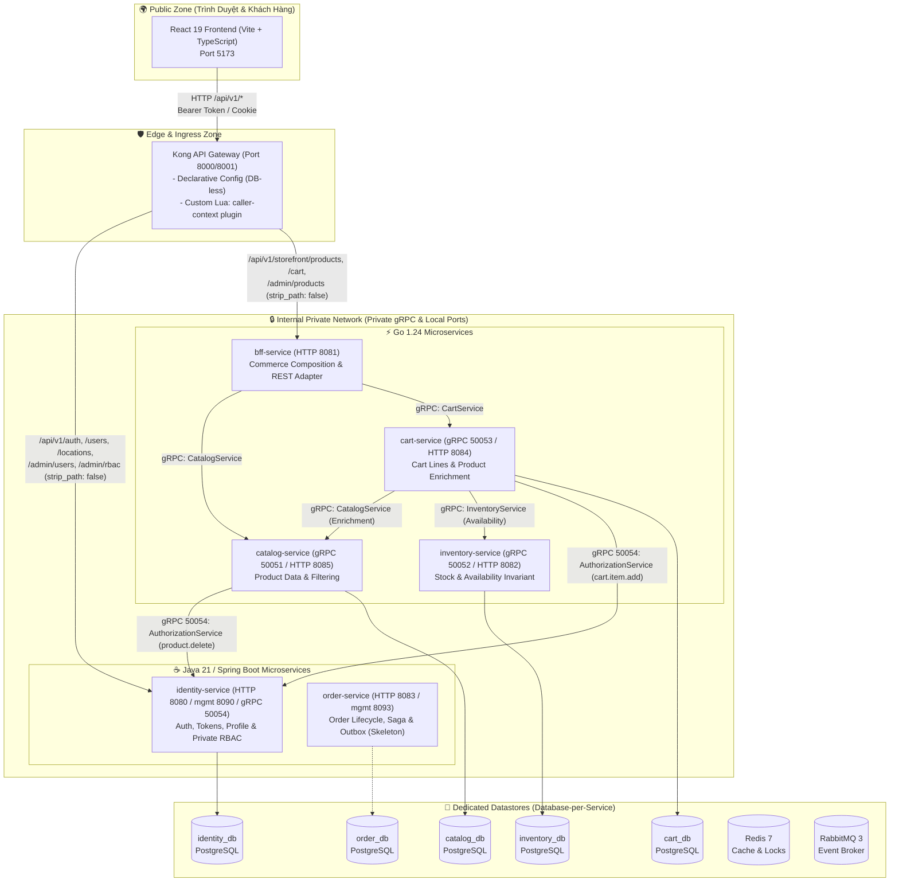
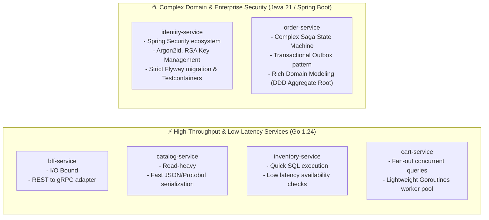
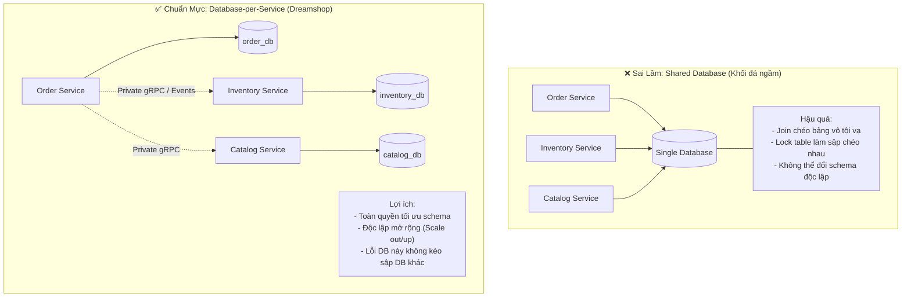

# Chuyên Đề 01: Hệ Thống, Ranh Giới Dịch Vụ & Thiết Kế Bounded Context

> **Tập trung phân tích**: Mô hình Monorepo Microservices, ranh giới nghiệp vụ theo Domain-Driven Design (DDD), nguyên tắc Database-per-Service, kiến trúc đa ngôn ngữ (Polyglot Go & Java), và các bẫy kiến trúc (Architectural Anti-Patterns) thường gặp từ góc nhìn Fresher đến Senior/Staff.

---

## 1. Bản Đồ Kiến Trúc Hệ Thống (System Topology)

Dreamshop được xây dựng theo mô hình **Microservices phân tán hướng sự kiện và kết hợp Hybrid Ingress**. Hệ thống phân tách rõ rệt giữa **Public Network** (phía ngoài Gateway) và **Private Network** (nội bộ giữa các microservices).

### Sơ Đồ Kiến Trúc Tổng Thể



---

## 2. Domain-Driven Design (DDD) & Ranh Giới Bounded Contexts

Một trong những sai lầm phổ biến nhất của các dự án Microservices là **chia service theo bảng dữ liệu kỹ thuật (CRUD / Entity Services)** thay vì chia theo **Bounded Context (Nghiệp vụ có ranh giới)**. 

Tại Dreamshop, việc phân định ranh giới được thực thi nghiêm ngặt theo [ADR-001](../adr/001-service-boundaries.md):

| Service | Bounded Context | Quyền Sở Hữu Nghiệp Vụ (Ownership) | Điều Nghiêm Cấm (Boundary Constraints) |
| :--- | :--- | :--- | :--- |
| **identity-service** | Identity & Access Management (IAM) | Tài khoản, mật khẩu, JWT issuance, Refresh sessions, dữ liệu địa giới, phân cấp quyền RBAC. | Không quản lý giỏ hàng, đơn hàng hay định nghĩa ý nghĩa kinh doanh của quyền hạn thương mại. |
| **catalog-service** | Product Information Management (PIM) | Thông tin sản phẩm, mô tả, danh mục, phân loại (variants), giá niêm yết, soft-delete (thẩm định quyền `product.delete` qua Identity gRPC). | Không quản lý tồn kho, không suy diễn trạng thái còn hàng (Availability là việc của Inventory); không tự lưu bảng RBAC riêng. |
| **inventory-service** | Stock & Inventory Control | Số lượng hàng tồn kho vật lý (`quantity`), số lượng đã giữ trước (`reserved`), bất biến không bán âm. | Không lưu tên sản phẩm, hình ảnh, hay chi tiết đơn giá tiền tệ. |
| **cart-service** | Shopping Basket Management | Dòng hàng tạm thời của user (`product_id`, `variant_label`, `quantity`). | Không lưu giá sản phẩm vào DB giỏ hàng; không tự kiểm tra quyền RBAC mà phải gọi Identity. |
| **order-service** | Order Processing & Fulfillment | Vòng đời đơn hàng (`PENDING_STOCK`, `CONFIRMED`, `CANCELLED`), snapshot giá tại thời điểm mua, idempotency. | Không mutate trực tiếp kho hàng; phải tương tác qua Event/Saga. |
| **bff-service** | Client Commerce Adapter | Tổng hợp dữ liệu hiển thị riêng cho UI/Frontend, chuyển đổi mã lỗi gRPC thành REST envelope. | Không chứa business logic lõi; không trở thành một internal message bus. |

---

## 3. Monorepo vs Multi-repo vs Monolith: Sự Đánh Đổi Sống Còn

### 3.1. Tại sao Dreamshop chọn Monorepo cho Microservices?
Nhiều kỹ sư thường nhầm lẫn giữa **Monolith** (nguyên khối về mặt runtime/kiến trúc) và **Monorepo** (nguyên khối về mặt lưu trữ mã nguồn):
- **Monorepo**: Một kho chứa mã nguồn duy nhất lưu trữ toàn bộ services, frontend và protobuf contracts.
- **Microservices**: Các dịch vụ hoàn toàn độc lập về runtime, port, tiến trình, database và deployment.

#### Ưu Điểm Lớn Nhất của Monorepo trong Dreamshop:
1. **Quản lý Hợp đồng Tập trung (Atomic Contract Synchronization)**:
   Khi một protobuf contract (`contracts/proto/cart/v1/cart.proto`) thay đổi:
   - Chạy lệnh `buf generate`.
   - Cả mã nguồn Go (`contracts/go/`) và Java (`contracts/java/`) được cập nhật ngay trong cùng một Git commit.
   - Tránh triệt để tình trạng "version drift" (service A dùng proto v1.2, service B dùng proto v1.1 do pull từ các repo git riêng lẻ).
2. **Onboarding & Local Orchestration Dễ Dàng**:
   Nhờ có `Makefile` và `deployments/docker/compose.foundation.yml` ở repo, một kỹ sư mới chỉ cần chạy `make infra-up` là có toàn bộ PostgreSQL, Redis, RabbitMQ và Kong sẵn sàng trong vài chục giây.

### 3.2. Nguy Cơ Lớn Nhất: "The Distributed Monolith Trap"
Nếu không có kỷ luật, Monorepo sẽ rất nhanh chóng biến thành một **"Distributed Monolith" (Khối đá phân tán)** — tức là mang toàn bộ nhược điểm của Monolith (ràng buộc mã nguồn, deploy đồng loạt) cộng thêm toàn bộ sự phức tạp của Distributed Systems (độ trễ mạng, mất gói tin, partial failure).

Dreamshop đã ngăn chặn điều này bằng các quy tắc thép trong [AGENTS.md](../../AGENTS.md):
- **Cấm tuyệt đối Import chéo mã nguồn**: `cart-service` không bao giờ được `import "ecommerce.local/catalog-service/..."`. Bất kỳ nhu cầu dữ liệu nào cũng phải đi qua Protobuf gRPC.
- **Không dùng Shared Kernel bừa bãi**: Không tạo ra các thư viện dùng chung kiểu `common-utils` chứa các domain model như `Product` hay `Order`. 
  > *"Duplication is far cheaper than the wrong abstraction."* (Trùng lặp một vài struct/class độc lập còn tốt hơn gấp ngàn lần một abstraction dùng chung gây thắt chặt coupling giữa các team).

---

## 4. Kiến Trúc Đa Ngôn Ngữ (Polyglot Architecture): Go vs Java 21

Hệ thống sử dụng song song hai ngôn ngữ chủ lực trong backend: **Go 1.24** và **Java 21 (Spring Boot)**. Đây không phải sự ngẫu hứng công nghệ, mà là một sự lựa chọn có chủ đích dựa trên đặc tính công việc:



### So Sánh Kỹ Thuật Chi Tiết:

| Tiêu Chí Kỹ Thuật | Go 1.24 (BFF, Catalog, Inventory, Cart) | Java 21 / Spring Boot (Identity, Order) |
| :--- | :--- | :--- |
| **Mô hình Concurrency** | **Goroutines & Channels**: Chi phí bộ nhớ chỉ ~2KB/goroutine. Cực kỳ tối ưu cho việc tạo worker pool gọi đồng thời Catalog và Inventory. | **Spring MVC platform thread-per-request** mặc định (chạy trên Java 21, sẵn sàng bật Virtual Threads qua `spring.threads.virtual.enabled=true` khi cần mở rộng thông lượng I/O). |
| **Mức tiêu thụ RAM (Footprint)** | **Rất nhẹ** (~15MB - 30MB per container). Khởi động tức thì (< 100ms). Thích hợp scale out thần tốc khi có traffic spike. | **Đáng kể** (~250MB - 500MB per container do JVM overhead, Metaspace, Spring Context). Khởi động từ 2s - 6s. |
| **Domain Modeling & Ecosystem** | Cấu trúc phẳng, thiên về hướng cấu trúc (structural typing). Đơn giản, tường minh, không có "magic". | Rất mạnh về hướng đối tượng (OOP), DDD Aggregate Roots, ORM/JPA (hoặc JDBI), Spring Security, Hibernate Validator. |
| **Quản lý Database Schema** | Sử dụng file SQL thuần với `jackc/pgx` hoặc `sqlc` và migration runner gọn nhẹ. | Sử dụng **Flyway** kiểm soát chặt chẽ từng phiên bản migration, tích hợp mạnh mẽ với **Testcontainers**. |

---

## 5. Nguyên Tắc Sống Còn: Database-per-Service

Tại sao trong file [deployments/postgres/init/01-create-databases.sql](../../deployments/postgres/init/01-create-databases.sql), hệ thống lại tạo ra 5 database tách biệt (`identity_db`, `catalog_db`, `inventory_db`, `cart_db`, `order_db`) thay vì một database duy nhất có nhiều bảng?

```sql
CREATE DATABASE identity_db;
CREATE DATABASE order_db;
CREATE DATABASE catalog_db;
CREATE DATABASE inventory_db;
CREATE DATABASE cart_db;
```



### Tại sao cấm tuyệt đối Cross-Database Foreign Keys & Joins?
1. **Độc lập triển khai (Independent Deployability)**: Nếu `order_items` có Foreign Key trực tiếp tới `products.id` của `catalog_db`, khi Catalog team muốn tái cấu trúc bảng `products` (ví dụ chia thành bảng `items` và `skus`), toàn bộ Order team sẽ bị chặn lại (Blocker).
2. **Khả năng Scale độc lập (Elastic Scalability)**: Trong một đợt Flash Sale, bảng `stock` của `inventory-service` phải hứng chịu hàng chục nghìn lượt ghi/lock mỗi giây. Việc tách `inventory_db` sang một cụm server riêng biệt giúp đảm bảo các truy vấn đọc sản phẩm ở `catalog_db` vẫn chạy trơn tru với độ trễ < 5ms.
3. **Bảo mật và Phân quyền (Security Isolation)**: User của service này chỉ có quyền truy cập vào database của service đó; nếu `bff-service` bị xâm nhập, kẻ tấn công không thể đọc trộm bảng hash mật khẩu trong `identity_db`.

---

## 6. Góc Nhìn Phân Tầng: Từ Fresher Đến Senior / Staff

### 👶 Fresher / Junior: Điều Cần Khắc Cốt Ghi Tâm
- **Hiểu rõ "Tại sao" trước khi gõ code**: Microservices sinh ra không phải để làm cho code "ngầu" hơn hay chạy nhanh hơn. Thực tế, một hệ thống Monolith viết tốt thường có độ trễ thấp hơn nhiều so với Microservices vì không tốn chi phí truyền dữ liệu qua mạng (Network I/O Serialization).
- **Quy tắc một chạm**: Không bao giờ được mở rộng quyền hạn của service mình bằng cách kết nối vào database của service khác. Cần dữ liệu từ service bạn bè? Hãy dùng gRPC Client gọi API được cấp phép!

### 🧑‍💻 Mid-Level: Làm Chủ Ranh Giới Thiết Kế
- **Tránh bẫy "Entity Service"**: Đừng chia service kiểu `UserService`, `ProductService`, `AddressService`, `ImageService`. Mỗi service như vậy chỉ là một lớp bọc mỏng xung quanh bảng DB (Anemic CRUD). Khi một tính năng mới xuất hiện (ví dụ đổi địa chỉ nhận hàng), bạn sẽ phải sửa 4-5 services cùng lúc (Shotgun Surgery).
- **Thay vào đó**: Hãy nhóm theo Business Capability. `identity-service` ôm trọn cả User, Authentication, RBAC và Address vì chúng phục vụ chung một Bounded Context về danh tính và hồ sơ khách hàng.

### 🧙 Senior / Staff / Architect: Tư Duy Đánh Đổi (Trade-offs & Governance)
- **Trả thuế phân tán (Distributed Systems Tax)**: Mỗi lần tách một service, bạn phải trả giá bằng: CI/CD pipeline riêng, monitoring/alert riêng, phân tích log phân tán, rủi ro partial failure, quản lý secret, chi phí network bandwidth. Hãy chỉ tách service khi có lý do rõ ràng về:
  - Ranh giới tổ chức (Team Ownership theo Conway's Law: 2 team khác nhau sở hữu 2 domain).
  - Tần suất release khác nhau (Catalog release 1 lần/tuần, Checkout release 3 lần/ngày).
  - Yêu cầu tài nguyên chuyên biệt (Search cần RAM lớn để index, Checkout cần CPU & IOPS cao để xử lý giao dịch).
- **Quản lý Monorepo quy mô lớn**: Dreamshop hiện dùng `go.work` cho Go và Maven multi-module cho Java. Khi repo phình to lên hàng trăm services, cần cân nhắc các build tool hiện đại hỗ trợ incremental caching như **Bazel**, **Nx** hoặc **Turborepo** để thời gian chạy test không trở thành cực hình.
