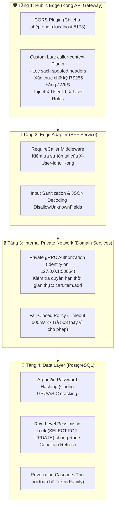
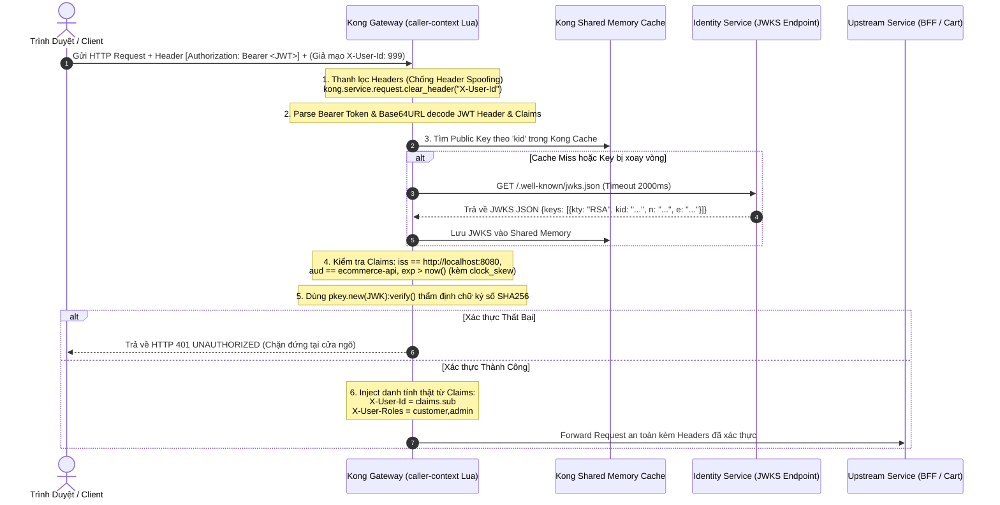
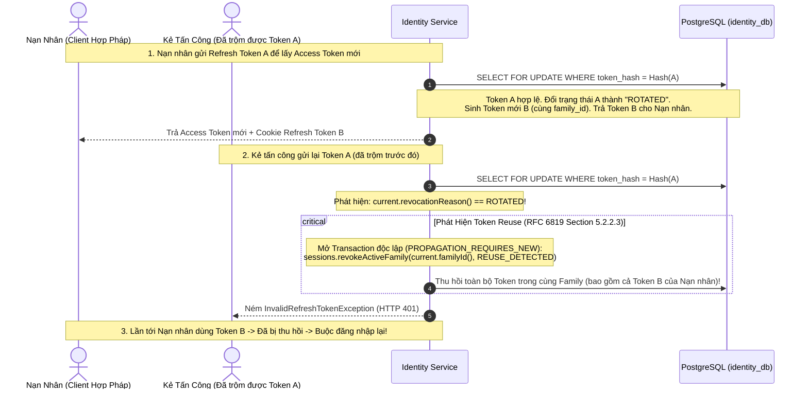
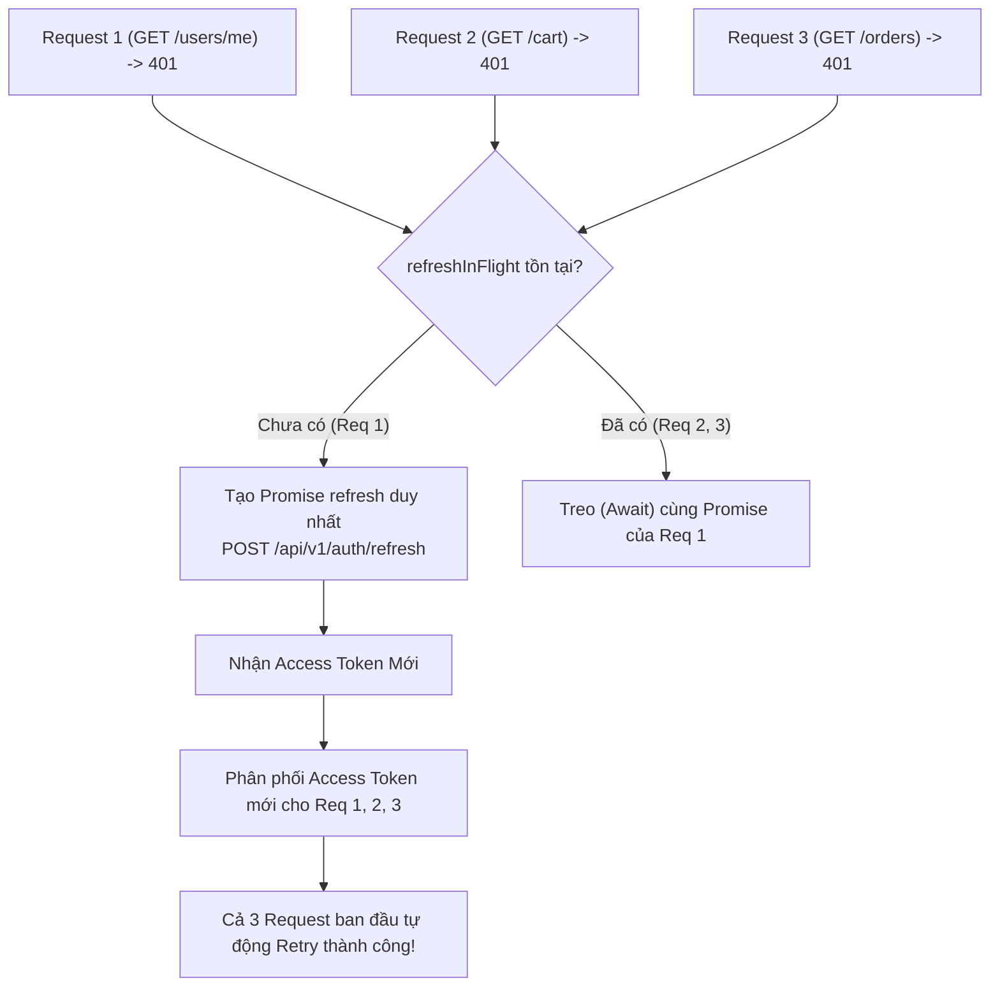

# Chuyên Đề 02: Bảo Mật Mép Mạng (Edge Security), Xác Thực & API Gateway

> **Tập trung phân tích**: Cơ chế vận hành của Kong API Gateway, kỹ thuật thẩm định chữ ký số JWT RS256 và cache JWKS bằng custom Lua plugin (`caller-context`), quy trình xoay vòng Refresh Token (RTR) và triệt tiêu phiên khi phát hiện Token Reuse (RFC 6819), kỹ thuật xử lý tranh chấp phiên ở Frontend bằng Single-Flight Promise, phân quyền RBAC phân cấp qua private gRPC, cùng mô hình đe dọa (Threat Modeling).

---

## 1. Kiến Trúc Bảo Mật Đa Tầng (Defense in Depth)

Hệ thống Dreamshop triển khai mô hình bảo mật nhiều lớp để đảm bảo nếu một phòng tuyến bị xuyên thủng, các phòng tuyến tiếp theo vẫn bảo vệ được dữ liệu khách hàng:



---

## 2. Điểm Nhấn: Custom Lua Plugin `caller-context` Trên Kong Gateway

Thay vì bắt từng microservice nội bộ phải tự parse JWT và tự fetch JWKS (gây lãng phí CPU và lặp lại code), Dreamshop đã đẩy toàn bộ trách nhiệm **Xác thực danh tính (Authentication)** ra rìa mạng (Edge) thông qua plugin Lua viết riêng: [deployments/kong/plugins/caller-context/handler.lua](../../deployments/kong/plugins/caller-context/handler.lua).

### 2.1. Quy Trình 6 Bước Xử Lý Của Plugin:



### 2.2. Chi Tiết Kỹ Thuật Đắt Giá Trong Mã Nguồn Lua:
1. **Chống Tấn Công Giả Mạo Header (Header Injection / Spoofing Guard)**:
   ```lua
   -- Dòng 109-110 trong handler.lua:
   kong.service.request.clear_header(conf.user_id_header)
   kong.service.request.clear_header(conf.roles_header)
   ```
   *Ý nghĩa*: Kẻ tấn công từ ngoài Internet có thể tự tạo header `X-User-Id: admin-uuid` nhằm đánh lừa backend. Plugin bắt buộc phải xóa sạch mọi header này trước khi xử lý, chỉ inject lại sau khi đã xác minh chữ ký JWT hợp lệ.
2. **Cơ Chế Dynamic Key Rotation & Tự Phục Hồi Cache (Self-Healing Cache)**:
   ```lua
   -- Dòng 138-147 trong handler.lua:
   local jwk = find_key(jwks, header.kid)
   if not jwk then
     kong.cache:invalidate(cache_key)
     jwks = load_jwks(conf.jwks_uri)
     jwk = find_key(jwks, header.kid)
   end
   ```
   *Ý nghĩa*: Khi Identity Service xoay vòng RSA Key mới (Key Rotation), Kong cache có thể vẫn chứa JWKS cũ và không tìm thấy `kid` mới. Thay vì ngay lập tức báo lỗi 401 cho người dùng, plugin chủ động **invalidate cache ngay lập tức** và fetch lại JWKS mới nhất từ Identity Service. Điều này đảm bảo tính khả dụng liên tục (High Availability) mà không cần reload Gateway.

---

## 3. First-Party Identity Service: Chuẩn Mực Quản Lý Phiên (Session Security)

Theo [ADR-007](../adr/007-first-party-identity-service.md), Dreamshop quyết định tự xây dựng First-Party Identity Service trên nền Java 21 / Spring Boot thay vì dùng Keycloak cồng kềnh để kiểm soát hoàn toàn mô hình dữ liệu tài khoản và học sâu về bảo mật phân tán.

### 3.1. Hashing Mật Khẩu Bằng Argon2id
Mật khẩu của người dùng được mã hóa bằng thuật toán **Argon2id** (thuật toán chiến thắng cuộc thi Password Hashing Competition):
- Kết hợp cả khả năng chống tấn công brute-force bằng GPU/ASIC (tận dụng bộ nhớ RAM lớn của Argon2d) và chống tấn công Side-Channel Cache-timing (của Argon2i).
- Có cơ chế fallback về `BCryptPasswordEncoder` nếu cấu hình hệ thống yêu cầu.

### 3.2. Refresh Token Rotation (RTR) & Token Family Revocation (RFC 6819)
Một trong những lỗ hổng lớn nhất của các hệ thống JWT là: **Làm sao thu hồi quyền khi Access Token bị lộ mà không biến nó thành stateful?**

Dreamshop giải quyết bằng cặp đôi:
- **Access Token**: JWT ký bằng RSA Private Key, **TTL ngắn (15 phút)**, lưu trên bộ nhớ (In-Memory) của ứng dụng client.
- **Refresh Token**: Chuỗi ngẫu nhiên bí mật (Opaque Token), **TTL dài (30 ngày)**, chỉ lưu trong Cookie an toàn (`HttpOnly`, `SameSite=Lax`, `Path=/api/v1/auth`, `Secure=true`).

#### Kịch Bản Phát Hiện Đánh Cắp Token (Token Reuse Detection):
Mã nguồn tại [services/identity-service/.../RefreshTokenService.java](../../services/identity-service/src/main/java/com/ecommerce/identity/auth/application/RefreshTokenService.java#L58-L86):



> **Chi Tiết Đắt Giá**: Việc sử dụng `SELECT ... FOR UPDATE` (Pessimistic Locking) trong PostgreSQL đảm bảo rằng hai request refresh chạy đồng thời (Concurrent Race) không thể cùng xoay vòng token mà một request bắt buộc phải đợi request kia kết thúc, triệt tiêu race condition tại tầng lưu trữ.

---

## 4. Frontend Engineering: Xử Lý Tranh Chấp Bằng Single-Flight Refresh

Tại Frontend React ([ecommerce-fe/src/lib/auth-session.ts](../../ecommerce-fe/src/lib/auth-session.ts)), đội ngũ kỹ sư Dreamshop đã xử lý một vấn đề kinh điển mà 90% lập trình viên Web thường mắc phải:

### Vấn Đề Gặp Phải (The Stampede Problem):
Khi người dùng truy cập một trang dashboard phức tạp tải đồng thời 5 API:
`GET /users/me`, `GET /cart`, `GET /notifications`, `GET /orders/preview`, `GET /promotions`.
Nếu lúc này Access Token 15 phút vừa hết hạn, cả 5 request đều đồng loạt nhận mã `401 Unauthorized`. 
Nếu không có cơ chế điều phối, Axios interceptor sẽ bắn đồng loạt 5 request `POST /api/v1/auth/refresh`. Request đầu tiên đến trước xoay vòng token thành công. 4 request còn lại gửi lên Refresh Token cũ đã bị trạng thái `ROTATED` $\rightarrow$ **Kích hoạt cơ chế Token Reuse Detection $\rightarrow$ Toàn bộ phiên người dùng bị hủy và văng ra màn hình Login ngay lập tức!**

### Giải Pháp: Single-Flight Refresh Promise
```typescript
// Trích từ ecommerce-fe/src/lib/auth-session.ts
let refreshInFlight: Promise<string> | null = null

export function runSingleFlightRefresh(refresh: () => Promise<string>): Promise<string> {
  if (!refreshInFlight) {
    refreshInFlight = refresh().finally(() => {
      refreshInFlight = null
    })
  }
  return refreshInFlight
}
```



---

## 5. Phân Quyền Phân Cấp (Hierarchical RBAC) & Private gRPC Authorization

Hệ thống triển khai mô hình phân quyền **Hierarchical RBAC (theo phong cách Yii2 RBAC)** trong PostgreSQL:
- `auth_items`: Chứa Role (ví dụ `CUSTOMER`, `ADMIN`, `SUPER_ADMIN`) và Permission (ví dụ `cart.item.add`, `address.create`).
- `auth_item_children`: Quan hệ kế thừa (Role này chứa Role khác hoặc chứa Permissions).
- `auth_assignments`: Gán Role cho từng `user_id`.

### Sự Đánh Đổi Kiến Trúc: gRPC Authorization vs Token Permissions

| Phương Án | Cách Thực Hiện | Ưu Điểm | Nhược Điểm (Trade-offs) | Lựa Chọn Của Dreamshop |
| :--- | :--- | :--- | :--- | :---: |
| **A. Nhúng Permissions vào JWT** | Khi login, nhét mảng `permissions: ["cart.item.add", ...]` vào claim của JWT. | - Gateway hoặc Service đọc token là biết quyền ngay, không tốn thêm network call (0ms latency). | - Không thể thu hồi quyền ngay lập tức (phải đợi token hết hạn 15 phút).<br/>- Payload của JWT phình to (vượt quá kích thước header HTTP nếu có hàng trăm permissions). | ❌ Không chọn |
| **B. Private gRPC Call Tại Thời Điểm Chạy (Dreamshop)** | Cart Service gọi trực tiếp gRPC `CheckPermission` tới Identity Service (`127.0.0.1:50054`) trước khi thêm hàng vào giỏ. | - **Real-time 100%**: Admin vừa xóa quyền trong DB là request tiếp theo bị `403 FORBIDDEN` ngay lập tức.<br/>- Token JWT giữ nguyên sự gọn nhẹ. | - **Thêm độ trễ mạng** cho mỗi lần thêm giỏ hàng.<br/>- Tạo ra sự phụ thuộc đồng bộ (Availability coupling): Identity sập thì Cart cũng không thêm hàng được. | ✅ **Đã chọn** ([Spec 2026-08-25](../superpowers/specs/2026-08-25-private-grpc-authorization-design.md)) |

### Cơ Chế Fail-Closed Bảo Vệ Hệ Thống:
Mã nguồn [services/cart-service/internal/grpc/server.go](../../services/cart-service/internal/grpc/server.go#L101-L114):
```go
allowed, err := s.authorization.CheckPermission(authorizationCtx, userID, cartItemAddPermission)
if err != nil {
    // Identity bị sập hoặc quá hạn timeout 500ms -> Fail-closed!
    return nil, statusWithReason(codes.Unavailable, "authorization service is unavailable", reasonAuthorizationUnavailable)
}
if !allowed {
    return nil, statusWithReason(codes.PermissionDenied, "cart permission denied", reasonCartPermissionDenied)
}
```
*Triết lý*: Không bao giờ cho phép người dùng ghi dữ liệu khi không chắc chắn họ có quyền. Nếu Identity Service gặp sự cố, Cart trả về `503 Service Unavailable` thay vì ngầm định cho phép.

---

## 6. Mô Hình Đe Dọa (Threat Modeling) & Những Lỗ Hổng Cần Khắc Phục

Dưới góc nhìn bảo mật của một Senior Security Architect, hệ thống Dreamshop hiện tại có các bề mặt tấn công tiềm tàng:

| Mối Đe Dọa (Threat) | Mức Độ | Phân Tích Thực Tế Trong Codebase | Khuyến Nghị Khắc Phục |
| :--- | :---: | :--- | :--- |
| **Bypass Gateway Gọi Trực Tiếp Cổng Service** | **Nghiêm trọng** (Cao) | Các service như `catalog-service` (8085), `cart-service` (8084) hiện bind port trực tiếp trên máy chủ host. Nếu kẻ tấn công trong cùng mạng LAN hoặc VPC gửi request giả mạo `X-User-Id`, các service này sẽ tin tưởng hoàn toàn. | Các internal services chỉ nên lắng nghe trên Unix Domain Socket hoặc Private Docker Network kín không expose port ra Host. |
| **Thiếu Rate Limiting Trên Kong** | **Trung bình** | Kong hiện tại chỉ cấu hình CORS và `caller-context`. Route `/api/v1/auth/login` chưa bật plugin `rate-limiting`. Kẻ tấn công có thể brute-force mật khẩu. | Bật Kong `rate-limiting` plugin: Giới hạn tối đa 5 requests/phút trên mỗi IP đối với các endpoint `/auth/login` và `/auth/register`. |
| **Lộ Route Admin Trong Local Config** | **Trung bình** | Trong [kong.yaml](../../deployments/kong/kong.yaml#L34-L39), route `/api/v1/admin/products` được trỏ thẳng tới `bff-admin-products` mà không gắn plugin `caller-context` để kiểm tra quyền admin. | Tuyệt đối không merge file config dev này lên production; bắt buộc route `/admin/*` phải yêu cầu xác thực và có role `ADMIN`. |
| **Thiếu Mutual TLS (mTLS) Nội Bộ** | **Thấp - Trung bình** | Giao tiếp gRPC giữa BFF, Cart, Catalog và Identity hiện chạy plaintext trên HTTP/2 không có TLS. | Khi triển khai Production trên Kubernetes, cần tích hợp **Service Mesh (Istio / Linkerd)** hoặc cấu hình SPIFFE/SPIRE để cấp chứng chỉ mTLS cho từng service pod. |

---

## 7. Góc Nhìn Phân Tầng: Từ Fresher Đến Senior / Staff

### 👶 Fresher / Junior: Điều Cần Khắc Cốt Ghi Tâm
- **Không lưu Access Token vào LocalStorage**: LocalStorage rất dễ bị đánh cắp thông qua lỗ hổng XSS (Cross-Site Scripting). Lưu Access Token trong bộ nhớ RAM của ứng dụng và Refresh Token trong `HttpOnly` Cookie là quy chuẩn vàng của bảo mật Web.
- **Hiểu chữ ký số RSA**: Private Key dùng để ký (chỉ Identity Service giữ), Public Key dùng để thẩm định (Identity công khai qua JWKS để Kong và các bên kiểm tra). Không bao giờ được để lộ Private Key ra file cấu hình công khai hay git commit.

### 🧑‍💻 Mid-Level: Làm Chủ Kỹ Thuật Triển Khai
- **Luôn thanh lọc Headers ở Gateway**: Bất kỳ header nào mang tính chất tin cậy như `X-User-Id`, `X-Tenant-Id`, `X-Roles` phải được Gateway xóa sạch từ request của client trước khi gán giá trị sau thẩm định.
- **Hiểu cơ chế Single-Flight**: Hãy rèn luyện thói quen tư duy về Concurrency trên Frontend. Khi người dùng thao tác nhanh hoặc reload trang, bao nhiêu network request sẽ đồng thời kích hoạt và chúng ảnh hưởng thế nào đến state machine của backend?

### 🧙 Senior / Staff / Architect: Tư Duy Hệ Thống & Scale Lớn
- **Quy mô 100,000 QPS với Private Authorization**: Nếu hệ thống đạt 100,000 QPS, việc gọi gRPC kiểm tra quyền vào `identity_db` cho mỗi request thêm vào giỏ hàng sẽ làm nghẽn toàn bộ PostgreSQL. Khi đó cần chuyển đổi sang kiến trúc **Google Zanzibar** hoặc **Open Policy Agent (OPA)** chạy dưới dạng Sidecar container ngay cạnh Cart Service, sử dụng Redis hoặc Shared Memory để cache quyền với cơ chế vô hiệu hóa cache (Cache Eviction) qua Kafka event khi có thay đổi RBAC.
