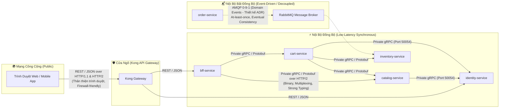
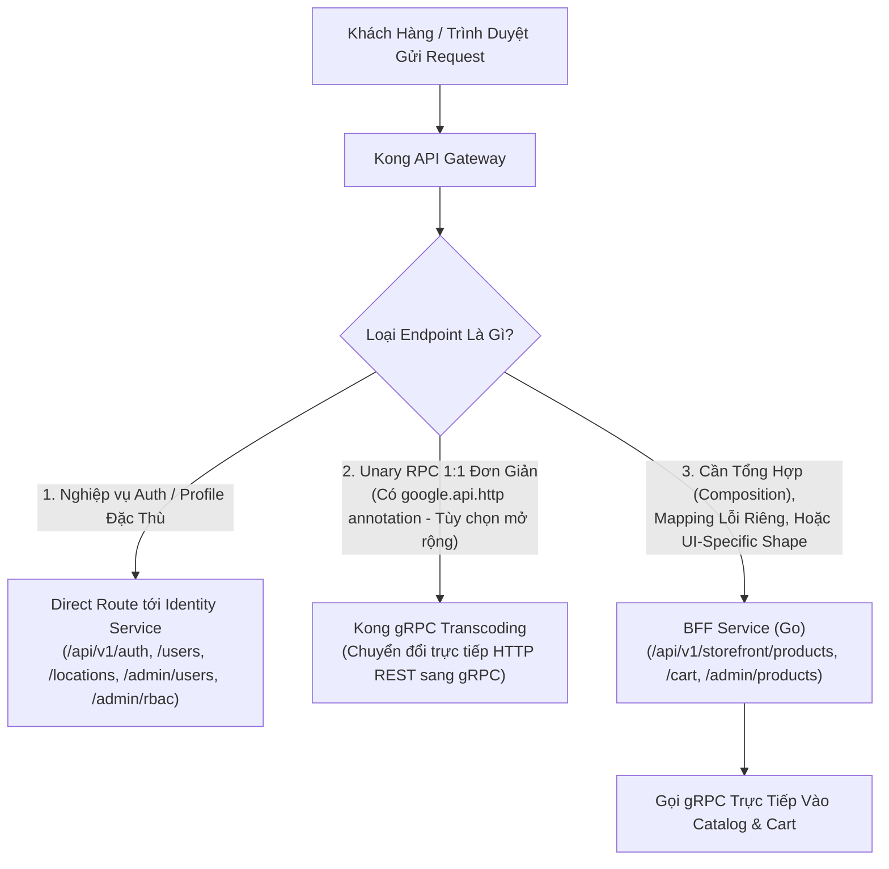
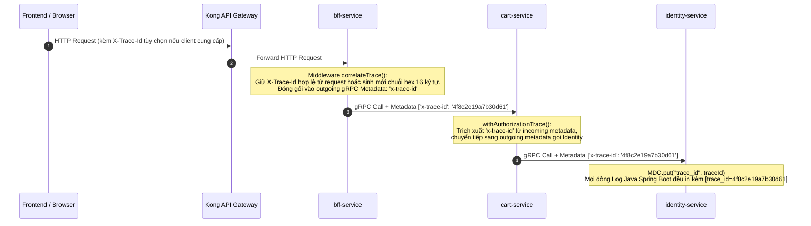

# Chuyên Đề 03: Giao Thức Giao Tiếp, Quản Trị Hợp Đồng & Hybrid Routing

> **Tập trung phân tích**: So sánh chuyên sâu giữa REST/JSON, gRPC/Protobuf và Message Broker (RabbitMQ), kiến trúc định tuyến lai Hybrid Edge Routing (ADR-008), quy trình quản trị Schema với Buf CLI, chuẩn hóa mô hình xử lý lỗi phân tán (`google.rpc.ErrorInfo`), và cơ chế lan truyền vết ngữ cảnh (Distributed Tracing & Correlation).

---

## 1. Cuộc Chiến Giao Thức (Protocol Matrix) Trong Hệ Thống Phân Tán

Một trong những quyết định kỹ thuật chuẩn mực của Dreamshop là **phân tách rõ rệt giữa giao thức đối ngoại (Ingress/Public) và giao thức đối nội (Internal/Private)**:



### Bảng So Sánh Kỹ Thuật Chi Tiết:

| Tiêu Chí | REST / JSON | gRPC / Protobuf v3 | RabbitMQ (AMQP) |
| :--- | :--- | :--- | :--- |
| **Định dạng dữ liệu** | Văn bản (Text - UTF-8 string). | Nhị phân (Binary - Tag-Length-Value). | Nhị phân hoặc JSON bọc trong AMQP frame. |
| **Kích thước Payload** | Lớn (chứa đầy đủ tên key JSON như `"availableQuantity": 10`). | **Cực nhỏ** (giảm 60% - 80% dung lượng do key được nén thành số nguyên thẻ 1-byte). | Tùy thuộc vào payload đóng gói. |
| **Tốc độ tuần tự hóa (Serialization)** | Chậm (tốn nhiều chu kỳ CPU để parse chuỗi string sang struct). | **Cực nhanh** (biên dịch mã máy trực tiếp, tối ưu bộ nhớ). | Nhanh nếu dùng binary payload. |
| **Giao thức truyền dẫn** | HTTP/1.1 (phổ biến) hoặc HTTP/2. | Bắt buộc **HTTP/2** (Hỗ trợ Multiplexing, Header compression HPACK, Streaming). | TCP socket thuần (kết nối duy trì liên tục). |
| **Mức độ ràng buộc hợp đồng (Contract)** | Lỏng lẻo (OpenAPI/Swagger thường không bắt buộc ở thời điểm biên dịch). | **Cực kỳ chặt chẽ** (Strict Contract First: Trình biên dịch báo lỗi ngay nếu sai kiểu dữ liệu). | Chặt chẽ nếu dùng Protobuf event payload; lỏng nếu dùng JSON payload. |
| **Phù hợp nhất cho** | Client-to-Backend, Public Web APIs, Third-party integration. | **Service-to-Service nội bộ**, microservices cần độ trễ cực thấp (p99 < 5ms). | **Bất đồng bộ (Async)**, tác vụ chạy nền, phân tán sự kiện (Domain Events), Saga. |

---

## 2. Kiến Trúc Định Tuyến Lai: Hybrid Edge Routing (ADR-008)

Trong các hệ thống Microservices truyền thống, người ta thường tranh cãi giữa 2 thái cực:
1. **Thái cực 1: Tất cả API phải đi qua BFF (Backend-For-Frontend)**: Dẫn đến hiện tượng "BFF Fatigue" — BFF trở thành một điểm nghẽn cổ chai khổng lồ chỉ để viết hàng chục hàm pass-through vô nghĩa (gọi RPC thế nào thì trả ra REST y hệt như vậy).
2. **Thái cực 2: Tự động Transcode toàn bộ gRPC ra REST tại Gateway (gRPC-Gateway / Envoy / Kong Transcoding)**: Dẫn đến việc UI bị phụ thuộc chặt vào schema của backend; khi màn hình cần gộp dữ liệu từ 2-3 service hoặc cần cấu trúc JSON tùy biến, Gateway không thể đáp ứng được.

### Quyết Định Thông Minh Của Dreamshop Trong ADR-008:
Dreamshop đã dung hòa hoàn hảo bằng mô hình **Hybrid Routing**:



> **Hiện trạng định tuyến trong codebase**: Toàn bộ các public route hiện hành trên Kong đều đi theo nhánh (1) tới `identity-service` hoặc nhánh (3) tới `bff-service` với `strip_path: false`; nhánh (2) Kong gRPC Transcoding qua `google.api.http` được ADR-008 phê duyệt làm tùy chọn mở rộng cho các unary RPC 1:1 đơn giản trong tương lai (hiện chưa có file `.proto` nào gắn annotation này).

#### Quy Tắc Thép:
- **Nghiêm cấm Microservices gọi nhau qua Kong hoặc BFF**: Giao tiếp giữa các internal service (`Cart -> Catalog`, `Cart -> Inventory`) bắt buộc phải dùng gRPC trực tiếp trên mạng riêng nội bộ. Kong và BFF chỉ là bề mặt đón khách ở cửa ngõ, tuyệt đối không được biến thành "internal message bus".

---

## 3. Quản Trị Hợp Đồng Với Buf CLI (Schema Governance)

Hợp đồng dữ liệu giữa các dịch vụ được lưu trữ tập trung tại thư mục [contracts/proto/](../../contracts/proto/). Dreamshop sử dụng công cụ hiện đại **Buf CLI** thay vì lệnh `protoc` truyền thống phức tạp:

```powershell
# Quy trình kiểm tra và sinh mã chuẩn mực của dự án:
buf format --diff --exit-code
buf lint
buf generate
```

### 3.1. Cấu Hình Sinh Mã Polyglot Trong `buf.gen.yaml`:
```yaml
version: v2
clean: false
plugins:
  - remote: buf.build/protocolbuffers/go:v1.34.2
    out: contracts/go
    opt: paths=source_relative
  - remote: buf.build/grpc/go:v1.5.1
    out: contracts/go
    opt: paths=source_relative
  - remote: buf.build/protocolbuffers/java:v25.3
    out: contracts/java/src/main/generated
  - remote: buf.build/grpc/java:v1.65.1
    out: contracts/java/src/main/generated
```

### 3.2. Quy Tắc Giữ Tính Tương Thích Tiến Lùi (Backward & Forward Compatibility):
Để một microservice có thể deploy độc lập mà không làm sập các service khác, Dreamshop quy định các nguyên tắc bất di bất dịch trong [api-contracts.md](../../docs/steering/api-contracts.md):

1. **Thay Đổi Tương Thích (Additive Changes - Được Phép)**:
   - Thêm một trường mới (new field) vào message với số tag chưa từng được dùng.
   - Thêm một RPC method mới vào Service.
   - Thêm một enum value mới (với quy ước enum value `0` luôn là `UNSPECIFIED`).
2. **Thay Đổi Phá Vỡ (Breaking Changes - Tuyệt Đối Tránh)**:
   - Đổi số thứ tự tag (Field Tag Number) của trường hiện tại.
   - Xóa một trường đang dùng hoặc tái sử dụng số tag của trường đã xóa (Bắt buộc phải dùng từ khóa `reserved` để khóa vĩnh viễn số tag đó).
   - Đổi kiểu dữ liệu của trường (ví dụ từ `int32` sang `int64`).
   - Đổi tên trường (đối với JSON mapping qua gRPC gateway).

---

## 4. Chuẩn Hóa Mô Hình Xử Lý Lỗi (Distributed Error Handling Model)

Trong hệ sinh thái Microservices, việc trả về lỗi thế nào để client hiểu được mà không để lộ cấu trúc nhạy cảm của backend là một bài toán hóc búa.

### 4.1. Tầng gRPC Nội Bộ: Sử Dụng `google.rpc.ErrorInfo`
Thay vì chỉ trả về mã lỗi gRPC chung chung như `codes.InvalidArgument` hay `codes.PermissionDenied`, Dreamshop gắn thêm siêu dữ liệu (Metadata Details) bằng chuẩn của Google:

```go
// Trích từ services/cart-service/internal/grpc/server.go:
func statusWithReason(code codes.Code, message, reason string) error {
	base := status.New(code, message)
	withDetails, err := base.WithDetails(&errdetails.ErrorInfo{
		Reason: reason,                 // Ví dụ: "CART_PERMISSION_DENIED"
		Domain: "ecommerce.cart.v1",    // Domain sở hữu lỗi
	})
	if err != nil {
		return base.Err()
	}
	return withDetails.Err()
}
```

### 4.2. Tầng BFF: Ánh Xạ Sang REST Envelope Chuẩn
Tại BFF ([services/bff-service/internal/http/cart.go](../../services/bff-service/internal/http/cart.go#L156-L169)), lỗi gRPC từ các domain service được dịch ngược sang mã HTTP và phong bì REST cố định:

```json
{
  "code": "FORBIDDEN",
  "message": "You do not have permission to add products to the cart.",
  "traceId": "4f8c2e19a7b30d61"
}
```
*(Trường `errors` được khai báo `omitempty` và tự động lược bỏ khi không có chi tiết lỗi cấp trường).*

#### Nguyên Tắc Bảo Mật:
- **Triệt tiêu hoàn toàn rò rỉ Stack Trace**: Không bao giờ để thông báo lỗi của database (ví dụ: `pq: relation "users" does not exist` hay Java `NullPointerException`) lọt ra JSON trả về cho khách hàng. Mọi chi tiết nhạy cảm chỉ được ghi lại trong log nội bộ kèm `traceId`.

---

## 5. Lan Truyền Ngữ Cảnh Vết (Distributed Tracing & Correlation)

Khi một thao tác của người dùng đi qua 4 tầng:
`Trình duyệt -> Kong -> BFF -> Cart Service -> Identity Service`, làm sao đội ngũ hỗ trợ kỹ thuật (On-call Engineer) có thể tra cứu toàn bộ hành trình của một request khi xảy ra lỗi?

Dreamshop triển khai kỹ thuật **Trace Correlation Propagation**:



### Đánh Giá Kiến Trúc: Tự Triển Khai (Custom Trace) vs Chuẩn W3C / OpenTelemetry
- **Hiện trạng của Dreamshop**: Đang dùng chuỗi ngẫu nhiên tự sinh và header tùy biến `X-Trace-Id`.
- **Hạn chế**: Khi tích hợp vào các hệ thống APM chuẩn công nghiệp như Jaeger, Tempo, Datadog hay New Relic, header tùy biến này không tự động liên kết thành các Span/Trace cây phân cấp được.
- **Đề xuất nâng cấp**: Nên chuyển sang chuẩn **W3C TraceContext** (`traceparent: 00-4bf92f3577b34da6a3ce929d0e0e4736-00f067aa0ba902b7-01`) và tích hợp **OpenTelemetry SDK** cho Go và Java.

---

## 6. Góc Nhìn Phân Tầng: Từ Fresher Đến Senior / Staff

### 👶 Fresher / Junior: Điều Cần Khắc Cốt Ghi Tâm
- **Hiểu tại sao Protobuf tốt hơn JSON**: JSON dễ đọc bằng mắt người nhưng máy tính phải tốn công phân tích từng ký tự chuỗi. Protobuf mã hóa nhị phân bằng số thẻ, giúp máy tính đọc thẳng vào bộ nhớ mà không cần tốn công phân giải cú pháp.
- **Không bao giờ đổi số Field Tag**: Trong file `.proto`, số phía sau dấu `=` không phải là giá trị khởi tạo, mà là **định danh nhị phân** của trường đó trên đường truyền. Nếu bạn đổi `string user_id = 1;` thành `string user_id = 2;`, toàn bộ client cũ sẽ không đọc được trường này nữa!

### 🧑‍💻 Mid-Level: Làm Chủ Kỹ Thuật Triển Khai
- **Thiết kế API Contract Additive**: Khi cần sửa API, luôn luôn ưu tiên bổ sung thêm trường mới thay vì sửa trường cũ. Duy trì cả hai trường trong ít nhất 1-2 chu kỳ release để đảm bảo các service cũ deploy chậm hơn vẫn hoạt động bình thường.
- **Xử lý Deadline / Timeout Budget**: Trong một chuỗi gọi nhiều tầng, timeout của service tầng dưới nên ngắn hơn timeout của service tầng trên. Hiện tại trong codebase, nhánh ủy quyền đã thu hẹp chặt (`Catalog/Cart -> Identity: 500ms` so với `BFF -> Catalog/Cart: 3s`), trong khi `Cart -> Catalog/Inventory` mặc định vẫn là `3s` — có thể tinh chỉnh xuống `1.5s - 2s` để BFF luôn kịp nhận phản hồi suy thoái (`degraded=true`) trước khi hết deadline tổng.

### 🧙 Senior / Staff / Architect: Tư Duy Hệ Thống & Scale Lớn
- **HTTP/2 Multiplexing & Head-of-Line Blocking**: gRPC tận dụng HTTP/2 để truyền nhiều RPC stream trên cùng một kết nối TCP duy nhất. Tuy nhiên, ở tầng TCP, nếu có một gói tin bị rớt (Packet Loss), toàn bộ các stream trên kết nối đó sẽ bị nghẽn (TCP Head-of-line blocking). Trong môi trường Cloud/WAN không ổn định, các kiến trúc sư cần cân nhắc chuyển dịch sang **HTTP/3 (gRPC over QUIC/UDP)** để loại bỏ triệt để vấn đề này.
- **Contract Governance ở quy mô 50+ Teams**: Dreamshop đã tích hợp sẵn `buf breaking --against '.git#branch=main'` trong job `contracts` của `.github/workflows/ci.yml` để tự động từ chối mọi Pull Request có chứa breaking changes vi phạm quy tắc tương thích; ở quy mô 50+ teams, cơ chế này có thể mở rộng thêm với Buf Schema Registry (BSR) tập trung.
