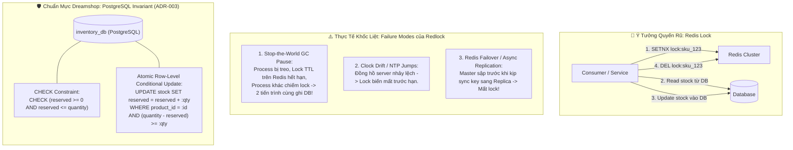
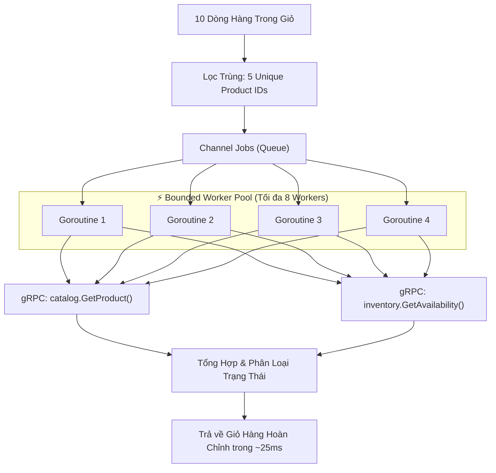
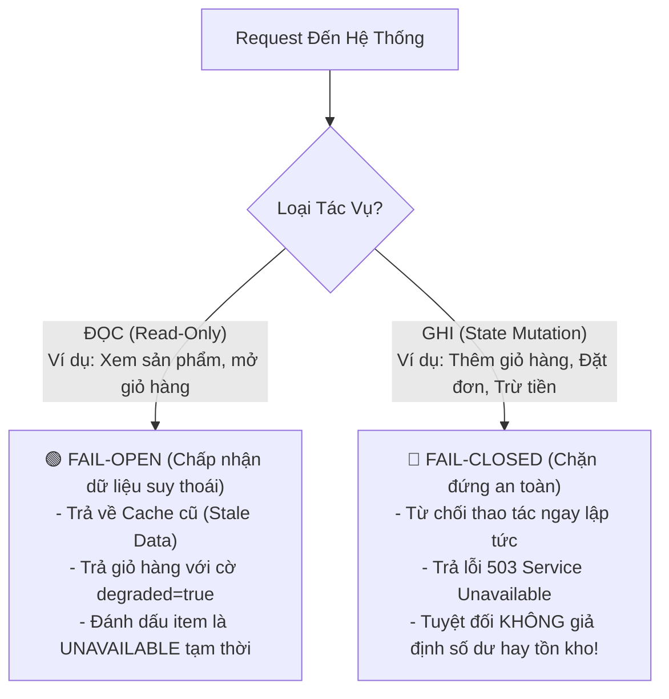

# Chuyên Đề 04: Xử Lý Đồng Thời, Bất Biến Dữ Liệu & Chống Bán Quá Tồn (Oversell)

> **Tập trung phân tích**: Bài toán Flash Sale và tranh chấp tài nguyên (Concurrency Contention), đại chiến kỹ thuật giữa **Database Invariant** và **Redis Distributed Lock** (ADR-003), mô hình Worker Pool tổng hợp dữ liệu trong `cart-service`, và chiến lược suy thoái mềm dẻo (Graceful Degradation) kết hợp Fail-Closed / Fail-Open (ADR-004).

---

## 1. Bài Toán Kinh Điển: Flash Sale & Hiểm Họa Bán Quá Tồn (Overselling)

Hãy tưởng tượng một kịch bản thương mại điện tử thực tế:
Vào lúc 12:00:00 trưa, ngày 11/11, một chiếc iPhone đời mới được giảm giá 50% với số lượng tồn kho chỉ còn **1 chiếc duy nhất**. Đúng 12:00:00, có **10,000 khách hàng** cùng bấm nút "Xác nhận đặt hàng".

### 1.1. Cách Làm Ngây Thơ (Naive Anti-Pattern) Gây Thảm Họa:
```go
// ❌ SAI LẦM CHẾT NGƯỜI: Read-Modify-Write không có đồng bộ
stock := db.QueryRow("SELECT quantity, reserved FROM stock WHERE product_id = ?", id)
if (stock.quantity - stock.reserved) >= 1 {
    // Độ trễ mạng hoặc context switch giữa hai lệnh này:
    // Hàng trăm request khác cùng đọc được (quantity - reserved) == 1!
    db.Exec("UPDATE stock SET reserved = reserved + 1 WHERE product_id = ?", id)
}
```
*Hậu quả*: Cả 100 request cùng thấy còn hàng, cùng tăng `reserved` lên 1. Kết quả `reserved = 100` trong khi `quantity = 1` $\rightarrow$ **Bán âm 99 chiếc iPhone**. Doanh nghiệp phải đền bù thiệt hại hàng trăm triệu đồng và hứng chịu khủng hoảng truyền thông.

---

## 2. Đại Chiến Kỹ Thuật: Database Invariant vs Redis Distributed Lock (ADR-003)

Tại sao một lập trình viên non tay thường nghĩ ngay đến **Redis Distributed Lock (Redlock)**, trong khi một Senior / Principal Architect của Dreamshop lại quyết định đặt niềm tin tuyệt đối vào **Database Invariant** trong [ADR-003](../adr/003-redis-lock-vs-db-invariant.md)?



### 2.1. Phân Tích Lập Luận Martin Kleppmann vs Salvatore Sanfilippo (antirez)
Trong bài báo khoa học nổi tiếng *"How to do distributed locking"*, Martin Kleppmann đã chứng minh rằng: **Một distributed lock chỉ an toàn khi nó đi kèm với Fencing Token (một số nguyên tăng dần được kiểm tra tại storage đích)**. Nếu database không tự bảo vệ chính nó bằng ràng buộc dữ liệu, thì bất kỳ sự cố mạng (Network Partition), tạm dừng tiến trình (GC Pause) hay trôi đồng hồ (Clock Drift) nào cũng sẽ khiến Redis Lock bị vô hiệu hóa!

### 2.2. Hiện Thực Hóa Ràng Buộc Thép Trong PostgreSQL Của Dreamshop
Nhìn vào file migration [000001_create_stock.up.sql](../../services/inventory-service/internal/store/migrations/000001_create_stock.up.sql):

```sql
CREATE TABLE stock (
    product_id text primary key,
    quantity integer not null check (quantity >= 0),
    reserved integer not null default 0 check (reserved >= 0 and reserved <= quantity),
    updated_at timestamptz not null default now()
);
```

#### Sức Mạnh Tuyệt Đối Của `CHECK (reserved <= quantity)`:
- Ràng buộc này được engine của PostgreSQL thẩm định trực tiếp ở cấp độ hạt nhân (Kernel/Storage Engine) trong cùng Transaction.
- Cho dù code Go có bug, cho dù có 10,000 goroutines chạy đồng thời, cho dù mạng chập chờn gửi lại 10 lần request duplicate $\rightarrow$ **PostgreSQL sẽ ném ngay lỗi `check_violation` và rollback transaction lập tức nếu `reserved > quantity`. Số lượng tồn khả dụng không bao giờ bị âm!**

### 2.3. Vai Trò Đúng Đắn Của Redis Là Gì?
Trong ADR-003, Dreamshop xác định:
- **Database Invariant**: Là **Nguồn Chân Lý Duy Nhất (Source of Truth)** bảo đảm tính đúng đắn của dữ liệu.
- **Redis**: Chỉ đóng vai trò là tầng **giảm tải (Contention-shedding / Token Bucket)** phía trước đối với các sản phẩm quá "hot" để ngăn 10,000 queries cùng ùa vào đập nát connection pool của PostgreSQL, nhưng tuyệt đối không được dùng Redis để thay thế kiểm tra nghiệp vụ của Database.

---

## 3. Worker Pool Đa Nhiệm & Tổng Hợp Dữ Liệu Trong `cart-service`

Một bài toán kiến trúc phổ biến trong Microservices: **Làm sao giỏ hàng hiển thị đầy đủ thông tin (Tên sản phẩm, hình ảnh, giá tiền, số lượng còn lại) mà không vi phạm nguyên tắc Database-per-service?**

### 3.1. Thiết Kế Lưu Trữ Tinh Gọn (Lean Persistence)
Trong [000001_create_cart.up.sql](../../services/cart-service/internal/store/migrations/000001_create_cart.up.sql), bảng `cart_items` chỉ lưu duy nhất:
- `product_id`
- `variant_label`
- `quantity`

*Tại sao không lưu cột `price` hay `product_name` trong giỏ hàng?*
Bởi vì giá sản phẩm có thể thay đổi từng giờ, tên sản phẩm có thể cập nhật, sản phẩm có thể bị xóa mềm. Nếu lưu giá vào giỏ hàng, giỏ hàng sẽ bị stale data (dữ liệu rác lỗi thời) so với Catalog.

### 3.2. Worker Pool Phân Tán (Fan-Out / Fan-In Concurrent Enrichment)
Khi người dùng mở giỏ hàng có 10 sản phẩm khác nhau:
Nếu gọi tuần tự (Sequential): $10 \text{ items} \times (10\text{ms Catalog} + 10\text{ms Inventory}) = \mathbf{200\text{ms}}$.
Để tối ưu hóa, `cart-service` triển khai mô hình **Worker Pool có giới hạn (Bounded Worker Pool)** trong file [services/cart-service/internal/grpc/server.go](../../services/cart-service/internal/grpc/server.go#L239-L292):

```go
const enrichmentConcurrency = 8 // Giới hạn tối đa 8 goroutines đồng thời

func (s *Server) enrichProducts(ctx context.Context, lines []domain.Line) map[string]productEnrichment {
    // 1. Lọc danh sách unique product_ids
    productIDs := extractUniqueProductIDs(lines)
    
    // 2. Khởi tạo Bounded Worker Pool qua Channel và WaitGroup
    jobs := make(chan int)
    workers := min(len(productIDs), enrichmentConcurrency)
    
    var waitGroup sync.WaitGroup
    for i := 0; i < workers; i++ {
        go func() {
            defer waitGroup.Done()
            for index := range jobs {
                results[index] = s.enrichProduct(ctx, productIDs[index], ...)
            }
        }()
    }
    
    // 3. Đẩy công việc vào Channel và thu thập kết quả
    for index := range productIDs { jobs <- index }
    close(jobs)
    waitGroup.Wait()
    return formatResults(results)
}
```



#### Lợi Điểm Của Bounded Worker Pool:
- **Chống cạn kiệt tài nguyên (Resource Exhaustion)**: Không tạo goroutine vô tội vạ (`go doWork()`). Giới hạn ở 8 workers giúp kiểm soát chính xác mức độ tiêu thụ CPU, RAM và số lượng gRPC connections tới Catalog và Inventory.
- **Tuân thủ Context Cancellation**: Nếu người dùng đóng trình duyệt (Request context bị Cancel), toàn bộ các goroutine con đang chạy sẽ dừng ngay lập tức thông qua việc lắng nghe `ctx.Done()`.

---

## 4. Khả Năng Chịu Lỗi & Suy Thoái Mềm Dẻo (Graceful Degradation - ADR-004)

Hệ thống phân tán chắc chắn sẽ có lúc bị lỗi từng phần (Partial Failure). Điều quan trọng không phải là hệ thống có bị lỗi hay không, mà là **hệ thống ứng xử thế nào khi có một service phụ thuộc bị sập?**

### 4.1. Ma Trận Quyết Định: Fail-Closed vs Fail-Open (ADR-004)



### 4.2. Minh Chứng Thực Tế Trong Codebase:
Trong [services/cart-service/internal/grpc/server.go](../../services/cart-service/internal/grpc/server.go#L361-L368), khi `inventory-service` bị sập hoặc quá hạn timeout:
```go
if enrichment.inventoryErr != nil || enrichment.availability == nil {
    // Inventory sập: Vẫn trả giỏ hàng cho user xem, nhưng bật cờ degraded!
    return item, true // degraded = true
}
```
Tại Frontend ([ecommerce-fe/src/pages/cart-page.tsx](../../ecommerce-fe/src/pages/cart-page.tsx)):
- Người dùng vẫn xem được các sản phẩm trong giỏ và tổng tiền ước tính.
- Các nút thanh toán đối với dòng hàng bị suy thoái sẽ tạm khóa kèm thông báo: *"Dữ liệu tồn kho đang được cập nhật, vui lòng thử lại sau giây lát"*.
- **Trải nghiệm người dùng không bị sụp đổ thành một trang lỗi trắng (White Screen of Death)**.

---

## 5. Góc Nhìn Phân Tầng: Từ Fresher Đến Senior / Staff

### 👶 Fresher / Junior: Điều Cần Khắc Cốt Ghi Tâm
- **Hiểu Concurrency Race Condition**: Không bao giờ được phép `SELECT` ra rồi dùng code Java/Go cộng trừ rồi mới `UPDATE` lại DB mà không có cơ chế khoá (Lock) hoặc câu lệnh điều kiện nguyên tử (Atomic Update).
- **Phân biệt Pessimistic Lock vs Optimistic Lock**:
  - *Pessimistic Locking* (`SELECT ... FOR UPDATE`): Khóa dòng ngay từ đầu, người khác phải chờ. Thích hợp khi tỉ lệ tranh chấp cao (Flash sale).
  - *Optimistic Locking* (cột `version`): Không khóa, ai commit trước thì thắng, ai commit sau thấy version đổi thì fail/retry. Thích hợp khi tỉ lệ tranh chấp thấp.

### 🧑‍💻 Mid-Level: Làm Chủ Kỹ Thuật Triển Khai
- **Tránh Goroutine Leak**: Khi dùng concurrency trong Go, luôn luôn phải đảm bảo channel có buffer phù hợp hoặc có goroutine đọc channel, và luôn dùng `sync.WaitGroup` hoặc `errgroup` để đợi toàn bộ goroutines kết thúc an toàn.
- **Thiết kế Circuit Breaker & Bulkhead**: Bulkhead (vách ngăn khoang tàu) giúp cô lập lỗi: Nếu luồng gọi `inventory-service` bị chậm, nó chỉ làm nghẽn pool của Inventory, không được phép chiếm dụng toàn bộ connection pool của Catalog hay Database.

### 🧙 Senior / Staff / Architect: Tư Duy Hệ Thống & Scale Lớn
- **Bài toán Flash Sale 1,000,000 QPS (Shopee Scale)**:
  - Khi traffic lên tới 1 triệu requests/giây, ngay cả việc `UPDATE stock ...` vào PostgreSQL cũng sẽ làm sập Database do hàng nghìn transactions tranh chấp cùng 1 dòng dữ liệu (Row Lock Contention $\rightarrow$ CPU tiêu tốn 100% chỉ để quản lý lock queue).
  - *Giải pháp cấp tiến của các sàn TMĐT lớn*:
    1. **Tách nhỏ tồn kho (Stock Sharding / Virtual Buckets)**: Chia 1,000 chiếc điện thoại thành 10 buckets (mỗi bucket 100 chiếc nằm trên các dòng hoặc partitions khác nhau). Requests được hash ngẫu nhiên vào các buckets để giải phóng tranh chấp row lock.
    2. **Khấu trừ tồn kho trong Redis bằng Lua Script nguyên tử (Decrby)**: Chỉ những requests trừ thành công trong Redis mới được đẩy vào Message Queue (RabbitMQ/Kafka) để ghi bất đồng bộ xuống Database.
