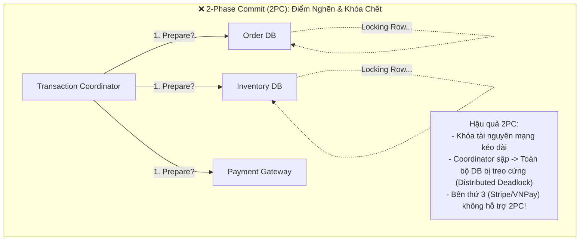
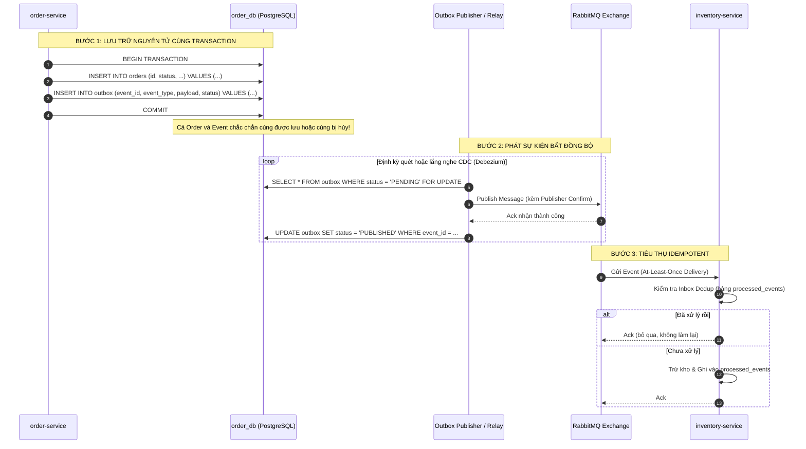
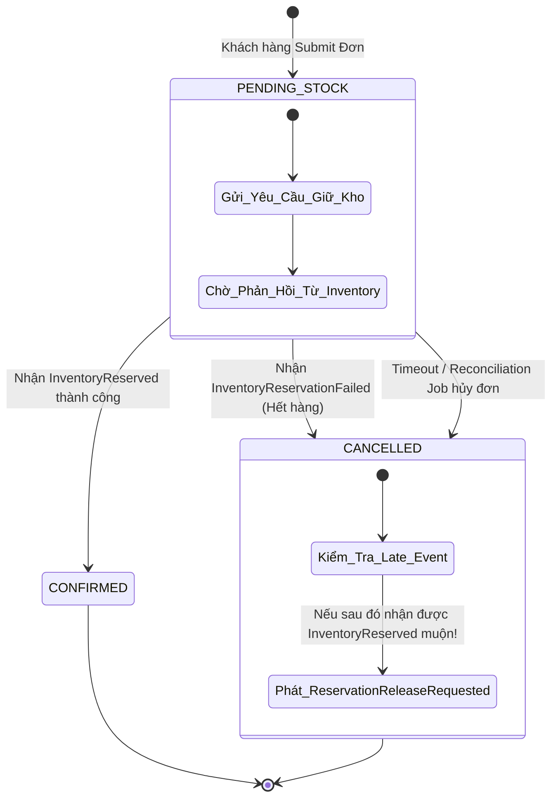
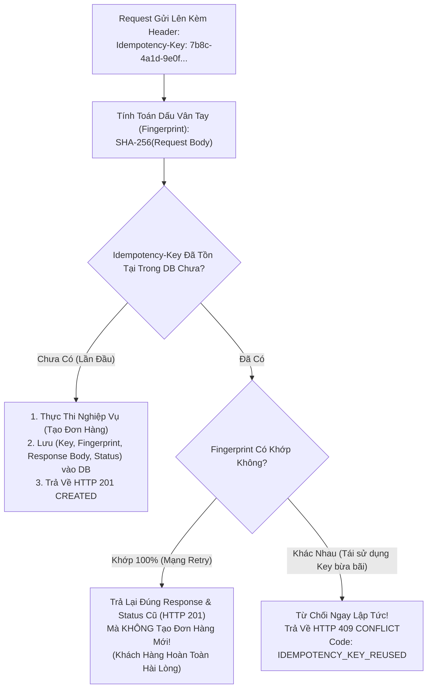

# Chuyên Đề 05: Giao Dịch Phân Tán, Mô Hình Saga & Kiến Trúc Hướng Sự Kiện

> **Tập trung phân tích**: Lý do giao thức 2PC (Two-Phase Commit) thất bại trong Microservices, bài toán ghi kép (Dual-Write Problem) và giải pháp **Transactional Outbox / Inbox Pattern** (ADR-002), điều phối giao dịch phân tán bằng **Saga Orchestration** (ADR-005), cơ chế kiểm soát trùng lặp lệnh **Idempotency** (ADR-006), và các tiến trình hòa giải định kỳ (Reconciliation Jobs) giải quyết hiện tượng rò rỉ tài nguyên.

---

## 1. Cái Chết Của 2PC & Sự Trỗi Dậy Của Tính Nhất Quán Cuối Cùng (Eventual Consistency)

Trong thế giới ứng dụng nguyên khối (Monolith), tính toàn vẹn dữ liệu được đảm bảo tuyệt đối nhờ tính chất **ACID** của Relational Database. Bạn có thể mở một transaction: trừ kho ở bảng `stocks`, tạo hóa đơn ở bảng `orders`, trừ tiền ở bảng `wallets`, nếu bất kỳ bước nào lỗi thì `ROLLBACK` toàn bộ trong 1 phần triệu giây.

Tuy nhiên, khi bước sang Microservices với nguyên tắc **Database-per-Service**:
- `order_db` nằm trên server 1.
- `inventory_db` nằm trên server 2.
- `payment_db` nằm trên server 3 (hoặc cổng thanh toán bên thứ ba như VNPay/Momo/Stripe).

Theo **Định lý CAP (Consistency - Availability - Partition Tolerance)**: Trong một hệ thống phân tán qua mạng (chắc chắn có Partition Tolerance), ta buộc phải đánh đổi giữa **Tính nhất quán tức thời (Strong Consistency)** và **Tính sẵn sàng cao (High Availability)**.
Dreamshop chấp nhận mô hình **BASE (Basically Available, Soft state, Eventual consistency)**: Hệ thống có thể mất vài giây để đạt trạng thái nhất quán, đổi lại hệ thống không bao giờ bị tê liệt toàn bộ.

---

## 2. Bài Toán Ghi Kép (Dual-Write) & Transactional Outbox Pattern (ADR-002)

Khi `order-service` tạo một đơn hàng, nó phải làm 2 việc:
1. Ghi thông tin đơn hàng vào bảng `orders` trong PostgreSQL.
2. Gửi một Message `OrderCreated` lên RabbitMQ để thông báo cho `inventory-service`.

### 2.1. Cạm Bẫy Chết Người Của Việc Ghi Kép:
- **Kịch bản A**: Ghi DB trước, bắn Message sau. 
  $\rightarrow$ Ghi DB thành công, nhưng tiến trình bị mất điện/crash trước khi gửi được lên RabbitMQ. Hậu quả: Đơn hàng đã tạo nhưng kho không hề biết, đơn hàng bị "bỏ rơi" vĩnh viễn!
- **Kịch bản B**: Bắn Message trước, ghi DB sau.
  $\rightarrow$ Bắn RabbitMQ thành công, nhưng DB bị lỗi duplicate key hoặc cúp điện nên rollback. Hậu quả: Kho đã nhận được tin nhắn và trừ hàng của một đơn hàng... không hề tồn tại trong cơ sở dữ liệu!

### 2.2. Giải Pháp: Transactional Outbox Pattern (ADR-002)
Để giải quyết triệt để, Dreamshop thiết kế mô hình **Transactional Outbox**:

#### Quy Tắc Đắt Giá Trong ADR-002:
- Giao hàng qua Message Broker luôn là **At-Least-Once (Ít nhất một lần)**, không bao giờ có "Exactly-Once" hoàn hảo trong thế giới thực.
- Do đó, **Consumer bắt buộc phải là Idempotent Consumer** (xử lý lặp lại không sinh ra tác dụng phụ tiêu cực).

---

## 3. Mô Hình Saga & Vòng Đời Giữ Hàng (ADR-005)

Hệ thống Dreamshop lựa chọn mô hình **Saga Orchestration (Điều Phối Tập Trung)** do `order-service` làm nhạc trưởng điều phối vòng đời của một đơn hàng:

### 3.3. Xử Lý Hiện Tượng Lệch Pha: Late Event & Rò Rỉ Tồn Kho (Stock Leak)
Đây là câu hỏi phân loại ứng viên Senior/Staff: **Chuyện gì xảy ra nếu mạng bị trễ 5 phút, Order Service đã timeout và tự đổi trạng thái sang `CANCELLED`, nhưng 5 phút sau `inventory-service` mới xử lý xong và gửi về event `InventoryReserved`?**

#### Cách Xử Lý Sai:
- `order-service` thấy đơn đã `CANCELLED` thì chỉ đơn giản lờ đi (ignore) event muộn đó.
- *Hậu quả*: Một phần hàng trong kho đã bị đánh dấu là `reserved`, nhưng đơn hàng thì đã bị hủy. Số hàng này bị giam cầm vĩnh viễn $\rightarrow$ **Rò rỉ tồn kho (Stock Leak)**!

#### Giải Pháp Chuẩn Mực Trong ADR-005 Của Dreamshop:
1. Khi `order-service` đang ở trạng thái `CANCELLED` mà nhận được event `InventoryReserved` đến muộn:
2. `order-service` ngay lập tức ghi một bản ghi Outbox: `ReservationReleaseRequested` (Yêu cầu giải phóng tồn kho bù trừ).
3. `inventory-service` nhận được event giải phóng sẽ hoàn trả lại số lượng tồn kho khả dụng (`reserved = reserved - quantity`) một cách hoàn toàn tự động!
4. **Trạng thái terminal `CANCELLED` tuyệt đối không bị mở lại, và tồn kho được bảo toàn 100%**.

---

## 4. Cơ Chế Idempotency Chuẩn Mực (ADR-006)

Khi khách hàng bấm "Đặt Hàng", mạng di động 4G bị giật, trình duyệt của khách hàng không nhận được phản hồi nên tự động gửi lại request lần thứ 2. Làm sao backend đảm bảo khách hàng không bị trừ tiền hoặc tạo 2 đơn hàng giống hệt nhau?

Dreamshop quy chuẩn trong [ADR-006](../adr/006-error-model-and-idempotency.md):

### Chi Tiết Cần Lưu Ý:
- **Thời gian lưu trữ (TTL)**: Khóa Idempotency key thường được cấu hình lưu trữ trong 24 giờ.
- **Phân biệt rõ ràng**: Một request mạng bị lặp lại (Network Retry) phải được trả về kết quả thành công của lần trước (`200/201`), chứ không được báo lỗi `409` làm hoang mang người dùng.

---

## 5. Tiến Trình Hòa Giải Dữ Liệu (Reconciliation Jobs)

Trong hệ thống phân tán, không có cơ chế nào đảm bảo 100% không bao giờ xảy ra trục trặc kỳ quái (ví dụ: máy chủ bị crash phần cứng đúng lúc đang commit, broker bị mất dữ liệu chưa kịp đồng bộ đĩa). Vì vậy, các hệ thống thương mại điện tử lớn luôn cần một **Lưới an toàn cuối cùng: Reconciliation Jobs**.

### Cơ Chế Hòa Giải Định Kỳ Trong Dreamshop:
Một tiến trình nền (Background Cron Job / Scheduler) quét định kỳ mỗi 5 phút:
1. **Quét các đơn hàng bị treo**: Tìm các đơn hàng ở trạng thái `PENDING_STOCK` quá 15 phút mà chưa nhận được kết quả giữ kho.
2. **Kích hoạt bồi hoàn tự động**: Tiến trình chuyển đơn hàng sang `CANCELLED` và phát lệnh kiểm tra/giải phóng tồn kho tương ứng.
3. **Dead Letter Queue (DLQ) & Alerting**: Nếu một sự kiện thử lại 5 lần vẫn lỗi do payload sai định dạng, sự kiện sẽ được đẩy vào hàng đợi chết (DLQ) và kích hoạt cảnh báo tới kênh Slack/PagerDuty của đội On-call để kỹ sư vào xử lý thủ công.

---

## 6. Góc Nhìn Phân Tầng: Từ Fresher Đến Senior / Staff

### 👶 Fresher / Junior: Điều Cần Khắc Cốt Ghi Tâm
- **Hiểu Dual-Write Problem**: Đừng bao giờ viết code: `userService.save(user); rabbitTemplate.send(event);` ngay trong controller. Nếu broker bị mất kết nối, dữ liệu của bạn sẽ bị phân mảnh và sai lệch ngay lập tức.
- **Khái niệm Idempotency**: "F5 nhiều lần không bị mua nhiều lần". Mọi API ghi dữ liệu quan trọng đều phải có cơ chế Idempotency.

### 🧑‍💻 Mid-Level: Làm Chủ Kỹ Thuật Triển Khai
- **Saga Orchestration vs Choreography**:
  - *Choreography* (Sự kiện bắn vòng quanh giữa các service không có người chỉ huy): Dễ làm lúc đầu, nhưng khi có 10 bước sẽ biến thành một đống bùi nhùi không ai biết luồng đi về đâu.
  - *Orchestration* (Một service trung tâm như `order-service` nắm giữ State Machine): Rõ ràng, dễ theo dõi, dễ viết test kiểm chứng từng trạng thái.
- **Inbox Pattern**: Khi viết Message Consumer, luôn nhớ lưu `event_id` vào cơ sở dữ liệu để loại trừ các message bị broker gửi trùng lặp.

### 🧙 Senior / Staff / Architect: Tư Duy Hệ Thống & Scale Lớn
- **Outbox Polling vs Change Data Capture (CDC)**:
  - Polling bảng `outbox` bằng câu lệnh `SELECT ... FOR UPDATE SKIP LOCKED` phù hợp cho quy mô vừa và nhỏ (< 5,000 TPS).
  - Khi scale lên hàng chục nghìn đơn hàng mỗi giây, việc liên tục query bảng outbox sẽ tạo áp lực I/O nặng nề lên database. Khi đó, kiến trúc sư cần chuyển sang **Change Data Capture (CDC) với Debezium**: Debezium đọc trực tiếp Write-Ahead Log (WAL) của PostgreSQL và streaming các sự kiện sang Kafka/RabbitMQ mà không tốn một query SQL nào vào database!
