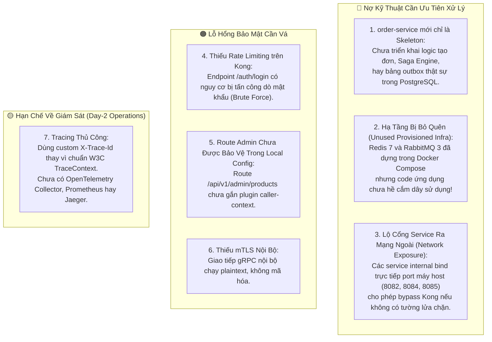
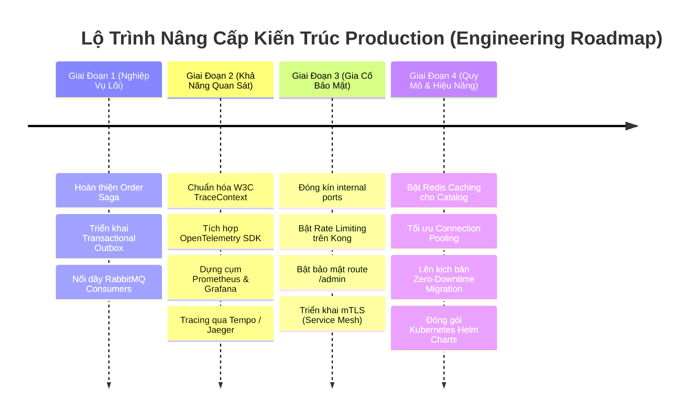

# Chuyên Đề 06: Đối Chiếu Thực Tế, Lỗ Hổng Kỹ Thuật & Lộ Trình Lên Senior/Staff

> **Tập trung phân tích**: Đối chiếu kiến trúc Dreamshop với các hệ thống lớn thực tế (Shopee, Tiki, Amazon, Uber), nhận xét khách quan điểm xuất sắc và các nợ kỹ thuật (Tech Debts), xây dựng lộ trình nâng cấp hạ tầng Production-ready, và cung cấp bộ 15 câu hỏi phỏng vấn tình huống phân loại năng lực từ Fresher đến Staff Engineer.

---

## 1. Đối Chiếu Thực Tế Với Các "Gã Khổng Lồ" Công Nghệ

| Khía Cạnh | Hệ Thống Dreamshop (Hiện Tại) | Shopee / Lazada (Thực Tế) | Amazon / Shopify (Thực Tế) | Tiki / VNG (Thực Tế) |
| :--- | :--- | :--- | :--- | :--- |
| **Kiến Trúc Ingress** | Kong API Gateway + Custom Lua plugin (`caller-context`) + Go BFF. | Cụm Nginx / OpenResty tùy biến cao + cụm Gateway nội bộ (Spike Buster). | AWS CloudFront + Amazon API Gateway / Envoy Proxy. | Kong Enterprise / Tyk Gateway + Go BFF cho Mobile/Web. |
| **Giao Tiếp Nội Bộ** | Private direct gRPC (HTTP/2) theo contract Protobuf (Buf CLI). | gRPC nội bộ hoặc Thrift RPC, kết hợp Service Mesh nội bộ quy mô lớn. | gRPC / AWS Coral Service Framework, private VPC peering. | gRPC cho synchronous calls, kết hợp RabbitMQ / Kafka. |
| **Xử Lý Chống Oversell** | PostgreSQL DB Invariant (`CHECK reserved <= quantity`) + row-level lock. | **Redis Cluster + Lua Script (Decrby)** để giữ chỗ cực nhanh, sau đó async ghi DB. | DynamoDB Conditional Writes + Phân bổ kho theo Cell-based Architecture. | Redis Distributed Lock kết hợp MySQL Invariant và Queue phân luồng. |
| **Giao Dịch Phân Tán** | Saga Orchestration (Order Service làm Coordinator) + Transactional Outbox. | TCC (Try-Confirm-Cancel) hoặc Saga trên Apache Kafka & RocketMQ. | AWS Step Functions (Orchestration) hoặc EventBridge (Choreography). | Transactional Outbox qua Debezium CDC streaming vào Kafka. |
| **Quản Lý Phiên (Auth)** | First-Party Identity Java 21, Argon2id, RS256 JWT, RTR theo RFC 6819. | Centralized Passport Service, OAuth2/OIDC, Multi-factor Auth (MFA), Token Sharding. | Amazon Cognito / Internal IAM, Hardware Security Module (HSM) cho signing. | Keycloak hoặc Custom OAuth2 Server, Redis token blacklist. |

---

## 2. Nhận Xét Khách Quan: Điểm Xuất Sắc & Nợ Kỹ Thuật (Tech Debts)

### 2.1. Các Điểm Sáng Kiến Trúc (Architectural Highlights)
1. **Ranh Giới Nghiệp Vụ Cực Kỳ Chặt Chẽ (Strict Boundaries)**:
   Không có hiện tượng "rò rỉ abstraction". Mỗi service sở hữu database riêng biệt, không có bất kỳ câu lệnh cross-DB join hay foreign key xuyên service nào.
2. **Bảo Mật Edge Đẳng Cấp**:
   Việc viết riêng plugin Lua `caller-context` trên Kong để kiểm tra chữ ký RS256, tự động cache và phục hồi JWKS, đồng thời thanh lọc sạch sẽ các header giả mạo `X-User-Id` là một kỹ thuật bảo mật thực chiến xuất sắc.
3. **Quy Trình Quản Lý Phiên Chuẩn RFC 6819**:
   Cơ chế Refresh Token Rotation với tính năng **Token Family Revocation** và `SELECT ... FOR UPDATE` trong `identity-service` triệt tiêu hoàn toàn rủi ro sử dụng lại token bị đánh cắp.
4. **Tư Duy Bất Biến Database (ADR-003)**:
   Hiểu sâu sắc giới hạn của Redis Lock và đặt tính đúng đắn vào Database Invariant (`CHECK constraint`) thể hiện độ chín chắn rất cao của người thiết kế hệ thống.
5. **Kỹ Thuật Xử Lý Concurrency Ở Tầng Ứng Dụng**:
   - Frontend: `runSingleFlightRefresh` ngăn chặn hiện tượng tháo chạy (Stampede) làm hỏng phiên.
   - Backend Cart: Bounded Worker Pool (`enrichmentConcurrency = 8`) gom dữ liệu đa nhiệm an toàn.

---

### 2.2. Các Lỗ Hổng & Nợ Kỹ Thuật (Identified Tech Debts)

---

## 3. Lộ Trình Cải Tiến Kỹ Thuật (Production-Ready Actionable Roadmap)

Để đưa Dreamshop từ một nền tảng thực nghiệm thành một hệ thống thương mại điện tử thực chiến chịu tải hàng chục nghìn người dùng, dự án cần thực hiện lộ trình 4 giai đoạn:

### Chi Tiết Từng Giai Đoạn:

#### Giai Đoạn 1: Hoàn Thiện Nghiệp Vụ Lõi (Weeks 1 - 3)
- Triển khai đầy đủ bảng `orders` và bảng `outbox` trong `order-service`.
- Viết tiến trình Outbox Polling Publisher gửi sự kiện sang RabbitMQ.
- Viết consumer trong `inventory-service` lắng nghe event giữ hàng và bồi hoàn hàng.
- Nối nút "Đặt hàng" ở Frontend để hoàn thiện luồng End-to-End từ giỏ hàng đến đơn hàng thành công.

#### Giai Đoạn 2: Xây Dựng Hệ Thống Giám Sát Toàn Diện (Weeks 4 - 5)
- Thay thế header tự chế `X-Trace-Id` bằng chuẩn công nghiệp **W3C TraceContext** (`traceparent`).
- Thêm **OpenTelemetry Collector** vào Docker Compose.
- Cấu hình Prometheus cào metrics `/actuator/prometheus` từ Java và endpoint `/metrics` từ Go.
- Thiết lập Alerting Rule khi lỗi 5xx vượt quá 1% hoặc độ trễ p99 vượt quá 500ms.

#### Giai Đoạn 3: Gia Cố Bảo Mật Mép Mạng & Nội Bộ (Weeks 6 - 7)
- Chuyển toàn bộ các service nội bộ sang chế độ Private Network không map port ra host trong Docker.
- Bật plugin `rate-limiting` trên Kong cho các route `/api/v1/auth/*` (Tối đa 5 req/phút với login, 100 req/phút với các API khác).
- Bắt buộc kiểm tra quyền `ADMIN` trên route `/api/v1/admin/*`.

#### Giai Đoạn 4: Scale Lớn & Sẵn Sàng Vận Hành 24/7 (Weeks 8 - 10)
- Tích hợp Redis làm Cache-Aside cho `catalog-service` với chiến lược TTL ngắn (5 phút) kết hợp vô hiệu hóa cache khi sản phẩm bị sửa hoặc xóa mềm.
- Xây dựng quy trình **Zero-Downtime Database Migration** (kỹ thuật Expand and Contract pattern).
- Viết bộ manifest Kubernetes (K8s Deployments, Services, ConfigMaps, HPA tự động scale pods theo CPU/RAM).

---

## 4. Ma Trận Kỹ Năng & 15 Câu Hỏi Phỏng Vấn Tình Huống Microservices

Bảng dưới đây định vị trình độ kỹ sư dựa trên năng lực giải quyết các bài toán trong codebase Dreamshop:

| Cấp Bậc | Năng Lực Kỳ Vọng Đối Với Hệ Thống Microservices |
| :--- | :--- |
| **Fresher / Junior** | Hiểu kiến trúc cơ bản, giải thích được luồng dữ liệu từ React $\rightarrow$ Kong $\rightarrow$ BFF $\rightarrow$ Services. Biết viết API gRPC/REST theo contract có sẵn. Biết viết unit test với Mockito/Go test. |
| **Mid-Level** | Tự thiết kế và thêm một Service mới. Làm chủ các pattern: Outbox, Saga, Worker Pool, Idempotency. Biết cách debug lỗi phân tán qua log/traceId. Viết Integration Test với Testcontainers. |
| **Senior Engineer** | Đánh giá được các đánh đổi kỹ thuật (Trade-offs). Xử lý tranh chấp Concurrency, Flash sale chống oversell. Thiết kế cơ chế phục hồi khi dependency gặp sự cố (Fail-closed/Circuit Breaker). Tối ưu hóa Database queries, connection pools. |
| **Staff / Architect** | Thiết kế ranh giới Bounded Context cho toàn công ty. Thiết kế mô hình bảo mật Zero-Trust, Token lifecycle, Schema governance. Quy hoạch bài toán Scale 100,000+ QPS, Chiến lược Disaster Recovery, Zero-Downtime deployment. |

---

### 15 Câu Hỏi Phỏng Vấn Chuyên Sâu Trực Tiếp Từ Codebase Dreamshop

#### 🟢 Nhóm Nền Tảng (Fresher / Junior)
1. **Hỏi**: *Tại sao trong hệ thống Dreamshop, các service Go và Java lại gọi nhau qua gRPC mà không dùng REST HTTP?*
   - **Trả lời**: gRPC sử dụng Protobuf (mã hóa nhị phân) truyền trên HTTP/2 multiplexing, giúp giảm kích thước gói tin đến 70% và tốc độ tuần tự hóa nhanh hơn gấp nhiều lần JSON. Ngoài ra gRPC cung cấp Strict Type Contract được sinh code tự động qua Buf CLI, giúp tránh các lỗi gõ sai tên trường lúc runtime.
2. **Hỏi**: *Database-per-service là gì? Nếu cần hiển thị tên sản phẩm trong giỏ hàng, tại sao Cart Service không SELECT trực tiếp từ bảng của Catalog Service?*
   - **Trả lời**: Database-per-service là nguyên tắc mỗi microservice sở hữu database riêng biệt. Việc SELECT trực tiếp sẽ tạo ra sự phụ thuộc chặt chẽ vào schema của service khác (Tight Coupling), làm mất khả năng deploy độc lập và dễ gây khóa bảng chéo nhau. Thay vào đó, Cart gọi gRPC sang Catalog để lấy thông tin sản phẩm.
3. **Hỏi**: *Access Token và Refresh Token khác nhau thế nào trong dự án?*
   - **Trả lời**: Access Token là JWT có TTL ngắn (15 phút), được ký bằng RSA private key, chứa thông tin định danh và được Gateway giải mã thẩm định. Refresh Token là chuỗi bí mật ngẫu nhiên lưu trong DB và HttpOnly Cookie với TTL dài (30 ngày), dùng để xin cấp lại Access Token mới mà không bắt người dùng nhập lại mật khẩu.

---

#### 🟡 Nhóm Pattern & Kỹ Thuật (Mid-Level)
4. **Hỏi**: *Hãy giải thích hiện tượng "Token Reuse" trong Refresh Token Rotation (RFC 6819) và cách `RefreshTokenService.java` xử lý tình huống này?*
   - **Trả lời**: Khi Refresh Token A được dùng để lấy token mới B, trạng thái của A chuyển thành `ROTATED`. Nếu kẻ tấn công dùng lại token A cũ, hệ thống phát hiện trạng thái `ROTATED`, lập tức mở một transaction độc lập (`REQUIRES_NEW`) để thu hồi toàn bộ các token có cùng `familyId`. Điều này bảo vệ nạn nhân bằng cách vô hiệu hóa ngay lập tức toàn bộ phiên đăng nhập của kẻ gian.
5. **Hỏi**: *Tại sao Frontend React lại cần hàm `runSingleFlightRefresh` trong `auth-session.ts`?*
   - **Trả lời**: Khi Access Token hết hạn, nếu có 5 API gọi đồng thời, cả 5 API đều nhận mã 401. Nếu không có single-flight, 5 request refresh sẽ bắn lên server. Request đầu tiên thành công sẽ biến token cũ thành `ROTATED`. 4 request sau dùng lại token cũ sẽ kích hoạt cơ chế phát hiện Token Reuse và đá văng người dùng ra ngoài. `runSingleFlightRefresh` đảm bảo chỉ có 1 request refresh duy nhất được gửi đi, các request khác cùng chờ kết quả.
6. **Hỏi**: *Dual-Write problem là gì? Transactional Outbox Pattern giải quyết bài toán này như thế nào?*
   - **Trả lời**: Dual-Write là việc ghi dữ liệu vào Database và gửi Message lên Broker không thể nguyên tử (Atomic). Nếu ghi DB thành công nhưng Broker sập thì mất sự kiện; nếu gửi Broker trước nhưng DB rollback thì sự kiện bị ma. Outbox Pattern giải quyết bằng cách lưu bản ghi sự kiện vào bảng `outbox` ngay trong cùng transaction của Database, sau đó một tiến trình nền riêng biệt sẽ quét và gửi lên Broker với cơ chế đảm bảo At-Least-Once Delivery.
7. **Hỏi**: *Trong `cart-service`, tại sao lại dùng Bounded Worker Pool với kích thước 8 goroutines thay vì tạo goroutine không giới hạn cho mỗi sản phẩm?*
   - **Trả lời**: Tạo goroutines vô hạn (`go func()`) khi giỏ hàng có nhiều dòng sản phẩm có thể dẫn đến cạn kiệt tài nguyên (CPU, RAM) và làm nghẽn kết nối gRPC/TCP tới Catalog và Inventory. Giới hạn 8 workers giúp kiểm soát chặt chẽ thông lượng và bảo vệ downstream service không bị quá tải.

---

#### 🔴 Nhóm Tư Duy Hệ Thống & Đánh Đổi (Senior / Staff)
8. **Hỏi**: *Trong ADR-003, tại sao Dreamshop lại chọn Database Invariant (`CHECK constraint`) thay vì Redis Distributed Lock (Redlock) để chống Oversell trong Flash Sale?*
   - **Trả lời**: Redlock có các điểm yếu chết người trong thực tế: Stop-the-world GC Pause làm hết hạn lock lease trong khi tiến trình vẫn nghĩ mình giữ lock, Clock drift nhảy giờ hệ thống, và sự cố mất đồng bộ khi Redis master failover sang replica. Nếu Database không có ràng buộc tự bảo vệ, Redlock sẽ làm âm kho. Ràng buộc `CHECK (reserved <= quantity)` trong PostgreSQL là nguồn chân lý tối hậu, đảm bảo dữ liệu không bao giờ bị sai lệch cho dù tầng phân tán có gặp bất kỳ sự cố nào.
9. **Hỏi**: *Trong Saga Order, giả sử Order Service đã hủy đơn do Timeout, nhưng sau đó nhận được sự kiện `InventoryReserved` đến muộn. Hệ thống xử lý thế nào để không bị "Rò rỉ tồn kho" (Stock Leak)?*
   - **Trả lời**: Theo ADR-005, Order Service không được lờ đi sự kiện muộn. Khi đang ở trạng thái `CANCELLED` mà nhận được `InventoryReserved`, Order Service sẽ phát sinh ngay một sự kiện bù trừ (Compensating Event) là `ReservationReleaseRequested`. Inventory Service nhận được sự kiện này sẽ nhả lại số lượng hàng đã giữ, đảm bảo trạng thái hủy không bị đảo ngược và kho hàng được hoàn trả chính xác.
10. **Hỏi**: *Phân tích sự đánh đổi giữa việc nhúng Permissions vào JWT Claims so với việc gọi gRPC CheckPermission thời gian thực từ Cart sang Identity (ADR-007 & Spec 2026-08-25)?*
    - **Trả lời**: Nhúng quyền vào JWT cho phép Gateway/Service kiểm tra tức thì (0ms latency, không tốn network call), nhưng nhược điểm là không thể thu hồi quyền ngay lập tức (phải đợi token hết hạn 15 phút) và làm token phình to. Gọi gRPC thời gian thực đảm bảo tính cập nhật tức thì (ngay khi Admin xóa quyền là request sau bị chặn ngay), nhưng trả giá bằng thêm độ trễ mạng và tạo ra sự phụ thuộc tính sẵn sàng (Availability Coupling) vào Identity Service.
11. **Hỏi**: *Idempotency-Key hoạt động thế nào theo ADR-006? Làm sao phân biệt được giữa việc "Mạng chập chờn gửi lại" và việc "Kẻ xấu cố tình tái sử dụng Key cho giao dịch khác"?*
    - **Trả lời**: Hệ thống tính toán hàm băm (Fingerprint) SHA-256 trên nội dung của Request Body. Nếu cùng `Idempotency-Key` mà Body Fingerprint giống hệt nhau $\rightarrow$ Đây là mạng retry hợp pháp, hệ thống trả lại kết quả cũ (HTTP 200/201) mà không thực thi lại logic. Nếu cùng Key mà Body Fingerprint khác nhau $\rightarrow$ Đây là hành vi tái sử dụng key sai trái, hệ thống lập tức từ chối với HTTP 409 Conflict (`IDEMPOTENCY_KEY_REUSED`).
12. **Hỏi**: *Giải thích chính sách Fail-Closed vs Fail-Open trong ADR-004? Khi Inventory Service sập, tại sao xem giỏ hàng lại Fail-Open nhưng thêm sản phẩm vào giỏ lại Fail-Closed?*
    - **Trả lời**: Thao tác Đọc (Xem giỏ hàng) an toàn với dữ liệu suy thoái nên chọn Fail-Open: trả giỏ hàng kèm cờ `degraded=true` để người dùng vẫn xem được đồ, giữ chân trải nghiệm khách hàng. Thao tác Ghi (Thêm giỏ hàng, Đặt đơn) làm thay đổi trạng thái và liên quan đến tiền bạc/tồn kho nên bắt buộc phải Fail-Closed: từ chối giao dịch ngay lập tức (HTTP 503) vì không bao giờ được phép giả định một người có quyền hay một sản phẩm còn hàng khi dịch vụ thẩm định đang ngừng hoạt động.
13. **Hỏi**: *Làm thế nào để nâng cấp Schema Database trong kiến trúc Microservices mà không cần dừng hệ thống (Zero-Downtime Migration)?*
    - **Trả lời**: Sử dụng kỹ thuật **Expand and Contract (Parallel Change)** qua 3 bước:
      1. *Expand*: Tạo cột mới trong DB (cho phép NULL hoặc default value) mà không xóa cột cũ. Deploy ứng dụng mới có khả năng ghi vào cả 2 cột và đọc từ cột mới.
      2. *Migrate Data*: Chạy script nền chuyển dữ liệu từ cột cũ sang cột mới cho các bản ghi lịch sử.
      3. *Contract*: Khi 100% services đã chuyển sang dùng cột mới, deploy phiên bản code gỡ bỏ cột cũ, sau đó mới chạy migration xóa cột cũ trong database.
14. **Hỏi**: *Nếu một sản phẩm Flash Sale có 100,000 lượt request/giây tranh chấp, hàng nghìn transactions cùng chạy `UPDATE stock ...` sẽ làm nghẽn hàng đợi Row Lock của PostgreSQL. Là một Solution Architect, bạn sẽ tái cấu trúc hệ thống như thế nào để vượt qua giới hạn này?*
    - **Trả lời**: Áp dụng 2 kỹ thuật cấp tiến:
      - *Stock Sharding (Phân mảnh tồn kho)*: Chia 1,000 tồn kho thành 10 bản ghi độc lập (mỗi bản ghi 100 sản phẩm). Request được băm ngẫu nhiên vào các mảnh, giảm tranh chấp row lock đi 10 lần.
      - *In-Memory Pre-Reservation*: Chuyển toàn bộ tồn kho Flash Sale lên Redis. Dùng Lua script nguyên tử thực hiện `redis.call('decrby', key, qty)` với thời gian đáp ứng < 1ms. Chỉ 1,000 request trừ thành công trên Redis mới được quyền đẩy sự kiện vào RabbitMQ/Kafka để ghi nhận đơn hàng xuống PostgreSQL theo tốc độ mà Database chịu được (Backpressure / Rate-leveling).
15. **Hỏi**: *Làm thế nào để bảo vệ hệ thống khỏi tấn công Header Spoofing nếu một microservice nội bộ vô tình bị lộ port ra ngoài Internet?*
    - **Trả lời**:
      - Tầng 1: Đóng toàn bộ cổng của microservice trên máy chủ, chỉ cho phép lắng nghe trên mạng nội bộ ảo (Docker overlay network / Kubernetes Pod Network) không gắn Public IP.
      - Tầng 2: Thiết lập **Mutual TLS (mTLS)** giữa API Gateway và các Service. Microservice chỉ chấp nhận kết nối từ các client có chứng chỉ số hợp lệ do Certificate Authority nội bộ cấp.
      - Tầng 3: Sử dụng Token ký số nội bộ (Internal JWT / Service Identity Tokens) thay vì truyền header plaintext `X-User-Id`.
