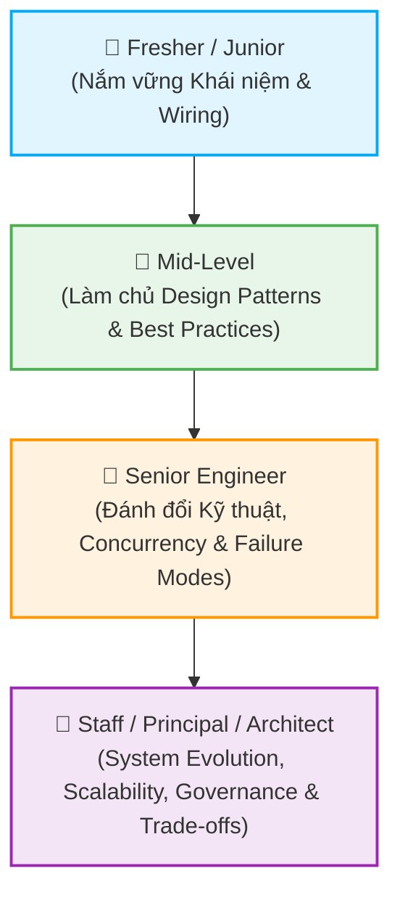

# Dreamshop Microservices Architecture Deep Dive
## Bản Phân Tích & Thẩm Định Kiến Trúc Toàn Diện (Fresher → Senior/Staff)

> **Tài liệu thẩm định kỹ thuật chuyên sâu** dành cho toàn bộ nền tảng thương mại điện tử phân tán **Dreamshop**.
> Tài liệu này được biên soạn dựa trên phân tích trực tiếp mã nguồn, 9 Kiến trúc Quyết định (ADRs), các Steering Rules và các thông số vận hành thực tế của repository, kết hợp đối chiếu với các tiêu chuẩn công nghiệp (Shopee, Tiki, Amazon, Netflix, Uber).

---

## 📌 Mục Lục Bộ Tài Liệu

Tài liệu được phân chia thành 6 chuyên đề độc lập nhưng liên kết chặt chẽ, phục vụ lộ trình học tập, nghiên cứu và nâng cấp hệ thống:

| STT | Tài Liệu | Khía Cạnh Khảo Sát | Trọng Tâm Kiến Trúc |
| :---: | :--- | :--- | :--- |
| **01** | [**Hệ Thống & Ranh Giới Dịch Vụ**](./01-he-thong-va-ranh-gioi-dich-vu.md) | Tổng quan hệ thống, Domain-Driven Design, Monorepo & Polyglot Stack | Service Boundaries, Database-per-Service, Go vs Java, `go.work` & Maven Reactor |
| **02** | [**Bảo Mật, Xác Thực & API Gateway**](./02-bao-mat-xac-thuc-va-api-gateway.md) | Kong Gateway, Custom Lua Plugin, JWT RS256, Refresh Token Rotation & RBAC | `caller-context` plugin, JWKS caching, Single-flight refresh, Session Family Revocation, Private gRPC Authz |
| **03** | [**Giao Thức, Hợp Đồng & Hybrid Routing**](./03-giao-thuc-hop-dong-va-hybrid-routing.md) | REST vs gRPC vs Message Broker, Hybrid Routing, Schema Governance, Tracing | ADR-008, Buf CLI, `google.rpc.ErrorInfo`, Chuẩn hóa REST Envelope, Distributed Tracing (`X-Trace-Id`) |
| **04** | [**Đồng Thời, Nhất Quán & Chống Oversell**](./04-dong-thoi-nhat-quan-va-chong-oversell.md) | Xử lý Concurrency, Flash Sale, Worker Pool, Graceful Degradation | DB Invariant (`CHECK constraint`) vs Redis Lock (ADR-003), Cart Worker Pool Concurrency, Circuit Breaker (ADR-004) |
| **05** | [**Giao Dịch Phân Tán & Event-Driven**](./05-giao-dich-phan-tan-va-event-driven.md) | Eventual Consistency, Outbox/Inbox Pattern, Saga Pattern, Idempotency | Dual-write problem (ADR-002), Saga Orchestration (ADR-005), Idempotency Keys (ADR-006), Reconciliation Jobs |
| **06** | [**So Sánh Thực Tế, Lỗ Hổng & Lộ Trình Senior**](./06-so-sanh-thuc-te-lo-hong-va-lo-trinh-senior.md) | Đối chiếu công nghiệp (Shopee, Amazon), Nợ kỹ thuật, Actionable Roadmap & Interview Matrix | Phân tích Gaps, Đề xuất nâng cấp Production, Ma trận năng lực & Bộ câu hỏi phỏng vấn chuyên sâu |

---

## 🧭 Hướng Dẫn Tiếp Cận Theo Level Kỹ Sư

### 1. Dành cho Fresher / Junior Engineer
- **Mục tiêu**: Hiểu tại sao hệ thống không viết chung một khối (Monolith) mà tách ra 6 services.
- **Lộ trình đọc gợi ý**:
  1. Đọc [Chương 1](./01-he-thong-va-ranh-gioi-dich-vu.md): Hiểu mô hình Monorepo, Database-per-service (tại sao cấm JOIN chéo DB).
  2. Đọc [Chương 2](./02-bao-mat-xac-thuc-va-api-gateway.md): Hiểu luồng người dùng đăng nhập -> cấp Access Token (JWT) & Refresh Token trong HttpOnly Cookie -> Gateway kiểm tra token thế nào.
  3. Đọc [Chương 3](./03-giao-thuc-hop-dong-va-hybrid-routing.md): Hiểu gRPC là gì, Protobuf là gì, tại sao backend gọi nhau bằng gRPC mà không dùng REST.

### 2. Dành cho Mid-Level Engineer
- **Mục tiêu**: Làm chủ các Design Pattern phân tán cốt lõi và kỹ thuật xử lý dữ liệu phức tạp.
- **Lộ trình đọc gợi ý**:
  1. Đọc [Chương 3](./03-giao-thuc-hop-dong-va-hybrid-routing.md): Mô hình BFF (Backend-for-Frontend), cơ chế xử lý lỗi chuẩn hóa `google.rpc.ErrorInfo`.
  2. Đọc [Chương 4](./04-dong-thoi-nhat-quan-va-chong-oversell.md): Cơ chế Worker Pool trong `cart-service` để tổng hợp dữ liệu (fan-out query), cơ chế Graceful Degradation khi service phụ thuộc bị sập.
  3. Đọc [Chương 5](./05-giao-dich-phan-tan-va-event-driven.md): Transactional Outbox Pattern, Saga Orchestration, Idempotency Pattern với fingerprinting.

### 3. Dành cho Senior / Staff Engineer / Solution Architect
- **Mục tiêu**: Đánh giá các quyết định đánh đổi (Trade-offs), phân tích rủi ro hệ thống, mô hình hóa mối đe dọa (Threat Modeling), xử lý tranh chấp tài nguyên mức phần cứng/database, và thiết kế lộ trình tiến hóa lên scale lớn.
- **Lộ trình đọc gợi ý**:
  1. Đọc [Chương 4](./04-dong-thoi-nhat-quan-va-chong-oversell.md): Nghiên cứu chuyên sâu cuộc tranh luận kinh điển giữa **Database Invariants (`CHECK`, Row Locks)** vs **Redis Distributed Lock (Redlock)** theo tư tưởng Martin Kleppmann & Salvatore Sanfilippo.
  2. Đọc [Chương 2](./02-bao-mat-xac-thuc-va-api-gateway.md): Phân tích Race Conditions trong Refresh Token Rotation (RFC 6819), Token Family Revocation, và trade-off giữa "Token chứa Permissions" vs "Private gRPC Authorization Call".
  3. Đọc [Chương 5](./05-giao-dich-phan-tan-va-event-driven.md): Distributed Transactions, Dual-write problem, Reconciliation jobs giải quyết Zombie Reservations và Clock drift.
  4. Đọc [Chương 6](./06-so-sanh-thuc-te-lo-hong-va-lo-trinh-senior.md): Nhận xét khách quan điểm nghẽn, nợ kỹ thuật và lộ trình nâng cấp hạ tầng Production-ready.

---

## 📊 Tóm Tắt Điều Hành (Executive Architecture Scorecard)

Dưới đây là bảng đánh giá khách quan của kiến trúc Dreamshop hiện tại dựa trên 7 trụ cột kiến trúc phân tán:

| Trụ Cột (Pillar) | Điểm (Thang 10) | Nhận Xét Kiến Trúc |
| :--- | :---: | :--- |
| **Domain Isolation & Boundaries** | **9.5 / 10** | **Xuất sắc**. Tách biệt ranh giới cực kỳ nghiêm ngặt; Database-per-service triệt để; không có cross-DB join hay lạm dụng shared libraries. |
| **Authentication & Edge Security** | **9.0 / 10** | **Rất tốt**. Gateway xác thực RS256 JWT bằng custom Lua plugin với JWKS caching; Refresh Token Rotation với Token Family Revocation đúng chuẩn RFC 6819; Frontend singleflight refresh. Thiếu Rate Limiting & mTLS nội bộ. |
| **Contract Governance & Protocols** | **9.0 / 10** | **Rất tốt**. Sử dụng Buf CLI quản lý Protobuf contracts; gRPC riêng tư cho nội bộ, Kong làm cổng duy nhất; Model lỗi chuẩn `ErrorInfo`. |
| **Concurrency & Data Integrity** | **8.5 / 10** | **Khá tốt**. Tư duy chống oversell dựa trên PostgreSQL invariant (`CHECK constraint`) chuẩn mực; Cart enrichment worker pool tối ưu. Tuy nhiên chưa có caching layer thực sự trên Redis. |
| **Distributed Transactions & Events** | **6.5 / 10** | **Đang hoàn thiện (In-Progress)**. Đã có thiết kế ADR-002 (Outbox) và ADR-005 (Saga) rất chuẩn, nhưng code `order-service` hiện tại mới ở mức skeleton; RabbitMQ chưa được cắm dây thực tế vào luồng nghiệp vụ. |
| **Observability & Telemetry** | **6.0 / 10** | **Trung bình**. Đã có truyền tải thủ công `X-Trace-Id` qua HTTP và gRPC metadata, nhưng chưa tích hợp OpenTelemetry SDK, chưa có centralized tracing (Jaeger/Tempo) hay metrics (Prometheus). |
| **Production Readiness (Day-2 Ops)** | **6.5 / 10** | **Cần bổ sung**. Cấu hình Docker Compose phù hợp local development; thiếu Kubernetes manifests, CI/CD pipeline phức hợp cho Monorepo, và cơ chế Zero-downtime DB migrations tự động. |

---
*Mời bạn bắt đầu nghiên cứu chi tiết từ [Chương 1: Hệ Thống & Ranh Giới Dịch Vụ](./01-he-thong-va-ranh-gioi-dich-vu.md).*
