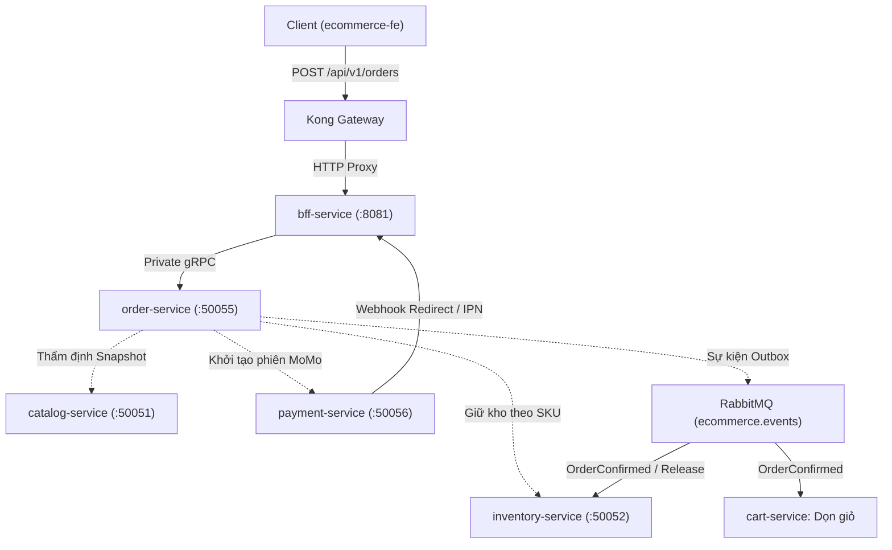
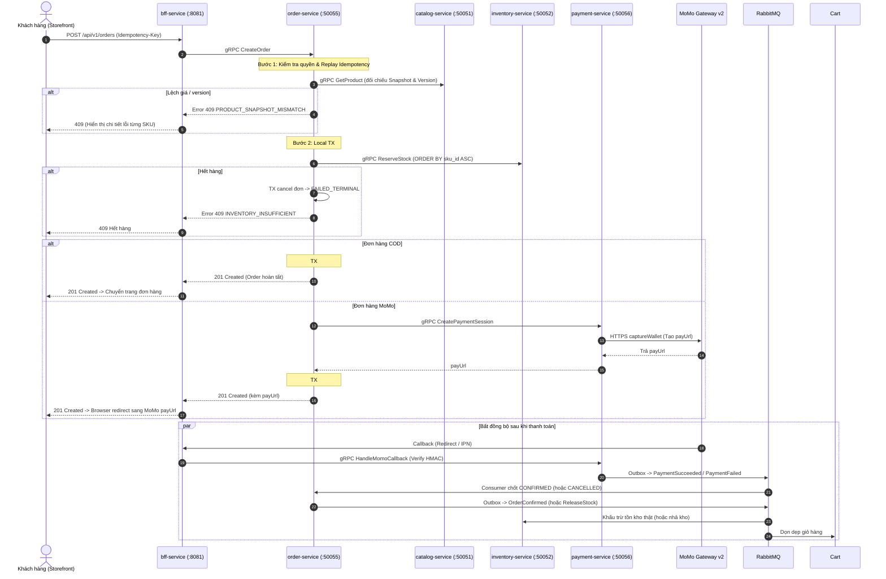
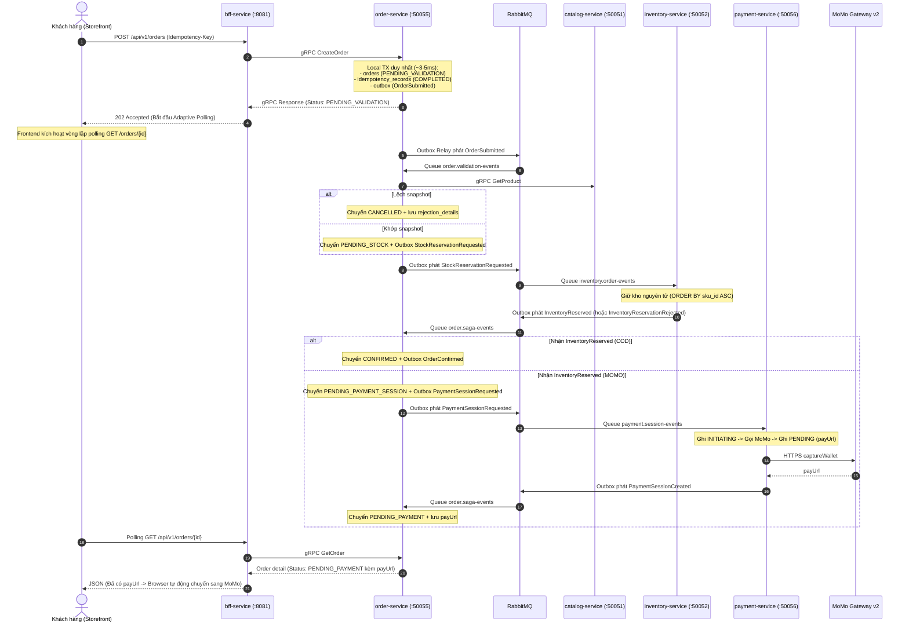

# Báo Cáo Phân Tích Chuyên Sâu: Bài Toán Đặt Hàng & 2 Cơ Chế Code Hiện Tại

> **Tài liệu tham chiếu:** 
> - Nhánh 1: [`feat/checkout-hybrid`](.worktrees/checkout-hybrid) ([ADR-013](docs/adr/013-variant-sku-pricing-and-inventory.md), [Spec Hybrid](docs/superpowers/specs/2026-10-28-order-checkout-saga-design.md))
> - Nhánh 2: [`feat/checkout-event-driven`](.worktrees/checkout-event-driven) ([ADR-014](docs/superpowers/specs/2026-11-03-event-driven-order-checkout-saga-design.md), [Spec Event-Driven](docs/superpowers/specs/2026-11-03-event-driven-order-checkout-saga-design.md))
> - Tài liệu tổng hợp & runbook: [`docs/superpowers/2026-11-05-checkout-saga-summary-and-guide.md`](docs/superpowers/2026-11-05-checkout-saga-summary-and-guide.md)

---

## 1. Bản Chất Bài Toán Đặt Hàng Phân Tán (E-Commerce Order Checkout)

Trong hệ thống thương mại điện tử microservices của dự án, chuỗi hành động đặt hàng từ giỏ hàng sang chốt đơn và thanh toán đối mặt với 6 bài toán kỹ thuật phức tạp:



1. **Tính Nhất Quán Bản Chụp (Snapshot Consistency & Human Think-Time):**
   - Giữa thời điểm khách xem trang xem trước đơn (`OrderPreviewPage`) và thời điểm bấm nút Đặt hàng có độ trễ suy nghĩ vài chục giây đến vài chục phút.
   - Quản trị viên có thể vừa đổi giá, đổi tên, ẩn/xóa biến thể hoặc nâng `version` sản phẩm.
   - Hệ thống bắt buộc phải phát hiện sai lệch và từ chối tạo đơn với mã `PRODUCT_SNAPSHOT_MISMATCH` kèm chi tiết từng SKU, không được bán sai giá hoặc âm thầm tính theo giá cũ.
2. **Chống Bán Vượt Tồn Kho (Anti-Oversell Invariant):**
   - Trong kịch bản Flash Sale, hàng chục khách hàng cùng tranh mua những đơn vị tồn kho cuối cùng của một SKU.
   - Bảo vệ mức cơ sở dữ liệu (`CHECK (reserved >= 0 AND reserved <= quantity)` và `UPDATE ... WHERE quantity - reserved >= req`) thay vì phụ thuộc vào Redis distributed lock ([ADR-003](docs/adr/003-redis-lock-vs-db-invariant.md)).
   - Sắp xếp thứ tự khóa dòng `ORDER BY sku_id ASC` để triệt tiêu nguy cơ Deadlock khi nhiều đơn hàng chứa các SKU chéo nhau.
3. **Tính Lũy Đẳng (Idempotency Control):**
   - Khách hàng bấm đúp nút "Đặt hàng", hoặc rớt mạng khi response đang trả về.
   - Khóa lũy đẳng kép: `(user_id, idempotency_key)` trong bảng `idempotency_records` kết hợp mã băm `SHA-256` của request payload (request fingerprint).
   - Replay kết quả chuẩn xác nếu cùng fingerprint; trả lỗi `409 IDEMPOTENCY_KEY_REUSED` nếu cùng key nhưng sửa nội dung đơn.
4. **Tách Bounded Context `payment-service` Độc Lập:**
   - Dịch vụ Go mới (`:8086`, gRPC `:50056`, `payment_db`), quản lý khóa bí mật `MOMO_*`, tạo phiên thanh toán MoMo v2 (`captureWallet`), xác thực HMAC-SHA256 callback hằng số thời gian (`hmac.Equal`).
5. **Điều Phối Saga & Vòng Đời Giữ Kho Bồi Hoàn (Saga Compensation):**
   - Không dùng 2PC/XA ([ADR-002](docs/adr/002-transactional-outbox.md)). Mọi thay đổi trạng thái và ghi sự kiện outbox phải nằm trong cùng một local database transaction.
   - Đơn quá hạn 15 phút chưa thanh toán hoặc bị khách hủy -> phát Outbox nhả kho bồi hoàn (`ReservationReleaseRequested`).
   - Xử lý MoMo IPN đến trễ khi đơn đã `CANCELLED` -> giữ nguyên `CANCELLED`, chuyển trạng thái thanh toán sang `REFUND_REQUIRED` và phát `order.payment.refund_requested` để tránh thất thoát tiền của khách.
6. **Dọn Giỏ Hàng Bất Đồng Bộ (`cart-service`):**
   - Khi đơn chốt thành công (`OrderConfirmed`), `cart-service` tiêu thụ sự kiện qua RabbitMQ và xóa các dòng SKU đã mua. Bảng `processed_events` đảm bảo xóa lũy đẳng và không xóa nhầm nếu khách vừa thêm lại sản phẩm đó.

---

## 2. Tổng Quan Hai Cơ Chế Code Hiện Tại

Cả hai cơ chế đã được xây dựng hoàn chỉnh trên 2 nhánh Git độc lập và gắn vào 2 git worktree:
- **Cơ chế 1:** `feat/checkout-hybrid` tại `.worktrees/checkout-hybrid`
- **Cơ chế 2:** `feat/checkout-event-driven` tại `.worktrees/checkout-event-driven`

### Bảng So Sánh Đối Chiếu Toàn Diện

| Tiêu chí | Cơ chế 1: Hybrid Saga (`feat/checkout-hybrid`) | Cơ chế 2: Pure Event-Driven Saga (`feat/checkout-event-driven`) |
| :--- | :--- | :--- |
| **Tài liệu & ADR** | [ADR-013](docs/adr/013-variant-sku-pricing-and-inventory.md), [Spec Hybrid](docs/superpowers/specs/2026-10-28-order-checkout-saga-design.md) | [ADR-014](docs/superpowers/specs/2026-11-03-event-driven-order-checkout-saga-design.md), [Spec Event-Driven](docs/superpowers/specs/2026-11-03-event-driven-order-checkout-saga-design.md) |
| **Phản hồi `POST /api/v1/orders`** | **`201 Created`**: Trả ngay đơn hàng hoàn chỉnh (COD) hoặc link thanh toán `payUrl` (MoMo) trong cùng một request HTTP duy nhất. Trả trực tiếp `409 Conflict` nếu lệch snapshot hoặc hết kho. | **`202 Accepted`**: Trả ngay trong **`~3–5ms`** sau khi kiểm tra schema/quyền và lưu đơn ở `PENDING_VALIDATION` + Transactional Outbox. Toàn bộ khâu kiểm kho và tạo link MoMo đẩy sang background worker. |
| **Giao tiếp Thẩm định Catalog** | **Đồng bộ**: `order-service` gọi private gRPC `CatalogService.GetProduct` trực tiếp trên luồng HTTP của user. | **Bất đồng bộ**: Worker `OrderValidationConsumer` của `order-service` đọc event từ queue `order.validation-events` rồi mới gọi gRPC `CatalogService.GetProduct`. |
| **Giao tiếp Giữ kho (`Inventory`)** | **Đồng bộ**: `order-service` gọi private gRPC `InventoryService.ReserveStock` (`:50052`, deadline 1.5s). | **Bất đồng bộ**: `order-service` phát event `StockReservationRequested` -> `inventory-service` lắng nghe, giữ kho trong DB rồi phát `InventoryReserved` / `InventoryReservationRejected` qua Outbox. |
| **Giao tiếp Phiên MoMo (`Payment`)** | **Đồng bộ**: `order-service` gọi private gRPC `PaymentService.CreatePaymentSession` (`:50056`, deadline 12s) để lấy `payUrl`. | **Bất đồng bộ**: `order-service` phát `PaymentSessionRequested` -> `payment-service` lắng nghe (có 2-phase lock chống gọi trùng cổng MoMo), gọi MoMo rồi phát `PaymentSessionCreated` mang `payUrl` về lại. |
| **Xử lý MoMo Callback (Redirect/IPN)** | BFF tiếp nhận -> gọi gRPC `PaymentService.HandleMomoCallback` (xác thực HMAC) -> Outbox phát `PaymentSucceeded`/`PaymentFailed` -> `order-service` chốt đơn. | Tương tự bản Hybrid: BFF tiếp nhận -> gRPC `PaymentService.HandleMomoCallback` -> Outbox phát `PaymentSucceeded`/`PaymentFailed` -> `order-service` chốt đơn. |
| **Máy Trạng Thái `OrderStatus`** | **4 trạng thái:**<br>`PENDING_STOCK` (nội bộ/quá độ)<br>`PENDING_PAYMENT`<br>`CONFIRMED`<br>`CANCELLED` | **6 trạng thái:**<br>`PENDING_VALIDATION`<br>`PENDING_STOCK`<br>`PENDING_PAYMENT_SESSION`<br>`PENDING_PAYMENT`<br>`CONFIRMED`<br>`CANCELLED` |
| **Trải nghiệm Frontend (`ecommerce-fe`)** | - Bấm đặt hàng -> chờ ~150-300ms -> redirect sang MoMo hoặc chuyển trang đơn hàng.<br>- Báo lỗi `409` trực tiếp tại trang xem trước nếu hết hàng hoặc lệch giá. | - Bấm đặt hàng -> nhận `202 Accepted` tức thì (~5ms).<br>- Tự động kích hoạt **Adaptive Polling** trên `GET /api/v1/orders/{orderId}` (nhịp 300ms, 500ms, 1s, 2s).<br>- Lưu session vào `sessionStorage` để không mất trạng thái nếu user F5.<br>- Khi đơn chốt, tự động redirect MoMo hoặc trang đơn hàng; nếu bị từ chối thì đọc `rejectionDetails` để cảnh báo từng SKU. |
| **Khác biệt Cơ sở dữ liệu** | - `order_db`: bảng `orders` không có cột `rejection_details`.<br>- `inventory_db`: không có bảng `outbox_events` (chỉ có bảng `stock_reservations`).<br>- `payment_db`: bảng `payments` quản lý phiên thanh toán 1 pha. | - `order_db`: bảng `orders` bổ sung cột `rejection_details JSONB` để lưu lý do từ chối cho polling client tra cứu.<br>- `inventory_db`: bổ sung bảng `outbox_events` và `processed_events`.<br>- `payment_db`: bảng `payments` bổ sung quản lý 2-phase session (`INITIATING` -> `PENDING`). |
| **Hàng Đợi RabbitMQ** | Dùng các queue:<br>`inventory.order-events`<br>`cart.order-events`<br>`order.payment-events` | Bổ sung thêm các queue chuyên biệt:<br>`order.validation-events`<br>`order.saga-events`<br>`payment.session-events` |
| **Ưu Điểm Cốt Lõi** | - Kiến trúc trực quan, dễ hiểu, dễ debug.<br>- Không cần cơ chế polling phức tạp ở frontend.<br>- Độ trễ người dùng thấp ở điều kiện tải bình thường.<br>- Đơn giản hóa trạng thái DB. | - Khả năng san phẳng đỉnh tải (**Peak-shaving**) tối đa khi Flash Sale.<br>- **Temporal Decoupling**: Order nhận đơn an toàn kể cả khi Inventory hoặc MoMo gateway sập/bảo trì 10-30 giây.<br>- Không giam giữ HTTP thread ở BFF/Order. |
| **Nhược Điểm / Đánh Đổi** | - Dưới tải cực lớn (Flash Sale), các kết nối gRPC giữ kho đồng bộ có thể gây tắc nghẽn thread pool.<br>- Frontend phải chờ trọn vẹn thời gian gọi MoMo ngoài Internet. | - Trải nghiệm Polling bất đồng bộ đòi hỏi code frontend phức tạp hơn.<br>- Tổng thời gian hội tụ (Settle Time) dài hơn một chút do trải qua nhiều chặng queue.<br>- Khó debug hơn vì trace bị ngắt quãng giữa các consumer. |

---

## 3. Chi Tiết Kiến Trúc 1: Hybrid Saga (`feat/checkout-hybrid`)

Trong bản Hybrid, `order-service` đóng vai trò là Orchestrator vừa điều phối gRPC đồng bộ ở pha khởi tạo vừa điều phối sự kiện bất đồng bộ ở pha kết thúc:



---

## 4. Chi Tiết Kiến Trúc 2: Pure Event-Driven Saga (`feat/checkout-event-driven`)

Ở bản Pure Event-Driven, luồng HTTP tiếp nhận đơn tách rời 100% khỏi các network call bên ngoài. Cửa ngõ chỉ làm nhiệm vụ ghi đơn và trả `202 Accepted` ngay lập tức:



---

## 5. Ma Trận Xử Lý Các Tình Huống Tranh Chấp & Sự Cố (Edge Cases)

| Tình huống tranh chấp / Sự cố | Cách giải quyết ở Bản Hybrid | Cách giải quyết ở Bản Pure Event-Driven |
| :--- | :--- | :--- |
| **A. 50 khách cùng tranh 5 slot hàng cuối (Flash Sale Oversell)** | `ReserveStock` dùng conditional update `quantity - reserved >= req` khóa dòng theo thứ tự SKU tăng dần. Đúng 5 request đầu tiên thành công; 45 request sau trả lỗi `409 INVENTORY_INSUFFICIENT` ngay tại lời gọi HTTP. | Cả 50 request đều nhận `202 Accepted`. Khi các event `StockReservationRequested` vào hàng đợi, `inventory-service` xử lý tuần tự: 5 đơn đầu phát `InventoryReserved`, 45 đơn sau phát `InventoryReservationRejected`. 45 đơn này chuyển thành `CANCELLED`, client polling nhận kết quả từ chối rõ ràng. Tồn kho không bao giờ âm. |
| **B. Admin đổi giá khi khách đang ở màn hình xem trước** | `order-service` kiểm tra với Catalog trước khi tạo đơn; phát hiện lệch `unit_price` hoặc `version` thì ném ngay `409 PRODUCT_SNAPSHOT_MISMATCH`. | Đơn vẫn được nhận `202 Accepted`. Worker `OrderValidationConsumer` phát hiện lệch giá với Catalog sẽ chuyển đơn sang `CANCELLED` và lưu chi tiết vào `rejection_details`. Khi frontend poll thấy `CANCELLED` kèm mã lỗi này sẽ hiển thị cảnh báo đỏ và mời quay về giỏ hàng. |
| **C. Khách bấm đúp hoặc gửi bão trùng Idempotency-Key** | Request đầu tiên chiếm key `IN_PROGRESS`. Request thứ hai cùng key gặp `REQUEST_IN_PROGRESS` sẽ chờ kết quả từ request đầu. Nếu sửa đổi payload sẽ bị từ chối `409 IDEMPOTENCY_KEY_REUSED`. | Hoàn toàn tương tự: khóa `(user_id, idempotency_key)` chặn đứng mọi request trùng lặp, chỉ có duy nhất 1 đơn hàng được tạo trong database. |
| **D. MoMo Callback giả mạo chữ ký** | Endpoint `/api/v1/payments/momo-*` chuyển vào `payment-service`. Hàm `hmac.Equal` so khớp chữ ký HMAC-SHA256 chuẩn thời gian hằng số. Sai chữ ký bị chặn đứng với HTTP 400. | Cơ chế xác thực callback của `payment-service` ở cả 2 nhánh là giống nhau 100%: chặn đứng callback giả mạo và bảo vệ trạng thái đơn hàng. |
| **E. MoMo IPN về khi đơn đã bị hủy (Late Payment on Cancelled Order)** | Đơn đã ở trạng thái `CANCELLED` (do timeout 15p hoặc khách tự hủy). Khi nhận `PaymentSucceeded`, `order-service` tuân thủ ADR-005: **không mở lại đơn**, chuyển `payment_status = REFUND_REQUIRED` và phát `RefundRequested` để lưu vết đối soát. | Hoàn toàn tương tự: `OrderSagaCoordinator` khóa dòng `SELECT ... FOR UPDATE`, thấy status là `CANCELLED` thì chỉ cập nhật `REFUND_REQUIRED` và phát Outbox bồi hoàn hoàn tiền. |
| **F. Sự cố dịch vụ phụ thuộc sập nguồn tạm thời (Catalog, Inventory, MoMo)** | Yêu cầu `POST /orders` bị lỗi `503 Unavailable` hoặc `504 Gateway Timeout`. Khách hàng phải bấm thử lại. | Yêu cầu `POST /orders` vẫn thành công `202 Accepted`. Các message nằm bền vững trong RabbitMQ exchange/queue. Khi dịch vụ phụ thuộc khởi động lại sau 15–30s, worker tiếp tục xử lý bình thường mà không mất đơn. |

---

## 6. Bộ Kiểm Thử Mô Phỏng Cạnh Tranh Đa Luồng (`concurrency-sim`)

Cả hai nhánh đều được trang bị bộ công cụ mô phỏng tải thực tế tại `scripts/concurrency-sim` thực thi qua script PowerShell:

```powershell
# Chạy toàn bộ 4 kịch bản kèm đối soát SQL bất biến trực tiếp trên PostgreSQL:
pwsh ./scripts/run-concurrency-sim.ps1 -VerifySql
```

Bộ công cụ kiểm chứng tự động 4 kịch bản:
1. `flash-sale-oversell`: 50 luồng đồng thời tranh mua 5 đơn vị tồn kho.
2. `snapshot-mismatch-race`: 20 luồng đặt hàng trong lúc Admin chạy luồng tăng giá sản phẩm song song.
3. `idempotency-storm`: 20 luồng gửi trùng `Idempotency-Key` + 5 luồng sửa payload.
4. `momo-callback-race`: Đua tranh đồng thời giữa redirect hợp lệ, IPN hợp lệ, IPN giả mạo chữ ký và yêu cầu khách hủy đơn.

---

## 7. Quy Trình Vận Hành & Chuyển Đổi Nhánh (Branch-Switching Runbook)

Khi cần demo hoặc đối chiếu giữa hai nhánh trên môi trường local dùng chung container PostgreSQL và RabbitMQ, các khác biệt về schema Flyway/golang-migrate và RabbitMQ queue cần được reset nhanh bằng khối lệnh sau (chạy trong PowerShell):

```powershell
# 1. Tạo mới sạch order_db & payment_db
docker exec -i ecommerce-postgres psql -U ecommerce -d postgres -c "DROP DATABASE IF EXISTS order_db; CREATE DATABASE order_db; DROP DATABASE IF EXISTS payment_db; CREATE DATABASE payment_db;"

# 2. Reset riêng migration stock_reservations của inventory_db (giữ nguyên bảng stock, đưa reserved = 0)
docker exec -i ecommerce-postgres psql -U ecommerce -d inventory_db -c "DROP TABLE IF EXISTS outbox_events, stock_reservations, processed_events CASCADE; UPDATE stock SET reserved = 0; DELETE FROM schema_migrations WHERE version LIKE '000003_%';"

# 3. Reset processed_events của cart_db
docker exec -i ecommerce-postgres psql -U ecommerce -d cart_db -c "DROP TABLE IF EXISTS processed_events CASCADE; DELETE FROM schema_migrations WHERE version LIKE '000004_%';"

# 4. Dọn các queue Saga trên RabbitMQ
$sagaQueues = @("inventory.order-events", "cart.order-events", "payment.order-events", "payment.session-events", "order.payment-events", "order.validation-events", "order.saga-events")
foreach ($q in $sagaQueues) { docker exec ecommerce-rabbitmq rabbitmqctl delete_queue $q 2>$null | Out-Null }
```

---

## 8. Khuyến Nghị Lựa Chọn Khi Hợp Nhất Vào `main`

- **Nên chọn `feat/checkout-hybrid` nếu:** Ưu tiên luồng nghiệp vụ tường minh, phản hồi người dùng tức thời trong 1 request, độ trễ thấp ở điều kiện kinh doanh bình thường, việc vận hành và debug ít điểm ngắt quãng.
- **Nên chọn `feat/checkout-event-driven` nếu:** Dự án định hướng chịu tải cực cao (Flash Sale lớn, Peak-Shaving), yêu cầu tách rời thời gian sống (temporal decoupling) giữa các dịch vụ, chấp nhận đánh đổi bằng vòng lặp Polling ở frontend và độ phức tạp trạng thái phân tán.
