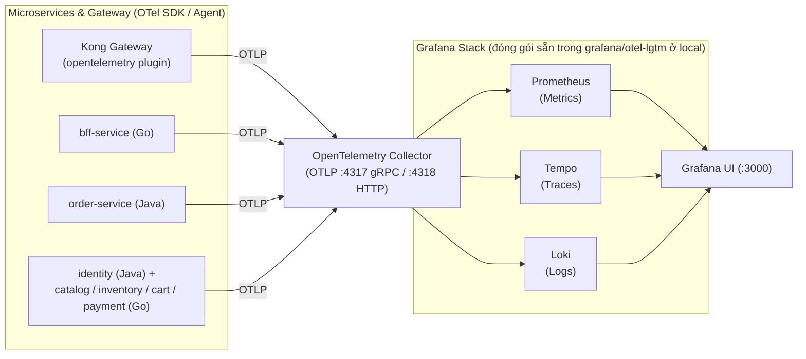

# Observability cho Microservices: OpenTelemetry, Grafana Stack vs ELK và Truy vết xuyên Outbox/RabbitMQ

Tài liệu này tổng hợp hiện trạng giám sát của hệ thống, đối chiếu các Observability Stack phổ biến trong thực tế (**Grafana LGTM**, **ELK/OpenSearch**, **Datadog**, **ClickHouse + SigNoz**), và cung cấp thiết kế chi tiết kèm mã nguồn mẫu để tích hợp **OpenTelemetry (OTel)** xuyên suốt `Kong -> BFF -> gRPC -> Transactional Outbox -> RabbitMQ -> Consumers`.

---

## 1. Hiện trạng Observability trong Repository

Hệ thống hiện chưa cài đặt OpenTelemetry hay cụm giám sát tập trung (Prometheus/Grafana/Loki/Tempo/ELK), mà đang vận hành bằng cơ chế tương quan thủ công nhẹ:

| Trụ cột | Cơ chế hiện tại | Vị trí tiêu biểu | Giới hạn |
| --- | --- | --- | --- |
| **Tracing / Correlation** | Truyền chuỗi `X-Trace-Id` (HTTP) và `x-trace-id` (gRPC metadata); `order-service` đọc từ SLF4J `MDC` ghi vào cột `correlation_id` và `payload.correlationId` của bảng `outbox_events`. | `bff-service/internal/http/respond.go`, `order-service/.../GrpcTraceIdInterceptor.java`, `identity-service/.../TraceIdFilter.java` | Chỉ có 1 mã chuỗi đơn để lọc log; chưa có chuẩn W3C `traceparent`, chưa đo độ trễ từng bước (Span) và chưa có UI xem cây gọi phân tán. |
| **Logging** | Java dùng SLF4J/Logback (gắn `MDC trace_id`), Go dùng `log/slog` và `log` chuẩn, xuất thẳng ra `stdout`. | Tất cả 7 services | Log nằm rời rạc trên từng terminal/container, chưa gom tập trung. |
| **Metrics & Health** | Java bật `spring-boot-starter-actuator` với `include: health,info`; Go mở endpoint `/healthz`, `/readyz`. | `services/*/application.yml`, các HTTP health handler của Go | Chưa expose `/actuator/prometheus` hay `/metrics` cho Prometheus. |

### Phân biệt `correlation_id` và `aggregate_id` trong `outbox_events`

Trong bảng `outbox_events` của `order-service`:

- **`aggregate_id` (`orderId`)** gom **toàn bộ sự kiện trong suốt vòng đời một đơn hàng** (đặt đơn lúc 10:00, auto-confirm lúc 10:01, hủy đơn lúc 10:15, MoMo IPN đến muộn lúc 10:16).
- **`correlation_id`** gom **đúng một hành động / một request cụ thể** (ví dụ duy nhất lệnh `POST /api/v1/orders` lúc 10:00 hoặc duy nhất một lần gọi webhook MoMo). Nếu một request làm phát sinh nhiều event bù trừ liên tiếp (`ReservationReleaseRequested` + `PaymentCancelRequested`), tất cả đều chia sẻ chung `correlation_id` để truy ngược nguyên nhân gốc qua cả ranh giới bất đồng bộ của RabbitMQ (nơi ngữ cảnh HTTP/gRPC ban đầu đã kết thúc).

---

## 2. Đối chiếu các Observability Stack trong Thực tế

### 2.1. Xu hướng chung của ngành

- **OpenTelemetry (OTel)** đã trở thành mẫu số chung (~76–77% tổ chức đầu tư hoặc vận hành production) cùng với **Prometheus** (~77% cho metrics) nhằm tránh phụ thuộc nhà cung cấp (*vendor lock-in*).
- Nhiều tổ chức vận hành mô hình **hybrid** (trung bình ~8 công cụ), phổ biến nhất là kết hợp: **Prometheus + Grafana** (Metrics/Alerting) + **Loki hoặc ELK/OpenSearch** (Logs) + **Tempo/Jaeger** (Traces) + **Sentry** (Exception tracking).

### 2.2. So sánh 4 kiến trúc phổ biến

| Tiêu chí | **Grafana LGTM Stack** *(Prometheus/Mimir + Loki + Tempo + Grafana)* | **ELK / OpenSearch** *(Elasticsearch + Fluent Bit/Logstash + Kibana)* | **Datadog** *(SaaS thương mại)* | **ClickHouse + SigNoz** *(Columnar OTel-native)* |
| --- | --- | --- | --- | --- |
| **Tài nguyên (RAM/CPU)** | **Rất nhẹ** (viết bằng Go; cụm local `otel-lgtm` chỉ tốn ~300–600 MB RAM). | **Nặng** (Elasticsearch/JVM dễ ngốn 2–4 GB+ RAM và nhiều dung lượng đĩa do full-text index). | Không tốn hạ tầng tự host (SaaS). | Nhẹ hơn ELK rõ rệt nhờ nén cột của ClickHouse (gấp 5–10 lần). |
| **3 trụ cột (Logs + Metrics + Traces)** | Đồng nhất 1 UI Grafana: nhảy trực tiếp từ đỉnh latency trên Prometheus $\rightarrow$ Trace ở Tempo $\rightarrow$ Log ở Loki theo `trace_id`. | Mạnh nhất ở **Logs**; Metrics & APM nặng hơn và nhiều tính năng nằm ở bản trả phí. | Toàn diện, dùng ngay (*out-of-the-box*), tương quan cực mượt. | Gom cả 3 trụ cột vào **1 DB ClickHouse duy nhất**, giao diện giống Datadog. |
| **Tìm kiếm Log (Full-text)** | Đánh index theo **label** (`service`, `env`, `level`) rồi quét nén $\rightarrow$ rẻ và nhanh khi lọc theo service + `trace_id`, chậm hơn khi tìm text tự do diện rộng. | **Mạnh nhất** cho full-text search phức tạp, audit log và SIEM. | Tốt, nhưng tính phí theo dung lượng ingest & index. | Truy vấn ad-hoc nhanh trên dữ liệu high-cardinality. |
| **Gánh nặng vận hành & Chi phí** | Dễ bắt đầu ở quy mô nhỏ/vừa; ở quy mô lớn (Mimir/Thanos) đòi hỏi kinh nghiệm SRE. | Tốn công tuning JVM, mapping và ILM (Index Lifecycle Management). | Không cần vận hành nhưng **chi phí tăng rất nhanh** khi scale Kubernetes/custom metrics. | Ít thành phần hơn LGTM (1 DB thay vì 3–4 backend). |

### 2.3. Lựa chọn khuyến nghị cho Repository này

- **Nên chọn OpenTelemetry + Grafana Stack** (local dùng 1 container `grafana/otel-lgtm`, production tách `otel-collector` + `prometheus` + `loki` + `tempo` + `grafana`):
  - Nhẹ RAM khi chạy cùng 7 microservices + PostgreSQL + Redis + RabbitMQ + MinIO + Kong trên máy phát triển.
  - Khớp trực tiếp với hệ sinh thái Spring Boot Actuator và Go `slog`/gRPC.
  - Khớp với lộ trình sản xuất trong [Chuyên đề 06](../architecture-evaluation/06-so-sanh-thuc-te-lo-hong-va-lo-trinh-senior.md).
- Chỉ ưu tiên **ELK/OpenSearch** nếu hệ thống có yêu cầu nặng về full-text search log, audit/SIEM hoặc đã có sẵn đội vận hành Elasticsearch.

---

## 3. OpenTelemetry (OTel) và Vai trò từng Thành phần

OpenTelemetry **không phải** công cụ lưu trữ hay vẽ biểu đồ và **không phải** một microservice nghiệp vụ phải tự lập trình. Nó đóng vai trò như **chuẩn giao tiếp trung lập** gồm 3 phần:

1. **OTel SDK / Agent (nhúng trong từng service)**: Thu thập Traces, Metrics, Logs và gửi bất đồng bộ theo chuẩn **OTLP** (`:4317` gRPC / `:4318` HTTP).
2. **Context Propagation (chuẩn W3C `traceparent`)**: Tự động truyền `trace_id` + `span_id` qua HTTP headers, gRPC metadata và AMQP headers để dựng biểu đồ thác nước (*waterfall*) đo thời gian từng bước.
3. **OpenTelemetry Collector / `grafana/otel-lgtm` (container hạ tầng có sẵn)**: Tương tự PostgreSQL, RabbitMQ hay Kong — chỉ kéo Docker image về chạy để hứng dữ liệu OTLP, xử lý batch và đẩy vào backend lưu trữ/hiển thị.

> **Cô lập lỗi (Fault Isolation):** Vì OTel SDK gửi dữ liệu theo batch bất đồng bộ ở luồng nền, ngay cả khi container `otel-lgtm` bị tắt hoặc gặp sự cố, toàn bộ 7 microservice nghiệp vụ vẫn hoạt động bình thường và không làm lỗi luồng đặt hàng.



---

## 4. Thiết kế Tích hợp Chi tiết (Kèm Mã nguồn Mẫu)

### 4.1. Hạ tầng Docker Compose & Kong

Thêm 1 container `grafana/otel-lgtm` vào `deployments/docker/compose.foundation.yml`:

```yaml
  otel-lgtm:
    image: grafana/otel-lgtm:latest
    container_name: ecommerce-otel-lgtm
    ports:
      - "3000:3000"   # Grafana UI (mặc định admin / admin)
      - "4317:4317"   # OTLP gRPC cho Java / Go services
      - "4318:4318"   # OTLP HTTP cho Kong / Java Agent / NestJS
    networks:
      - ecommerce-net
```

Bật plugin global trong `deployments/kong/kong.yaml`:

```yaml
plugins:
  - name: opentelemetry
    config:
      endpoint: http://otel-lgtm:4318/v1/traces
      header_type: w3c
      resource_attributes:
        service.name: kong-gateway
```

---

### 4.2. Các Go Services (`bff`, `catalog`, `inventory`, `cart`, `payment`)

#### Quyết định không tạo Shared Go Package

Với quy mô 5 service Go, đặt 1 file nhỏ độc lập `internal/telemetry/otel.go` (~65 dòng) trong từng service thường tốt hơn việc tạo thêm Go module dùng chung:
- Giữ mỗi microservice độc lập 100%, không làm phức tạp `go.mod`, build context của từng `Dockerfile` hay quy tắc ranh giới (`make check-boundaries`).
- Code khởi tạo OTel rất ổn định; mọi thông số thay đổi theo môi trường (endpoint, sampling) đều cấu hình qua biến môi trường `OTEL_*`.

#### File `internal/telemetry/otel.go` (mẫu dùng trong từng Go service)

```go
package telemetry

import (
	"context"
	"log/slog"
	"os"
	"time"

	"go.opentelemetry.io/otel"
	"go.opentelemetry.io/otel/exporters/otlp/otlpmetric/otlpmetricgrpc"
	"go.opentelemetry.io/otel/exporters/otlp/otlptrace/otlptracegrpc"
	"go.opentelemetry.io/otel/propagation"
	sdkmetric "go.opentelemetry.io/otel/sdk/metric"
	"go.opentelemetry.io/otel/sdk/resource"
	sdktrace "go.opentelemetry.io/otel/sdk/trace"
	semconv "go.opentelemetry.io/otel/semconv/v1.26.0"
	"go.opentelemetry.io/otel/trace"
)

func Init(ctx context.Context, serviceName, otlpEndpoint string) (func(context.Context) error, error) {
	if otlpEndpoint == "" {
		otlpEndpoint = "127.0.0.1:4317"
	}

	res, err := resource.New(ctx, resource.WithAttributes(semconv.ServiceName(serviceName)))
	if err != nil {
		return nil, err
	}

	traceExp, err := otlptracegrpc.New(ctx,
		otlptracegrpc.WithEndpoint(otlpEndpoint),
		otlptracegrpc.WithInsecure(),
	)
	if err != nil {
		return nil, err
	}
	tp := sdktrace.NewTracerProvider(
		sdktrace.WithBatcher(traceExp),
		sdktrace.WithResource(res),
	)

	metricExp, err := otlpmetricgrpc.New(ctx,
		otlpmetricgrpc.WithEndpoint(otlpEndpoint),
		otlpmetricgrpc.WithInsecure(),
	)
	if err != nil {
		return nil, err
	}
	mp := sdkmetric.NewMeterProvider(
		sdkmetric.WithReader(sdkmetric.NewPeriodicReader(metricExp, sdkmetric.WithInterval(10*time.Second))),
		sdkmetric.WithResource(res),
	)

	otel.SetTracerProvider(tp)
	otel.SetMeterProvider(mp)
	otel.SetTextMapPropagator(propagation.NewCompositeTextMapPropagator(
		propagation.TraceContext{},
		propagation.Baggage{},
	))

	base := slog.NewJSONHandler(os.Stdout, nil)
	slog.SetDefault(slog.New(&traceSlogHandler{Handler: base}))

	return func(shutdownCtx context.Context) error {
		_ = mp.Shutdown(shutdownCtx)
		return tp.Shutdown(shutdownCtx)
	}, nil
}

type traceSlogHandler struct{ slog.Handler }

func (h *traceSlogHandler) Handle(ctx context.Context, r slog.Record) error {
	sc := trace.SpanFromContext(ctx).SpanContext()
	if sc.IsValid() {
		r.AddAttrs(
			slog.String("trace_id", sc.TraceID().String()),
			slog.String("span_id", sc.SpanID().String()),
		)
	}
	return h.Handler.Handle(ctx, r)
}
```

#### Gắn vào HTTP, gRPC và đồng bộ `X-Trace-Id` trong `bff-service`

```go
// cmd/server/main.go
shutdownTelemetry, err := telemetry.Init(ctx, "bff-service", cfg.OTLPEndpoint)
if err != nil {
    return err
}
defer func() { _ = shutdownTelemetry(context.Background()) }()

// gRPC Client (tự inject traceparent + xuất metrics gRPC)
orderConn, err := grpc.NewClient(
    cfg.OrderGRPCAddr,
    grpc.WithTransportCredentials(insecure.NewCredentials()),
    grpc.WithStatsHandler(otelgrpc.NewClientHandler()),
)

// HTTP Server (tự extract traceparent từ Kong + mở root/child span)
tracedHandler := otelhttp.NewHandler(router, "bff.http")

// Tại các gRPC Server (catalog, inventory, cart, payment):
grpcServer := grpc.NewServer(grpc.StatsHandler(otelgrpc.NewServerHandler()))
```

Đồng bộ `X-Trace-Id` trong `bff-service/internal/http/respond.go` để mã `traceId` trả về client trùng khớp 1-1 với Trace ID trong Grafana Tempo:

```go
func correlateTrace(next http.Handler) http.Handler {
	return http.HandlerFunc(func(w http.ResponseWriter, r *http.Request) {
		var traceID string
		if sc := trace.SpanFromContext(r.Context()).SpanContext(); sc.IsValid() {
			traceID = sc.TraceID().String()
		} else {
			traceID = resolveTraceID(r.Header.Get(traceHeader))
		}

		ctx := context.WithValue(r.Context(), traceIDKey{}, traceID)
		outgoing, _ := metadata.FromOutgoingContext(ctx)
		outgoing = outgoing.Copy()
		outgoing.Set(traceMetadataKey, traceID)
		ctx = metadata.NewOutgoingContext(ctx, outgoing)

		w.Header().Set(traceHeader, traceID)
		next.ServeHTTP(w, r.WithContext(ctx))
	})
}
```

---

### 4.3. Các Java Services (`order-service`, `identity-service` — Spring Boot 4.1)

Có hai phương án cho Java:

- **Phương án A (Spring Boot Starter — tường minh khi chạy từ IDE)**:
  Thêm `spring-boot-starter-opentelemetry` và `opentelemetry-grpc-1.6` (vì service dựng `grpc-netty-shaded` trực tiếp):

  ```xml
  <dependency>
      <groupId>org.springframework.boot</groupId>
      <artifactId>spring-boot-starter-opentelemetry</artifactId>
  </dependency>
  <dependency>
      <groupId>io.opentelemetry.instrumentation</groupId>
      <artifactId>opentelemetry-grpc-1.6</artifactId>
      <version>2.12.0-alpha</version>
  </dependency>
  ```

  Cấu hình trong `application.yml`:

  ```yaml
  management:
    otlp:
      tracing:
        endpoint: ${OTEL_EXPORTER_OTLP_ENDPOINT:http://127.0.0.1:4318}/v1/traces
      metrics:
        export:
          url: ${OTEL_EXPORTER_OTLP_ENDPOINT:http://127.0.0.1:4318}/v1/metrics
    tracing:
      sampling:
        probability: 1.0 # 1.0 ở local; production giảm xuống 0.1 hoặc dùng tail-sampling

  logging:
    pattern:
      level: "%5p [${spring.application.name:order-service},%X{traceId:-},%X{spanId:-}]"
  ```

  Gắn interceptor vào Netty gRPC Server/Client và đồng bộ `TraceIdProvider`:

  ```java
  // GrpcServerLifecycle & GrpcClientConfig
  GrpcTelemetry grpcTelemetry = GrpcTelemetry.create(openTelemetry);
  // Server: .intercept(grpcTelemetry.newServerInterceptor())
  // Client: .intercept(grpcTelemetry.newClientInterceptor())

  // TraceIdProvider.current()
  public static String current() {
      SpanContext sc = Span.current().getSpanContext();
      if (sc.isValid()) {
          return sc.getTraceId();
      }
      String traceId = MDC.get(MDC_KEY);
      return traceId == null || traceId.isBlank() ? newTraceId() : traceId;
  }
  ```

- **Phương án B (Zero-code Java Agent — lý tưởng cho container Docker)**:
  Gắn `-javaagent:opentelemetry-javaagent.jar` kèm `-Dotel.service.name=order-service` và `-Dotel.exporter.otlp.endpoint=http://otel-lgtm:4318`. Agent tự động bắt HTTP, gRPC, JDBC/PostgreSQL, RabbitMQ và MDC log mà không cần thêm dependency.

---

### 4.4. Mở rộng Đa ngôn ngữ (Polyglot — ví dụ thêm NestJS)

Khi bổ sung service bằng ngôn ngữ khác (như NestJS/Node.js), hạ tầng `otel-lgtm` không cần thay đổi. Chỉ cần cài SDK của ngôn ngữ đó để dùng chung chuẩn W3C `traceparent` và đẩy OTLP về `:4318`:

```ts
// src/telemetry.ts (import ở dòng đầu tiên của src/main.ts)
import { NodeSDK } from '@opentelemetry/sdk-node';
import { getNodeAutoInstrumentations } from '@opentelemetry/auto-instrumentations-node';
import { OTLPTraceExporter } from '@opentelemetry/exporter-trace-otlp-http';

const sdk = new NodeSDK({
  serviceName: 'notification-service',
  traceExporter: new OTLPTraceExporter({
    url: process.env.OTEL_EXPORTER_OTLP_ENDPOINT ?? 'http://localhost:4318/v1/traces',
  }),
  instrumentations: [getNodeAutoInstrumentations()],
});

sdk.start();
```

---

### 4.5. Nối Trace xuyên qua Transactional Outbox và RabbitMQ

Vì `OutboxRelayScheduler` chạy ở thread nền sau khi DB transaction đã commit, trace sẽ bị đứt nếu không lưu lại `traceparent` trong bảng outbox.

1. **Migration additive (`order_db`)**:
   ```sql
   ALTER TABLE outbox_events
       ADD COLUMN traceparent VARCHAR(128) NOT NULL DEFAULT '';
   ```

2. **Chụp `traceparent` khi ghi Outbox (`OrderTransactionStepService.saveOutboxEvent`)**:
   ```java
   private String captureCurrentTraceparent() {
       Map<String, String> carrier = new HashMap<>();
       openTelemetry.getPropagators().getTextMapPropagator()
               .inject(io.opentelemetry.context.Context.current(), carrier, Map::put);
       return carrier.getOrDefault("traceparent", "");
   }
   ```

3. **Khôi phục ngữ cảnh và gắn vào AMQP Header (`OutboxRelayScheduler.publishWithConfirm`)**:
   ```java
   io.opentelemetry.context.Context parentCtx = openTelemetry.getPropagators()
           .getTextMapPropagator()
           .extract(io.opentelemetry.context.Context.root(),
                   Map.of("traceparent", row.traceparent()),
                   MAP_GETTER);

   Span span = tracer.spanBuilder("outbox.publish " + row.routingKey())
           .setParent(parentCtx)
           .setSpanKind(SpanKind.PRODUCER)
           .setAttribute("messaging.system", "rabbitmq")
           .setAttribute("messaging.destination.name", RabbitMqConfig.EXCHANGE_NAME)
           .setAttribute("messaging.rabbitmq.destination.routing_key", row.routingKey())
           .startSpan();

   try (Scope ignored = span.makeCurrent()) {
       MessageProperties props = new MessageProperties();
       // ... các property hiện có ...
       openTelemetry.getPropagators().getTextMapPropagator()
               .inject(io.opentelemetry.context.Context.current(), props,
                       (p, k, v) -> p.setHeader(k, v));

       Message message = new Message(row.payload().getBytes(StandardCharsets.UTF_8), props);
       rabbitTemplate.send(RabbitMqConfig.EXCHANGE_NAME, row.routingKey(), message, cd);
   } finally {
       span.end();
   }
   ```

4. **Extract `traceparent` tại Go Consumer (`cart-service`, `inventory-service`, `payment-service`)**:
   ```go
   type amqpHeaderCarrier amqp.Table

   func (c amqpHeaderCarrier) Get(key string) string {
       if v, ok := c[key].(string); ok {
           return v
       }
       return ""
   }
   func (c amqpHeaderCarrier) Set(key, val string) { c[key] = val }
   func (c amqpHeaderCarrier) Keys() []string {
       keys := make([]string, 0, len(c))
       for k := range c {
           keys = append(keys, k)
       }
       return keys
   }

   func (c *Consumer) handleDelivery(ctx context.Context, ch *amqp.Channel, msg amqp.Delivery) {
       extractedCtx := otel.GetTextMapPropagator().Extract(ctx, amqpHeaderCarrier(msg.Headers))
       spanCtx, span := otel.Tracer("cart-service").Start(
           extractedCtx,
           "cart.consume "+msg.RoutingKey,
           trace.WithSpanKind(trace.SpanKindConsumer),
       )
       defer span.End()

       if err := DispatchMessage(spanCtx, c.handler, msg.RoutingKey, msg.Body); err != nil {
           span.RecordError(err)
           span.SetStatus(codes.Error, err.Error())
       }
       // ... ack / retry / DLQ ...
   }
   ```

Kết quả trên Grafana Tempo là một cây trace liền mạch duy nhất từ HTTP ingress tới tận consumer bất đồng bộ:

```text
TraceID: 4bf92f3577b34da6a3ce929d0e0e4736
├── kong-gateway: POST /api/v1/orders ......................... 185ms
│   └── bff-service: POST /api/v1/orders ...................... 178ms
│       └── order-service: OrderService/CreateOrder ........... 170ms
│           ├── identity-service: CheckPermission .............  12ms
│           ├── catalog-service: GetProduct ...................  18ms
│           ├── PostgreSQL: INSERT orders + outbox_events .....   9ms
│           ├── inventory-service: ReserveStock ...............  28ms
│           └── outbox.publish order.placed ...................   4ms
│               └── cart-service: cart.consume order.placed ...  14ms
```

---

## 5. Quan hệ giữa OpenTelemetry và REST Contract (`traceId` / `X-Trace-Id`)

OpenTelemetry **không phụ thuộc vào JSON body của REST contract** vì toàn bộ việc lan truyền ngữ cảnh đi qua transport headers (`traceparent`). Tuy nhiên, việc phơi bày `traceId` ra phía client vẫn rất hữu ích cho vận hành:

- **Response thành công (`2xx`)**: Không nên nhét `traceId` vào JSON body để giữ payload nghiệp vụ sạch; trả qua HTTP response header (`X-Trace-Id`) là đủ.
- **Response lỗi (`4xx` / `5xx`)**: Nên giữ trường `"traceId"` trong error envelope (`{ "code", "message", "errors", "traceId" }`) để người dùng, QA hoặc bộ phận hỗ trợ có thể gửi kèm mã tra cứu, giúp kỹ sư tìm chính xác trace/log trong Grafana trong vài giây.
- **Hệ thống cũ chưa có `traceId` trong body**: Không cần thay đổi phá vỡ contract JSON; chỉ cần bổ sung header `X-Trace-Id` ở HTTP response là đủ và hoàn toàn tương thích ngược.
