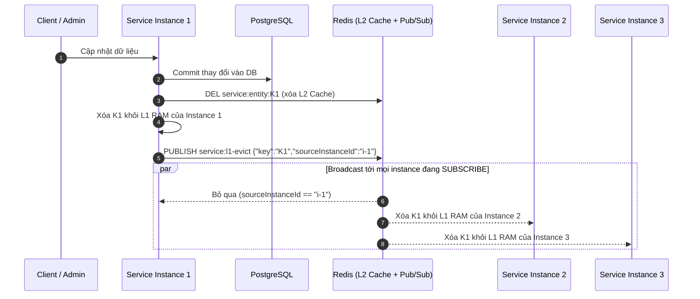
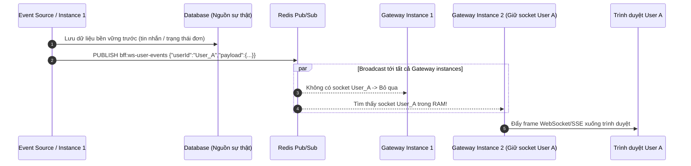

# Kiến trúc Messaging & Caching: RabbitMQ, Redis và In-Memory Cache (Tài liệu tham khảo mở rộng)

Tài liệu này tổng hợp nguyên tắc lựa chọn giữa **RabbitMQ**, **Redis (`Key-Value` / `Pub/Sub` / `Streams`)** và **In-Memory Cache trên RAM của tiến trình (`Caffeine` / Go LRU)**, kèm mẫu thiết kế chuẩn để triển khai khi mở rộng hệ thống lên nhiều instance.

---

## 1. Phân biệt RabbitMQ và các chế độ bên trong Redis

Một tiến trình Redis (`:6379`) cung cấp nhiều nhóm lệnh độc lập với ngữ nghĩa hoàn toàn khác nhau:

| Công nghệ / Chế độ | Lệnh / Giao thức | Lưu trữ bền vững | Chia tải nhiều instance (Competing Consumers) | Cơ chế phân phối | Bài toán phù hợp |
| --- | --- | --- | --- | --- | --- |
| **RabbitMQ** *(Event Bus chính)* | AMQP `0-9-1` (`ecommerce.events`) | Có (lưu đĩa tới khi `ACK`, có `DLX`/`DLQ`) | **Có** (nhiều instance cùng đọc 1 queue, mỗi tin chỉ giao 1 instance) | Định tuyến qua `Topic Exchange` tới từng queue độc lập | Giao dịch bất đồng bộ liên service, Saga compensation, trừ/hoàn kho, xóa giỏ hàng, thanh toán. |
| **Redis Key-Value** *(L2 Cache)* | `GET`, `SET`, `DEL` | Trong RAM của Redis (theo TTL) | Dùng chung kho dữ liệu tập trung | Truy xuất trực tiếp theo key | Cache phân tán dùng chung giữa mọi instance của 1 service, rate limiting, session/token ngắn hạn. |
| **Redis Pub/Sub** *(Ephemeral Broadcast)* | `PUBLISH`, `SUBSCRIBE` | **Không** (*fire-and-forget*, không lưu key, không `ACK`, không `DLQ`) | **Không** (nhân bản tin nhắn tới **tất cả** kết nối đang `SUBSCRIBE`) | Phát quảng bá (*broadcast*) thời gian thực (`< 1ms`) | Xóa Local Cache L1 trên RAM của mọi replica; đẩy sự kiện realtime ra kết nối WebSocket/SSE đang mở ở replica bất kỳ. |
| **Redis Streams** | `XADD`, `XREADGROUP`, `XACK` | Có (append-only log trong Redis) | Có (qua Consumer Group) | Đọc theo nhóm kèm Pending List | Hàng đợi nội bộ nhẹ khi không có sẵn message broker chuyên dụng (không ưu tiên trong repo này vì đã có RabbitMQ). |

### Nguyên tắc ranh giới dịch vụ (Service Boundaries)

- **Giao tiếp bất đồng bộ giữa các service khác nhau (Cross-Service):** Bắt buộc đi qua **RabbitMQ** (`ecommerce.events`) kèm Transactional Outbox và xử lý idempotent ở consumer. Không dùng Redis Pub/Sub để truyền domain event giữa hai microservice khác nhau.
- **Đồng bộ nội bộ giữa các replica của cùng một service (Intra-Service Multi-Instance):** Được phép dùng **Redis Pub/Sub** với prefix kênh thuộc quyền sở hữu riêng của service đó (ví dụ `catalog:l1-evict`, `identity:rbac-evict`, `bff:ws-fanout`) để đồng bộ trạng thái chỉ tồn tại trong RAM của từng process.

---

## 2. Topology RabbitMQ chuẩn hiện tại

Hệ thống áp dụng mô hình **1 Topic Exchange dùng chung + 1 Queue riêng cho mỗi Consumer Service**:

- **Exchange chính:** `ecommerce.events` (`topic`, `durable = true`) — đóng vai trò bộ định tuyến trung tâm dựa trên `routing_key` phân cấp (`order.placed`, `order.confirmed`, `payment.succeeded`, ...).
- **Dead-Letter Exchange:** `ecommerce.events.dlx` (`topic`, `durable = true`) — gom các message lỗi vĩnh viễn hoặc vượt quá số lần retry vào `<queue-name>.dlq`.
- **Tách Queue giữa các service khác nhau** (`inventory.order-events`, `cart.order-events`, `payment.order-events`, `order.payment-events`):
  - Đảm bảo một sự kiện (như `order.confirmed`) được nhân bản đầy đủ cho cả `inventory-service` lẫn `cart-service`.
  - Cho phép mỗi service scale nhiều instance độc lập (chia tải trên cùng queue của service đó) và cô lập lỗi/tốc độ xử lý.
- **Gộp các event cùng tính chất vào 1 Queue trong cùng 1 service:** Khi các handler có thời gian thực thi ngắn tương đương và dùng chung chính sách `QoS` / retry / `DLQ`. Chỉ tách thêm queue mới trong cùng một service nếu phát sinh tác vụ nặng kéo dài gây nghẽn (*head-of-line blocking*) các sự kiện giao dịch nhanh.

---

## 3. In-Memory Cache (RAM của App) vs Redis (kể cả khi đặt cùng 1 Server)

Ngay cả khi ứng dụng và Redis chạy chung trên một máy chủ (`127.0.0.1`), chúng vẫn là **hai tiến trình hệ điều hành tách biệt**:

| Tiêu chí | In-Memory trong RAM của App (L1) | Redis trên cùng hoặc khác Server (L2) |
| --- | --- | --- |
| **Độ trễ đọc & CPU** | `~50 – 100 ns` (`0.0001 ms`), trỏ trực tiếp object có sẵn trong RAM, **không tốn CPU serialize/parse JSON**. | `~0.05 – 0.2 ms` (localhost) hoặc `~0.5 – 1 ms` (LAN), tốn system call qua OS kernel và chi phí serialize/deserialize. |
| **Khi Restart / Deploy App** | **Mất sạch 100% cache** (*Cold Cache*), dễ gây tải đột biến xuống PostgreSQL ngay sau khi khởi động lại. | **Giữ nguyên 100% cache** (*Warm Cache*) vì Redis chạy ở tiến trình độc lập. |
| **Áp lực Garbage Collector (GC)** | Dữ liệu lớn làm phình Heap của JVM/Go, khiến GC phải quét nhiều object sống dai và có thể gây *GC pause*. | Tách hoàn toàn khỏi Heap của App; kiểm soát trần bộ nhớ an toàn bằng `maxmemory` + `allkeys-lru`. |
| **Khi nào nên chọn** | Dữ liệu nhỏ (`< 50MB`), ít thay đổi, tần suất đọc cực cao (danh mục Tỉnh/Phường, JWKS public key, cấu hình, quyền RBAC). | Dữ liệu lớn, thay đổi thường xuyên, trạng thái cần sống qua lúc redeploy (rate-limit counter, session/token, query nặng) hoặc dùng chung cho nhiều replica. |

---

## 4. Công cụ In-Memory Cache chuẩn trong Java và Go

Không sử dụng `HashMap` (Java) hoặc `map[K]V` trần (Go) làm cache trong server đa luồng vì:
1. **Lỗi đồng thời:** `map` trần trong Go gây `panic` sập tiến trình ngay khi vừa đọc vừa ghi song song; `HashMap` trong Java gây sai lệch dữ liệu ngầm.
2. **Rò rỉ bộ nhớ (`OutOfMemory`):** Kể cả `ConcurrentHashMap` (Java) hay `sync.Map` (Go) cũng không có cơ chế tự hết hạn (**TTL**) hay giới hạn số lượng phần tử (**Max Size / Eviction**).

### Trong Java (Spring Boot)
- **Bảng tĩnh cố định, rất nhỏ:** Dùng `ConcurrentHashMap<K, V>`.
- **Cache thực thụ:** Dùng **`Caffeine`** (`com.github.ben-manes.caffeine:caffeine`) — thư viện chuẩn với thuật toán **W-TinyLFU**, hỗ trợ sẵn giới hạn kích thước, TTL và khóa chống *Cache Stampede* theo từng key:

```java
Cache<String, Product> cache = Caffeine.newBuilder()
        .maximumSize(10_000)
        .expireAfterWrite(Duration.ofSeconds(60))
        .build();

// Nếu nhiều thread cùng hỏi 1 id đang trống, chỉ 1 thread gọi xuống DB:
Product product = cache.get(productId, id -> productRepository.findById(id));
cache.invalidate(productId);
```

### Trong Go
- **Cache thực thụ có Generics, TTL và giới hạn kích thước:** Dùng **`hashicorp/golang-lru/v2/expirable`** (gọn nhẹ) hoặc **`maypok86/otter`** (tải cực lớn, dùng W-TinyLFU tương đương Caffeine), kết hợp `golang.org/x/sync/singleflight` để chống *Cache Stampede*:

```go
cache := expirable.NewLRU[string, Product](10_000, nil, 60*time.Second)

if p, ok := cache.Get(skuID); ok {
    return p, nil
}
// Khi cache miss, bọc lời gọi DB bằng singleflight.Group theo skuID trước khi cache.Add(...)
```

- **Tập key rất nhỏ và không muốn thêm dependency:** Bọc `map[string]entry` bằng `sync.RWMutex` (`RLock` khi đọc, `Lock` khi ghi) kèm trường `expiresAt time.Time`.

---

## 5. Ba chiến lược Cache khi chạy nhiều Instance Backend

Khi chạy nhiều replica của cùng một service, mỗi replica nắm một vùng RAM (`Caffeine` / Go LRU) độc lập. Tùy yêu cầu nhất quán dữ liệu, chọn một trong ba chiến lược sau:

1. **Chiến lược A — Chỉ dùng Local Cache L1 với TTL ngắn (`5s – 30s`):**
   - Dùng cho dữ liệu nhỏ, đọc nhiều và **chấp nhận trễ vài giây** giữa các instance (danh mục địa giới hành chính, danh sách hiển thị trang chủ). Không cần Redis hay Pub/Sub.
2. **Chiến lược B — Chỉ dùng Redis Cache L2 tập trung (không dùng L1):**
   - Dùng khi dữ liệu **lớn** (tránh nhân bản tốn RAM trên từng instance), tần suất sửa liên tục, cần nhất quán ngay sau `DEL key` và độ trễ `~0.5 – 1 ms` của Redis đã đáp ứng tốt SLA. Đây là lựa chọn mặc định đơn giản và an toàn nhất khi scale ngang.
3. **Chiến lược C — Two-Level Cache (`L1 RAM` + `L2 Redis` + `Redis Pub/Sub` xóa L1):**
   - Chỉ áp dụng cho dữ liệu vừa cần tốc độ đọc nano-giây (`0.0001 ms`) vừa đòi hỏi vô hiệu hóa gần như tức thời trên mọi replica (ví dụ thu hồi quyền RBAC, khóa tài khoản, đổi cấu hình nóng).

### Luồng chuẩn của Chiến lược C (Two-Level Cache Invalidation)



**Quy tắc cài đặt bắt buộc cho Chiến lược C:**
- **Thứ tự ghi/xóa:** Commit DB $\rightarrow$ `DEL` trên L2 Redis $\rightarrow$ xóa L1 cục bộ $\rightarrow$ `PUBLISH` thông báo xóa L1.
- **Chống tự xóa lặp:** Đính kèm `sourceInstanceId` (UUID sinh lúc khởi động process) để bỏ qua tin nhắn do chính mình phát ra.
- **Fallback an toàn:** Luôn giữ TTL ngắn (`30s – 120s`) và `maximumSize` trên L1; nếu kết nối `SUBSCRIBE` bị đứt và kết nối lại, phải gọi `invalidateAll()` toàn bộ L1 ngay sau khi nối lại thành công.

---

## 6. Mẫu thiết kế WebSocket / SSE Realtime trên nhiều Instance

### Bài toán
Kết nối WebSocket hoặc Server-Sent Events (SSE) là kết nối TCP có trạng thái (*stateful*), gắn cố định trình duyệt của người dùng vào **một instance cụ thể** sau Load Balancer. Khi sự kiện phát sinh ở một instance khác (hoặc từ RabbitMQ consumer chạy ở một instance bất kỳ), instance đó không giữ đối tượng socket của người nhận trong RAM nên cần Redis Pub/Sub để chuyển tiếp tới tất cả gateway replicas.

### Luồng hoạt động chuẩn



### Quy tắc cài đặt bắt buộc
1. **Persist-first (Lưu bền vững trước khi phát Pub/Sub):** Tuyệt đối không dùng Redis Pub/Sub làm nơi duy nhất giữ dữ liệu quan trọng. Trạng thái đơn hàng hoặc tin nhắn phải nằm trong PostgreSQL trước; nếu sự kiện bắt nguồn từ service khác (như `order-service`), hãy tiêu thụ từ RabbitMQ rồi mới đẩy sang Redis Pub/Sub nội bộ của tầng giữ WebSocket.
2. **Cơ chế tự hồi phục phía Frontend:** Khi trình duyệt mất mạng và kết nối lại WebSocket/SSE, frontend cần gọi lại REST API để bù những sự kiện phát ra trong lúc rớt mạng.
3. **Tách riêng kết nối Redis cho `SUBSCRIBE`:** Trên giao thức Redis (đặc biệt RESP2), một kết nối đã vào chế độ `SUBSCRIBE` chỉ được phép nhận tin Pub/Sub, không thể dùng chung để gọi `GET`/`SET`/`DEL`. Luôn khởi tạo client/connection riêng cho subscriber loop.
4. **Bảo vệ vòng lặp đọc Pub/Sub:** Không thực hiện tác vụ I/O chặn lâu trực tiếp trên luồng đọc kênh Pub/Sub; đẩy vào buffer có giới hạn của từng kết nối WebSocket để một client chậm không làm nghẽn các user khác trên cùng instance.
