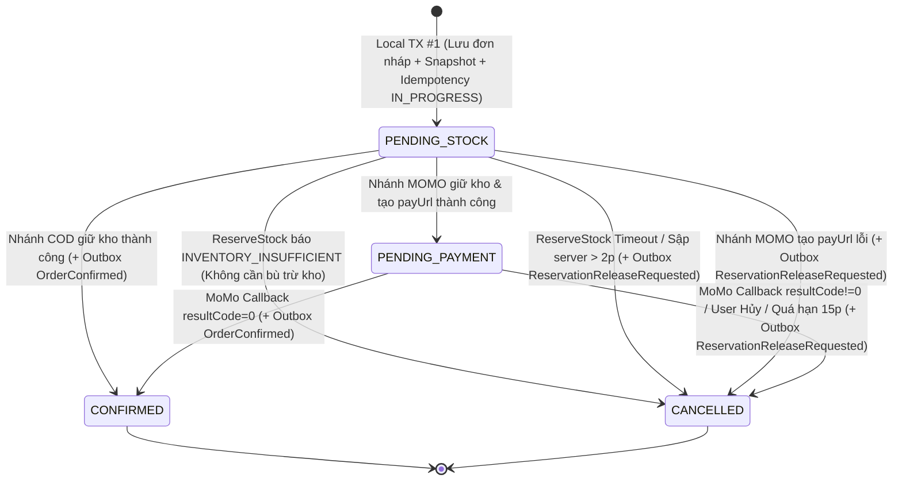
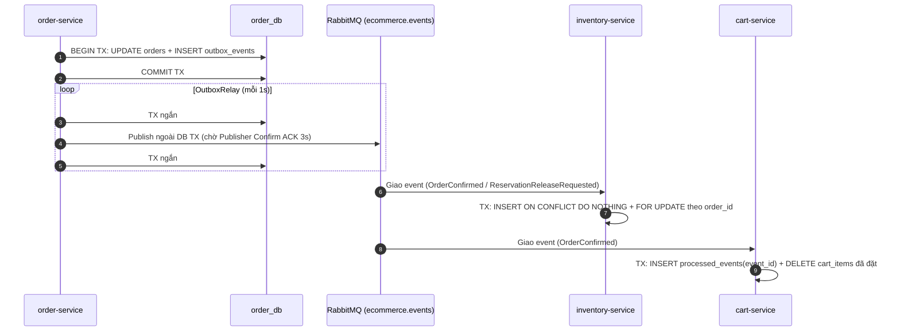

# Thiết Kế & Phân Tích Kỹ Thuật Chuyên Sâu: Hệ Thống Đặt Hàng Đa Sản Phẩm, Nhất Quán Snapshot, Thanh Toán COD/MoMo & Saga Chống Race Condition

## 1. Bối Cảnh & Mục Đích (Intent and Why)

Hiện tại luồng mua sắm của gian hàng đã hoàn thiện tới bước quản lý giỏ hàng (`cart-service`) và giao diện xem trước đơn hàng sơ khởi (`OrderPreviewPage`), nhưng chuỗi giá trị cốt lõi nhất của thương mại điện tử là **Đặt hàng & Thanh toán (Order & Checkout)** vẫn đang bỏ trống:

1. `order-service` mới chỉ là một Spring Boot skeleton khởi chạy cổng quản trị `:8093`, cơ sở dữ liệu `order_db` đã cấp phát nhưng chưa có lược đồ, chưa có gRPC server hay kết nối RabbitMQ.
2. `inventory-service` mới quản lý số lượng tồn vật lý (`quantity`) và tra cứu khả dụng theo từng SKU (`GetAvailability`, `BatchGetAvailability`), chưa hiện thực hóa vòng đời giữ chỗ (`stock_reservations`), xác nhận khấu trừ hay hoàn trả tồn kho bất đồng bộ.
3. `OrderPreviewPage` trên `ecommerce-fe` mới đọc địa chỉ đơn lẻ từ hồ sơ cá nhân (`CurrentUser`) thay vì kết nối sổ địa chỉ giao hàng (`/api/v1/users/me/addresses` đã có sẵn trên `identity-service`), chưa có lựa chọn phương thức thanh toán (`COD`, `MOMO`), và nút đặt hàng chỉ hiển thị thông báo tạm.
4. Giữa thời điểm khách hàng mở trang xem trước đơn hàng và thời điểm bấm nút xác nhận đặt hàng tồn tại một khoảng trễ suy nghĩ của con người (*human think-time* từ vài giây tới hàng chục phút). Trong khoảng thời gian đó, quản trị viên có thể vừa cập nhật giá, đổi tên, chỉnh sửa phân loại hoặc ngừng kinh doanh sản phẩm; đồng thời hàng chục khách hàng khác có thể cùng bấm mua những đơn vị tồn kho cuối cùng.

Tài liệu này đặc tả toàn diện thiết kế kiến trúc, phân tích chuyên sâu các công nghệ phân tán áp dụng, ma trận xử lý sự cố / cạnh tranh đa luồng (*race conditions*), các đánh đổi kỹ thuật (*trade-offs*) và kế hoạch kiểm chứng tải đa luồng cho tính năng Đặt hàng xuyên suốt `identity-service`, `contracts`, `catalog-service`, `inventory-service`, `cart-service`, `order-service`, `bff-service`, Kong và `ecommerce-fe`.

---

## 2. Mục Tiêu, Phi Mục Tiêu & Phản Mục Tiêu (Goals, Non-Goals, Anti-Goals)

### 2.1. Mục tiêu (Goals)
- **Đặt hàng nhiều sản phẩm từ giỏ hàng qua bước Xem trước (`OrderPreviewPage`)**:
  - Hỗ trợ chọn nhiều dòng sản phẩm khả dụng trong `CartPage` để chuyển sang `OrderPreviewPage` (`/gio-hang/dat-hang`).
  - Tích hợp sổ địa chỉ giao hàng từ `identity-service` (`/api/v1/users/me/addresses`): cho phép chọn địa chỉ có sẵn, thêm nhanh địa chỉ mới ngay tại màn hình xem trước (hoặc tự động kế thừa thông tin từ hồ sơ nếu sổ địa chỉ trống).
  - Hỗ trợ chọn 2 phương thức thanh toán: **Thanh toán khi nhận hàng (`COD`)** và **Ví điện tử `MOMO` (`captureWallet` v2)**.
- **Bất biến hóa dữ liệu lịch sử (Immutable Order Snapshots)**:
  - Lưu trữ độc lập toàn bộ bản chụp tại thời điểm tạo đơn trong `order_db`: thông tin từng dòng SKU đặt mua (`product_id`, `sku_id`, tên sản phẩm, thương hiệu, danh mục, nhãn biến thể, mã màu, ảnh đại diện, đơn giá của SKU, thành tiền), bản chụp địa chỉ nhận hàng (người nhận, số điện thoại, mã & tên tỉnh/thành, mã & tên phường/xã, địa chỉ chi tiết), phí vận chuyển, tổng thanh toán và thông tin giao dịch thanh toán. Mọi thay đổi về sau bên `catalog-service` hay sổ địa chỉ `identity-service` không làm biến đổi đơn hàng lịch sử.
- **Bảo chứng tính nhất quán giữa Xem trước và Đặt hàng (Preview-to-Order Consistency)**:
  - Phát hiện chính xác 100% trường hợp một hoặc nhiều sản phẩm trong đơn vừa bị cập nhật (đổi giá, đổi tên, xóa biến thể, xóa mềm ngừng bán, hoặc tăng `version` danh mục) kể từ lúc hiển thị ở trang xem trước.
  - Khi phát hiện sai lệch, từ chối tạo đơn ngay lập tức với mã lỗi ổn định `PRODUCT_SNAPSHOT_MISMATCH` (`HTTP 409`), trả kèm danh sách chi tiết từng sản phẩm và lý do thay đổi để giao diện hiển thị cảnh báo rõ ràng và điều hướng người dùng quay lại giỏ hàng (`/gio-hang`) thao tác lại.
- **Chống bán vượt tồn kho (Anti-Oversell) & Chịu lỗi phân tán**:
  - Tuyệt đối không để xảy ra `reserved > quantity` hoặc tồn kho khả dụng âm dưới tải đa luồng cao.
  - Đảm bảo tính lũy đẳng (**Idempotency**) chống tạo đơn trùng khi người dùng bấm đúp hoặc mạng tự thử lại; đảm bảo không rò rỉ tồn kho giữ chỗ (*stock leak*) khi tiến trình sập nguồn, đứt mạng gRPC, lỗi cổng MoMo hoặc hết hạn thanh toán 15 phút.
- **Bộ công cụ mô phỏng đa luồng (Concurrency & Race-Condition Simulation Suite)**:
  - Cung cấp bộ kịch bản kiểm thử đa luồng tự động tái hiện và kiểm chứng bằng số liệu thực tế các tình huống tranh chấp: Flash-sale tranh kho cuối, Admin cập nhật giá giữa lúc khách thanh toán, bão retry `Idempotency-Key`, và đua tranh đồng thời giữa `momo-redirect` / `momo-ipn` / tiến trình hủy quá hạn.

### 2.2. Phi mục tiêu (Non-Goals)
- Không tách một `payment-service` hay `saga-service` độc lập ở giai đoạn này; `order-service` đóng vai trò chủ sở hữu vòng đời đơn hàng kiêm bộ điều phối Saga theo đúng [ADR-001](../../adr/001-service-boundaries.md) và [ADR-005](../../adr/005-saga-compensation-and-reservation-lifecycle.md).
- Không triển khai mã giảm giá (voucher/coupon), chia tách một đơn thành nhiều kiện giao hàng khác kho, hoặc hoàn tiền tự động qua API Refund của MoMo (các ca thanh toán đến muộn sau khi đơn đã hủy sẽ được ghi nhận trạng thái đối soát hoàn tiền thủ công).
- Không hỗ trợ đặt hàng cho khách vãng lai chưa đăng nhập (*guest checkout*).

### 2.3. Phản mục tiêu (Anti-Goals)
- **Không giữ khóa cơ sở dữ liệu trong lúc người dùng xem trang Xem trước**: Tuyệt đối không dùng `SELECT ... FOR UPDATE` hay giữ chỗ tồn kho ngay khi khách vừa mở `OrderPreviewPage` (gây cạn kiệt connection pool và tấn công từ chối dịch vụ tồn kho khi khách mở trang rồi bỏ đó).
- **Không dùng giao thức 2PC / XA Distributed Transaction** xuyên PostgreSQL của nhiều service hoặc qua RabbitMQ/MoMo ([ADR-002](../../adr/002-transactional-outbox.md)).
- **Không mở DB Transaction của `order-service` bọc ra ngoài lời gọi mạng** (`gRPC` sang `Catalog`/`Inventory`/`Identity` hoặc `HTTPS` sang `MoMo`), tuân thủ nghiêm ngặt `services/order-service/AGENTS.md`.
- **Không tin tưởng mù quáng dữ liệu giá/phí ship từ trình duyệt để tính tiền mà không thẩm định lại**, và **không tin tưởng query string `resultCode=0` trên URL redirect MoMo nếu chưa xác thực chữ ký `HmacSHA256`**.

---

## 3. Ràng Buộc Kiến Trúc (Architectural Constraints)

Thiết kế tuân thủ toàn bộ các ADR và quy tắc ranh giới đã được chấp thuận trong kho mã nguồn:
- **Ranh giới dịch vụ & Kiểm tra tự động (`make check-boundaries`)**:
  - Không import code chéo giữa các service, không truy cập chéo cơ sở dữ liệu (`order_db`, `inventory_db`, `catalog_db`, `cart_db`, `identity_db` hoàn toàn tách biệt).
  - Không chứa chuỗi kết nối gọi nội bộ vòng qua Kong (`:8000`) bên trong mã nguồn hoặc cấu hình runtime của `services/*`.
- **Định tuyến biên (`ADR-011`)**:
  - Mọi thao tác đặt hàng và tra cứu đơn của `ecommerce-fe` đi qua Kong → `bff-service` (`/api/v1/orders...`) với plugin `caller-context` xác thực JWT.
  - Hai đầu mối nhận phản hồi từ cổng MoMo (`/api/v1/payments/momo-redirect` và `/api/v1/payments/momo-ipn`) không mang JWT người dùng nên được mở qua route công khai riêng trên Kong có gắn `request-transformer` xóa sạch header giả mạo `X-User-Id`, `X-User-Roles`, chuyển tiếp vào `bff-service` → `order-service` gRPC và bắt buộc xác thực chữ ký `HmacSHA256`.
  - Bổ sung header `Idempotency-Key` vào danh sách CORS `headers` cho phép trên `deployments/kong/kong.yaml`.
- **Tương thích hợp đồng (`ADR-006`, `ADR-013`, `docs/steering/api-contracts.md`)**:
  - Mọi cập nhật trong `contracts/proto/**/*.proto` kế thừa mô hình thuần SKU (`ADR-013`) phải là thay đổi cộng thêm (*additive*), giữ nguyên tên và số thứ tự các trường hiện có để vượt qua `buf format`, `buf lint`, `buf generate` và `make verify SERVICE=contracts`.
  - Mọi phản hồi REST giữ chuẩn envelope `{ "data": ..., "message": "..." }` và lỗi `{ "code": "...", "message": "...", "errors": {...}, "traceId": "..." }`.

---

## 4. Phân Tích Chuyên Sâu Các Phương Án & Lựa Chọn Công Nghệ (Approaches & Deep Technical Analysis)

### 4.1. Các phương án điều phối đã cân nhắc

#### Phương án 1 (Được chọn): Hybrid — Thẩm định Snapshot & Giữ kho đồng bộ qua gRPC kết hợp Transactional Outbox / RabbitMQ Saga cho Chốt đơn, Nhả kho & Dọn giỏ hàng
- **Cơ chế**:
  1. Khi nhận lệnh `CreateOrder`, `order-service` kiểm tra `Idempotency-Key`, kiểm tra quyền `order.create` qua `identity-service` gRPC, và gọi `catalog-service` gRPC kiểm tra phiên bản `version` + đối chiếu snapshot sản phẩm. Nếu lệch, trả ngay `409 PRODUCT_SNAPSHOT_MISMATCH`.
  2. Ghi nhận đơn ở trạng thái nháp ý định `PENDING_STOCK` (Local TX ngắn), sau đó gọi `inventory-service` gRPC `ReserveStock` để giữ chỗ nguyên tử trong `inventory_db`. Nếu thiếu hàng, chuyển đơn sang `CANCELLED` và trả ngay `409 INVENTORY_INSUFFICIENT`.
  3. Nếu giữ kho thành công:
     - Với `COD`: chuyển đơn sang `CONFIRMED` và ghi sự kiện `OrderConfirmed` vào bảng `outbox_events` trong cùng 1 transaction. Worker nền đẩy sự kiện lên RabbitMQ để `inventory-service` khấu trừ kho thật và `cart-service` xóa các dòng sản phẩm đã đặt.
     - Với `MOMO`: gọi HTTPS sang cổng MoMo v2 lấy `payUrl`, chuyển đơn sang `PENDING_PAYMENT` (hạn giữ kho 15 phút) và trả `payUrl` ngay cho trình duyệt chuyển hướng. Khi nhận `momo-redirect` / `momo-ipn` hoặc khi chạm mốc 15 phút quá hạn, `order-service` dùng khóa dòng `SELECT ... FOR UPDATE` chốt một trạng thái duy nhất (`CONFIRMED` hoặc `CANCELLED`) và ghi Outbox tương ứng (`OrderConfirmed` hoặc `ReservationReleaseRequested`).
- **Lý do chọn**: Phản hồi lỗi lệch giá và lỗi hết hàng tức thì ngay trên trang Xem trước; lấy được `payUrl` MoMo chỉ trong 1 lượt bấm nút; tuyệt đối không bao giờ đẩy người dùng sang MoMo quét mã trả tiền cho một mặt hàng đã hết kho; đồng thời vẫn đảm bảo tính nhất quán cuối cùng chống kẹt kho 100% nhờ Outbox + Saga Compensation + Reconciliation Job.
- **Đánh đổi chấp nhận**: Thêm một cuộc gọi gRPC nội bộ tới `inventory-service` trong đường đi của lệnh đặt hàng (độ trễ mạng nội bộ vài mili-giây, giới hạn bằng deadline cứng `1.5s`, fail-closed không lặp retry đồng bộ theo [ADR-004](../../adr/004-circuit-breaker-fallback-policy.md)).

#### Phương án 2 (Loại bỏ): Pure Asynchronous Choreography — Trả `202 PENDING_STOCK` ngay, giữ kho hoàn toàn qua RabbitMQ rồi Frontend phải Polling mới lấy được link MoMo
- **Cơ chế**: `CreateOrder` chỉ lưu `PENDING_STOCK` + Outbox `OrderCreated` rồi trả về ngay. `inventory-service` tiêu thụ sự kiện giữ kho rồi bắn ngược `InventoryReserved`; lúc đó `order-service` mới gọi MoMo tạo `payUrl`.
- **Lý do loại bỏ**: Làm đứt gãy trải nghiệm người dùng ở bước thanh toán MoMo (trình duyệt phải hiện màn hình chờ và liên tục hỏi vòng `/api/v1/orders/{id}` mới biết còn hàng hay hết hàng và mới lấy được `payUrl`), đồng thời làm luồng sự kiện bị phân mảnh qua lại ("Event Ping-Pong") khó kiểm soát lỗi.

#### Phương án 3 (Loại bỏ): Giao dịch phân tán 2PC/3PC (Two/Three-Phase Commit) hoặc Khóa phân tán Redis thuần túy
- **Lý do loại bỏ**:
  - `2PC/XA` khóa cứng tài nguyên xuyên nhiều cơ sở dữ liệu qua mạng và bất khả thi khi tích hợp cổng thanh toán bên ngoài như MoMo; vi phạm trực tiếp [ADR-002](../../adr/002-transactional-outbox.md).
  - Dùng `Redis Distributed Lock` thay cho kiểm tra tại DB có nguy cơ bán âm kho khi JVM/Go dừng thu gom rác (*GC Pause*), trôi đồng hồ hoặc hết hạn lease trước khi DB kịp commit; vi phạm [ADR-003](../../adr/003-redis-lock-vs-db-invariant.md).

---

### 4.2. Phân tích chuyên sâu 6 trụ cột kỹ thuật áp dụng

#### Trụ cột 1: Cross-Service Optimistic Snapshot Verification (`products.version` + Field Diff)
- **Bài toán**: Không thể dùng khóa bi quan giữ dòng sản phẩm trong lúc khách đang đọc trang xem trước, nhưng nếu chỉ so sánh `updated_at` kiểu giây/mili-giây vẫn có xác suất va chạm thời gian (*timestamp collision*), còn nếu tăng `version` trên mọi thay đổi của bảng `products` (kể cả khi tăng `sold_count` hay `review_count`) thì việc khách A mua hàng sẽ làm hỏng phiên đặt hàng của khách B một cách vô lý.
- **Giải pháp**:
  1. Bổ sung cột `version BIGINT NOT NULL DEFAULT 1` trên bảng `products` của `catalog_db`.
  2. Cột `version` **chỉ tăng nguyên tử (`version = version + 1`)** khi có thay đổi thuộc tính thương mại do quản trị viên thực hiện (`UpdateProduct`: tên, mô tả, thương hiệu, danh mục, giá bán, giá gốc, ảnh, video, danh sách biến thể; và `SoftDeleteProduct`: ẩn/khôi phục sản phẩm).
  3. Khi `cart-service` làm giàu dữ liệu giỏ hàng từ `CatalogService.GetProduct`, trường `productVersion` được đính kèm vào từng `CartItem` trả về `ecommerce-fe`.
  4. Khi bấm đặt hàng, `ecommerce-fe` gửi kèm kỳ vọng của từng dòng (`skuId`, `expectedProductVersion`, `unitPrice`, `expectedName`, `variantLabel`). `order-service` đối chiếu trực tiếp với bản ghi mới nhất từ `CatalogService.GetProduct` và khớp biến thể trong `product.variants` theo `sku_id`:
     - Sản phẩm không tồn tại hoặc `deleted == true` $\rightarrow$ báo `UNAVAILABLE` (*"Sản phẩm đã ngừng kinh doanh"*).
     - `skuId` không còn nằm trong danh sách biến thể `product.variants` hiện hữu của sản phẩm $\rightarrow$ báo `VARIANT_UNAVAILABLE` (*"Phân loại bạn chọn không còn tồn tại"*).
     - `matchedVariant.price != expected.unitPrice` $\rightarrow$ báo `PRICE_CHANGED` (*"Giá phân loại vừa thay đổi từ X sang Y"*).
     - `live.name != expected.name` hoặc `matchedVariant.label != expected.variantLabel` $\rightarrow$ báo `INFO_UPDATED` (*"Tên sản phẩm hoặc nhãn phân loại vừa được cập nhật"*).
     - `live.version != expected.productVersion` (ví dụ đổi danh mục/thông tin thương mại khác) $\rightarrow$ báo `VERSION_CHANGED` (*"Thông tin sản phẩm vừa được cập nhật mới"*).
  - Nhờ kết hợp cả **số hiệu phiên bản đơn điệu (`version`)** và **giá trị bản chụp kỳ vọng theo từng `sku_id`**, hệ thống vừa bắt trúng 100% thay đổi danh mục, vừa giải thích rõ ràng cho người dùng biết **chính xác điều gì vừa thay đổi**.

#### Trụ cột 2: Anti-Oversell bằng Ràng buộc Bất biến PostgreSQL & Thứ tự Khóa Tất định Theo `sku_id` (`ADR-003`, `ADR-013`)
- **Cơ chế nguyên tử**:
  Theo [ADR-013](../../adr/013-variant-sku-pricing-and-inventory.md), mỗi phân loại biến thể (`ProductVariant`) sở hữu một dòng tồn kho độc lập `stock(sku_id)`. Trong `inventory_db`, việc giữ chỗ cho một đơn hàng nhiều dòng diễn ra trong một transaction ngắn duy nhất:
  1. Gom nhóm cộng dồn số lượng theo `sku_id` (đảm bảo nếu cùng một `sku_id` xuất hiện nhiều lần trong payload thì tổng `requested` được kiểm tra trong một lần chạm khóa duy nhất, trong khi hai phân loại khác nhau của cùng `product_id` rút từ hai dòng `stock(sku_id)` độc lập).
  2. **Sắp xếp danh sách `sku_id` theo thứ tự từ điển tăng dần (`ORDER BY sku_id ASC`)** trước khi chạy vòng lặp `UPDATE`. Quy tắc này triệt tiêu hoàn toàn nguy cơ **Deadlock chéo** khi Đơn 1 mua `(SKU_A, SKU_B)` cùng lúc Đơn 2 mua `(SKU_B, SKU_A)`.
  3. Với mỗi `sku_id`, chạy câu lệnh điều kiện nguyên tử:
     ```sql
     UPDATE stock
     SET reserved = reserved + $2,
         updated_at = now()
     WHERE sku_id = $1
       AND (quantity - reserved) >= $2
     RETURNING quantity, reserved;
     ```
     Engine của PostgreSQL tự động áp đặt khóa ghi cấp dòng (*Row-Level Exclusive Lock*) lên dòng `sku_id`, buộc các giao dịch đồng thời phải xếp hàng tuần tự và đánh giá lại biểu thức `(quantity - reserved) >= $2` trên dữ liệu mới nhất vừa commit (*Read Committed Re-evaluation*). Nếu bất kỳ SKU nào trả về `0 rows`, toàn bộ transaction `ROLLBACK` ngay lập tức.
  4. Ràng buộc cứng `CHECK (reserved >= 0 AND reserved <= quantity)` ở tầng bảng là chốt chặn vật lý cuối cùng.

#### Trụ cột 3: Saga Orchestration tích hợp Ngữ nghĩa TCC (Try - Confirm - Cancel) ngay trong `order-service`

- **Tại sao không tách `saga-service` riêng?**: Trạng thái của đơn hàng chính là trạng thái của phiên giao dịch Saga. Đặt bộ điều phối ngay trong `order-service` giúp ghi nguyên tử trạng thái đơn và sự kiện điều phối vào cùng `order_db` mà không sinh thêm một bước đồng bộ mạng dư thừa.

#### Trụ cột 4: Khóa Bi quan `SELECT ... FOR UPDATE` + Kiểm tra Trạng thái Nguồn trên MỌI Bước Chuyển & `@Version`
- Không chỉ ở giai đoạn hậu tạo đơn (`momo-redirect`, `momo-ipn`, thao tác Hủy đơn của người dùng, `OrderReconciliationScheduler`), mà **ngay cả các bước chuyển từ `PENDING_STOCK` trong orchestrator** (`PENDING_STOCK → CONFIRMED`, `PENDING_STOCK → PENDING_PAYMENT`, `PENDING_STOCK → CANCELLED`) cũng bắt buộc nạp dòng qua `SELECT ... FROM orders WHERE id = :id FOR UPDATE` (hoặc `UPDATE ... WHERE id = :id AND status = :expectedStatus`) và kiểm tra khớp trạng thái nguồn:
  - Kết hợp timeout cứng trên `MomoGatewayClient` (`connectTimeout = 3s`, `readTimeout = 10s`, nhỏ hơn hẳn ngưỡng `2 phút` của `OrderReconciliationScheduler`), nếu vì bất kỳ lý do gì đơn `PENDING_STOCK` đã bị tiến trình đối soát hủy trước (`status == CANCELLED`), bước chuyển sang `PENDING_PAYMENT` thấy không còn ở `PENDING_STOCK` sẽ dừng lại ngay, **không ghi đè trạng thái và tuyệt đối không trả `payUrl` cho khách** (chặn đứng nguy cơ khách thanh toán cho đơn đã nhả kho).
  - Ở giai đoạn `PENDING_PAYMENT`, luồng vào đầu tiên giữ khóa dòng, kiểm tra `status == PENDING_PAYMENT`, chuyển sang trạng thái đích (`CONFIRMED` hoặc `CANCELLED`), chèn bản ghi `outbox_events` tương ứng và commit; các luồng đến sau thấy trạng thái mới nhất không còn là `PENDING_PAYMENT` nên thoát an toàn.
- Trường `@Version` của JPA được giữ trên `OrderEntity` như lớp phòng vệ chiều sâu (*defense-in-depth*).

#### Trụ cột 5: Transactional Outbox (Lease-Claim không giữ TX qua mạng) + Idempotency theo `order_id` & Tombstone (`ADR-002`, `ADR-005`)

- **Không giữ DB Transaction qua lời gọi RabbitMQ**: `OutboxRelayScheduler` dùng 1 transaction ngắn (`~1ms`) để claim batch (`FOR UPDATE SKIP LOCKED`, đẩy `next_attempt_at = now() + 15s`) và `COMMIT` ngay trước khi gửi mạng sang RabbitMQ, sau đó mở transaction ngắn thứ hai đánh dấu `published_at = now()`, tuân thủ tuyệt đối quy tắc không giữ kết nối DB qua I/O mạng của `order-service`.
- **Khóa chống lỗi `23505` & Bia mộ (Tombstone) bằng `INSERT ... ON CONFLICT DO NOTHING`**: Trong PostgreSQL `READ COMMITTED`, `SELECT ... FOR UPDATE` không khóa được dòng chưa tồn tại. Do đó cả `ReserveStock` lẫn consumer `ReservationReleaseRequested` bên `inventory-service` đều chạy `INSERT INTO stock_reservations ... ON CONFLICT (order_id) DO NOTHING` **trước**, rồi mới `SELECT ... FOR UPDATE` khi dòng đã tồn tại: vừa triệt tiêu lỗi trùng khóa `23505` khi gói giữ kho trễ đụng độ gói hủy song song, vừa cắm sẵn bia mộ `RELEASED` chặn đứng gói `ReserveStock` đến muộn mà không cần thêm bảng `processed_events` hay `outbox_events` dư thừa bên `inventory-service`.

#### Trụ cột 6: Bảo mật hai chiều chữ ký `HmacSHA256` cho cổng thanh toán MoMo v2
- Tham khảo từ luồng `captureWallet` hiện hữu của hệ thống mẫu nhưng **nâng cấp toàn diện về bảo mật và kiến trúc gateway**:
  1. **Chiều đi (`CreatePayment`)**: Ký `HmacSHA256` bằng `MOMO_SECRET_KEY` trên chuỗi khóa sắp xếp đúng chuẩn MoMo v2:
     `accessKey=$accessKey&amount=$amount&extraData=$extraData&ipnUrl=$ipnUrl&orderId=$momoOrderId&orderInfo=$orderInfo&partnerCode=$partnerCode&redirectUrl=$redirectUrl&requestId=$requestId&requestType=captureWallet`
  2. **Chiều về (`momo-redirect` & `momo-ipn`)**: **Bắt buộc tái tạo và đối chiếu chữ ký `signature` bằng hằng thời gian (`MessageDigest.isEqual`)** trên chuỗi phản hồi chuẩn của MoMo v2:
     `accessKey=$accessKey&amount=$amount&extraData=$extraData&message=$message&orderId=$momoOrderId&orderInfo=$orderInfo&orderType=$orderType&partnerCode=$partnerCode&payType=$payType&requestId=$requestId&responseTime=$responseTime&resultCode=$resultCode&transId=$transId`
     Đồng thời đối chiếu `amount` trả về phải khớp tuyệt đối với `order.total_amount_minor`. Nhờ vậy, kẻ tấn công không thể tự gõ `?orderId=...&resultCode=0` lên thanh địa chỉ trình duyệt để chiếm đoạt đơn hàng chưa thanh toán.

---

## 5. Thiết Kế Chi Tiết Từng Phân Hệ (Surface-by-Surface Specification)

### 5.1. `identity-service` — Phân quyền RBAC cho Đơn hàng
- **Flyway Migration (`services/identity-service/src/main/resources/db/migration/V12__add_order_permissions.sql`)**:
  - Thêm 3 quyền hệ thống vào `auth_items` (`type = 'PERMISSION'`, `system_item = true`):
    - `order.create`: Tạo đơn hàng mới.
    - `order.view`: Xem danh sách và chi tiết đơn hàng cá nhân.
    - `order.cancel`: Hủy đơn hàng cá nhân khi đang ở trạng thái chờ thanh toán (`PENDING_PAYMENT`).
  - Gán cả 3 quyền cho vai trò `CUSTOMER` trong `auth_item_children` (`ON CONFLICT DO NOTHING`). Tài khoản chỉ mang vai trò quản trị (`ADMIN` đơn thuần không kiêm `CUSTOMER`) sẽ bị từ chối đặt hàng trên storefront (`403 ORDER_PERMISSION_DENIED`), nhất quán với chính sách của giỏ hàng và danh sách yêu thích.

### 5.2. `contracts` — Hợp đồng Protobuf Cộng thêm (Additive Only)

#### a) `contracts/proto/catalog/v1/catalog.proto`
- Giữ nguyên toàn bộ trường hiện có (kể cả `max_price` và `sku_ids` từ `ADR-013`), bổ sung trường phiên bản sản phẩm:
  - `GetProductResponse`: thêm `int64 version = 24;`
  - `ProductSummary`: thêm `int64 version = 19;`
  - `AdminProductSummary`: thêm `int64 version = 24;`

#### b) `contracts/proto/cart/v1/cart.proto`
- Trên `CartItem`: thêm `int64 product_version = 17;`

#### c) `contracts/proto/inventory/v1/inventory.proto`
- Chỉ bổ sung vào `InventoryService` duy nhất 1 RPC nội bộ phục vụ giữ chỗ đồng bộ theo SKU (việc chốt kho và nhả kho đi hoàn toàn qua sự kiện RabbitMQ, không mở RPC dư thừa):
  ```protobuf
  rpc ReserveStock(ReserveStockRequest) returns (ReserveStockResponse);
  ```
- Các message mới:
  - `ReservationLine { string sku_id = 1; string product_id = 2; int32 quantity = 3; }`
  - `ReserveStockRequest { string order_id = 1; repeated ReservationLine items = 2; string expires_at = 3; }`
  - `ReserveStockResponse { string order_id = 1; string status = 2; }`
- Khi thiếu hàng, `ReserveStock` trả `codes.FailedPrecondition` đính kèm `google.rpc.ErrorInfo`:
  - `Reason = "INVENTORY_INSUFFICIENT"`, `Domain = "ecommerce.inventory.v1"`, `Metadata = { "sku_id": "...", "product_id": "...", "available": "...", "requested": "..." }`.
- Khi `order_id` đã bị cắm Tombstone `RELEASED`, trả `codes.FailedPrecondition` với `Reason = "RESERVATION_ALREADY_RELEASED"`.

#### d) `contracts/proto/order/v1/order.proto`
- Bảo toàn tuyệt đối số thứ tự các trường gốc hiện có (`1..4` trên `OrderItem`, `1..2` trên `CreateOrderRequest`, `1..3` trên `CreateOrderResponse`):
  ```protobuf
  service OrderService {
    rpc CreateOrder(CreateOrderRequest) returns (CreateOrderResponse);
    rpc GetOrder(GetOrderRequest) returns (GetOrderResponse);
    rpc ListOrders(ListOrdersRequest) returns (ListOrdersResponse);
    rpc CancelOrder(CancelOrderRequest) returns (CancelOrderResponse);
    rpc HandleMomoCallback(HandleMomoCallbackRequest) returns (HandleMomoCallbackResponse);
  }

  message ShippingAddressSnapshot {
    string recipient_name = 1;
    string phone = 2;
    string province_code = 3;
    string province_name = 4;
    string ward_code = 5;
    string ward_name = 6;
    string address_line = 7;
    string label = 8;
  }

  message OrderItem {
    string product_id = 1;
    string sku_id = 2;
    int32 quantity = 3;
    ecommerce.common.v1.Money unit_price = 4;
    string cart_item_id = 5;
    string variant_label = 6;
    string expected_name = 7;
    int64 expected_product_version = 8;
    string variant_color_hex = 9;
    string image_url = 10;
    string brand = 11;
    string category_name = 12;
    string image_emoji = 13;
    repeated uint32 image_hue = 14;
    ecommerce.common.v1.Money line_total = 15;
  }

  message CreateOrderRequest {
    string user_id = 1;
    repeated OrderItem items = 2;
    string idempotency_key = 3;
    ShippingAddressSnapshot shipping_address = 4;
    string payment_method = 5; // "COD" | "MOMO"
    string note = 6;
  }

  message OrderDetail {
    string order_id = 1;
    string order_code = 2;
    string user_id = 3;
    string status = 4;          // PENDING_STOCK | PENDING_PAYMENT | CONFIRMED | CANCELLED
    string payment_method = 5;  // COD | MOMO
    string payment_status = 6;  // UNPAID | PENDING | PAID | FAILED | REFUND_REQUIRED
    ShippingAddressSnapshot shipping_address = 7;
    repeated OrderItem items = 8;
    ecommerce.common.v1.Money subtotal = 9;
    ecommerce.common.v1.Money shipping_fee = 10;
    ecommerce.common.v1.Money total_amount = 11;
    string note = 12;
    string pay_url = 13;
    string cancel_reason = 14;
    string payment_expires_at = 15;
    string created_at = 16;
    string updated_at = 17;
  }

  message CreateOrderResponse {
    string order_id = 1;
    string status = 2;
    ecommerce.common.v1.Money total_amount = 3;
    OrderDetail order = 4;
    string pay_url = 5;
  }
  ```
  *(Kèm các message `GetOrderRequest/Response`, `ListOrdersRequest/Response` có phân trang `page, page_size, status`, `CancelOrderRequest/Response`, `HandleMomoCallbackRequest/Response` truyền đầy đủ tham số callback MoMo để xác thực chữ ký).*

### 5.3. `catalog-service` — Quản lý Phiên bản Danh mục (`version`)
- **Migration `000006_add_product_version.up.sql`**:
  ```sql
  ALTER TABLE products
      ADD COLUMN version bigint NOT NULL DEFAULT 1;
  ```
- Trong `internal/store/`:
  - `GetByID`, `Search`, `ListAdmin`: đọc thêm cột `version` và ánh xạ ra gRPC proto.
  - `UpdateProduct` và `SoftDelete`: cập nhật `version = version + 1, updated_at = now()` nguyên tử trong câu lệnh `UPDATE products`.

### 5.4. `inventory-service` — Giữ chỗ Nguyên tử Theo SKU, Tombstone & RabbitMQ Consumer
- **Migration `000003_create_stock_reservations.up.sql`** (tối giản đúng trách nhiệm giữ chỗ theo khóa nghiệp vụ `order_id` và `sku_id`, không tạo `processed_events` hay `outbox_events` không có consumer tiêu thụ):
  ```sql
  CREATE TABLE stock_reservations (
      order_id text PRIMARY KEY,
      status text NOT NULL CHECK (status IN ('ACTIVE', 'CONFIRMED', 'RELEASED')),
      expires_at timestamptz NOT NULL,
      release_reason text NOT NULL DEFAULT '',
      created_at timestamptz NOT NULL DEFAULT now(),
      updated_at timestamptz NOT NULL DEFAULT now()
  );

  CREATE INDEX ix_stock_reservations_active_expires
      ON stock_reservations (expires_at)
      WHERE status = 'ACTIVE';

  CREATE TABLE stock_reservation_items (
      order_id text NOT NULL REFERENCES stock_reservations(order_id) ON DELETE CASCADE,
      sku_id text NOT NULL,
      product_id text NOT NULL,
      quantity integer NOT NULL CHECK (quantity > 0),
      PRIMARY KEY (order_id, sku_id)
  );
  ```
- **Xử lý `ReserveStock(orderId, items, expiresAt)`**:
  1. Gom nhóm cộng dồn `quantity` theo `sku_id`, sắp xếp tăng dần `ORDER BY sku_id ASC`.
  2. Trong 1 PostgreSQL transaction:
     - Chạy `INSERT INTO stock_reservations (order_id, status, expires_at) VALUES ($1, 'ACTIVE', $2) ON CONFLICT (order_id) DO NOTHING` **trước**:
       - Nếu `RowsAffected() == 0` (đã tồn tại dòng `order_id`): chạy `SELECT status FROM stock_reservations WHERE order_id = $1 FOR UPDATE`:
         - Nếu `status IN ('ACTIVE', 'CONFIRMED')`: trả thành công ngay lập tức (*idempotent replay*).
         - Nếu `status == 'RELEASED'`: trả lỗi `FailedPrecondition` (`RESERVATION_ALREADY_RELEASED`).
     - Nếu `RowsAffected() == 1` (vừa tạo phiếu `ACTIVE` mới và đang giữ khóa dòng): với từng `(sku_id, product_id, qty)` đã sắp xếp `ORDER BY sku_id ASC`, chạy `UPDATE stock SET reserved = reserved + $2, updated_at = now() WHERE sku_id = $1 AND (quantity - reserved) >= $2` và chèn `stock_reservation_items (order_id, sku_id, product_id, quantity)`. Nếu bất kỳ SKU nào không cập nhật được dòng nào $\rightarrow$ truy vấn nhanh `available` hiện tại của `sku_id` đó, `ROLLBACK` toàn bộ transaction và trả `INVENTORY_INSUFFICIENT` kèm metadata `{ "sku_id", "product_id", "available", "requested" }`.
- **RabbitMQ Consumer**:
  - Lắng nghe queue `inventory.order-events` gắn vào Topic Exchange `ecommerce.events` với routing key `order.confirmed` và `order.reservation.release_requested` (kèm Dead-Letter Exchange `ecommerce.events.dlx` / queue `inventory.order-events.dlq` sau tối đa 5 lần thử lại).
  - Với `OrderConfirmed`: khóa dòng `SELECT status FROM stock_reservations WHERE order_id = $1 FOR UPDATE`; nếu đang `ACTIVE` thì trừ `quantity = quantity - qty, reserved = reserved - qty` trên bảng `stock` theo thứ tự `ORDER BY sku_id ASC` và cập nhật `status = 'CONFIRMED'` (nếu đã `CONFIRMED` thì bỏ qua lũy đẳng theo `order_id`).
  - Với `ReservationReleaseRequested`: chạy `INSERT INTO stock_reservations (order_id, status, expires_at, release_reason) VALUES ($1, 'RELEASED', now(), $2) ON CONFLICT (order_id) DO NOTHING`:
    - Nếu `RowsAffected() == 1`: đã cắm xong **Tombstone** `RELEASED` chặn gói `ReserveStock` đến muộn mà không sinh lỗi trùng khóa `23505`.
    - Nếu `RowsAffected() == 0`: đọc `SELECT status FROM stock_reservations WHERE order_id = $1 FOR UPDATE`; nếu đang `ACTIVE` thì giảm `reserved = reserved - qty` trên bảng `stock` theo thứ tự `ORDER BY sku_id ASC` và đổi sang `RELEASED` (nếu đã `RELEASED` hoặc `CONFIRMED` thì bỏ qua).
  - Không chạy thêm worker quét hết hạn song song bên trong `inventory-service` ở giai đoạn hiện tại; việc phát hiện đơn mồ côi (`PENDING_STOCK > 2m`) và quá hạn thanh toán (`PENDING_PAYMENT > 15m`) do `OrderReconciliationScheduler` tại `order-service` điều phối tập trung (Lớp 1).

### 5.5. `cart-service` — Tự động Dọn các dòng sản phẩm đã đặt
- **Migration `000004_create_processed_events.up.sql`**:
  ```sql
  CREATE TABLE processed_events (
      event_id text PRIMARY KEY,
      event_type text NOT NULL,
      processed_at timestamptz NOT NULL DEFAULT now()
  );
  ```
- **Enrichment**: Điền thêm `product_version` từ `CatalogService.GetProduct` vào `CartItem`.
- **RabbitMQ Consumer**:
  - Lắng nghe queue `cart.order-events` trên Topic Exchange `ecommerce.events` với routing key `order.confirmed`.
  - Trong 1 transaction cùng `INSERT INTO processed_events`: xóa đúng các dòng giỏ hàng thuộc `user_id` nằm trong danh sách `cart_item_ids` của sự kiện (hoặc khớp `(user_id, sku_id)` nếu `cart_item_id` trống). Các SKU khách **không tick chọn** trong giỏ được giữ nguyên vẹn. Với đơn MoMo chưa thanh toán hoặc hủy thanh toán, giỏ hàng vẫn được giữ nguyên để khách thuận tiện đặt lại.

### 5.6. `order-service` — Trái tim Điều phối Saga, Snapshot, Idempotency & MoMo
- **Cổng giao tiếp**:
  - HTTP nội bộ `:8083`, Management Actuator `:8093`.
  - Private gRPC Server: local `127.0.0.1:50055`, container `0.0.0.0:50055` (`ORDER_GRPC_HOST`, `ORDER_GRPC_PORT`).
  - Outbound gRPC clients: `Identity` (`50054`, timeout `500ms`), `Catalog` (`50051`, timeout `2s`), `Inventory` (`50052`, gọi đơn 1 lần fail-closed với deadline `1.5s`, không lặp retry đồng bộ).
- **Lược đồ `order_db` (Flyway `V1__create_orders_idempotency_and_outbox.sql`)**:
  - `orders`:
    - `id UUID PRIMARY KEY`
    - `order_code VARCHAR(32) NOT NULL UNIQUE` (ví dụ `ORD-20261028-XXXXXX` dễ đọc cho khách & truyền vào `orderInfo` MoMo)
    - `user_id UUID NOT NULL`
    - `idempotency_key VARCHAR(128) NOT NULL`
    - `status VARCHAR(32) NOT NULL` (`PENDING_STOCK`, `PENDING_PAYMENT`, `CONFIRMED`, `CANCELLED`)
    - `payment_method VARCHAR(16) NOT NULL` (`COD`, `MOMO`)
    - `payment_status VARCHAR(32) NOT NULL` (`UNPAID`, `PENDING`, `PAID`, `FAILED`, `REFUND_REQUIRED`)
    - Bản chụp địa chỉ: `recipient_name`, `recipient_phone`, `province_code`, `province_name`, `ward_code`, `ward_name`, `address_line`, `address_label`
    - Bản chụp tiền tệ (`VND`): `currency`, `subtotal_minor`, `shipping_fee_minor`, `total_amount_minor`
    - Giao dịch MoMo: `momo_request_id`, `momo_order_id`, `momo_trans_id`, `pay_url`, `payment_expires_at`
    - `note TEXT`, `cancel_reason VARCHAR(128)`, `version BIGINT NOT NULL DEFAULT 0` (`@Version`), `created_at`, `updated_at`
    - Ràng buộc duy nhất: `UNIQUE (user_id, idempotency_key)`
  - `order_items`:
    - `id UUID PRIMARY KEY`, `order_id UUID REFERENCES orders(id) ON DELETE CASCADE`, `cart_item_id VARCHAR(64)`, `product_id VARCHAR(128) NOT NULL`, `sku_id VARCHAR(128) NOT NULL`, `product_version BIGINT`, `product_name VARCHAR(255)`, `brand VARCHAR(128)`, `category_name VARCHAR(128)`, `variant_label VARCHAR(128)`, `variant_color_hex VARCHAR(32)`, `image_url TEXT`, `image_emoji VARCHAR(32)`, `image_hue VARCHAR(64)`, `unit_price_minor BIGINT`, `quantity INT`, `line_total_minor BIGINT`.
  - `idempotency_records`:
    - `user_id UUID`, `idempotency_key VARCHAR(128)`, `request_fingerprint VARCHAR(64) NOT NULL`, `status VARCHAR(24) NOT NULL` (`IN_PROGRESS`, `COMPLETED`, `FAILED_TERMINAL`), `order_id UUID`, `response_json JSONB` (lưu kết quả `201` khi `COMPLETED` hoặc chi tiết mã lỗi cuối cùng khi `FAILED_TERMINAL` để replay nhất quán cho cùng một key), `expires_at TIMESTAMPTZ NOT NULL`, `created_at TIMESTAMPTZ NOT NULL`, `updated_at TIMESTAMPTZ NOT NULL`, `PRIMARY KEY (user_id, idempotency_key)`.
  - `outbox_events`:
    - `id UUID PRIMARY KEY`, `event_type VARCHAR(64) NOT NULL`, `event_version INT NOT NULL DEFAULT 1`, `aggregate_id VARCHAR(64) NOT NULL`, `correlation_id VARCHAR(64)`, `payload JSONB NOT NULL`, `attempts INT NOT NULL DEFAULT 0`, `next_attempt_at TIMESTAMPTZ NOT NULL DEFAULT now()`, `published_at TIMESTAMPTZ`, `last_error TEXT`, `created_at TIMESTAMPTZ NOT NULL`.
- **Thời điểm ghi `idempotency_records` (`Local TX #1`), Xử lý Đua tranh Song song & Đối soát (`OrderTransactionStepService` + `OrderReconciliationScheduler`)**:
  - **Không ghi gì trước `Local TX #1`**: Toàn bộ các bước kiểm tra đầu vào, kiểm quyền RBAC (`order.create`), tra cứu nhanh `findRecord(userId, key)` chỉ đọc (nếu key đã tồn tại từ lượt trước) và đối chiếu snapshot với `CatalogService` đều chạy **thuần đọc (read-only)**. Nếu thất bại ở bất kỳ bước nào trước `Local TX #1`, hệ thống trả lỗi ngay mà **không chèn bất kỳ bản ghi nào** vào `idempotency_records` hay `orders`.
  - **Ghi nguyên tử trong `Local TX #1` & Chống lỗi `23505` khi hai request trùng chạy song song**: Bản ghi `idempotency_records` (`status = 'IN_PROGRESS'`) chỉ được chèn **cùng lúc với `orders` (`PENDING_STOCK`) và `order_items` trong `Local TX #1`** bằng câu lệnh chống xung đột:
    ```java
    int inserted = insertIdempotencyIfAbsent(userId, key, fingerprint, orderId, expiresAt);
    // SQL: INSERT INTO idempotency_records (...) VALUES (...) ON CONFLICT (user_id, idempotency_key) DO NOTHING
    if (inserted == 0) {
        // Chưa tạo đơn: kết thúc/rollback TX #1, sau đó đọc dòng đã commit ở ngoài TX #1 để replay
        return replay(findRecord(userId, key), fingerprint);
        // Trả về đúng: REQUEST_IN_PROGRESS | COMPLETED | FAILED_TERMINAL | IDEMPOTENCY_KEY_REUSED
    }
    // inserted == 1 -> chèn orders(PENDING_STOCK) + order_items ngay trong cùng TX #1 rồi commit
    ```
  - **Không tồn tại `IN_PROGRESS` mồ côi tách rời đơn hàng**: Vì `idempotency_records` luôn được tạo cùng transaction với `orders(PENDING_STOCK)`, không cần bước quét orphan riêng; khi `OrderReconciliationScheduler` quét các đơn `PENDING_STOCK` quá **2 phút** (`FOR UPDATE SKIP LOCKED`), nó chuyển đơn sang `CANCELLED`, cập nhật luôn bản ghi `idempotency_records` tương ứng (`WHERE status = 'IN_PROGRESS'`) sang `FAILED_TERMINAL` kèm phản hồi lỗi, và ghi `outbox_events` (`ReservationReleaseRequested`) trong **cùng một DB transaction**.
  - **Khóa dòng kiểm tra trạng thái nguồn trên mọi bước chuyển**: Mọi bước chuyển trong `OrderSagaOrchestrator` (`PENDING_STOCK → CONFIRMED`, `PENDING_STOCK → PENDING_PAYMENT`, `PENDING_STOCK → CANCELLED`) lẫn hậu tạo đơn (`PENDING_PAYMENT → CONFIRMED | CANCELLED`) đều nạp dòng bằng `SELECT ... FOR UPDATE` và kiểm tra khớp trạng thái nguồn mong đợi. Nếu dòng không còn ở `PENDING_STOCK` (ví dụ tiến trình đối soát đã hủy trước), orchestrator dừng ngay, không ghi đè trạng thái và không trả `payUrl` cho khách.
- **Quy tắc tính phí vận chuyển chuẩn tại `order-service`**:
  - Đối chiếu lại ở phía server không phụ thuộc client: `subtotal >= 299_000 VND ? 0 : 25_000 VND`, `total = subtotal + shipping_fee`.
- **Cấu hình MoMo (`application.yml`, `.env` & `scripts/start-local`)**:
  - Đọc từ biến môi trường:
    - `MOMO_PARTNER_CODE` (dev sandbox: `MOMO`)
    - `MOMO_ACCESS_KEY` (nạp từ `.env` local / biến môi trường runtime, không hardcode khóa bí mật vào cấu hình production)
    - `MOMO_SECRET_KEY` (nạp từ `.env` local / biến môi trường runtime)
    - `MOMO_API_ENDPOINT` (mặc định `https://test-payment.momo.vn/v2/gateway/api/create`)
    - `MOMO_CONNECT_TIMEOUT` (`3s`) và `MOMO_READ_TIMEOUT` (`10s`) — giới hạn cứng thời gian chờ HTTPS sang MoMo nhỏ hơn hẳn ngưỡng quét `2 phút` của `PENDING_STOCK`
    - `MOMO_REDIRECT_URL` (local qua `start-local` trỏ về cổng public ingress `/api/v1/payments/momo-redirect`; fallback trong `application.yml` dùng `http://localhost:8081/api/v1/payments/momo-redirect` để tuân thủ quy tắc kiểm tra ranh giới không chứa `:8000` trong `services/*`)
    - `MOMO_IPN_URL` (tương tự trỏ về `/api/v1/payments/momo-ipn`)
    - `MOMO_PAYMENT_TTL` (`15m`)
  - `scripts/start-local` tự động nạp tệp `.env` ở thư mục gốc dự án (nếu tồn tại) khi khởi chạy `make order` / `make bff`, đồng thời cập nhật `.env.example` với đầy đủ tên biến mẫu.
  - Hỗ trợ cờ `ORDER_MOMO_MOCK_ENABLED` (`false` mặc định khi chạy với khóa MoMo sandbox trong `.env`; khi bật `true` trong CI hoặc kịch bản bắn tải đa luồng sẽ ký và mô phỏng `payUrl` nội bộ ngay tại chỗ để tránh chạm giới hạn rate-limit của `test-payment.momo.vn`).

### 5.7. `bff-service` & Kong Gateway — Hợp đồng REST Công khai
- **Kong Routes**:
  - Route bảo vệ `orders-api` (`/api/v1/orders`, gắn plugin `caller-context`, `strip_path: false`; trong production khai báo tường minh `methods: ["GET", "POST"]`).
  - Route công khai `payments-momo-public` (`/api/v1/payments/momo-redirect` và `/api/v1/payments/momo-ipn`, gắn `request-transformer` gỡ `X-User-Id` & `X-User-Roles`, `strip_path: false`; trong production neo biểu thức chính quy `~/api/v1/payments/momo-redirect$` và `~/api/v1/payments/momo-ipn$` với `methods: ["GET", "POST"]`).
  - Mở rộng `deployments/kong/kong.yaml` thêm `Idempotency-Key` vào danh sách CORS `headers` cho phép.
- **Các Endpoint REST trên `bff-service`**:
  1. `POST /api/v1/orders` (bắt buộc header `Idempotency-Key`): tạo đơn hàng, trả `201 Created` kèm `OrderDetail` và `payUrl` (nếu `MOMO`). Khi gặp `PRODUCT_SNAPSHOT_MISMATCH`, trả `409 Conflict` kèm `errors` liệt kê từng `skuId` / dòng bị thay đổi.
  2. `GET /api/v1/orders`: phân trang danh sách đơn hàng của người dùng hiện tại (`page`, `pageSize`, `status`).
  3. `GET /api/v1/orders/{orderId}`: lấy chi tiết đơn hàng của người dùng hiện tại.
  4. `POST /api/v1/orders/{orderId}/cancel`: hủy đơn hàng cá nhân khi đang ở trạng thái `PENDING_PAYMENT` (giúp khách đổi ý hủy phiên MoMo và nhả tồn kho ngay lập tức mà không cần đợi hết 15 phút; các trạng thái đích `CONFIRMED` và `CANCELLED` được giữ bất biến là trạng thái kết thúc theo đúng [ADR-005](../../adr/005-saga-compensation-and-reservation-lifecycle.md)).
  5. `GET /api/v1/payments/momo-redirect`: nhận query params từ trình duyệt sau khi rời trang MoMo, gọi `OrderService.HandleMomoCallback` xác thực chữ ký HMAC và cập nhật trạng thái đơn, sau đó trả HTTP `302 Found` chuyển hướng trình duyệt về `${BFF_STOREFRONT_BASE_URL}/thanh-toan/ket-qua?orderId=...&result=success|failed`.
  6. `POST /api/v1/payments/momo-ipn`: nhận JSON webhook từ máy chủ MoMo, gọi `OrderService.HandleMomoCallback`, trả `204 No Content`.

### 5.8. `ecommerce-fe` — Trải nghiệm Xem trước, Chọn Địa chỉ, Thanh toán & Lịch sử Đơn hàng
1. **Trang Xem trước Đơn hàng (`OrderPreviewPage` - `/gio-hang/dat-hang`)**:
   - **Khối Địa chỉ nhận hàng**: Tải danh sách sổ địa chỉ từ `/api/v1/users/me/addresses`, tự động chọn địa chỉ mặc định (`isDefault`); mở hộp thoại chọn địa chỉ khác hoặc thêm địa chỉ mới ngay tại trang (dùng lại `SearchableSelect` tỉnh/thành — phường/xã chuẩn của dự án). Nếu sổ địa chỉ rỗng nhưng hồ sơ cá nhân đã có đủ thông tin giao hàng thì tự điền sẵn.
   - **Khối Sản phẩm & Snapshot**: Hiển thị danh sách các dòng đã chọn kèm ảnh, biến thể (`skuId`, `variantLabel`), đơn giá theo phân loại, số lượng và thành tiền. Giữ bản chụp kỳ vọng (`skuId`, `productVersion`, `unitPrice`, `name`, `variantLabel`) ngay từ thời điểm mở trang xem trước.
   - **Khối Phương thức thanh toán**: Radio/Card chọn trực quan giữa `COD` (*Thanh toán khi nhận hàng*) và `MOMO` (*Ví điện tử MoMo — Quét mã QR / Thẻ ATM*).
   - **Sinh và xoay vòng khóa `Idempotency-Key`**:
     - **Giữ nguyên `Idempotency-Key` hiện tại** trong hai trường hợp:
       1. Không nhận được bất kỳ HTTP response nào (`error.status === null` — rớt mạng hoặc timeout phía trình duyệt).
       2. Nhận phản hồi `409 REQUEST_IN_PROGRESS` (đơn gốc vẫn đang chạy ở server): giữ nguyên key, hiển thị trạng thái *"Đơn hàng đang được xử lý..."* (khóa nút bấm, không xoay key mới để tránh đẻ đơn thứ hai) và tự động gửi lại sau khoảng nghỉ ngắn (`1.5s`) cho tới khi nhận được kết quả cuối cùng (`201` hoặc lỗi kết thúc).
     - Với mọi HTTP response kết thúc khác (như `503`, `409 INVENTORY_INSUFFICIENT`, `400`...) hoặc khi người dùng thay đổi lựa chọn địa chỉ / phương thức thanh toán / ghi chú, frontend sinh `Idempotency-Key` mới (UUID v4) cho lần bấm tiếp theo để không kẹt vào đơn cũ đã hủy (`UNIQUE (user_id, idempotency_key)`). Backend replay đúng kết quả cuối cùng (`COMPLETED` hoặc `FAILED_TERMINAL`) cho từng key.
   - **Xử lý Lệch Snapshot (`PRODUCT_SNAPSHOT_MISMATCH`) & Hết hàng (`INVENTORY_INSUFFICIENT`)**:
     - Khi API trả `409 PRODUCT_SNAPSHOT_MISMATCH`: Không chỉ hiện toast thoáng qua mà hiển thị **Hộp cảnh báo nổi bật (Banner/Dialog)** ngay trên trang Xem trước, liệt kê rõ từng sản phẩm vừa bị cập nhật giá / thông tin / ngừng bán, khóa nút Đặt hàng cũ và cung cấp nút hành động chính **"Quay lại giỏ hàng để cập nhật"** (khi bấm sẽ gọi làm mới giỏ hàng `retryLoad()` và điều hướng về `/gio-hang`).
   - **Điều hướng sau khi tạo đơn**:
     - Nếu `COD`: Làm mới giỏ hàng và chuyển tới trang kết quả / chi tiết đơn hàng (`/don-hang/{orderId}?placed=1`).
     - Nếu `MOMO`: Nhận `payUrl` từ phản hồi và chuyển hướng trình duyệt `window.location.assign(payUrl)` giống luồng mẫu.
2. **Trang Kết quả Thanh toán (`/thanh-toan/ket-qua`) & Quản lý Đơn mua (`/don-hang`, `/don-hang/:orderId`)**:
   - Hiển thị trạng thái thanh toán thành công / thất bại khi quay về từ MoMo, cho phép xem toàn bộ thông tin snapshot của đơn hàng, theo dõi trạng thái, mở lại link thanh toán `payUrl` nếu đơn `PENDING_PAYMENT` còn hạn, hoặc hủy đơn.
   - Bổ sung mục **"Đơn mua"** vào menu tài khoản trên `SiteHeader`.

---

## 6. Ma Trận Edge Cases, Sự Cố Phân Tán & Cách Xử Lý (Comprehensive Edge-Case Matrix)

| # | Kịch bản Sự cố / Edge Case | Hiện tượng nếu thiết kế ngây thơ | Cơ chế Xử lý trong Thiết kế này |
| :-: | :--- | :--- | :--- |
| **1** | **Admin đổi giá phân loại / gỡ biến thể / ẩn sản phẩm đúng lúc khách đang ở trang Xem trước** | Tạo đơn với giá cũ gây lỗ, hoặc lấy giá mới âm thầm làm khách bị trừ tiền cao hơn lúc xem. | `products.version` tăng lên + đối chiếu biến thể theo `sku_id` (`unitPrice`, `variantLabel`, `name`, `deleted`). Chặn đơn với `409 PRODUCT_SNAPSHOT_MISMATCH`, liệt kê rõ SKU bị đổi và yêu cầu quay về `/gio-hang`. |
| **2** | **Payload đặt hàng lặp lại cùng 1 `sku_id` thành nhiều dòng vượt tồn kho của SKU đó** *(VD: SKU còn 3, gửi 2 dòng cùng `sku_id` mỗi dòng 2 chiếc)* | Kiểm tra rời rạc từng dòng thấy `2 <= 3` hợp lệ, hoặc dòng 1 giữ xong dòng 2 lỗi làm xử lý nửa vời. | `ReserveStock` gom nhóm cộng dồn số lượng theo `sku_id` (`2 + 2 = 4 > 3`) trong khi giữ độc lập các SKU khác nhau của cùng `product_id`, thực thi trong 1 DB transaction duy nhất: thiếu 1 SKU là `ROLLBACK` sạch cả đơn. |
| **3** | **50 người cùng bấm mua đơn vị tồn kho cuối cùng của 1 SKU (Flash-sale Race)** | `SELECT` thấy còn hàng rồi cùng `UPDATE` $\rightarrow$ bán âm kho (*Oversell*). | Câu lệnh đơn `UPDATE stock SET reserved = reserved + $2 WHERE sku_id = $1 AND (quantity - reserved) >= $2` khóa dòng tuần tự + `CHECK (reserved <= quantity)`. Đúng 1 người thắng, 49 người nhận `409 INVENTORY_INSUFFICIENT`. |
| **4** | **2 đơn hàng nhiều món khóa kho ngược thứ tự nhau** *(Đơn A: SKU_1→SKU_2, Đơn B: SKU_2→SKU_1)* | PostgreSQL dính **Deadlock** làm văng lỗi `40P01`. | Sắp xếp tất định danh sách mặt hàng theo `ORDER BY sku_id ASC` trước khi cập nhật kho — mọi giao dịch luôn lấy khóa cùng một chiều. |
| **5** | **Khách bấm đúp nút "Đặt hàng" 5 lần hoặc rớt mạng tự gửi lại** | Đua tranh `INSERT` văng lỗi `23505`/`500`, xoay key sớm khi `REQUEST_IN_PROGRESS` tạo đơn trùng, hoặc kẹt key cũ sau `503`. | `Local TX #1` chạy `INSERT INTO idempotency_records ... ON CONFLICT DO NOTHING` cùng lúc tạo đơn (bên thua `inserted == 0` rollback TX #1 rồi replay kết quả của bên thắng). Frontend giữ nguyên key khi `status === null` hoặc `409 REQUEST_IN_PROGRESS` (tự động thử lại sau `1.5s`), và chỉ sinh key mới khi nhận response lỗi kết thúc (`503`, `409` khác...). |
| **6** | **`order-service` sập nguồn (`kill -9`) ngay sau `Local TX #1` (`PENDING_STOCK`), trước hoặc sau khi gọi `ReserveStock`** | Đơn nằm treo mãi ở `PENDING_STOCK`, bản ghi idempotency kẹt ở `IN_PROGRESS`, kho bị khóa chết nếu đã giữ. | `OrderReconciliationScheduler` quét các đơn `PENDING_STOCK` quá **2 phút** (`FOR UPDATE SKIP LOCKED`), trong cùng 1 TX chuyển đơn sang `CANCELLED`, cập nhật `idempotency_records` sang `FAILED_TERMINAL` và chèn Outbox `ReservationReleaseRequested`. |
| **7** | **`ReserveStock` giữ kho thành công ở DB kho nhưng gói tin trả về bị Timeout mạng** | `order-service` tưởng lỗi nhưng kho đã bị giữ ngầm. | Gọi 1 lần fail-closed (`1.5s` deadline, không retry đồng bộ tránh đụng độ gói tin); khi timeout, hủy đơn `CANCELLED`, đánh dấu `idempotency_records = FAILED_TERMINAL` + bắn Outbox `ReservationReleaseRequested` thu hồi kho ngay. |
| **8** | **Gói tin `ReserveStock` bị lag mạng đến muộn song song hoặc SAU lệnh hủy `ReservationReleaseRequested`** | Hoặc hai bên cùng `INSERT` văng lỗi `23505`, hoặc gói trễ tới sau tạo kho ma không ai dọn. | Cả hai chiều đều chạy `INSERT INTO stock_reservations ... ON CONFLICT (order_id) DO NOTHING` trước rồi mới `SELECT ... FOR UPDATE`. Nếu lệnh hủy đến trước sẽ cắm sẵn **Tombstone** `RELEASED`, chặn đứng gói `ReserveStock` đến muộn mà không sinh lỗi `23505`. |
| **9** | **Đã giữ kho xong nhưng gọi API tạo thanh toán MoMo bị lỗi, hoặc MoMo treo quá hạn đối soát** | Hàng bị giam trong `reserved`, hoặc MoMo trả `payUrl` trễ ghi đè đơn đã hủy gây bán âm kho. | Đặt timeout cứng `3s/10s` trên `MomoGatewayClient` (nhỏ hơn hẳn mốc `2 phút`), khối lỗi chuyển ngay sang `CANCELLED` + Outbox `ReservationReleaseRequested`. Mọi bước chuyển từ `PENDING_STOCK` đều khóa `FOR UPDATE` kiểm tra `status == PENDING_STOCK`; nếu đơn đã bị hủy trước thì dừng ngay và không trả `payUrl`. |
| **10** | **`momo-redirect` (trình duyệt) và `momo-ipn` (webhook) và `Cron 15 phút` đập vào cùng 1 mili-giây** | Ghi đè trạng thái của nhau (*Lost Update*) hoặc bắn trùng sự kiện trừ kho / nhả kho trái chiều. | Khóa dòng bi quan `SELECT ... FOR UPDATE` trên bảng `orders`. Luồng đầu tiên chốt trạng thái; các luồng sau thấy `status != PENDING_PAYMENT` nên thoát an toàn. |
| **11** | **Người dùng tự sửa URL trình duyệt thành `?orderId=...&resultCode=0` giả mạo thanh toán thành công** | Đơn hàng được xác nhận `PAID` dù chưa thu được 1 đồng nào. | Xác thực bắt buộc chữ ký `HmacSHA256` bằng `MOMO_SECRET_KEY` và kiểm tra khớp `amount == total_amount_minor` trên cả `momo-redirect` lẫn `momo-ipn`. Sai chữ ký bị từ chối `400 INVALID_MOMO_SIGNATURE`. |
| **12** | **Đơn hết hạn 15 phút vừa bị Cron hủy & nhả kho ở giây 899, giây 900 MoMo gửi IPN báo `resultCode=0` (Late Payment)** | Hoặc nuốt luôn tiền khách mà không ai biết, hoặc cố mở lại đơn đã nhả kho gây âm kho. | Theo [ADR-005](../../adr/005-saga-compensation-and-reservation-lifecycle.md): **Không mở lại đơn đã `CANCELLED`** (vì kho đã nhả bán cho người khác). Giữ `status = CANCELLED` nhưng cập nhật `payment_status = REFUND_REQUIRED`, lưu `momo_trans_id` và ghi cảnh báo đối soát hoàn tiền. |
| **13** | **Khách chọn MoMo, sang trang MoMo rồi đổi ý bấm Quay lại / tắt tab không trả tiền** | Nếu xóa giỏ hàng quá sớm ngay lúc tạo đơn, khách quay lại thấy mất sạch giỏ hàng phải đi tìm chọn lại từng món. | Giỏ hàng chỉ xóa các món đã đặt khi nhận sự kiện `OrderConfirmed` (tức COD đặt xong, hoặc MoMo thực sự thanh toán thành công). Nếu hủy giữa chừng, giỏ hàng còn nguyên và đơn hết hạn sau 15 phút tự nhả kho. |

---

## 7. Đánh Đổi Kỹ Thuật Tổng Thể (Key Trade-Offs)

1. **Tính nhất quán cuối cùng (Eventual Consistency) ở bước dọn giỏ hàng và khấu trừ kho vật lý**:
   - *Đánh đổi*: Sau khi đơn chuyển sang `CONFIRMED`, mất khoảng vài chục tới vài trăm mili-giây qua Outbox Relay → RabbitMQ thì các dòng đã mua mới biến mất khỏi `cart_db` và `quantity` vật lý mới giảm (tuy nhiên `available = quantity - reserved` đã giảm **ngay lập tức** từ bước `ReserveStock` đồng bộ trước đó nên số lượng có thể bán trên toàn sàn luôn chính xác tức thì!). Để giao diện mượt mà, sau khi đặt đơn COD thành công (hoặc ở màn hình kết quả MoMo), frontend cũng chủ động làm mới trạng thái giỏ hàng.
2. **Độ trễ bước `CreateOrder` tăng nhẹ do kiểm tra `Catalog` + `ReserveStock` đồng bộ**:
   - *Đánh đổi*: Chấp nhận thêm ~5–15ms gọi gRPC nội bộ trên mạng riêng để đổi lấy trải nghiệm báo lỗi lệch giá / hết hàng tức thời và chặn tuyệt đối rủi ro thu tiền MoMo cho đơn hết hàng.
3. **Vận hành Outbox tại `order-service` và Inbox tại `cart-service`**:
   - *Đánh đổi*: Thêm bảng `outbox_events` + tiến trình nền (`OutboxRelayScheduler` theo cơ chế claim lease không giữ DB transaction qua mạng, cùng `OrderReconciliationScheduler`) tại `order-service` và bảng `processed_events` tại `cart-service` (trong khi `inventory-service` tinh gọn chỉ dựa trên trạng thái đơn điệu của `stock_reservations(order_id)`), đổi lại đạt chuẩn chịu lỗi cấp sản xuất thật theo đúng [ADR-002](../../adr/002-transactional-outbox.md) và [ADR-005](../../adr/005-saga-compensation-and-reservation-lifecycle.md).

---

## 8. Bộ Kịch Bản Mô Phỏng Đa Luồng & Kiểm Chứng Race Condition (Concurrency Simulation Suite)

Để chứng minh bằng thực nghiệm toàn bộ các cơ chế khóa và Saga không bị rò rỉ dưới tải đồng thời, dự án sẽ bổ sung công cụ chạy kịch bản mô phỏng đa luồng độc lập tại `scripts/concurrency-sim/` (viết bằng Go sử dụng goroutines & `sync.WaitGroup` + báo cáo thống kê chi tiết latency / status code / bất biến SQL, kèm script PowerShell khởi chạy nhanh trên Windows):

1. **Kịch bản 1 — `flash-sale-oversell` (Đua tranh mua SKU tồn kho thấp)**:
   - Thiết lập 1 SKU có `quantity = 5, reserved = 0`. Khởi tạo `N = 50` khách hàng (50 goroutines xuất phát đồng loạt tại cùng một rào chắn `close(startGate)`) cùng gửi `POST /api/v1/orders` mua mỗi người `1` đơn vị của SKU đó.
   - **Tiêu chí đạt**: Đúng `5` đơn `CONFIRMED`, đúng `45` request nhận `409 INVENTORY_INSUFFICIENT`; kiểm tra sau cùng `reserved == 0, quantity == 0` (sau khi Outbox xử lý xong), không có bất kỳ trạng thái âm kho hay đơn treo nào.
2. **Kịch bản 2 — `snapshot-mismatch-race` (Admin cập nhật giá SKU / xóa mềm giữa lúc khách bấm Đặt hàng)**:
   - `20` goroutines khách hàng giữ bản chụp `productVersion = v1` và giá SKU ban đầu ở trang Xem trước, bắn đồng loạt `POST /api/v1/orders` xen kẽ đúng thời điểm goroutine Quản trị viên gọi `PUT /api/v1/admin/products/{id}` đổi giá phân loại SKU đó sang mức mới (`v2`).
   - **Tiêu chí đạt**: Mọi đơn lọt vào trước thời điểm commit của Admin mang giá snapshot `v1` bất biến; mọi đơn chạm tới sau thời điểm Admin commit bị chặn `409 PRODUCT_SNAPSHOT_MISMATCH` kèm chi tiết trường `PRICE_CHANGED`; không tồn tại bất kỳ đơn nào bị tính giá `v2` mà khách chỉ nhìn thấy giá `v1`.
3. **Kịch bản 3 — `idempotency-storm` (Bão bấm đúp & Tái sử dụng khóa sai lệch)**:
   - Cùng 1 tài khoản bắn đồng thời `20` luồng mang cùng 1 `Idempotency-Key` và cùng payload hợp lệ, cộng thêm `5` luồng dùng cùng `Idempotency-Key` đó nhưng thay đổi số lượng sản phẩm.
   - **Tiêu chí đạt**: Trong `order_db` chỉ sinh ra **đúng 1 bản ghi đơn hàng duy nhất**, tồn kho chỉ bị trừ **đúng 1 lần**, các luồng hợp lệ nhận cùng `orderId` (hoặc `409 REQUEST_IN_PROGRESS` trong tích tắc đang xử lý rồi replay thành `201` khi gọi lại), và cả `5` luồng đổi payload đều bị từ chối `409 IDEMPOTENCY_KEY_REUSED`.
4. **Kịch bản 4 — `momo-callback-race` (Đua tranh đồng thời Redirect + IPN + Hủy đơn)**:
   - Tạo 1 đơn `MOMO` ở trạng thái `PENDING_PAYMENT`, sau đó bắn đồng loạt tại cùng một thời điểm: `10` request `GET /momo-redirect` (chữ ký HMAC hợp lệ), `10` request `POST /momo-ipn` (chữ ký HMAC hợp lệ), `5` request giả mạo chữ ký sai (`resultCode=0`), và `5` request `POST /api/v1/orders/{id}/cancel`.
   - **Tiêu chí đạt**: Toàn bộ `5` request giả mạo bị chặn `400`; khóa dòng `SELECT ... FOR UPDATE` đảm bảo đơn hàng hội tụ về **đúng 1 trạng thái cuối duy nhất** (`CONFIRMED` hoặc `CANCELLED`), bảng `outbox_events` chỉ phát **đúng 1 sự kiện duy nhất**, tồn kho không bao giờ bị trừ kép hay vừa trừ vừa nhả.

---

## 9. Các Quyết Định Chi Tiết Giao Cho Người Triển Khai (Builder Calls & Implementation Scope)

Các chi tiết kỹ thuật cấp thấp sau đây đã được chốt mặc định hợp lý để phục vụ lập kế hoạch triển khai trực tiếp mà không làm thay đổi hành vi sản phẩm:
- **Phạm vi hủy đơn của khách hàng (`Builder Call` theo ADR-005)**: Thao tác `POST /api/v1/orders/{orderId}/cancel` chỉ áp dụng cho đơn đang ở `PENDING_PAYMENT` (chưa thanh toán MoMo). Hai trạng thái `CONFIRMED` và `CANCELLED` giữ nguyên tính chất trạng thái kết thúc (*terminal state*) đúng chuẩn [ADR-005](../../adr/005-saga-compensation-and-reservation-lifecycle.md), chưa mở luồng hoàn kho vật lý hậu xác nhận cho đơn `COD` khi chưa có phân hệ vận chuyển / giao vận.
- **Định dạng mã đơn hiển thị (`Builder Call` - `orderCode`)**: `ORD-YYYYMMDD-XXXXXX` (6 ký tự chữ-số ngẫu nhiên viết hoa, kiểm tra chống trùng).
- **Thông số RabbitMQ chuẩn nội bộ (`Builder Call`)**: Topic Exchange bền vững `ecommerce.events`, Dead-Letter Exchange `ecommerce.events.dlx`; chu kỳ quét `OutboxRelay` mặc định `1000ms` (cấu hình được qua env để test chạy nhanh `100ms`); chu kỳ `OrderReconciliationScheduler` mặc định `30s` (`PENDING_STOCK` timeout `2m`, `PENDING_PAYMENT` timeout `15m`).
- **Quản lý cấu hình MoMo local & kiểm thử tải (`Builder Call`)**: `scripts/start-local` tự nạp `.env` ở gốc repo để nhận bộ biến `MOMO_*` dev sandbox khi chạy `make order` mà không commit khóa bí mật vào kho git; cờ `ORDER_MOMO_MOCK_ENABLED` phục vụ riêng cho test tự động và bộ script bắn tải đa luồng.
- **Lộ trình cập nhật tài liệu kiến trúc (`Builder Call`)**: Ghi nhận thêm `docs/adr/014-order-checkout-saga-and-momo-payment.md` (`ADR-014`, nối tiếp `ADR-013` của mô hình giá & tồn kho theo SKU) cho cổng gRPC của `order-service` (`50055`) cùng luồng thanh toán `PENDING_PAYMENT`, và cập nhật bảng trạng thái trong `docs/steering/service-catalog.md` cùng `AGENTS.md` khi hoàn tất triển khai.
