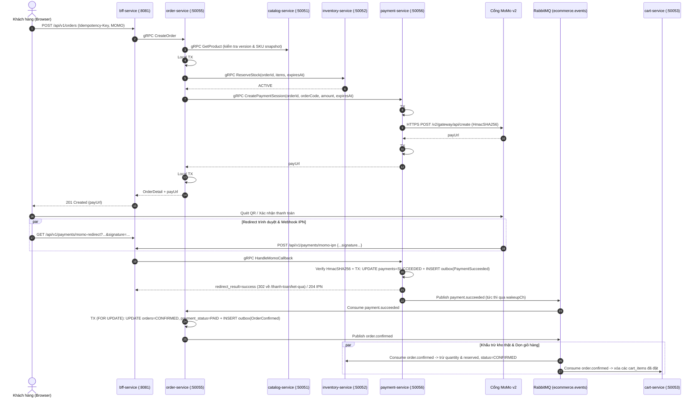
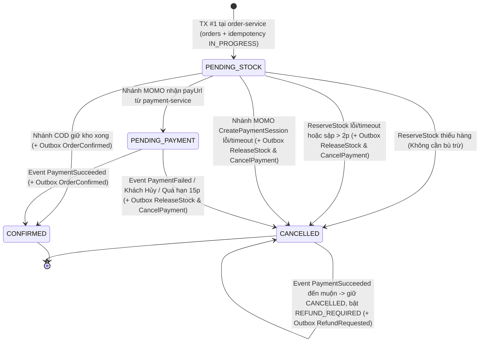

# Thiết Kế & Phân Tích Kỹ Thuật Chuyên Sâu: Hệ Thống Đặt Hàng Đa Sản Phẩm, Nhất Quán Snapshot, Tách Microservice `payment-service` (COD/MoMo) & Hybrid Saga Chống Race Condition

## 1. Bối Cảnh & Mục Đích (Intent and Why)

Hiện tại luồng mua sắm của gian hàng đã hoàn thiện tới bước quản lý giỏ hàng (`cart-service`) và giao diện xem trước đơn hàng sơ khởi (`OrderPreviewPage`), nhưng chuỗi giá trị cốt lõi nhất của thương mại điện tử là **Đặt hàng & Thanh toán (Order & Checkout)** vẫn đang bỏ trống:

1. `order-service` mới chỉ là một Spring Boot skeleton khởi chạy cổng quản trị `:8093`, cơ sở dữ liệu `order_db` đã cấp phát nhưng chưa có lược đồ, chưa có gRPC server hay kết nối RabbitMQ.
2. Nghiệp vụ thanh toán trực tuyến với đối tác bên ngoài (`MoMo` chữ ký `HmacSHA256`, quản lý phiên thanh toán, xác thực callback `redirect` / `IPN`, đối soát hoàn tiền) chưa có microservice chuyên trách sở hữu bounded context và cơ sở dữ liệu độc lập (`payment_db`).
3. `inventory-service` mới quản lý số lượng tồn vật lý (`quantity`) và tra cứu khả dụng theo từng SKU (`GetAvailability`, `BatchGetAvailability`), chưa hiện thực hóa vòng đời giữ chỗ (`stock_reservations`), xác nhận khấu trừ hay hoàn trả tồn kho bất đồng bộ.
4. `OrderPreviewPage` trên `ecommerce-fe` mới đọc địa chỉ đơn lẻ từ hồ sơ cá nhân (`CurrentUser`) thay vì kết nối sổ địa chỉ giao hàng (`/api/v1/users/me/addresses` đã có sẵn trên `identity-service`), chưa có lựa chọn phương thức thanh toán (`COD`, `MOMO`), và nút đặt hàng chỉ hiển thị thông báo tạm.
5. Giữa thời điểm khách hàng mở trang xem trước đơn hàng và thời điểm bấm nút xác nhận đặt hàng tồn tại một khoảng trễ suy nghĩ của con người (*human think-time* từ vài giây tới hàng chục phút). Trong khoảng thời gian đó, quản trị viên có thể vừa cập nhật giá, đổi tên, chỉnh sửa phân loại hoặc ngừng kinh doanh sản phẩm; đồng thời hàng chục khách hàng khác có thể cùng bấm mua những đơn vị tồn kho cuối cùng.

Tài liệu này đặc tả toàn diện thiết kế kiến trúc **Hybrid Saga** kết hợp tách mới microservice **`services/payment-service/`** (Go 1.24, sở hữu `payment_db`), phân tích chuyên sâu các công nghệ phân tán áp dụng, ma trận xử lý sự cố / cạnh tranh đa luồng (*race conditions*), các đánh đổi kỹ thuật (*trade-offs*) và kế hoạch kiểm chứng tải đa luồng xuyên suốt `identity-service`, `contracts`, `catalog-service`, `inventory-service`, `cart-service`, `payment-service`, `order-service`, `bff-service`, Kong và `ecommerce-fe`.

---

## 2. Mục Tiêu, Phi Mục Tiêu & Phản Mục Tiêu (Goals, Non-Goals, Anti-Goals)

### 2.1. Mục tiêu (Goals)
- **Đặt hàng nhiều sản phẩm từ giỏ hàng qua bước Xem trước (`OrderPreviewPage`)**:
  - Hỗ trợ chọn nhiều dòng sản phẩm khả dụng trong `CartPage` để chuyển sang `OrderPreviewPage` (`/gio-hang/dat-hang`).
  - Tích hợp sổ địa chỉ giao hàng từ `identity-service` (`/api/v1/users/me/addresses`): cho phép chọn địa chỉ có sẵn, thêm nhanh địa chỉ mới ngay tại màn hình xem trước (hoặc tự động kế thừa thông tin từ hồ sơ nếu sổ địa chỉ trống).
  - Hỗ trợ chọn 2 phương thức thanh toán: **Thanh toán khi nhận hàng (`COD`)** và **Ví điện tử `MOMO` (`captureWallet` v2)**.
- **Tách Bounded Context `payment-service` độc lập (Go 1.24 + `payment_db`)**:
  - Cô lập toàn bộ khóa bí mật `MOMO_*`, logic ký/xác thực `HmacSHA256`, vòng đời phiên thanh toán (`payments`), chống trùng theo `order_id`, và phát sự kiện kết quả thanh toán qua `payment_db.outbox_events` sang `payment-service`.
  - `order-service` tập trung thuần túy vào vòng đời đơn hàng, bất biến bản chụp thương mại, `Idempotency-Key`, điều phối Saga và đối soát quá hạn tập trung.
- **Bất biến hóa dữ liệu lịch sử (Immutable Order Snapshots)**:
  - Lưu trữ độc lập toàn bộ bản chụp tại thời điểm tạo đơn trong `order_db`: thông tin từng dòng SKU đặt mua (`product_id`, `sku_id`, tên sản phẩm, thương hiệu, danh mục, nhãn biến thể, mã màu, ảnh đại diện, đơn giá của SKU, thành tiền), bản chụp địa chỉ nhận hàng (người nhận, số điện thoại, mã & tên tỉnh/thành, mã & tên phường/xã, địa chỉ chi tiết), phí vận chuyển, tổng thanh toán và trạng thái thanh toán. Mọi thay đổi về sau bên `catalog-service` hay sổ địa chỉ `identity-service` không làm biến đổi đơn hàng lịch sử.
- **Bảo chứng tính nhất quán giữa Xem trước và Đặt hàng (Preview-to-Order Consistency)**:
  - Phát hiện chính xác 100% trường hợp một hoặc nhiều sản phẩm trong đơn vừa bị cập nhật (đổi giá, đổi tên, xóa biến thể, xóa mềm ngừng bán, hoặc tăng `version` danh mục) kể từ lúc hiển thị ở trang xem trước.
  - Khi phát hiện sai lệch, từ chối tạo đơn ngay lập tức với mã lỗi ổn định `PRODUCT_SNAPSHOT_MISMATCH` (`HTTP 409`), trả kèm danh sách chi tiết từng sản phẩm và lý do thay đổi để giao diện hiển thị cảnh báo rõ ràng và điều hướng người dùng quay lại giỏ hàng (`/gio-hang`) thao tác lại.
- **Chống bán vượt tồn kho (Anti-Oversell) & Chịu lỗi phân tán xuyên `order-service` ↔ `inventory-service` ↔ `payment-service`**:
  - Tuyệt đối không để xảy ra `reserved > quantity` hoặc tồn kho khả dụng âm dưới tải đa luồng cao.
  - Đảm bảo tính lũy đẳng (**Idempotency**) chống tạo đơn trùng và chống tạo phiên MoMo trùng khi bấm đúp hoặc rớt mạng; đảm bảo không rò rỉ tồn kho giữ chỗ (*stock leak*) và không bỏ sót tiền khách khi tiến trình sập nguồn, đứt mạng gRPC sau khi tạo phiên thanh toán, lỗi cổng MoMo hoặc hết hạn thanh toán 15 phút.
- **Bộ công cụ mô phỏng đa luồng (Concurrency & Race-Condition Simulation Suite)**:
  - Cung cấp bộ kịch bản kiểm thử đa luồng tự động tái hiện và kiểm chứng bằng số liệu thực tế các tình huống tranh chấp: Flash-sale tranh kho cuối, Admin cập nhật giá giữa lúc khách thanh toán, bão retry `Idempotency-Key`, và đua tranh đồng thời giữa `momo-redirect` / `momo-ipn` / thao tác hủy đơn / tiến trình hủy quá hạn.

### 2.2. Phi mục tiêu (Non-Goals)
- Không tách một `saga-service` đứng riêng ngoài `order-service`; `order-service` đóng vai trò chủ sở hữu vòng đời đơn hàng kiêm bộ điều phối Saga theo đúng [ADR-005](../../adr/005-saga-compensation-and-reservation-lifecycle.md).
- Không mở rộng thêm cổng thanh toán ngoài `COD` và `MOMO` (`captureWallet` v2) trong phạm vi lần này (không làm thẻ lưu token trừ tiền trực tiếp / VNPay / ZaloPay).
- Không triển khai mã giảm giá (voucher/coupon), chia tách một đơn thành nhiều kiện giao hàng khác kho, hoặc gọi tự động sang API Refund của MoMo (các ca thanh toán đến muộn sau khi đơn đã hủy được đồng bộ cờ `REFUND_REQUIRED` sang cả `order-service` và `payment-service` để đối soát hoàn tiền có kiểm soát).
- Không hỗ trợ đặt hàng cho khách vãng lai chưa đăng nhập (*guest checkout*).

### 2.3. Phản mục tiêu (Anti-Goals)
- **Không giữ khóa cơ sở dữ liệu trong lúc người dùng xem trang Xem trước**: Tuyệt đối không dùng `SELECT ... FOR UPDATE` hay giữ chỗ tồn kho ngay khi khách vừa mở `OrderPreviewPage` (gây cạn kiệt connection pool và tấn công từ chối dịch vụ tồn kho khi khách mở trang rồi bỏ đó).
- **Không dùng giao thức 2PC / XA Distributed Transaction** xuyên PostgreSQL của nhiều service hoặc qua RabbitMQ/MoMo ([ADR-002](../../adr/002-transactional-outbox.md)).
- **Không mở DB Transaction bọc ra ngoài lời gọi mạng ở bất kỳ service nào**: `order-service` không giữ transaction `order_db` khi gọi gRPC (`Identity`, `Catalog`, `Inventory`, `Payment`) hay publish RabbitMQ; `payment-service` không giữ transaction `payment_db` khi gọi HTTPS sang cổng MoMo hay publish RabbitMQ.
- **Không tin tưởng mù quáng dữ liệu giá/phí ship từ trình duyệt để tính tiền mà không thẩm định lại**, và **không tin tưởng query string `resultCode=0` hay `resultCode!=0` trên callback MoMo nếu chưa xác thực chữ ký `HmacSHA256`**.

---

## 3. Ràng Buộc Kiến Trúc (Architectural Constraints)

Thiết kế tuân thủ toàn bộ các ADR và quy tắc ranh giới đã được chấp thuận trong kho mã nguồn, đồng thời mở rộng biên dịch vụ có kiểm soát qua `ADR-014`:
- **Ranh giới dịch vụ & Kiểm tra tự động (`make check-boundaries`)**:
  - Bổ sung `services/payment-service/` (Go module `ecommerce.local/payment-service`, sở hữu độc quyền `payment_db`, local HTTP health `:8086`, private gRPC `127.0.0.1:50056`).
  - Tuyệt đối không import code chéo giữa các service, không truy cập chéo cơ sở dữ liệu (`order_db`, `payment_db`, `inventory_db`, `catalog_db`, `cart_db`, `identity_db` hoàn toàn tách biệt). Lưu ý: công cụ `scripts/internal/boundaries` quét toàn văn tệp nguồn nên ngay cả comment SQL/code bên trong `services/payment-service/` cũng không được chứa chuỗi tên DB ngoại lai như `order_db` (và ngược lại `services/order-service/` không chứa chuỗi `payment_db`).
  - Không chứa chuỗi kết nối gọi nội bộ vòng qua Kong (`:8000`) bên trong mã nguồn hoặc cấu hình mặc định của `services/*`.
- **Định tuyến biên (`ADR-011`)**:
  - Giữ nguyên cấu trúc biên Kong gọn nhẹ chỉ trỏ về các upstream hiện hữu (`identity-service`, `bff-service`, và các static/storage containers ở production).
  - Mọi thao tác đặt hàng và tra cứu đơn của `ecommerce-fe` đi qua Kong → `bff-service` (`/api/v1/orders...`) với plugin `caller-context` xác thực JWT → gọi private gRPC `order-service` (`:50055`).
  - Hai đầu mối nhận phản hồi từ cổng MoMo (`/api/v1/payments/momo-redirect` và `/api/v1/payments/momo-ipn`) không mang JWT người dùng nên được mở qua route công khai riêng trên Kong có gắn `request-transformer` xóa sạch header giả mạo `X-User-Id`, `X-User-Roles`, chuyển tiếp vào `bff-service` → gọi thẳng private gRPC `payment-service` (`:50056`) và bắt buộc xác thực chữ ký `HmacSHA256`.
  - Bổ sung header `Idempotency-Key` vào danh sách CORS `headers` cho phép trên `deployments/kong/kong.yaml`.
- **Tương thích hợp đồng (`ADR-006`, `ADR-013`, `docs/steering/api-contracts.md`)**:
  - Mọi cập nhật trong `contracts/proto/**/*.proto` kế thừa mô hình thuần SKU (`ADR-013`) phải là thay đổi cộng thêm (*additive*), giữ nguyên tên và số thứ tự các trường hiện có, bổ sung gói mới `contracts/proto/payment/v1/payment.proto` để vượt qua `buf format`, `buf lint`, `buf generate` và `make verify SERVICE=contracts`.
  - Mọi phản hồi REST giữ chuẩn envelope `{ "data": ..., "message": "..." }` và lỗi `{ "code": "...", "message": "...", "errors": {...}, "traceId": "..." }`.

---

## 4. Phân Tích Chuyên Sâu Các Phương Án & Lựa Chọn Công Nghệ (Approaches & Deep Technical Analysis)

### 4.1. Các phương án kiến trúc đã cân nhắc cho Hybrid Saga + `payment-service`

#### Phương án 1 (Được chọn): Hybrid Đồng bộ Tạo Phiên & Bất đồng bộ Chốt Kết Quả — Định tuyến MoMo Callback qua `Kong -> bff-service -> payment-service (gRPC)` + Outbox hai chiều `payment-service` ↔ `order-service`
- **Cơ chế tổng thể**:
  1. **Tạo đơn đồng bộ có kiểm soát**:
     - `order-service` kiểm tra quyền `order.create` (`Identity` `:50054`), kiểm tra `Idempotency-Key` chỉ đọc, và đối chiếu phiên bản `version` + bản chụp SKU qua `Catalog` (`:50051`). Lệch snapshot trả ngay `409 PRODUCT_SNAPSHOT_MISMATCH`.
     - `Local TX #1` ghi nguyên tử `idempotency_records(IN_PROGRESS)` + `orders(PENDING_STOCK)` + `order_items`.
     - Gọi `InventoryService.ReserveStock` (`:50052`, deadline `1.5s`, fail-closed). Nếu thiếu hàng, chuyển đơn sang `CANCELLED` (`FAILED_TERMINAL`) và trả ngay `409 INVENTORY_INSUFFICIENT`.
     - Nếu `COD`: chuyển đơn sang `CONFIRMED` + ghi `order_db.outbox_events(OrderConfirmed)` trong cùng 1 transaction, trả ngay `201 Created`.
     - Nếu `MOMO`: gọi private gRPC `PaymentService.CreatePaymentSession` (`:50056`, deadline `12s`, lũy đẳng theo `order_id`). `payment-service` mở `TX #A` ngắn cắm khóa `order_id`, gọi HTTPS MoMo v2 bên ngoài DB TX (`3s` connect / `10s` total timeout), rồi mở `TX #B` lưu `pay_url` (`status = PENDING`). Nhận được `payUrl`, `order-service` khóa `SELECT ... FOR UPDATE` kiểm tra `status == PENDING_STOCK`, cập nhật `PENDING_PAYMENT` + `pay_url` (`COMPLETED`) và trả ngay `201 Created` kèm `payUrl` trong 1 lượt bấm duy nhất. Nếu `CreatePaymentSession` lỗi hoặc timeout, `order-service` chuyển đơn sang `CANCELLED` (`FAILED_TERMINAL`) và ghi Outbox đồng thời `ReservationReleaseRequested` (nhả kho) + `PaymentCancelRequested` (hủy/cắm bia mộ phiên thanh toán).
  2. **Nhận kết quả MoMo & Chốt đơn bất đồng bộ qua RabbitMQ**:
     - Cả `GET /api/v1/payments/momo-redirect` lẫn `POST /api/v1/payments/momo-ipn` đi qua `Kong -> bff-service -> PaymentService.HandleMomoCallback (:50056)`.
     - `payment-service` xác thực chữ ký `HmacSHA256` hằng thời gian (`hmac.Equal`) và khớp số tiền `amount_minor`, cập nhật bảng `payments` (`SUCCEEDED` hoặc `FAILED`) cùng bản ghi `payment_db.outbox_events` (`PaymentSucceeded` hoặc `PaymentFailed`) trong 1 local TX, đánh thức tức thì `OutboxRelay` đẩy lên RabbitMQ, rồi trả kết quả cho `bff-service` (`302 Found` về `/thanh-toan/ket-qua?orderId=...&result=...` cho redirect, `204 No Content` cho IPN).
     - `order-service` tiêu thụ `PaymentSucceeded` / `PaymentFailed` qua queue `order.payment-events`: khóa `SELECT ... FOR UPDATE` trên `orders`, chốt `CONFIRMED` (+ Outbox `OrderConfirmed` cho `inventory-service` trừ kho thật & `cart-service` dọn giỏ) hoặc `CANCELLED` (+ Outbox `ReservationReleaseRequested`). Nếu `PaymentSucceeded` đến muộn sau khi đơn đã `CANCELLED`, `order-service` giữ nguyên `CANCELLED` (`ADR-005`), bật `payment_status = REFUND_REQUIRED` và phát Outbox `RefundRequested` về lại `payment-service`.
- **Lý do chọn**:
  - Phản hồi lỗi lệch giá và hết hàng tức thì; lấy `payUrl` ngay lập tức trong 1 HTTP request mà không bắt trình duyệt chờ đợi / hỏi vòng khi tạo đơn; không bao giờ đưa khách sang MoMo trả tiền cho món hàng đã hết kho.
  - Giữ Kong gọn nhẹ đúng mô hình 2 upstream ứng dụng (`identity-service`, `bff-service`), không phải nhúng `grpc-gateway` HTTP REST vào `payment-service`.
  - Tách bạch hoàn toàn: `payment-service` không cần biết sự tồn tại của gRPC `order-service` (kể cả khi `order-service` đang bảo trì/khởi động lại, `payment-service` vẫn nhận IPN từ MoMo trả `204` an toàn và lưu bền vững sự kiện thanh toán vào `payment_db.outbox_events`).
- **Đánh đổi chấp nhận**: Khi trình duyệt từ MoMo redirect về `/thanh-toan/ket-qua`, kết quả đi qua RabbitMQ từ `payment-service` sang `order-service` mất khoảng `15–50ms`; trang `/thanh-toan/ket-qua` xử lý mượt bằng cơ chế kiểm tra nếu đơn còn `PENDING_PAYMENT` thì tự động poll nhẹ `500ms/lần` (tối đa `10s`) cho tới khi hội tụ.

#### Phương án 2 (Loại bỏ): Nhúng `grpc-gateway` HTTP REST vào `payment-service` và cấu hình Kong định tuyến thẳng tới `payment-service`
- **Cơ chế**: Mở thêm upstream thứ 3 trên `kong.yaml` & `kong-production.yaml` trỏ trực tiếp `/api/v1/payments/*` vào cổng HTTP của `payment-service` (tương tự cơ chế direct REST trong `ADR-011`).
- **Lý do loại bỏ**: Chỉ có đúng 2 endpoint callback mỏng của MoMo nhưng lại làm phình cấu hình Kong ở mọi môi trường, buộc `payment-service` gánh thêm tầng HTTP transcoding / redirect trình duyệt vốn đã có sẵn và đồng nhất tại `bff-service`.

#### Phương án 3 (Loại bỏ): Pure Asynchronous Choreography từ đầu hoặc Giao dịch 2PC / Redis Lock thuần túy
- **Lý do loại bỏ**:
  - Choreography ngay từ bước tạo đơn buộc trình duyệt nhận `202 Accepted` rồi phải polling liên tục mới biết còn hàng hay hết hàng và mới lấy được `payUrl`, gây trải nghiệm chậm chạp và đứt đoạn luồng chuyển trang MoMo.
  - `2PC/XA` vi phạm [ADR-002](../../adr/002-transactional-outbox.md) và bất khả thi qua cổng HTTPS bên ngoài; `Redis Lock` thay cho ràng buộc PostgreSQL có nguy cơ bán âm kho khi dừng GC hoặc trôi đồng hồ, vi phạm [ADR-003](../../adr/003-redis-lock-vs-db-invariant.md).

---

### 4.2. Sơ đồ Luồng Tuần tự & Máy Trạng Thái Liên Dịch Vụ



---

### 4.3. Phân tích chuyên sâu 7 trụ cột kỹ thuật áp dụng

#### Trụ cột 1: Cross-Service Optimistic Snapshot Verification (`products.version` + Field Diff)
- **Bài toán**: Không thể dùng khóa bi quan giữ dòng sản phẩm trong lúc khách đang đọc trang xem trước, nhưng nếu chỉ so sánh `updated_at` vẫn có xác suất va chạm thời gian, còn nếu tăng `version` trên mọi thay đổi không thương mại thì phiên đặt hàng của khách khác bị hủy vô lý.
- **Giải pháp**:
  1. Bổ sung cột `version BIGINT NOT NULL DEFAULT 1` trên bảng `products` của `catalog_db`.
  2. Cột `version` **chỉ tăng nguyên tử (`version = version + 1`)** khi quản trị viên thay đổi thuộc tính thương mại (`UpdateProduct` và `SoftDeleteProduct`).
  3. Khi `cart-service` làm giàu dữ liệu giỏ hàng từ `CatalogService.GetProduct`, trường `productVersion` được đính kèm vào từng `CartItem` trả về `ecommerce-fe`.
  4. Khi bấm đặt hàng, `ecommerce-fe` gửi kèm kỳ vọng của từng dòng (`skuId`, `expectedProductVersion`, `unitPrice`, `expectedName`, `variantLabel`). `order-service` đối chiếu trực tiếp với bản ghi mới nhất từ `CatalogService.GetProduct` và khớp biến thể trong `product.variants` theo `sku_id`:
     - Sản phẩm không tồn tại hoặc `deleted == true` $\rightarrow$ báo `UNAVAILABLE` (*"Sản phẩm đã ngừng kinh doanh"*).
     - `skuId` không còn nằm trong danh sách `product.variants` hiện hữu $\rightarrow$ báo `VARIANT_UNAVAILABLE` (*"Phân loại bạn chọn không còn tồn tại"*).
     - `matchedVariant.price != expected.unitPrice` $\rightarrow$ báo `PRICE_CHANGED` (*"Giá phân loại vừa thay đổi từ X sang Y"*).
     - `live.name != expected.name` hoặc `matchedVariant.label != expected.variantLabel` $\rightarrow$ báo `INFO_UPDATED` (*"Tên sản phẩm hoặc nhãn phân loại vừa được cập nhật"*).
     - `live.version != expected.productVersion` $\rightarrow$ báo `VERSION_CHANGED` (*"Thông tin sản phẩm vừa được cập nhật mới"*).

#### Trụ cột 2: Anti-Oversell bằng Ràng buộc Bất biến PostgreSQL & Thứ tự Khóa Tất định Theo `sku_id` (`ADR-003`, `ADR-013`)
- Mỗi phân loại biến thể (`ProductVariant`) sở hữu một dòng tồn kho độc lập `stock(sku_id)` trong `inventory_db`. Việc giữ chỗ diễn ra trong một transaction ngắn duy nhất:
  1. Gom nhóm cộng dồn số lượng theo `sku_id`.
  2. **Sắp xếp danh sách `sku_id` tăng dần (`ORDER BY sku_id ASC`)** trước khi chạy vòng lặp `UPDATE`, triệt tiêu hoàn toàn nguy cơ **Deadlock chéo** khi hai đơn hàng mua cùng tập SKU theo thứ tự ngược nhau.
  3. Với mỗi `sku_id`, chạy câu lệnh điều kiện nguyên tử:
     ```sql
     UPDATE stock
     SET reserved = reserved + $2,
         updated_at = now()
     WHERE sku_id = $1
       AND (quantity - reserved) >= $2
     RETURNING quantity, reserved;
     ```
     Nếu bất kỳ SKU nào trả về `0 rows`, toàn bộ transaction `ROLLBACK` ngay lập tức. Ràng buộc cứng `CHECK (reserved >= 0 AND reserved <= quantity)` là chốt chặn vật lý cuối cùng.

#### Trụ cột 3: Hai Máy Trạng Thái Độc Lập Liên Kết Qua Saga (`orders` & `payments`)

- Trạng thái phiên thanh toán bên `payment-service` (`payments.status`):
  - `INITIATING` $\rightarrow$ `PENDING` (lấy `pay_url` từ MoMo thành công) hoặc `FAILED` (MoMo từ chối/lỗi mạng).
  - `PENDING` $\rightarrow$ `SUCCEEDED` (callback MoMo `resultCode == 0`), `FAILED` (callback MoMo `resultCode != 0`), hoặc `CANCELLED` (nhận `PaymentCancelRequested` từ `order-service`).
  - `CANCELLED` (hoặc `SUCCEEDED` bị hủy chéo) $\rightarrow$ `REFUND_REQUIRED` khi phát hiện tiền về trên đơn đã hủy.

#### Trụ cột 4: Tách Transaction Khỏi I/O Mạng + Khóa Bi quan `SELECT ... FOR UPDATE` Trên Mọi Bước Chuyển
- **Tại `order-service`**:
  - Mọi bước chuyển từ `PENDING_STOCK` (`→ CONFIRMED`, `→ PENDING_PAYMENT`, `→ CANCELLED`) và từ `PENDING_PAYMENT` (`→ CONFIRMED`, `→ CANCELLED`) đều khóa dòng bằng `SELECT ... FROM orders WHERE id = :id FOR UPDATE` và kiểm tra khớp trạng thái nguồn mong đợi.
  - Ràng buộc thời gian chặt chẽ: `payment-service` giới hạn gọi MoMo ở `connectTimeout = 3s`, `totalTimeout = 10s`; `order-service` đặt deadline gRPC `CreatePaymentSession` ở `12s` — nhỏ hơn rất nhiều so với mốc quét `2 phút` (`120s`) của `OrderReconciliationScheduler`. Nếu vì bất kỳ lý do gì đơn đã bị chuyển sang `CANCELLED` trước khi `TX #2` chạy, `TX #2` thấy `status != PENDING_STOCK` sẽ dừng ngay và **không trả `payUrl` cho khách**.
- **Tại `payment-service`**:
  - `CreatePaymentSession` tách làm 2 transaction cực ngắn (`TX #A` cắm dòng `INITIATING` và commit trước khi gọi HTTPS MoMo; `TX #B` khóa `FOR UPDATE` kiểm tra vẫn đang `INITIATING` rồi mới lưu `PENDING` + `pay_url`). Tuyệt đối không giữ kết nối `payment_db` trong lúc chờ mạng MoMo.

#### Trụ cột 5: Outbox Hai Chiều Độ Trễ Thấp (`wakeupCh` / Post-Commit Trigger + Lease-Claim) & Bia Mộ (Tombstone) Theo `order_id`
- **Không giữ DB Transaction qua lời gọi RabbitMQ**: Cả `OutboxRelayScheduler` (Java tại `order-service`) lẫn `OutboxRelay` (Go tại `payment-service`) đều dùng 1 transaction ngắn (`~1ms`) để claim batch (`FOR UPDATE SKIP LOCKED`, đẩy `next_attempt_at = now() + 15s`) và `COMMIT` ngay trước khi publish lên RabbitMQ (chờ Publisher Confirm ACK `3s`), sau đó mở transaction ngắn thứ hai đánh dấu `published_at = now()`.
- **Đánh thức tức thì sau Commit**: Ngay khi transaction nghiệp vụ commit (`TransactionSynchronization.afterCommit` ở Spring Boot và `select { case wakeupCh <- struct{}{}: default: }` ở Go), worker Outbox được đánh thức chạy ngay lập tức thay vì ngồi đợi hết chu kỳ timer `1s`, giảm độ trễ truyền tin nội bộ xuống còn vài mili-giây.
- **Lũy đẳng & Bia mộ (Tombstone) bằng `INSERT ... ON CONFLICT (order_id) DO NOTHING`**:
  - Trên `inventory_db.stock_reservations(order_id)`: nếu `ReservationReleaseRequested` tới trước gói `ReserveStock` bị lag mạng, nó cắm dòng Tombstone `RELEASED`, chặn đứng gói `ReserveStock` đến muộn mà không sinh lỗi trùng khóa `23505`.
  - Trên `payment_db.payments(order_id)`: hoàn toàn tương tự! Nếu `CreatePaymentSession` thành công bên `payment-service` nhưng rớt mạng chiều về và khách thử lại với cùng `order_id`, `payment-service` trả ngay `pay_url` đã lưu. Ngược lại, nếu `order-service` đã hủy đơn và phát `PaymentCancelRequested` tới trước gói `CreatePaymentSession` bị trễ, `payment-service` cắm dòng Tombstone `CANCELLED` (`momo_request_id = 'tombstone:' || order_id`), chặn gói `CreatePaymentSession` trễ ngay từ `TX #A` trước cả khi gọi ra MoMo!

#### Trụ cột 6: Đối Soát Tập Trung Một Đầu Mối Tại `order-service` (`OrderReconciliationScheduler`)
- Toàn bộ chính sách thời gian nghiệp vụ (`PENDING_STOCK > 2 phút` và `PENDING_PAYMENT > 15 phút`) chỉ đặt tại **một nơi duy nhất là `order-service`**, không chạy cron quét hết hạn độc lập bên `inventory-service` hay `payment-service`:
  - Triệt tiêu hoàn toàn nguy cơ lệch đồng hồ / đua tranh giữa hai bộ đếm giờ ở hai service khác nhau (ví dụ kho tự nhả ở phút 14:59 trong khi đơn vẫn cho thanh toán ở phút 15:00).
  - Với đơn `PENDING_STOCK > 2 phút`: `OrderReconciliationScheduler` khóa `FOR UPDATE SKIP LOCKED`, chuyển đơn sang `CANCELLED`, cập nhật `idempotency_records` sang `FAILED_TERMINAL`, và phát Outbox `ReservationReleaseRequested` (kèm `PaymentCancelRequested` nếu `payment_method == 'MOMO'`). Bất kể trước lúc `order-service` sập nguồn nó đã kịp gọi tới đâu, cả kho lẫn phiên thanh toán đều tự động hội tụ sạch sẽ!
  - Với đơn `PENDING_PAYMENT > 15 phút`: chuyển sang `CANCELLED` (`cancel_reason = 'PAYMENT_EXPIRED'`) và phát đồng thời `ReservationReleaseRequested` + `PaymentCancelRequested`.

#### Trụ cột 7: Bảo Mật Hai Chiều Chữ Ký `HmacSHA256` Cho Cổng Thanh Toán MoMo v2 Tại `payment-service`
1. **Chiều đi (`CreatePaymentSession`)**: Ký `HmacSHA256` bằng `MOMO_SECRET_KEY` trên chuỗi khóa sắp xếp đúng chuẩn MoMo v2:
   `accessKey=$accessKey&amount=$amount&extraData=$extraData&ipnUrl=$ipnUrl&orderId=$momoOrderId&orderInfo=$orderInfo&partnerCode=$partnerCode&redirectUrl=$redirectUrl&requestId=$requestId&requestType=captureWallet`
2. **Chiều về (`momo-redirect` & `momo-ipn`)**: **Bắt buộc tái tạo và đối chiếu chữ ký `signature` bằng hằng thời gian (`hmac.Equal`) TRƯỚC mọi thao tác ghi DB** trên chuỗi phản hồi chuẩn của MoMo v2:
   `accessKey=$accessKey&amount=$amount&extraData=$extraData&message=$message&orderId=$momoOrderId&orderInfo=$orderInfo&orderType=$orderType&partnerCode=$partnerCode&payType=$payType&requestId=$requestId&responseTime=$responseTime&resultCode=$resultCode&transId=$transId`
   Đồng thời đối chiếu `amount` trả về phải khớp tuyệt đối với `payments.amount_minor`. Nhờ vậy:
   - Kẻ tấn công không thể tự gõ `?orderId=...&resultCode=0` để chiếm đoạt đơn chưa trả tiền.
   - Kẻ tấn công cũng không thể bắn `?orderId=victim&resultCode=1006` giả mạo thất bại để phá hủy đơn đang chờ thanh toán của người khác (vì sai chữ ký bị chặn `400 INVALID_MOMO_SIGNATURE` ngay từ cửa).

---

## 5. Thiết Kế Chi Tiết Từng Phân Hệ (Surface-by-Surface Specification)

### 5.1. `identity-service` — Phân quyền RBAC cho Đơn hàng
- **Flyway Migration (`services/identity-service/src/main/resources/db/migration/V12__add_order_permissions.sql`)**:
  - Thêm 3 quyền hệ thống vào `auth_items` (`type = 'PERMISSION'`, `system_item = true`):
    - `order.create`: Tạo đơn hàng mới.
    - `order.view`: Xem danh sách và chi tiết đơn hàng cá nhân.
    - `order.cancel`: Hủy đơn hàng cá nhân khi đang ở trạng thái chờ thanh toán (`PENDING_PAYMENT`).
  - Gán cả 3 quyền cho vai trò `CUSTOMER` trong `auth_item_children` (`ON CONFLICT DO NOTHING`). Tài khoản chỉ mang vai trò quản trị (`ADMIN` đơn thuần không kiêm `CUSTOMER`) sẽ bị từ chối đặt hàng trên storefront (`403 ORDER_PERMISSION_DENIED`), nhất quán với chính sách của giỏ hàng và danh sách yêu thích.

### 5.2. `contracts` — Hợp đồng Protobuf & Sự Kiện RabbitMQ

#### a) `contracts/proto/catalog/v1/catalog.proto`
- Giữ nguyên toàn bộ trường hiện có (kể cả `max_price` và `sku_ids` từ `ADR-013`), bổ sung trường phiên bản sản phẩm:
  - `GetProductResponse`: thêm `int64 version = 24;`
  - `ProductSummary`: thêm `int64 version = 19;`
  - `AdminProductSummary`: thêm `int64 version = 24;`

#### b) `contracts/proto/cart/v1/cart.proto`
- Trên `CartItem`: thêm `int64 product_version = 17;`

#### c) `contracts/proto/inventory/v1/inventory.proto`
- Chỉ bổ sung vào `InventoryService` duy nhất 1 RPC nội bộ phục vụ giữ chỗ đồng bộ theo SKU (việc chốt kho và nhả kho đi hoàn toàn qua sự kiện RabbitMQ):
  ```protobuf
  rpc ReserveStock(ReserveStockRequest) returns (ReserveStockResponse);
  ```
- Các message mới:
  - `ReservationLine { string sku_id = 1; string product_id = 2; int32 quantity = 3; }`
  - `ReserveStockRequest { string order_id = 1; repeated ReservationLine items = 2; string expires_at = 3; }`
  - `ReserveStockResponse { string order_id = 1; string status = 2; }`
- Khi thiếu hàng, `ReserveStock` trả `codes.FailedPrecondition` đính kèm `google.rpc.ErrorInfo` (`Reason = "INVENTORY_INSUFFICIENT"`, `Domain = "ecommerce.inventory.v1"`, `Metadata = { "sku_id", "product_id", "available", "requested" }`).
- Khi `order_id` đã bị cắm Tombstone `RELEASED`, trả `codes.FailedPrecondition` với `Reason = "RESERVATION_ALREADY_RELEASED"`.

#### d) `contracts/proto/payment/v1/payment.proto` (Mới)
- Gói hợp đồng riêng `ecommerce.payment.v1` (`go_package = "ecommerce.local/contracts/go/payment/v1;paymentv1"`, `java_package = "com.ecommerce.contracts.payment.v1"`):
  ```protobuf
  service PaymentService {
    rpc CreatePaymentSession(CreatePaymentSessionRequest) returns (CreatePaymentSessionResponse);
    rpc HandleMomoCallback(HandleMomoCallbackRequest) returns (HandleMomoCallbackResponse);
  }

  message CreatePaymentSessionRequest {
    string order_id = 1;
    string order_code = 2;
    string user_id = 3;
    ecommerce.common.v1.Money amount = 4;
    string expires_at = 5;
  }

  message CreatePaymentSessionResponse {
    string order_id = 1;
    string status = 2;   // "PENDING"
    string pay_url = 3;
  }

  message HandleMomoCallbackRequest {
    string partner_code = 1;
    string order_id = 2;
    string request_id = 3;
    int64 amount = 4;
    string order_info = 5;
    string order_type = 6;
    string trans_id = 7;
    int32 result_code = 8;
    string message = 9;
    string pay_type = 10;
    int64 response_time = 11;
    string extra_data = 12;
    string signature = 13;
    string source = 14;  // "REDIRECT" | "IPN"
  }

  message HandleMomoCallbackResponse {
    string order_id = 1;
    string payment_status = 2;   // SUCCEEDED | FAILED | REFUND_REQUIRED | CANCELLED
    string redirect_result = 3;  // "success" | "failed"
  }
  ```
- Mã lỗi `google.rpc.ErrorInfo` (`Domain = "ecommerce.payment.v1"`):
  - `INVALID_MOMO_SIGNATURE` (`codes.InvalidArgument`)
  - `PAYMENT_AMOUNT_MISMATCH` (`codes.InvalidArgument`)
  - `PAYMENT_NOT_FOUND` (`codes.NotFound`)
  - `PAYMENT_ALREADY_CANCELLED` (`codes.FailedPrecondition`)
  - `PAYMENT_SESSION_IN_PROGRESS` (`codes.Aborted`)
  - `PAYMENT_GATEWAY_REJECTED` (`codes.FailedPrecondition`)
  - `PAYMENT_GATEWAY_UNAVAILABLE` (`codes.Unavailable`)

#### e) `contracts/proto/order/v1/order.proto`
- Bảo toàn tuyệt đối số thứ tự các trường gốc hiện có (`1..4` trên `OrderItem`, `1..2` trên `CreateOrderRequest`, `1..3` trên `CreateOrderResponse`) và chỉ mở các RPC thuộc miền đơn hàng (không chứa callback MoMo):
  ```protobuf
  service OrderService {
    rpc CreateOrder(CreateOrderRequest) returns (CreateOrderResponse);
    rpc GetOrder(GetOrderRequest) returns (GetOrderResponse);
    rpc ListOrders(ListOrdersRequest) returns (ListOrdersResponse);
    rpc CancelOrder(CancelOrderRequest) returns (CancelOrderResponse);
  }

  message ShippingAddressSnapshot {
    string recipient_name = 1;
    string phone = 2;
    string province_code = 3;
    string province_name = 4;
    string ward_code = 5;
    string ward_name = 6;
    string address_line = 7;
    string label = 8;
  }

  message OrderItem {
    string product_id = 1;
    string sku_id = 2;
    int32 quantity = 3;
    ecommerce.common.v1.Money unit_price = 4;
    string cart_item_id = 5;
    string variant_label = 6;
    string expected_name = 7;
    int64 expected_product_version = 8;
    string variant_color_hex = 9;
    string image_url = 10;
    string brand = 11;
    string category_name = 12;
    string image_emoji = 13;
    repeated uint32 image_hue = 14;
    ecommerce.common.v1.Money line_total = 15;
  }

  message CreateOrderRequest {
    string user_id = 1;
    repeated OrderItem items = 2;
    string idempotency_key = 3;
    ShippingAddressSnapshot shipping_address = 4;
    string payment_method = 5; // "COD" | "MOMO"
    string note = 6;
  }

  message OrderDetail {
    string order_id = 1;
    string order_code = 2;
    string user_id = 3;
    string status = 4;          // PENDING_STOCK | PENDING_PAYMENT | CONFIRMED | CANCELLED
    string payment_method = 5;  // COD | MOMO
    string payment_status = 6;  // UNPAID | PENDING | PAID | FAILED | REFUND_REQUIRED
    ShippingAddressSnapshot shipping_address = 7;
    repeated OrderItem items = 8;
    ecommerce.common.v1.Money subtotal = 9;
    ecommerce.common.v1.Money shipping_fee = 10;
    ecommerce.common.v1.Money total_amount = 11;
    string note = 12;
    string pay_url = 13;
    string cancel_reason = 14;
    string payment_expires_at = 15;
    string created_at = 16;
    string updated_at = 17;
  }

  message CreateOrderResponse {
    string order_id = 1;
    string status = 2;
    ecommerce.common.v1.Money total_amount = 3;
    OrderDetail order = 4;
    string pay_url = 5;
  }
  ```
  *(Kèm các message `GetOrderRequest/Response`, `ListOrdersRequest/Response` có phân trang `page, page_size, status`, và `CancelOrderRequest/Response`).*

#### f) Hợp đồng Sự kiện RabbitMQ (`ecommerce.events`)
Mọi sự kiện dùng Topic Exchange bền vững `ecommerce.events` (kèm Dead-Letter Exchange `ecommerce.events.dlx`, tối đa 5 lần thử lại trước khi đẩy vào `*.dlq`):

| Routing Key | Event Type (`v1`) | Service Phát | Queue Tiêu Thụ | Ý Nghĩa Nghiệp Vụ |
| :--- | :--- | :--- | :--- | :--- |
| `order.confirmed` | `OrderConfirmed` | `order-service` | `inventory.order-events`, `cart.order-events` | Trừ `quantity` & `reserved` kho thật; xóa `cart_items` đã đặt. |
| `order.reservation.release_requested` | `ReservationReleaseRequested` | `order-service` | `inventory.order-events` | Nhả `reserved` hoặc cắm Tombstone `RELEASED` theo `order_id`. |
| `order.payment.cancel_requested` | `PaymentCancelRequested` | `order-service` | `payment.order-events` | Hủy phiên `PENDING`/`INITIATING` hoặc cắm Tombstone `CANCELLED` theo `order_id`. |
| `order.payment.refund_requested` | `RefundRequested` | `order-service` | `payment.order-events` | Đánh dấu `REFUND_REQUIRED` cho khoản thanh toán MoMo đến muộn sau khi đơn đã hủy. |
| `payment.succeeded` | `PaymentSucceeded` | `payment-service` | `order.payment-events` | Chốt đơn `PENDING_PAYMENT → CONFIRMED` (`PAID`), hoặc bật `REFUND_REQUIRED` nếu đơn đã `CANCELLED`. |
| `payment.failed` | `PaymentFailed` | `payment-service` | `order.payment-events` | Chuyển đơn `PENDING_PAYMENT → CANCELLED` (`FAILED`) và phát yêu cầu nhả kho. |

### 5.3. `catalog-service` — Quản lý Phiên bản Danh mục (`version`)
- **Migration `000006_add_product_version.up.sql`**:
  ```sql
  ALTER TABLE products
      ADD COLUMN version bigint NOT NULL DEFAULT 1;
  ```
- Trong `internal/store/`:
  - `GetByID`, `Search`, `ListAdmin`: đọc thêm cột `version` và ánh xạ ra gRPC proto.
  - `UpdateProduct` và `SoftDelete`: cập nhật `version = version + 1, updated_at = now()` nguyên tử trong câu lệnh `UPDATE products`.

### 5.4. `inventory-service` — Giữ chỗ Nguyên tử Theo SKU, Tombstone & RabbitMQ Consumer
- **Migration `000003_create_stock_reservations.up.sql`**:
  ```sql
  CREATE TABLE stock_reservations (
      order_id text PRIMARY KEY,
      status text NOT NULL CHECK (status IN ('ACTIVE', 'CONFIRMED', 'RELEASED')),
      expires_at timestamptz NOT NULL,
      release_reason text NOT NULL DEFAULT '',
      created_at timestamptz NOT NULL DEFAULT now(),
      updated_at timestamptz NOT NULL DEFAULT now()
  );

  CREATE INDEX ix_stock_reservations_active_expires
      ON stock_reservations (expires_at)
      WHERE status = 'ACTIVE';

  CREATE TABLE stock_reservation_items (
      order_id text NOT NULL REFERENCES stock_reservations(order_id) ON DELETE CASCADE,
      sku_id text NOT NULL,
      product_id text NOT NULL,
      quantity integer NOT NULL CHECK (quantity > 0),
      PRIMARY KEY (order_id, sku_id)
  );
  ```
- **Xử lý `ReserveStock(orderId, items, expiresAt)`**:
  1. Gom nhóm cộng dồn `quantity` theo `sku_id`, sắp xếp tăng dần `ORDER BY sku_id ASC`.
  2. Trong 1 PostgreSQL transaction:
     - Chạy `INSERT INTO stock_reservations (order_id, status, expires_at) VALUES ($1, 'ACTIVE', $2) ON CONFLICT (order_id) DO NOTHING` **trước**:
       - Nếu `RowsAffected() == 0`: đọc `SELECT status FROM stock_reservations WHERE order_id = $1 FOR UPDATE`:
         - Nếu `status IN ('ACTIVE', 'CONFIRMED')`: trả thành công ngay lập tức (*idempotent replay*).
         - Nếu `status == 'RELEASED'`: trả lỗi `FailedPrecondition` (`RESERVATION_ALREADY_RELEASED`).
     - Nếu `RowsAffected() == 1`: với từng `(sku_id, product_id, qty)` theo `ORDER BY sku_id ASC`, chạy `UPDATE stock SET reserved = reserved + $2, updated_at = now() WHERE sku_id = $1 AND (quantity - reserved) >= $2` và chèn `stock_reservation_items`. Nếu thiếu bất kỳ SKU nào $\rightarrow$ đọc nhanh `available` hiện tại, `ROLLBACK` toàn bộ transaction và trả `INVENTORY_INSUFFICIENT`.
- **RabbitMQ Consumer (`inventory.order-events`)**:
  - Lắng nghe `order.confirmed` và `order.reservation.release_requested`.
  - Với `OrderConfirmed`: `SELECT status FROM stock_reservations WHERE order_id = $1 FOR UPDATE`; nếu đang `ACTIVE` thì trừ `quantity = quantity - qty, reserved = reserved - qty` theo `ORDER BY sku_id ASC` và đổi sang `CONFIRMED`.
  - Với `ReservationReleaseRequested`: `INSERT INTO stock_reservations (order_id, status, expires_at, release_reason) VALUES ($1, 'RELEASED', now(), $2) ON CONFLICT (order_id) DO NOTHING`; nếu `RowsAffected() == 0` thì `SELECT ... FOR UPDATE`, nếu đang `ACTIVE` giảm `reserved = reserved - qty` theo `ORDER BY sku_id ASC` và đổi sang `RELEASED`.

### 5.5. `cart-service` — Tự động Dọn các dòng sản phẩm đã đặt
- **Migration `000004_create_processed_events.up.sql`**:
  ```sql
  CREATE TABLE processed_events (
      event_id text PRIMARY KEY,
      event_type text NOT NULL,
      processed_at timestamptz NOT NULL DEFAULT now()
  );
  ```
- **Enrichment**: Điền thêm `product_version` từ `CatalogService.GetProduct` vào `CartItem`.
- **RabbitMQ Consumer (`cart.order-events`)**:
  - Lắng nghe `order.confirmed`. Trong 1 transaction cùng `INSERT INTO processed_events`: xóa đúng các dòng giỏ hàng thuộc `user_id` nằm trong `cart_item_ids` của sự kiện (hoặc khớp `(user_id, sku_id)` nếu `cart_item_id` trống). Các SKU không tick chọn được giữ nguyên. Với đơn MoMo chưa thanh toán hoặc hủy thanh toán, giỏ hàng vẫn còn nguyên để khách đặt lại.

### 5.6. `payment-service` (Microservice Mới — Go 1.24 + `payment_db`)
- **Cổng giao tiếp & Cấu trúc module**:
  - Module Go: `ecommerce.local/payment-service` tại `services/payment-service/` (bổ sung vào `go.work`, `Makefile`, `scripts/start-local`, `scripts/verify-foundation`, `deployments/postgres/init/01-create-databases.sql`, `deployments/docker/compose.production.yml` và `.github/workflows/ci.yml`).
  - HTTP Health Server: `:8086` (`GET /healthz`).
  - Private gRPC Server: local `127.0.0.1:50056`, container `0.0.0.0:50056` (`GRPC_ADDR`).
  - Sở hữu độc quyền PostgreSQL `payment_db` (tự động chạy SQL migrations nhúng qua `embed.FS` lúc khởi động theo đúng chuẩn `catalog-service`, `inventory-service`, `cart-service`).
- **Lược đồ `payment_db` (`services/payment-service/internal/store/migrations/000001_create_payments_and_outbox.up.sql`)**:
  ```sql
  CREATE TABLE payments (
      order_id text PRIMARY KEY,
      order_code text NOT NULL DEFAULT '',
      user_id text NOT NULL DEFAULT '',
      method text NOT NULL DEFAULT 'MOMO' CHECK (method IN ('MOMO')),
      status text NOT NULL CHECK (status IN ('INITIATING', 'PENDING', 'SUCCEEDED', 'FAILED', 'CANCELLED', 'REFUND_REQUIRED')),
      amount_minor bigint NOT NULL DEFAULT 0 CHECK (amount_minor >= 0),
      currency text NOT NULL DEFAULT 'VND',
      momo_order_id text NOT NULL,
      momo_request_id text NOT NULL,
      momo_trans_id text NOT NULL DEFAULT '',
      pay_url text NOT NULL DEFAULT '',
      result_code integer,
      result_message text NOT NULL DEFAULT '',
      cancel_reason text NOT NULL DEFAULT '',
      expires_at timestamptz NOT NULL DEFAULT now(),
      created_at timestamptz NOT NULL DEFAULT now(),
      updated_at timestamptz NOT NULL DEFAULT now(),
      CONSTRAINT uq_payments_momo_order_id UNIQUE (momo_order_id),
      CONSTRAINT uq_payments_momo_request_id UNIQUE (momo_request_id)
  );

  CREATE TABLE outbox_events (
      id text PRIMARY KEY,
      event_type text NOT NULL,
      routing_key text NOT NULL,
      aggregate_id text NOT NULL,
      payload jsonb NOT NULL,
      attempts integer NOT NULL DEFAULT 0,
      next_attempt_at timestamptz NOT NULL DEFAULT now(),
      published_at timestamptz,
      last_error text NOT NULL DEFAULT '',
      created_at timestamptz NOT NULL DEFAULT now()
  );

  CREATE INDEX ix_payment_outbox_pending
      ON outbox_events (next_attempt_at, created_at)
      WHERE published_at IS NULL;
  ```
- **Xử lý `CreatePaymentSession(orderId, orderCode, userId, amount, expiresAt)`**:
  1. **TX #A ngắn (`~1ms`)**:
     - `INSERT INTO payments (order_id, order_code, user_id, method, status, amount_minor, currency, momo_order_id, momo_request_id, expires_at) VALUES ($1, $2, $3, 'MOMO', 'INITIATING', $4, $5, $1, $6, $7) ON CONFLICT (order_id) DO NOTHING`:
       - Nếu `RowsAffected() == 0`: đọc `SELECT status, pay_url FROM payments WHERE order_id = $1 FOR UPDATE` và `COMMIT`:
         - `status == 'PENDING'` và `pay_url != ''` $\rightarrow$ trả ngay `pay_url` đã lưu (*idempotent replay*).
         - `status IN ('CANCELLED', 'REFUND_REQUIRED')` $\rightarrow$ trả `PAYMENT_ALREADY_CANCELLED` (*Tombstone chặn đứng gói trễ*).
         - `status == 'INITIATING'` $\rightarrow$ trả `PAYMENT_SESSION_IN_PROGRESS`.
         - `status == 'FAILED'` $\rightarrow$ trả `PAYMENT_GATEWAY_REJECTED`.
       - Nếu `RowsAffected() == 1`: `COMMIT` TX #A ngay trước khi gọi mạng.
  2. **Gọi cổng MoMo v2 bên ngoài DB TX**:
     - Ký `HmacSHA256` và gửi HTTPS POST tới `MOMO_API_ENDPOINT` với `DialTimeout = 3s`, `Timeout = 10s` (hoặc sinh URL ký nội bộ khi `PAYMENT_MOMO_MOCK_ENABLED=true`).
  3. **TX #B ngắn (`~1ms`)**:
     - `SELECT status FROM payments WHERE order_id = $1 FOR UPDATE`:
       - Nếu `status != 'INITIATING'` (ví dụ `PaymentCancelRequested` đã hủy trong lúc đang chờ MoMo): giữ nguyên trạng thái đã hủy, `COMMIT` và trả `PAYMENT_ALREADY_CANCELLED` (không bao giờ lộ `payUrl`).
       - Nếu gọi MoMo lỗi mạng hoặc `resultCode != 0`: cập nhật `status = 'FAILED'`, lưu `result_code` / `result_message`, `COMMIT` và trả lỗi gRPC tương ứng (`PAYMENT_GATEWAY_UNAVAILABLE` hoặc `PAYMENT_GATEWAY_REJECTED`).
       - Nếu MoMo trả `payUrl` hợp lệ: cập nhật `status = 'PENDING'`, `pay_url = $2`, `result_code = 0`, `COMMIT` và trả `CreatePaymentSessionResponse`.
- **Xử lý `HandleMomoCallback`**:
  1. Xác thực chữ ký `HmacSHA256` hằng thời gian (`hmac.Equal`) bằng `MOMO_SECRET_KEY`. Nếu sai chữ ký $\rightarrow$ trả ngay `INVALID_MOMO_SIGNATURE` (`codes.InvalidArgument`) mà không chạm DB.
  2. Mở 1 local TX trên `payment_db`, khóa `SELECT ... FROM payments WHERE momo_order_id = $1 FOR UPDATE`:
     - Không tìm thấy $\rightarrow$ `PAYMENT_NOT_FOUND`.
     - `req.amount != payment.amount_minor` $\rightarrow$ `PAYMENT_AMOUNT_MISMATCH`.
     - Nếu `req.result_code == 0`:
       - Khi `status == 'PENDING'`: cập nhật `status = 'SUCCEEDED'`, `momo_trans_id = req.trans_id`, chèn `outbox_events` (`PaymentSucceeded`, routing key `payment.succeeded`).
       - Khi `status == 'CANCELLED'` (thanh toán đến muộn sau khi đơn đã hủy): cập nhật `status = 'REFUND_REQUIRED'`, `momo_trans_id = req.trans_id`, vẫn chèn `outbox_events` (`PaymentSucceeded`) để `order-service` đồng bộ cờ `REFUND_REQUIRED` sang `orders` (nếu chưa ghi nhận).
       - Khi `status IN ('SUCCEEDED', 'REFUND_REQUIRED')`: bỏ qua lũy đẳng (không chèn trùng Outbox).
     - Nếu `req.result_code != 0`:
       - Khi `status == 'PENDING'`: cập nhật `status = 'FAILED'`, lưu `result_code` & `result_message`, chèn `outbox_events` (`PaymentFailed`, routing key `payment.failed`).
       - Khi `status` đã ở trạng thái kết thúc (`SUCCEEDED`, `FAILED`, `CANCELLED`, `REFUND_REQUIRED`): bỏ qua lũy đẳng, giữ nguyên trạng thái hiện tại.
  3. Sau khi `COMMIT`, gọi `outboxRelay.Notify()` đánh thức goroutine gửi RabbitMQ ngay lập tức và trả `HandleMomoCallbackResponse` cho `bff-service`.
- **RabbitMQ Consumer (`payment.order-events`)**:
  - Lắng nghe `order.payment.cancel_requested` và `order.payment.refund_requested`.
  - Với `PaymentCancelRequested`: chạy `INSERT INTO payments (order_id, status, momo_order_id, momo_request_id, cancel_reason) VALUES ($1, 'CANCELLED', $1, 'tombstone:' || $1, $2) ON CONFLICT (order_id) DO NOTHING`; nếu đã có dòng thì `SELECT ... FOR UPDATE`: chuyển `INITIATING` / `PENDING` $\rightarrow$ `CANCELLED`, hoặc chuyển `SUCCEEDED` $\rightarrow$ `REFUND_REQUIRED`.
  - Với `RefundRequested`: `SELECT ... FOR UPDATE`, cập nhật `status = 'REFUND_REQUIRED'`, lưu `cancel_reason` lũy đẳng.
- **Cấu hình biến môi trường của `payment-service`**:
  - `MOMO_PARTNER_CODE`, `MOMO_ACCESS_KEY`, `MOMO_SECRET_KEY`, `MOMO_API_ENDPOINT`, `MOMO_CONNECT_TIMEOUT=3s`, `MOMO_READ_TIMEOUT=10s`, `PAYMENT_MOMO_MOCK_ENABLED=false`.
  - `MOMO_REDIRECT_URL` và `MOMO_IPN_URL`: giá trị fallback mặc định trong code Go của `payment-service` dùng `http://localhost:8081/api/v1/payments/momo-redirect` và `.../momo-ipn` (đảm bảo không có chuỗi `:8000` bên trong `services/*`); khi chạy local qua `scripts/start-local` sẽ truyền cổng public ingress tương ứng và tự động nạp tệp `.env` ở gốc repo.

### 5.7. `order-service` — Trái tim Điều phối Saga, Snapshot, Idempotency & Đối soát Tập trung
- **Cổng giao tiếp**:
  - HTTP nội bộ `:8083`, Management Actuator `:8093`.
  - Private gRPC Server: local `127.0.0.1:50055`, container `0.0.0.0:50055` (`ORDER_GRPC_HOST`, `ORDER_GRPC_PORT`).
  - Outbound gRPC clients:
    - `Identity` (`50054`, timeout `500ms`)
    - `Catalog` (`50051`, timeout `2s`)
    - `Inventory` (`50052`, gọi đơn 1 lần fail-closed với deadline `1.5s`, không lặp retry đồng bộ)
    - `Payment` (`50056`, gọi đơn 1 lần với deadline `12s` cho `CreatePaymentSession`)
  - Không chứa bất kỳ khóa bí mật `MOMO_*`, HTTP client MoMo hay hàm ký HMAC nào.
- **Lược đồ `order_db` (Flyway `V1__create_orders_idempotency_and_outbox.sql`)**:
  - `orders`:
    - `id UUID PRIMARY KEY`
    - `order_code VARCHAR(32) NOT NULL UNIQUE` (`ORD-YYYYMMDD-XXXXXX`)
    - `user_id UUID NOT NULL`
    - `idempotency_key VARCHAR(128) NOT NULL`
    - `status VARCHAR(32) NOT NULL` (`PENDING_STOCK`, `PENDING_PAYMENT`, `CONFIRMED`, `CANCELLED`)
    - `payment_method VARCHAR(16) NOT NULL` (`COD`, `MOMO`)
    - `payment_status VARCHAR(32) NOT NULL` (`UNPAID`, `PENDING`, `PAID`, `FAILED`, `REFUND_REQUIRED`)
    - Bản chụp địa chỉ: `recipient_name`, `recipient_phone`, `province_code`, `province_name`, `ward_code`, `ward_name`, `address_line`, `address_label`
    - Bản chụp tiền tệ (`VND`): `currency`, `subtotal_minor`, `shipping_fee_minor`, `total_amount_minor`
    - Thông tin liên kết phiên thanh toán: `pay_url TEXT`, `payment_trans_id VARCHAR(64)`, `payment_expires_at TIMESTAMPTZ`
    - `note TEXT`, `cancel_reason VARCHAR(128)`, `version BIGINT NOT NULL DEFAULT 0` (`@Version`), `created_at`, `updated_at`
    - Ràng buộc duy nhất: `UNIQUE (user_id, idempotency_key)`
  - `order_items`:
    - `id UUID PRIMARY KEY`, `order_id UUID REFERENCES orders(id) ON DELETE CASCADE`, `cart_item_id VARCHAR(64)`, `product_id VARCHAR(128) NOT NULL`, `sku_id VARCHAR(128) NOT NULL`, `product_version BIGINT`, `product_name VARCHAR(255)`, `brand VARCHAR(128)`, `category_name VARCHAR(128)`, `variant_label VARCHAR(128)`, `variant_color_hex VARCHAR(32)`, `image_url TEXT`, `image_emoji VARCHAR(32)`, `image_hue VARCHAR(64)`, `unit_price_minor BIGINT`, `quantity INT`, `line_total_minor BIGINT`.
  - `idempotency_records`:
    - `user_id UUID`, `idempotency_key VARCHAR(128)`, `request_fingerprint VARCHAR(64) NOT NULL`, `status VARCHAR(24) NOT NULL` (`IN_PROGRESS`, `COMPLETED`, `FAILED_TERMINAL`), `order_id UUID`, `response_json JSONB`, `expires_at TIMESTAMPTZ NOT NULL`, `created_at TIMESTAMPTZ NOT NULL`, `updated_at TIMESTAMPTZ NOT NULL`, `PRIMARY KEY (user_id, idempotency_key)`.
  - `outbox_events`:
    - `id UUID PRIMARY KEY`, `event_type VARCHAR(64) NOT NULL`, `routing_key VARCHAR(64) NOT NULL`, `event_version INT NOT NULL DEFAULT 1`, `aggregate_id VARCHAR(64) NOT NULL`, `correlation_id VARCHAR(64)`, `payload JSONB NOT NULL`, `attempts INT NOT NULL DEFAULT 0`, `next_attempt_at TIMESTAMPTZ NOT NULL DEFAULT now()`, `published_at TIMESTAMPTZ`, `last_error TEXT`, `created_at TIMESTAMPTZ NOT NULL`.
  - `processed_events`:
    - `event_id VARCHAR(64) PRIMARY KEY`, `event_type VARCHAR(64) NOT NULL`, `processed_at TIMESTAMPTZ NOT NULL DEFAULT now()`.
- **Luồng `Local TX #1`, Xử lý Đua tranh Song song & RabbitMQ Consumer (`order.payment-events`)**:
  - **Không ghi gì trước `Local TX #1`**: Kiểm tra đầu vào, RBAC (`order.create`), tra cứu nhanh `findRecord(userId, key)` chỉ đọc và đối chiếu snapshot `CatalogService` đều chạy thuần đọc.
  - **Ghi nguyên tử trong `Local TX #1`**: Chạy `INSERT INTO idempotency_records (...) VALUES (...) ON CONFLICT (user_id, idempotency_key) DO NOTHING` cùng lúc chèn `orders(PENDING_STOCK)` + `order_items`. Nếu `inserted == 0`, kết thúc TX #1 và đọc dòng đã commit để replay (`REQUEST_IN_PROGRESS | COMPLETED | FAILED_TERMINAL | IDEMPOTENCY_KEY_REUSED`).
  - **Tiêu thụ `PaymentSucceeded` & `PaymentFailed` (`order.payment-events`)**:
    - Trong 1 transaction cùng `INSERT INTO processed_events(event_id) ... ON CONFLICT DO NOTHING`, khóa `SELECT ... FROM orders WHERE id = :orderId FOR UPDATE`:
      - Với `PaymentSucceeded`:
        - Nếu `status == 'PENDING_PAYMENT'`: chuyển `status = 'CONFIRMED'`, `payment_status = 'PAID'`, `payment_trans_id = momoTransId`, ghi Outbox `OrderConfirmed`.
        - Nếu `status == 'CANCELLED'` (thanh toán đến muộn sau khi đơn đã hủy): giữ nguyên `status = 'CANCELLED'` (`ADR-005`), cập nhật `payment_status = 'REFUND_REQUIRED'`, `payment_trans_id = momoTransId`, ghi Outbox `RefundRequested` về `payment-service`.
      - Với `PaymentFailed`:
        - Nếu `status == 'PENDING_PAYMENT'`: chuyển `status = 'CANCELLED'`, `payment_status = 'FAILED'`, `cancel_reason = 'PAYMENT_FAILED'`, ghi Outbox `ReservationReleaseRequested`.
- **Quy tắc tính phí vận chuyển chuẩn tại `order-service`**:
  - Tính toán lại độc lập ở phía server: `subtotal >= 299_000 VND ? 0 : 25_000 VND`, `total = subtotal + shipping_fee`.

### 5.8. `bff-service` & Kong Gateway — Hợp đồng REST Công khai
- **Kong Routes (`deployments/kong/kong.yaml` & `kong-production.yaml`)**:
  - Giữ nguyên cấu trúc upstream hiện hữu trên Kong (không mở thêm upstream cho `order-service` hay `payment-service`).
  - Route bảo vệ `orders-api` (`/api/v1/orders`, gắn plugin `caller-context`, `strip_path: false`; trong production khai báo tường minh `methods: ["GET", "POST"]`).
  - Route công khai `payments-momo-public` (`/api/v1/payments/momo-redirect` và `/api/v1/payments/momo-ipn`, gắn `request-transformer` gỡ `X-User-Id` & `X-User-Roles`, `strip_path: false`; trong production neo biểu thức chính quy `~/api/v1/payments/momo-redirect$` và `~/api/v1/payments/momo-ipn$` với `methods: ["GET", "POST"]`).
  - Mở rộng `deployments/kong/kong.yaml` thêm `Idempotency-Key` vào danh sách CORS `headers` cho phép.
- **Các Endpoint REST trên `bff-service`**:
  - Gọi tới `OrderService` (`BFF_ORDER_GRPC_ADDR`, mặc định local `127.0.0.1:50055`):
    1. `POST /api/v1/orders` (bắt buộc header `Idempotency-Key`): tạo đơn hàng, trả `201 Created` kèm `OrderDetail` và `payUrl` (nếu `MOMO`). Khi gặp `PRODUCT_SNAPSHOT_MISMATCH`, trả `409 Conflict` kèm `errors` liệt kê từng `skuId` bị thay đổi.
    2. `GET /api/v1/orders`: phân trang danh sách đơn hàng của người dùng hiện tại (`page`, `pageSize`, `status`).
    3. `GET /api/v1/orders/{orderId}`: lấy chi tiết đơn hàng của người dùng hiện tại.
    4. `POST /api/v1/orders/{orderId}/cancel`: hủy đơn hàng cá nhân khi đang ở trạng thái `PENDING_PAYMENT` (chuyển đơn sang `CANCELLED` và phát đồng thời `ReservationReleaseRequested` + `PaymentCancelRequested`).
  - Gọi tới `PaymentService` (`BFF_PAYMENT_GRPC_ADDR`, mặc định local `127.0.0.1:50056`):
    5. `GET /api/v1/payments/momo-redirect`: chuyển toàn bộ query params sang `PaymentService.HandleMomoCallback(source = "REDIRECT")`. Nếu chữ ký không hợp lệ, trả `400 Bad Request` JSON envelope; nếu hợp lệ, trả HTTP `302 Found` chuyển hướng trình duyệt về `${BFF_STOREFRONT_BASE_URL}/thanh-toan/ket-qua?orderId=...&result=success|failed`.
    6. `POST /api/v1/payments/momo-ipn`: chuyển JSON body sang `PaymentService.HandleMomoCallback(source = "IPN")`, trả `204 No Content` khi hợp lệ (hoặc `400` khi sai chữ ký).

### 5.9. `ecommerce-fe` — Trải nghiệm Xem trước, Chọn Địa chỉ, Thanh toán & Lịch sử Đơn hàng
1. **Trang Xem trước Đơn hàng (`OrderPreviewPage` - `/gio-hang/dat-hang`)**:
   - **Khối Địa chỉ nhận hàng**: Tải danh sách sổ địa chỉ từ `/api/v1/users/me/addresses`, tự động chọn địa chỉ mặc định (`isDefault`); mở hộp thoại chọn địa chỉ khác hoặc thêm địa chỉ mới ngay tại trang. Nếu sổ địa chỉ rỗng nhưng hồ sơ cá nhân đã có đủ thông tin giao hàng thì tự điền sẵn.
   - **Khối Sản phẩm & Snapshot**: Hiển thị danh sách các dòng đã chọn kèm ảnh, biến thể (`skuId`, `variantLabel`), đơn giá theo phân loại, số lượng và thành tiền. Giữ bản chụp kỳ vọng (`skuId`, `productVersion`, `unitPrice`, `name`, `variantLabel`) ngay từ thời điểm mở trang xem trước.
   - **Khối Phương thức thanh toán**: Radio/Card chọn trực quan giữa `COD` (*Thanh toán khi nhận hàng*) và `MOMO` (*Ví điện tử MoMo — Quét mã QR / Thẻ ATM*).
   - **Sinh và xoay vòng khóa `Idempotency-Key`**:
     - **Giữ nguyên `Idempotency-Key` hiện tại** khi không nhận được HTTP response (`error.status === null`) hoặc nhận `409 REQUEST_IN_PROGRESS` (hiển thị *"Đơn hàng đang được xử lý..."*, khóa nút bấm và tự động gửi lại sau `1.5s`).
     - Với mọi HTTP response kết thúc khác (`503`, `409 INVENTORY_INSUFFICIENT`, `400`...) hoặc khi người dùng đổi địa chỉ / phương thức thanh toán / ghi chú, sinh `Idempotency-Key` mới (UUID v4) cho lần bấm tiếp theo.
   - **Xử lý Lệch Snapshot (`PRODUCT_SNAPSHOT_MISMATCH`)**: Hiển thị Banner/Dialog cảnh báo nổi bật liệt kê rõ từng sản phẩm vừa thay đổi, khóa nút Đặt hàng cũ và cung cấp nút **"Quay lại giỏ hàng để cập nhật"**.
   - **Điều hướng sau khi tạo đơn**:
     - Nếu `COD`: làm mới giỏ hàng và chuyển tới `/don-hang/{orderId}?placed=1`.
     - Nếu `MOMO`: chuyển hướng trình duyệt `window.location.assign(payUrl)`.
2. **Trang Kết quả Thanh toán (`/thanh-toan/ket-qua`) & Quản lý Đơn mua (`/don-hang`, `/don-hang/:orderId`)**:
   - Khi trình duyệt quay về `/thanh-toan/ket-qua?orderId=...&result=...`, trang gọi `GET /api/v1/orders/{orderId}`. Nếu đơn vẫn đang ở trạng thái quá độ `PENDING_PAYMENT` trong vài chục mili-giây chờ sự kiện RabbitMQ từ `payment-service` sang `order-service`, giao diện hiển thị trạng thái *"Đang đồng bộ kết quả thanh toán..."* và tự động poll nhẹ mỗi `500ms` (tối đa `10s`) cho tới khi đơn hội tụ sang `CONFIRMED` hoặc `CANCELLED` (hoặc hiển thị thông báo đối soát hoàn tiền nếu `paymentStatus === 'REFUND_REQUIRED'`), đồng thời làm mới giỏ hàng khi đơn đã `CONFIRMED`.
   - Cho phép xem chi tiết snapshot đơn mua, mở lại `payUrl` khi đơn `PENDING_PAYMENT` còn hạn, hoặc bấm hủy đơn; bổ sung mục **"Đơn mua"** vào menu tài khoản trên `SiteHeader`.

---

## 6. Ma Trận Edge Cases, Sự Cố Phân Tán & Cách Xử Lý (Comprehensive Edge-Case Matrix)

| # | Kịch bản Sự cố / Edge Case | Hiện tượng nếu thiết kế ngây thơ | Cơ chế Xử lý trong Thiết kế này |
| :-: | :--- | :--- | :--- |
| **1** | **Admin đổi giá phân loại / gỡ biến thể / ẩn sản phẩm đúng lúc khách đang ở trang Xem trước** | Tạo đơn với giá cũ gây lỗ, hoặc lấy giá mới âm thầm làm khách bị trừ tiền cao hơn lúc xem. | `products.version` tăng lên + đối chiếu biến thể theo `sku_id` (`unitPrice`, `variantLabel`, `name`, `deleted`). Chặn đơn với `409 PRODUCT_SNAPSHOT_MISMATCH`, liệt kê rõ SKU bị đổi và yêu cầu quay về `/gio-hang`. |
| **2** | **Payload đặt hàng lặp lại cùng 1 `sku_id` thành nhiều dòng vượt tồn kho của SKU đó** | Kiểm tra rời rạc từng dòng thấy hợp lệ hoặc xử lý nửa vời. | `ReserveStock` gom nhóm cộng dồn số lượng theo `sku_id`, thực thi trong 1 DB transaction duy nhất: thiếu 1 SKU là `ROLLBACK` sạch cả đơn. |
| **3** | **50 người cùng bấm mua đơn vị tồn kho cuối cùng của 1 SKU (Flash-sale Race)** | `SELECT` thấy còn hàng rồi cùng `UPDATE` $\rightarrow$ bán âm kho (*Oversell*). | Câu lệnh đơn `UPDATE stock SET reserved = reserved + $2 WHERE sku_id = $1 AND (quantity - reserved) >= $2` khóa dòng tuần tự + `CHECK (reserved <= quantity)`. Đúng 1 người thắng, 49 người nhận `409 INVENTORY_INSUFFICIENT`. |
| **4** | **2 đơn hàng nhiều món khóa kho ngược thứ tự nhau** *(Đơn A: SKU_1→SKU_2, Đơn B: SKU_2→SKU_1)* | PostgreSQL dính **Deadlock** làm văng lỗi `40P01`. | Sắp xếp tất định danh sách mặt hàng theo `ORDER BY sku_id ASC` trước khi cập nhật kho — mọi giao dịch luôn lấy khóa cùng một chiều. |
| **5** | **Khách bấm đúp nút "Đặt hàng" 5 lần hoặc rớt mạng tự gửi lại** | Đua tranh `INSERT` văng lỗi `23505`/`500` hoặc tạo nhiều đơn trùng. | `Local TX #1` chạy `INSERT INTO idempotency_records ... ON CONFLICT DO NOTHING` cùng lúc tạo đơn. Frontend giữ nguyên key khi `status === null` hoặc `409 REQUEST_IN_PROGRESS` (tự động thử lại sau `1.5s`), và chỉ sinh key mới khi nhận response lỗi kết thúc. |
| **6** | **`order-service` gọi `PaymentService.CreatePaymentSession` thành công ở `payment_db` nhưng rớt mạng chiều về (`DeadlineExceeded` / `Unavailable`)** | `order-service` không nhận được `payUrl`, kho đã giữ ở `inventory-service`, phiên `PENDING` nằm mồ côi ở `payment-service`. | `order-service` fail-closed chuyển ngay đơn sang `CANCELLED` (`idempotency_records = FAILED_TERMINAL`) và ghi Outbox đồng thời `ReservationReleaseRequested` + `PaymentCancelRequested` để nhả kho và hủy phiên thanh toán; khách bấm lại tạo đơn mới sạch sẽ (còn nếu retry rơi vào cùng `order_id` trước khi hủy thì `payment-service` trả lại `pay_url` lũy đẳng). |
| **7** | **`order-service` sập nguồn (`kill -9`) ngay sau `TX #1` (`PENDING_STOCK`) — trước hoặc sau khi gọi `ReserveStock` / `CreatePaymentSession`** | Đơn nằm treo mãi ở `PENDING_STOCK`, kho bị giam và phiên thanh toán treo ở `payment-service`. | `OrderReconciliationScheduler` quét các đơn `PENDING_STOCK` quá **2 phút** (`FOR UPDATE SKIP LOCKED`), trong cùng 1 TX chuyển đơn sang `CANCELLED`, đổi `idempotency_records` sang `FAILED_TERMINAL`, và phát Outbox `ReservationReleaseRequested` + `PaymentCancelRequested`. |
| **8** | **Gói tin `ReserveStock` hoặc `CreatePaymentSession` bị lag mạng đến muộn SAU khi lệnh bù trừ (`Release` / `Cancel`) đã chạy** | Gói trễ tới sau tự tạo mới phiếu giữ kho hoặc gọi MoMo tạo phiên thanh toán ma không ai dọn. | Cả `stock_reservations(order_id)` lẫn `payments(order_id)` đều dùng `INSERT ... ON CONFLICT (order_id) DO NOTHING` cắm sẵn **Tombstone** (`RELEASED` / `CANCELLED`), chặn đứng gói gRPC đến muộn ngay từ cửa mà không sinh lỗi `23505`. |
| **9** | **`order-service` sập nguồn ngay sau khi trả `201 + payUrl` cho khách, hoặc đang bảo trì đúng lúc MoMo gọi IPN** | Nếu MoMo gọi thẳng vào `order-service` hoặc `payment-service` gọi sync sang `order-service` thì IPN bị lỗi. | `Kong -> bff-service -> payment-service` xử lý độc lập hoàn toàn: `payment-service` xác thực HMAC, chốt `SUCCEEDED` và lưu bền vững `PaymentSucceeded` vào `payment_db.outbox_events`, trả `204` cho MoMo. Khi `order-service` sống lại, nó tiêu thụ sự kiện từ RabbitMQ và chốt đơn `CONFIRMED` không mất dữ liệu. |
| **10** | **`momo-redirect` (trình duyệt) và `momo-ipn` (webhook) đập vào `payment-service` cùng 1 mili-giây** | Chèn 2 sự kiện `PaymentSucceeded` hoặc ghi đè trạng thái của nhau. | `HandleMomoCallback` khóa dòng `SELECT ... FROM payments WHERE momo_order_id = $1 FOR UPDATE`. Luồng đầu tiên đổi `PENDING → SUCCEEDED` và chèn 1 bản ghi Outbox; luồng thứ hai thấy đã `SUCCEEDED` nên thoát lũy đẳng. Phía `order-service` còn có lớp bảo vệ thứ hai bằng `processed_events` + `SELECT ... FOR UPDATE` trên `orders`. |
| **11** | **Trình duyệt vừa redirect về `/thanh-toan/ket-qua` nhanh hơn 20ms so với gói tin RabbitMQ từ `payment-service` sang `order-service`** | Giao diện đọc `GET /api/v1/orders/{id}` thấy vẫn đang `PENDING_PAYMENT` nên báo nhầm chưa thanh toán. | `payment-service` kích hoạt `wakeupCh` đẩy RabbitMQ ngay lập tức sau commit (`~15–50ms`); đồng thời `/thanh-toan/ket-qua` thấy `status === 'PENDING_PAYMENT'` sẽ hiển thị *"Đang đồng bộ kết quả thanh toán..."* và poll nhẹ `500ms/lần` (tối đa `10s`) cho tới khi hội tụ. |
| **12** | **Người dùng tự sửa URL trình duyệt thành `?orderId=...&resultCode=0`, hoặc kẻ xấu bắn `?orderId=victim&resultCode=1006` phá đơn người khác** | Chiếm đoạt đơn không trả tiền, hoặc làm hủy oan đơn đang chờ thanh toán của khách thật. | Xác thực bắt buộc chữ ký `HmacSHA256` hằng thời gian (`hmac.Equal`) bằng `MOMO_SECRET_KEY` và khớp `amount == amount_minor` trước mọi thao tác DB. Mọi callback giả mạo (dù `resultCode=0` hay `!=0`) đều bị chặn `400 INVALID_MOMO_SIGNATURE`. |
| **13** | **Đơn hết hạn 15 phút vừa bị `order-service` hủy & nhả kho ở giây 899, giây 900 MoMo gửi IPN báo `resultCode=0` (Late Payment)** | Hoặc nuốt luôn tiền khách mà không ai biết, hoặc cố mở lại đơn đã nhả kho gây bán âm kho. | Theo [ADR-005](../../adr/005-saga-compensation-and-reservation-lifecycle.md): **Không mở lại đơn đã `CANCELLED`**. Cả hai chiều đua tranh giữa `PaymentCancelRequested` và `PaymentSucceeded` đều hội tụ về `orders.status = CANCELLED`, `orders.payment_status = REFUND_REQUIRED` (kèm Outbox `RefundRequested`) và `payments.status = REFUND_REQUIRED` lưu kèm `momo_trans_id` để đối soát hoàn tiền. |
| **14** | **Khách chọn MoMo, sang trang MoMo rồi bấm Hủy / Quay lại không trả tiền** | Nếu xóa giỏ hàng ngay lúc tạo đơn, khách quay lại thấy mất sạch giỏ hàng phải đi tìm lại từng món. | Giỏ hàng chỉ xóa các món đã đặt khi nhận `OrderConfirmed`. Khi khách hủy trên MoMo (có chữ ký hợp lệ `resultCode != 0`) hoặc bấm Hủy đơn trên web, kho được nhả ngay và giỏ hàng vẫn còn nguyên vẹn. |

---

## 7. Đánh Đổi Kỹ Thuật Tổng Thể (Key Trade-Offs)

1. **Tách `payment-service` thêm 1 hop gRPC khi tạo đơn MoMo và 1 hop RabbitMQ khi chốt kết quả callback**:
   - *Đánh đổi*: Tăng thêm một microservice Go cần vận hành (`payment_db`, Outbox worker riêng) và thêm khoảng `15–50ms` hội tụ bất đồng bộ sau khi khách thanh toán xong trên MoMo; đổi lại cô lập tuyệt đối khóa mật mã & tích hợp đối tác thanh toán khỏi `order-service`, cho phép `payment-service` tiếp nhận webhook IPN bền vững ngay cả khi `order-service` đang khởi động lại, và mở đường sạch sẽ nếu tương lai bổ sung cổng thanh toán mới mà không chạm vào lõi Saga đơn hàng.
2. **Tính nhất quán cuối cùng (Eventual Consistency) ở bước dọn giỏ hàng và khấu trừ kho vật lý**:
   - *Đánh đổi*: Sau khi đơn chuyển sang `CONFIRMED`, mất vài chục mili-giây qua Outbox Relay → RabbitMQ thì các dòng đã mua mới biến mất khỏi `cart_db` và `quantity` vật lý mới giảm (tuy nhiên `available = quantity - reserved` đã giảm **ngay lập tức** từ bước `ReserveStock` đồng bộ trước đó nên số lượng có thể bán trên toàn sàn luôn chính xác tức thì).
3. **Đối soát quá hạn tập trung tại `order-service` thay vì quét phân tán ở từng service con**:
   - *Đánh đổi*: Việc giải phóng kho/phiên thanh toán quá hạn phụ thuộc vào sự kiện bù trừ từ `OrderReconciliationScheduler` của `order-service` qua Outbox, nhưng đổi lại loại bỏ hoàn toàn lỗi lệch đồng hồ và tranh chấp trạng thái giữa nhiều bộ đếm giờ độc lập.

---

## 8. Bộ Kịch Bản Mô Phỏng Đa Luồng & Kiểm Chứng Race Condition (Concurrency Simulation Suite)

Dự án bổ sung công cụ chạy kịch bản mô phỏng đa luồng độc lập tại `scripts/concurrency-sim/` (viết bằng Go sử dụng goroutines & `sync.WaitGroup` + báo cáo thống kê chi tiết latency / status code / bất biến SQL xuyên `order_db`, `inventory_db`, `payment_db`):

1. **Kịch bản 1 — `flash-sale-oversell` (Đua tranh mua SKU tồn kho thấp)**:
   - Thiết lập 1 SKU có `quantity = 5, reserved = 0`. Khởi tạo `N = 50` khách hàng xuất phát đồng loạt tại cùng một rào chắn `close(startGate)` gửi `POST /api/v1/orders` mua mỗi người `1` đơn vị của SKU đó.
   - **Tiêu chí đạt**: Đúng `5` đơn `CONFIRMED`, đúng `45` request nhận `409 INVENTORY_INSUFFICIENT`; kiểm tra sau cùng `reserved == 0, quantity == 0`, không có bất kỳ trạng thái âm kho hay đơn treo nào.
2. **Kịch bản 2 — `snapshot-mismatch-race` (Admin cập nhật giá SKU / xóa mềm giữa lúc khách bấm Đặt hàng)**:
   - `20` goroutines khách hàng giữ bản chụp `productVersion = v1` bắn đồng loạt `POST /api/v1/orders` xen kẽ đúng thời điểm goroutine Quản trị viên gọi `PUT /api/v1/admin/products/{id}` đổi giá phân loại SKU sang mức mới (`v2`).
   - **Tiêu chí đạt**: Mọi đơn lọt vào trước thời điểm commit của Admin mang giá snapshot `v1` bất biến; mọi đơn chạm tới sau thời điểm Admin commit bị chặn `409 PRODUCT_SNAPSHOT_MISMATCH` (`PRICE_CHANGED`); không tồn tại đơn nào bị tính giá `v2` mà khách chỉ nhìn thấy giá `v1`.
3. **Kịch bản 3 — `idempotency-storm` (Bão bấm đúp & Tái sử dụng khóa sai lệch)**:
   - Cùng 1 tài khoản bắn đồng thời `20` luồng mang cùng 1 `Idempotency-Key` và cùng payload hợp lệ (trên đơn `MOMO`), cộng thêm `5` luồng dùng cùng `Idempotency-Key` đó nhưng thay đổi số lượng sản phẩm.
   - **Tiêu chí đạt**: Trong `order_db` chỉ sinh ra **đúng 1 đơn hàng**, trong `payment_db` chỉ sinh ra **đúng 1 phiên thanh toán**, tồn kho chỉ giữ **đúng 1 lần**, các luồng hợp lệ nhận cùng `orderId` + `payUrl`, và cả `5` luồng đổi payload đều bị từ chối `409 IDEMPOTENCY_KEY_REUSED`.
4. **Kịch bản 4 — `momo-callback-race` (Đua tranh đồng thời Redirect + IPN + Giả mạo chữ ký + Hủy đơn xuyên `payment-service` & `order-service`)**:
   - Tạo 1 đơn `MOMO` ở trạng thái `PENDING_PAYMENT`, sau đó bắn đồng loạt tại cùng một thời điểm: `10` request `GET /momo-redirect` (HMAC hợp lệ), `10` request `POST /momo-ipn` (HMAC hợp lệ), `5` request giả mạo chữ ký sai (`resultCode=0` và `resultCode=1006`), và `5` request `POST /api/v1/orders/{id}/cancel`.
   - **Tiêu chí đạt**: Toàn bộ `5` request giả mạo bị chặn `400`; `payments` và `orders` hội tụ nhất quán (hoặc đơn `CONFIRMED` + `PAID` + `SUCCEEDED`, hoặc nếu lệnh hủy thắng trước 1ms thì đơn giữ `CANCELLED` + `REFUND_REQUIRED` ở cả `order_db` và `payment_db`); tồn kho không bao giờ bị trừ kép hay vừa trừ vừa nhả.

---

## 9. Các Quyết Định Chi Tiết Giao Cho Người Triển Khai (Builder Calls & Implementation Scope)

Các chi tiết kỹ thuật cấp thấp sau đây đã được chốt mặc định hợp lý để phục vụ lập kế hoạch triển khai trực tiếp mà không làm thay đổi hành vi sản phẩm:
- **Cổng mạng chuẩn của `payment-service` (`Builder Call`)**: Local HTTP health `:8086` (`/healthz`), private gRPC `127.0.0.1:50056` (container `0.0.0.0:50056`), nối tiếp dải cổng hiện hữu (`50051..50055`, `8080..8085`).
- **Phạm vi hủy đơn của khách hàng (`Builder Call` theo ADR-005)**: Thao tác `POST /api/v1/orders/{orderId}/cancel` chỉ áp dụng cho đơn đang ở `PENDING_PAYMENT` (chưa thanh toán MoMo). Hai trạng thái `CONFIRMED` và `CANCELLED` giữ nguyên tính chất trạng thái kết thúc (*terminal state*) đúng chuẩn [ADR-005](../../adr/005-saga-compensation-and-reservation-lifecycle.md).
- **Định dạng mã đơn hiển thị (`Builder Call` - `orderCode`)**: `ORD-YYYYMMDD-XXXXXX` (6 ký tự chữ-số ngẫu nhiên viết hoa, kiểm tra chống trùng).
- **Thông số RabbitMQ & Đối soát nội bộ (`Builder Call`)**: Topic Exchange bền vững `ecommerce.events`, Dead-Letter Exchange `ecommerce.events.dlx`; `OutboxRelay` ở cả `order-service` và `payment-service` có kích hoạt tức thì sau commit kèm chu kỳ quét dự phòng `1000ms` (cấu hình được qua env `100ms` khi chạy test); `OrderReconciliationScheduler` tại `order-service` quét mỗi `30s` (`PENDING_STOCK` timeout `2m`, `PENDING_PAYMENT` timeout `15m`).
- **Quản lý cấu hình MoMo local & kiểm thử tải (`Builder Call`)**: `scripts/start-local` tự nạp `.env` ở gốc repo để cấp bộ biến `MOMO_*` dev sandbox khi chạy `make payment` mà không commit khóa bí mật vào git; cờ `PAYMENT_MOMO_MOCK_ENABLED` trên `payment-service` phục vụ riêng cho test tự động và bộ script bắn tải đa luồng.
- **Lộ trình cập nhật tài liệu kiến trúc (`Builder Call`)**: Ghi nhận `docs/adr/014-order-checkout-saga-and-payment-service.md` (`ADR-014`, mở rộng `ADR-001` bổ sung `payment-service` cùng cổng gRPC `order-service :50055` & `payment-service :50056`), đồng thời cập nhật `docs/steering/service-catalog.md` và `AGENTS.md` khi hoàn tất triển khai.
