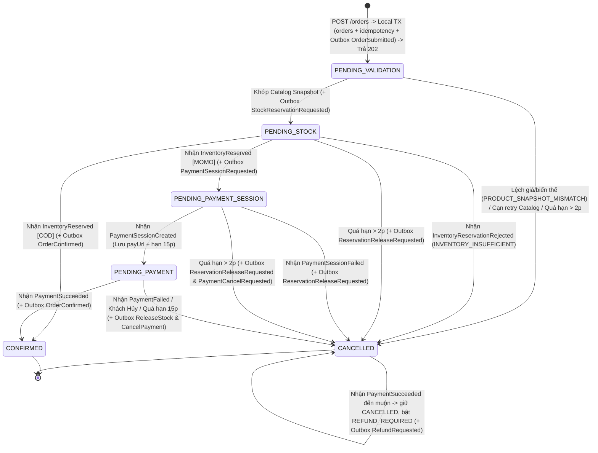
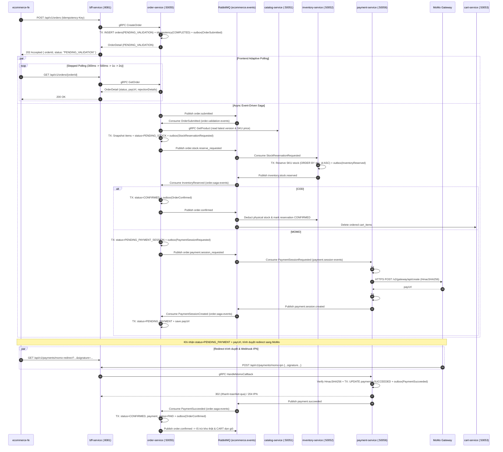

# Thiết Kế & Phân Tích Kỹ Thuật Chuyên Sâu: Hệ Thống Đặt Hàng Thuần Event-Driven (`202 Accepted` + Polling), Nhất Quán Snapshot, Tách Microservice `payment-service` (COD/MoMo) & RabbitMQ Saga

## 1. Bối Cảnh & Mục Đích (Intent and Why)

Kho mã nguồn hiện đã có bản đặc tả kiến trúc **Hybrid Saga + `payment-service`** tại [`2026-10-28-order-checkout-saga-design.md`](2026-10-28-order-checkout-saga-design.md) (kết hợp thẩm định `Catalog` + giữ kho `ReserveStock` + khởi tạo phiên `CreatePaymentSession` đồng bộ qua gRPC để trả `201 Created` kèm `payUrl` tức thì, và dùng Outbox/RabbitMQ cho bước chốt kết quả callback, nhả kho & dọn giỏ). Tuy nhiên, trong các bài toán chịu đỉnh tải đột biến lớn (*Flash Sale / Peak-Shaving*) hoặc yêu cầu tách rời thời gian sống (*Temporal Decoupling*) triệt để giữa cửa ngõ tiếp nhận đơn hàng và toàn bộ dịch vụ phụ thuộc phía sau (`catalog-service`, `inventory-service`, `payment-service` và cổng `MoMo`), mô hình gọi gRPC đồng bộ trên luồng bấm nút của người dùng vẫn chịu giới hạn bởi độ trễ mạng liên dịch vụ và trạng thái sống tức thời của từng hệ thống đích.

Tài liệu này đặc tả đầy đủ phiên bản kiến trúc độc lập theo hướng **Thuần Event-Driven Toàn Trình (Pure Asynchronous Intake + Event-Driven Saga Orchestration)** kết hợp tách mới microservice **`services/payment-service/`** (Go 1.24, sở hữu `payment_db`), tuân thủ nguyên bản tinh thần bất đồng bộ của [ADR-005](../../adr/005-saga-compensation-and-reservation-lifecycle.md):

1. Ngay khoảnh khắc khách hàng bấm nút **Đặt hàng**, `POST /api/v1/orders` chỉ xác thực đầu vào & quyền `order.create`, ghi nguyên tử đơn hàng ở trạng thái tiếp nhận `PENDING_VALIDATION` cùng bản ghi `idempotency_records` và sự kiện `OrderSubmitted` vào `order_db`, rồi trả về **`HTTP 202 Accepted` ngay lập tức (`~3–5ms`)** mà không gọi sang `Catalog`, `Inventory`, `Payment` hay cổng `MoMo` trên luồng HTTP của trình duyệt.
2. Toàn bộ quy trình thẩm định phiên bản danh mục (`products.version`), giữ chỗ tồn kho theo từng `sku_id` tại `inventory-service`, khởi tạo phiên thanh toán `MoMo` (`payUrl`) tại `payment-service`, chốt kết quả thanh toán, khấu trừ kho vật lý, bồi hoàn nhả kho / hủy phiên thanh toán và dọn giỏ hàng đều vận hành **100% bất đồng bộ qua Transactional Outbox + RabbitMQ** giữa `order-service`, `inventory-service`, `payment-service` và `cart-service`.
3. Trình duyệt (`ecommerce-fe`) thực hiện **Polling thích ứng** trên `GET /api/v1/orders/{orderId}` để nhận kết quả cuối cùng: điều hướng trang thành công (`COD`), tự động chuyển hướng sang `payUrl` (`MOMO`), hoặc hiển thị chi tiết từng dòng SKU bị lệch giá / hết tồn kho (`CANCELLED` kèm `rejectionDetails`).

---

## 2. Mục Tiêu, Phi Mục Tiêu & Phản Mục Tiêu (Goals, Non-Goals, Anti-Goals)

### 2.1. Mục tiêu (Goals)
- **Tiếp nhận đơn hàng tức thời & San phẳng đỉnh tải (Instant Intake & Peak-Shaving)**:
  - `POST /api/v1/orders` phản hồi `202 Accepted` chỉ với một giao dịch ghi cục bộ vào `order_db`. Ngay cả khi `catalog-service`, `inventory-service`, `payment-service` hoặc cổng `MoMo` đang bảo trì ngắn / khởi động lại (10–30 giây), yêu cầu đặt hàng vẫn được tiếp nhận an toàn vào hàng đợi sự kiện và tự động xử lý tiếp khi dịch vụ đích phục hồi.
- **Tách Bounded Context `payment-service` độc lập (Go 1.24 + `payment_db`) vận hành thuần Event-Driven với `order-service`**:
  - Cô lập toàn bộ khóa bí mật `MOMO_*`, ký/xác thực `HmacSHA256`, vòng đời phiên thanh toán (`payments`), chống trùng và cắm bia mộ (**Tombstone `CANCELLED`**) theo `order_id`, cùng bảng `payment_db.outbox_events` bên trong `services/payment-service/`.
  - `order-service` và `payment-service` **không gọi gRPC đồng bộ cho nhau**; mọi yêu cầu mở phiên thanh toán, trả `payUrl`, báo thanh toán thành công/thất bại, hủy phiên và yêu cầu đối soát hoàn tiền đều đi qua RabbitMQ. Chỉ duy nhất `bff-service` gọi private gRPC `PaymentService.HandleMomoCallback` (`:50056`) ở biên tiếp nhận HTTP redirect/IPN từ MoMo.
- **Đặt hàng đa sản phẩm từ giỏ hàng, Sổ địa chỉ & Thanh toán `COD` / `MOMO`**:
  - Hỗ trợ chọn nhiều dòng phân loại (`skuId`) từ `CartPage` sang `OrderPreviewPage` (`/gio-hang/dat-hang`), chọn hoặc thêm mới địa chỉ nhận hàng từ `identity-service` (`/api/v1/users/me/addresses`), và chọn phương thức thanh toán `COD` hoặc ví điện tử `MOMO` (`captureWallet` v2).
- **Trải nghiệm Polling mượt mà & Phản hồi lỗi có cấu trúc**:
  - Cung cấp cơ chế Polling giãn nhịp thông minh (*stepped backoff*) kèm tự khôi phục phiên chờ khi tải lại trang (`sessionStorage`) tại `OrderPreviewPage`, cùng cơ chế poll hội tụ ngắn tại trang kết quả `/thanh-toan/ket-qua`.
  - Bảo toàn trọn vẹn độ chi tiết của thông báo lỗi nghiệp vụ: khi đơn bị từ chối ngầm do lệch snapshot (`PRODUCT_SNAPSHOT_MISMATCH`), thiếu tồn kho (`INVENTORY_INSUFFICIENT`) hoặc lỗi mở phiên thanh toán (`PAYMENT_INITIATION_FAILED`), kết quả tra cứu đơn trả về đầy đủ `cancelReason` và bản đồ `rejectionDetails` theo từng `skuId`.
- **Chống bán âm kho (Anti-Oversell) & Bền vững Saga đa chiều qua Outbox**:
  - Cả ba dịch vụ tham gia điều phối trạng thái (`order-service`, `inventory-service`, `payment-service`) đều xuất bản sự kiện qua bảng `outbox_events` cục bộ trong cùng giao dịch cơ sở dữ liệu ([ADR-002](../../adr/002-transactional-outbox.md)), kết hợp đánh thức tức thời sau commit (`wakeupCh` / `AFTER_COMMIT`) để tổng độ trễ toàn trình khi tải thường chỉ mất `~40–100ms`.
- **Bộ công cụ mô phỏng đa luồng (Concurrency & Race-Condition Simulation Suite)**:
  - Kiểm chứng tự động bằng kịch bản bắn tải đồng thời trên mô hình `202 Accepted` + Polling xuyên `order_db`, `inventory_db` và `payment_db`.

### 2.2. Phi mục tiêu (Non-Goals)
- Không dựng hạ tầng WebSocket hoặc Server-Sent Events (SSE) xuyên qua BFF và Kong; việc nhận kết quả xử lý đơn thực hiện thuần túy qua HTTP Polling trên `GET /api/v1/orders/{orderId}`.
- Không tách một `saga-service` riêng ngoài `order-service`; `order-service` sở hữu vòng đời đơn hàng và điều phối Saga bất đồng bộ.
- Không mở rộng thêm phương thức thanh toán ngoài `COD` và `MOMO` (`captureWallet` v2) ở giai đoạn này.
- Không nhúng logic đơn hàng hoặc RabbitMQ vào `catalog-service` (tuân thủ nghiêm ngặt `services/catalog-service/AGENTS.md`).
- Không triển khai mã giảm giá (voucher), tách kiện đa kho, guest checkout, hoặc gọi tự động sang API Refund của MoMo (các ca thanh toán muộn sau khi đơn đã hủy hội tụ về cờ `REFUND_REQUIRED` ở cả `order-service` và `payment-service`).

### 2.3. Phản mục tiêu (Anti-Goals)
- **Không gọi `Catalog`, `Inventory`, `Payment` hay `MoMo` bên trong luồng xử lý HTTP `POST /api/v1/orders`**, và **không gọi gRPC đồng bộ giữa `order-service` với `inventory-service` hoặc `payment-service`**.
- **Không giữ khóa DB trong lúc khách xem trang `OrderPreviewPage`**, **không dùng 2PC/XA**, và **không bao giờ giữ DB Transaction mở xuyên qua lời gọi mạng** (`gRPC`, `HTTPS MoMo`, hay `RabbitMQ publish`) tại bất kỳ service nào.
- **Không mở lại đơn hàng đã rơi vào trạng thái kết thúc (`CONFIRMED` hoặc `CANCELLED`)** trong bất kỳ hoàn cảnh sự kiện đến trễ nào ([ADR-005](../../adr/005-saga-compensation-and-reservation-lifecycle.md)).
- **Không tin tưởng giá từ client mà không qua bước thẩm định `Catalog`**, và **không chấp nhận kết quả `momo-redirect` / `momo-ipn` (kể cả báo thành công hay báo thất bại) nếu chưa xác thực chữ ký `HmacSHA256` hằng thời gian**.

---

## 3. Ràng Buộc Kiến Trúc (Architectural Constraints)

- **Ranh giới dịch vụ (`make check-boundaries`)**:
  - Bổ sung `services/payment-service/` (Go module `ecommerce.local/payment-service`, sở hữu độc quyền `payment_db`, local HTTP health `:8086`, private gRPC `127.0.0.1:50056`).
  - Các cơ sở dữ liệu `order_db`, `payment_db`, `inventory_db`, `catalog_db`, `cart_db`, `identity_db` độc lập tuyệt đối; không import mã nguồn chéo giữa các service; không chứa chuỗi tên DB ngoại lai ngay cả trong comment SQL/code bên trong `services/<name>-service/`; không chứa chuỗi gọi nội bộ qua Kong (`:8000`) trong `services/*`.
- **Định tuyến biên (`ADR-011`)**:
  - Giữ nguyên cấu trúc 2 upstream ứng dụng hiện hữu trên Kong (`identity-service` và `bff-service`).
  - Các route `/api/v1/orders...` đi qua Kong (xác thực JWT + plugin `caller-context`) $\rightarrow$ `bff-service` $\rightarrow$ `order-service` private gRPC (`:50055`).
  - Hai route callback công khai `/api/v1/payments/momo-redirect` và `/api/v1/payments/momo-ipn` đi qua Kong với `request-transformer` xóa sạch `X-User-Id` & `X-User-Roles` chống giả mạo danh tính, chuyển tiếp vào `bff-service` $\rightarrow$ gọi thẳng `payment-service` private gRPC (`:50056`) xác thực chữ ký `HmacSHA256`.
  - Bổ sung `Idempotency-Key` vào danh sách CORS `headers` trên `deployments/kong/kong.yaml`.
- **Tương thích hợp đồng (`ADR-006`, `ADR-013`)**:
  - Giữ nguyên `inventory.proto` không thêm RPC giữ kho đồng bộ; tạo mới `contracts/proto/payment/v1/payment.proto` chỉ chứa duy nhất 1 RPC `HandleMomoCallback` phục vụ `bff-service`; mọi thay đổi trên `catalog.proto`, `cart.proto`, `order.proto` đều là cộng thêm (*additive*), bảo toàn số thứ tự trường gốc.

---

## 4. Các Phương Án Kiến Trúc Đã Cân Nhắc & Phân Tích Kỹ Thuật Chuyên Sâu

### 4.1. Lựa chọn phương án tích hợp `payment-service` trong mô hình Thuần Event-Driven

Trên nền tảng cửa ngõ tiếp nhận `202 Accepted` + worker nền thẩm định `CatalogService.GetProduct` (tránh độ trễ giá cũ của việc nhân bản bảng sản phẩm và tránh khóa cứng cửa ngõ `POST /orders` vào `Catalog`), hai phương án kết nối `order-service` với `payment-service` đã được đặt lên bàn cân:

#### Phương án A (Được chọn): Thuần Event-Driven 100% giữa `order-service` ↔ `payment-service` qua RabbitMQ + Tiếp nhận MoMo Callback qua `Kong -> bff-service -> payment-service (gRPC)`
- **Cơ chế**:
  1. `POST /api/v1/orders` kiểm tra đầu vào + quyền `order.create` (`Identity` `:50054`), ghi 1 TX cục bộ `orders(PENDING_VALIDATION)` + `idempotency_records(COMPLETED)` + `outbox_events(OrderSubmitted)`, trả ngay `202 Accepted` (`~3–5ms`).
  2. Consumer `order.validation-events` đọc `CatalogService.GetProduct` kiểm tra `version` + SKU snapshot; nếu khớp thì chốt snapshot, đổi sang `PENDING_STOCK` và phát `StockReservationRequested`.
  3. `inventory-service` giữ kho nguyên tử (`ORDER BY sku_id ASC`) và phát ngược `InventoryReserved` hoặc `InventoryReservationRejected` qua `inventory_db.outbox_events`.
  4. Consumer `order.saga-events` tại `order-service` nhận `InventoryReserved`:
     - Với `COD`: chuyển đơn sang `CONFIRMED` + phát `OrderConfirmed`.
     - Với `MOMO`: chuyển đơn sang trạng thái quá độ `PENDING_PAYMENT_SESSION` và phát sự kiện `PaymentSessionRequested` lên RabbitMQ (không gọi gRPC đồng bộ sang `payment-service`).
  5. `payment-service` tiêu thụ `PaymentSessionRequested` trên hàng đợi riêng `payment.session-events`: mở `TX #A` ngắn cắm dòng `INITIATING`, gọi HTTPS MoMo v2 bên ngoài DB TX (`3s` connect / `10s` total timeout), rồi mở `TX #B` lưu `PENDING` + `pay_url` kèm sự kiện `PaymentSessionCreated` (hoặc `PaymentSessionFailed`) vào `payment_db.outbox_events` và kích hoạt `wakeupCh` đẩy ngay về `order-service`.
  6. `order-service` nhận `PaymentSessionCreated`, chuyển `PENDING_PAYMENT_SESSION → PENDING_PAYMENT` + lưu `pay_url` để trình duyệt đang Poll trên `OrderPreviewPage` tự động redirect sang cổng MoMo.
  7. Khi khách thanh toán xong, `momo-redirect` & `momo-ipn` đi qua `Kong -> bff-service -> PaymentService.HandleMomoCallback (:50056)` xác thực `HmacSHA256`, lưu `SUCCEEDED`/`FAILED` và bắn `PaymentSucceeded`/`PaymentFailed` qua Outbox về `order-service` chốt đơn.
- **Lý do chọn**:
  - Giữ trọn vẹn triết lý tách rời thời gian sống (*temporal decoupling*) toàn trình từ kho tới thanh toán: `order.saga-events` tại `order-service` chỉ thực thi các giao dịch DB cục bộ `~1–2ms`, không bao giờ bị treo consumer thread chờ mạng HTTPS MoMo.
  - Sống sót tự nhiên qua các đợt bảo trì/khởi động lại ngắn (`15–30s`) của cả `inventory-service` lẫn `payment-service` nhờ hàng đợi bền vững và cơ chế retry Exponential Backoff.
  - Tận dụng sẵn vòng Polling đang chạy trên `OrderPreviewPage` sau `202 Accepted` nên người dùng không phải chịu thêm bất kỳ bước chờ phụ nào khi tạo link MoMo.
- **Đánh đổi chấp nhận**: Thêm cặp sự kiện `PaymentSessionRequested` / `PaymentSessionCreated` | `PaymentSessionFailed` và trạng thái quá độ `PENDING_PAYMENT_SESSION` (tăng thêm `~15–30ms` truyền tin nội bộ, vẫn nằm gọn trong nhịp Poll đầu tiên `300ms` của trình duyệt).

#### Phương án B (Loại bỏ): Bán Event-Driven — Giữ kho qua RabbitMQ nhưng worker `InventoryReserved` gọi gRPC đồng bộ `CreatePaymentSession` sang `payment-service`
- **Cơ chế**: Khi nhận `InventoryReserved` của đơn `MOMO`, consumer của `order-service` gọi trực tiếp gRPC `PaymentService.CreatePaymentSession(:50056)` để lấy `payUrl`.
- **Lý do loại bỏ**: Phá vỡ tính đồng nhất của kiến trúc thuần Event-Driven; làm các consumer thread trên `order.saga-events` bị giam cứng suốt thời gian `payment-service` chờ phản hồi HTTPS từ MoMo (lên tới `10s`), gây nguy cơ nghẽn hàng đợi chốt đơn của các đơn `COD` đi chung.

---

### 4.2. Phân tích chuyên sâu 7 trụ cột kỹ thuật của kiến trúc Thuần Event-Driven + `payment-service`

#### Trụ cột 1: Máy trạng thái Saga Bất đồng bộ Toàn trình & Chuỗi sự kiện Liên Dịch Vụ (`ADR-005`)





#### Trụ cột 2: Tối ưu độ trễ Outbox ba phân hệ xuống dưới `100ms` ("After-Commit Wakeup + Periodic Sweep") & Cô lập Hàng đợi
- **Đánh thức tức thời trong bộ nhớ sau khi Commit (`Immediate Wakeup`)**:
  - Tại `order-service` (Java/Spring): sử dụng `@TransactionalEventListener(phase = TransactionPhase.AFTER_COMMIT)` kích hoạt không chặn `OutboxRelay` rút và đẩy batch vừa ghi lên RabbitMQ ngay lập tức (`~2–5ms`).
  - Tại `inventory-service` và `payment-service` (Go): ngay sau khi `tx.Commit(ctx)` thành công, gửi tín hiệu non-blocking vào `chan struct{}` có buffer `1` (`select { case wakeupCh <- struct{}{}: default: }`) để goroutine `OutboxRelay` thức dậy xuất bản ngay tức khắc.
  - Vòng quét định kỳ `1000ms` dùng `SELECT ... FOR UPDATE SKIP LOCKED` (claim lease `next_attempt_at = now() + 15s` ngoài I/O mạng) đóng vai trò lưới bảo hiểm **At-Least-Once Delivery 100%** khi tiến trình sập nguồn.
- **Cô lập hàng đợi chống nghẽn dây chuyền (*Queue Isolation / Anti-Head-of-Line Blocking*)**:
  - Tại `order-service`: tách riêng `order.validation-events` (có gọi gRPC đọc `Catalog`) khỏi `order.saga-events` (chỉ chạy giao dịch DB cục bộ `~1ms` cho các sự kiện từ kho và thanh toán).
  - Tại `payment-service`: tách riêng `payment.session-events` (có gọi HTTPS ra cổng MoMo bên ngoài `3s/10s`) khỏi `payment.order-events` (chỉ chạy giao dịch DB cục bộ `~1ms` cho `PaymentCancelRequested` và `RefundRequested`). Nhờ vậy, kể cả khi cổng MoMo đang phản hồi chậm, các lệnh hủy đơn và cắm **Tombstone `CANCELLED`** vẫn đi thẳng vào `payment_db` tức thì mà không bị xếp hàng chờ phía sau các cuộc gọi HTTPS!

#### Trụ cột 3: Đóng gói chi tiết sai lệch Snapshot (`products.version` + `rejectionDetails JSONB`) cho Polling
- Bảng `products` của `catalog_db` bổ sung `version BIGINT NOT NULL DEFAULT 1`, chỉ tăng nguyên tử (`version = version + 1`) khi quản trị viên thay đổi thuộc tính thương mại (`UpdateProduct`, `SoftDeleteProduct`).
- Consumer `OrderSubmitted` đối chiếu dữ liệu kỳ vọng của từng dòng `sku_id` với `CatalogService.GetProduct` theo 5 mức ưu tiên (`UNAVAILABLE`, `VARIANT_UNAVAILABLE`, `PRICE_CHANGED`, `INFO_UPDATED`, `VERSION_CHANGED`) và lưu bền vững bản đồ `<skuId> -> "<mô tả chi tiết>"` vào cột `rejection_details JSONB` của bảng `orders` khi chuyển sang `CANCELLED`.

#### Trụ cột 4: Chống Oversell, Chống Deadlock & Bia Mộ (Tombstone) Kép ở cả Kho và Thanh Toán (`ADR-003`, `ADR-005`, `ADR-013`)
- **Tại `inventory-service`**:
  - Gom nhóm cộng dồn theo `sku_id`, sắp xếp **`ORDER BY sku_id ASC`** chống Deadlock, cập nhật nguyên tử `UPDATE stock SET reserved = reserved + $2 WHERE sku_id = $1 AND (quantity - reserved) >= $2` kèm `SAVEPOINT before_reserve` để ghi nhận `InventoryReservationRejected` trong cùng 1 commit nếu thiếu hàng.
  - Đua tranh hai chiều: nếu `ReservationReleaseRequested` đến trước `StockReservationRequested` bị kẹt mạng, `INSERT INTO stock_reservations ... ON CONFLICT (order_id) DO NOTHING` cắm sẵn **Tombstone `RELEASED`** chặn gói giữ kho trễ; ngược lại nếu `InventoryReserved` bay về khi đơn ở `order-service` đã `CANCELLED`, `order-service` lập tức phát bù `ReservationReleaseRequested`.
- **Tại `payment-service`**:
  - Áp dụng cùng mô hình bảo vệ hai chiều theo `order_id`:
    1. *Chiều lệnh hủy đến `payment-service` trước gói mở phiên*: `PaymentCancelRequested` chạy `INSERT INTO payments (order_id, status, momo_order_id, momo_request_id, cancel_reason) VALUES ($1, 'CANCELLED', $1, 'tombstone:' || $1, $2) ON CONFLICT (order_id) DO NOTHING`, cắm sẵn **Tombstone `CANCELLED`**. Khi gói `PaymentSessionRequested` bị lag mạng đến sau, `TX #A` thấy dòng đã `CANCELLED` nên `ACK` bỏ qua ngay mà không gọi sang MoMo!
    2. *Chiều gói `PaymentSessionCreated` bay về khi đơn bên `order-service` vừa bị hủy quá hạn*: `order-service` thấy `orders.status == CANCELLED` sẽ bỏ qua `payUrl` và phát bù `PaymentCancelRequested` (+ `ReservationReleaseRequested`) để `payment-service` đánh dấu phiên sang `CANCELLED`.

#### Trụ cột 5: Đơn giản hóa triệt để `Idempotency-Key` nhờ Intake Bất đồng bộ (`ADR-006`)
- `idempotency_records`, `orders(PENDING_VALIDATION)`, `order_items` và `outbox_events(OrderSubmitted)` được chèn và đánh dấu `COMPLETED` ngay trong cùng `Local TX #1` chỉ kéo dài vài mili-giây (`INSERT INTO idempotency_records ... ON CONFLICT (user_id, idempotency_key) DO NOTHING`), trả về cùng phản hồi `202 Accepted` với một `orderId` duy nhất cho mọi request trùng hợp lệ và trả `409 IDEMPOTENCY_KEY_REUSED` nếu khác `request_fingerprint`.

#### Trụ cột 6: Đối soát Tập trung Một Đầu Mối (`OrderReconciliationScheduler`) & Xử lý Late Payment (`ADR-005`)
- Toàn bộ chính sách thời gian nghiệp vụ chỉ đặt tại `order-service` (không chạy cron quét hết hạn riêng lẻ bên `inventory-service` hay `payment-service`), triệt tiêu nguy cơ lệch đồng hồ liên dịch vụ:
  - `PENDING_VALIDATION > 2 phút` $\rightarrow$ `CANCELLED` (`PROCESSING_TIMEOUT`).
  - `PENDING_STOCK > 2 phút` $\rightarrow$ `CANCELLED` (`STOCK_RESERVATION_TIMEOUT`) + phát `ReservationReleaseRequested`.
  - `PENDING_PAYMENT_SESSION > 2 phút` $\rightarrow$ `CANCELLED` (`PAYMENT_INITIATION_TIMEOUT`) + phát đồng thời `ReservationReleaseRequested` và `PaymentCancelRequested`.
  - `PENDING_PAYMENT > 15 phút` (`payment_expires_at < now()`) $\rightarrow$ `CANCELLED` (`PAYMENT_EXPIRED`) + phát đồng thời `ReservationReleaseRequested` và `PaymentCancelRequested`.
- Khi MoMo gửi IPN báo `resultCode=0` đến muộn sau khi đơn đã `CANCELLED`: giữ bất biến `orders.status = CANCELLED` (`ADR-005`), hội tụ cả `orders.payment_status = REFUND_REQUIRED` lẫn `payments.status = REFUND_REQUIRED` (kèm `momo_trans_id` và sự kiện `RefundRequested`) để đối soát hoàn tiền không sót một đồng nào.

#### Trụ cột 7: Bảo mật hai chiều chữ ký `HmacSHA256` tại `payment-service`
- **Chiều đi (`PaymentSessionRequested`)**: Ký `HmacSHA256` bằng `MOMO_SECRET_KEY` trên chuỗi chuẩn MoMo v2 `captureWallet` bên ngoài DB TX (`TX #A` $\rightarrow$ HTTPS MoMo `3s/10s` $\rightarrow$ `TX #B`).
- **Chiều về (`HandleMomoCallback`)**: Tái tạo chữ ký và đối chiếu hằng thời gian bằng `hmac.Equal` **trước mọi truy vấn DB**, đồng thời kiểm tra `amount == payments.amount_minor`. Ngăn chặn tuyệt đối cả hành vi giả mạo `resultCode=0` chiếm đoạt đơn lẫn hành vi bắn `resultCode=1006` giả mạo nhằm phá hủy đơn đang chờ thanh toán của khách hàng khác.

---

## 5. Thiết Kế Chi Tiết Từng Phân Hệ (Surface-by-Surface Specification)

### 5.1. Hợp đồng Sự kiện RabbitMQ Dùng Chung (`ecommerce.events`)

Tất cả sự kiện xuất bản lên Topic Exchange bền vững `ecommerce.events` (kèm Dead-Letter Exchange `ecommerce.events.dlx`) tuân thủ phong bì JSON chuẩn theo [ADR-002](../../adr/002-transactional-outbox.md):

```json
{
  "eventId": "550e8400-e29b-41d4-a716-446655440000",
  "eventType": "PaymentSessionRequested",
  "schemaVersion": 1,
  "occurredAt": "2026-11-05T08:30:00Z",
  "aggregateId": "019a47c2-7f2b-7a10-9a12-1029384756ab",
  "correlationId": "trace-id-propagated",
  "payload": {}
}
```

| `eventType` | Routing Key | Producer | Consumer Queue | Payload chính |
| :--- | :--- | :--- | :--- | :--- |
| `OrderSubmitted` | `order.submitted` | `order-service` | `order.validation-events` | `{ orderId }` |
| `StockReservationRequested` | `order.stock.reserve_requested` | `order-service` | `inventory.order-events` | `{ orderId, expiresAt, items: [{ skuId, productId, quantity }] }` |
| `InventoryReserved` | `inventory.stock.reserved` | `inventory-service` | `order.saga-events` | `{ orderId, expiresAt, items: [{ skuId, productId, quantity }] }` |
| `InventoryReservationRejected` | `inventory.stock.rejected` | `inventory-service` | `order.saga-events` | `{ orderId, reason, skuId, productId, available, requested }` |
| `PaymentSessionRequested` | `order.payment.session_requested` | `order-service` | `payment.session-events` | `{ orderId, orderCode, userId, amountMinor, currency, expiresAt }` |
| `PaymentSessionCreated` | `payment.session.created` | `payment-service` | `order.saga-events` | `{ orderId, payUrl, expiresAt }` |
| `PaymentSessionFailed` | `payment.session.failed` | `payment-service` | `order.saga-events` | `{ orderId, reason, resultCode, message }` |
| `PaymentSucceeded` | `payment.succeeded` | `payment-service` | `order.saga-events` | `{ orderId, momoOrderId, momoTransId, amountMinor, currency }` |
| `PaymentFailed` | `payment.failed` | `payment-service` | `order.saga-events` | `{ orderId, momoOrderId, resultCode, message }` |
| `OrderConfirmed` | `order.confirmed` | `order-service` | `inventory.order-events`, `cart.order-events` | `{ orderId, orderCode, userId, items: [{ skuId, productId, quantity, cartItemId }] }` |
| `ReservationReleaseRequested` | `order.reservation.release_requested` | `order-service` | `inventory.order-events` | `{ orderId, reason }` |
| `InventoryReleased` | `inventory.stock.released` | `inventory-service` | `order.saga-events` | `{ orderId, reason, releasedAt }` |
| `PaymentCancelRequested` | `order.payment.cancel_requested` | `order-service` | `payment.order-events` | `{ orderId, reason }` |
| `RefundRequested` | `order.payment.refund_requested` | `order-service` | `payment.order-events` | `{ orderId, momoTransId, amountMinor, currency, reason }` |

- **Cô lập hàng đợi chống nghẽn dây chuyền (*Queue Isolation / Anti-Head-of-Line Blocking*) & Exponential Backoff**:
  - Bước thẩm định danh mục (`OrderSubmitted`) được tách riêng sang queue `order.validation-events` (kèm `order.validation-events.dlq`), độc lập hoàn toàn với `order.saga-events` (nơi xử lý các sự kiện kho và thanh toán) để khi `catalog-service` gặp sự cố không gây Head-of-Line Blocking lên các sự kiện chốt/nhả kho `InventoryReserved` / `InventoryReleased` hay kết quả thanh toán. Tương tự tại `payment-service`, queue gọi HTTPS bên ngoài `payment.session-events` tách biệt hoàn toàn khỏi queue nội bộ `payment.order-events`.
  - Mỗi consumer queue (`order.validation-events`, `order.saga-events`, `inventory.order-events`, `payment.session-events`, `payment.order-events`, `cart.order-events`) đều cấu hình `x-dead-letter-exchange = ecommerce.events.dlx` đẩy vào queue `.dlq` tương ứng sau tối đa `5` lần thử lại theo **Exponential Backoff** (`1s -> 3s -> 7s -> 15s -> 25s`, tổng cửa sổ ~`51s`, đủ bao phủ trọn vẹn thời gian khởi động lại ngắn hạn `10–30s` của các dịch vụ đích).

---

### 5.2. `identity-service` — Phân quyền RBAC cho Đơn hàng
- **Flyway Migration (`services/identity-service/src/main/resources/db/migration/V12__add_order_permissions.sql`)**:
  - Thêm 3 quyền hệ thống vào `auth_items` (`type = 'PERMISSION'`, `system_item = true`): `order.create`, `order.view`, `order.cancel`, gán cho vai trò `CUSTOMER` trong `auth_item_children` (`ON CONFLICT DO NOTHING`).

---

### 5.3. `contracts` — Hợp đồng Protobuf Cộng thêm (Additive Only)

#### a) `contracts/proto/catalog/v1/catalog.proto`
- Bổ sung trường phiên bản sản phẩm: `GetProductResponse.version = 24`, `ProductSummary.version = 19`, `AdminProductSummary.version = 24`.

#### b) `contracts/proto/cart/v1/cart.proto`
- Trên `CartItem`: thêm `int64 product_version = 17;`

#### c) `contracts/proto/inventory/v1/inventory.proto`
- **Giữ nguyên 100%, không thêm RPC giữ kho đồng bộ**. Toàn bộ luồng giữ chỗ, chốt kho và nhả kho giao tiếp hoàn toàn qua sự kiện RabbitMQ.

#### d) `contracts/proto/payment/v1/payment.proto` (Mới — Tinh gọn 1 RPC cho biên Callback)
- Gói hợp đồng `ecommerce.payment.v1` (`go_package = "ecommerce.local/contracts/go/payment/v1;paymentv1"`, `java_package = "com.ecommerce.contracts.payment.v1"`), chỉ mở duy nhất RPC tiếp nhận callback cho `bff-service` (toàn bộ chiều tạo phiên / hủy phiên với `order-service` đi qua RabbitMQ):
  ```protobuf
  service PaymentService {
    rpc HandleMomoCallback(HandleMomoCallbackRequest) returns (HandleMomoCallbackResponse);
  }

  message HandleMomoCallbackRequest {
    string partner_code = 1;
    string order_id = 2;
    string request_id = 3;
    int64 amount = 4;
    string order_info = 5;
    string order_type = 6;
    string trans_id = 7;
    int32 result_code = 8;
    string message = 9;
    string pay_type = 10;
    int64 response_time = 11;
    string extra_data = 12;
    string signature = 13;
    string source = 14;  // "REDIRECT" | "IPN"
  }

  message HandleMomoCallbackResponse {
    string order_id = 1;
    string payment_status = 2;   // SUCCEEDED | FAILED | REFUND_REQUIRED | CANCELLED
    string redirect_result = 3;  // "success" | "failed"
  }
  ```
- Mã lỗi `google.rpc.ErrorInfo` (`Domain = "ecommerce.payment.v1"`): `INVALID_MOMO_SIGNATURE` (`codes.InvalidArgument`), `PAYMENT_AMOUNT_MISMATCH` (`codes.InvalidArgument`), `PAYMENT_NOT_FOUND` (`codes.NotFound`).

#### e) `contracts/proto/order/v1/order.proto`
- Bảo toàn tuyệt đối số thứ tự các trường gốc hiện có (`1..4` trên `OrderItem`, `1..2` trên `CreateOrderRequest`, `1..3` trên `CreateOrderResponse`) và chỉ giữ 4 RPC miền đơn hàng:
  ```protobuf
  service OrderService {
    rpc CreateOrder(CreateOrderRequest) returns (CreateOrderResponse);
    rpc GetOrder(GetOrderRequest) returns (GetOrderResponse);
    rpc ListOrders(ListOrdersRequest) returns (ListOrdersResponse);
    rpc CancelOrder(CancelOrderRequest) returns (CancelOrderResponse);
  }
  ```
  - `OrderDetail.status` hỗ trợ: `PENDING_VALIDATION | PENDING_STOCK | PENDING_PAYMENT_SESSION | PENDING_PAYMENT | CONFIRMED | CANCELLED`, kèm `map<string, string> rejection_details = 18;`.

---

### 5.4. `catalog-service` — Quản lý Phiên bản Danh mục (`version`)
- **Migration `000006_add_product_version.up.sql`**: `ALTER TABLE products ADD COLUMN version bigint NOT NULL DEFAULT 1;`
- `GetByID`, `Search`, `ListAdmin` đọc cột `version`; `UpdateProduct` và `SoftDelete` tăng nguyên tử `version = version + 1, updated_at = now()`.

---

### 5.5. `inventory-service` — Giữ chỗ Nguyên tử Theo SKU, `SAVEPOINT`, Tombstone & Transactional Outbox
- **Migration `000003_create_stock_reservations_and_outbox.up.sql`**: tạo bảng `stock_reservations`, `stock_reservation_items` và `outbox_events` (`ix_inventory_outbox_pending`).
- **Consumer trên `inventory.order-events`**:
  1. `StockReservationRequested`: gom nhóm cộng dồn theo `sku_id`, sắp xếp `ORDER BY sku_id ASC`, chạy `INSERT INTO stock_reservations ... ON CONFLICT (order_id) DO NOTHING` (nếu đã tồn tại dòng hoặc đã cắm Tombstone `RELEASED` thì `ACK` bỏ qua ngay); nếu mới thì đặt `SAVEPOINT before_reserve`, cập nhật `stock` và ghi `outbox_events` (`InventoryReserved` hoặc quay lui về `SAVEPOINT` để ghi `RELEASED` + `InventoryReservationRejected`), sau đó kích hoạt `wakeupCh`.
  2. `OrderConfirmed`: khóa `FOR UPDATE`, nếu `ACTIVE` thì trừ `quantity` & `reserved` theo `ORDER BY sku_id ASC` và chuyển sang `CONFIRMED`.
  3. `ReservationReleaseRequested`: cắm **Tombstone `RELEASED`** bằng `INSERT ... ON CONFLICT (order_id) DO NOTHING`, hoặc nếu đang `ACTIVE` thì hoàn trả `reserved`, chuyển `RELEASED`, chèn `outbox_events(InventoryReleased)` và kích hoạt `wakeupCh`.

---

### 5.6. `cart-service` — Enrichment `product_version` & Tự động Dọn giỏ hàng khi `OrderConfirmed`
- **Migration `000004_create_processed_events.up.sql`**: tạo bảng `processed_events(event_id)`.
- Điền `product_version` vào `CartItem`; consumer `cart.order-events` lắng nghe `order.confirmed` xóa đúng các dòng giỏ hàng đã đặt trong cùng transaction với `processed_events` (giữ nguyên các món không chọn mua và giữ nguyên giỏ khi đơn MoMo chưa thanh toán / bị hủy).

---

### 5.7. `payment-service` (Microservice Mới — Go 1.24 + `payment_db`)
- **Cổng giao tiếp & Hạ tầng**:
  - Module Go: `ecommerce.local/payment-service` tại `services/payment-service/` (cập nhật `go.work`, `Makefile`, `scripts/start-local`, `scripts/verify-foundation`, `deployments/postgres/init/01-create-databases.sql`, `deployments/docker/compose.production.yml`, `.github/workflows/ci.yml`).
  - HTTP Health Server: `:8086` (`GET /healthz`).
  - Private gRPC Server: local `127.0.0.1:50056`, container `0.0.0.0:50056` (`GRPC_ADDR`).
  - Sở hữu độc quyền PostgreSQL `payment_db` (migrations nhúng qua `embed.FS`).
- **Lược đồ `payment_db` (`000001_create_payments_and_outbox.up.sql`)**:
  ```sql
  CREATE TABLE payments (
      order_id text PRIMARY KEY,
      order_code text NOT NULL DEFAULT '',
      user_id text NOT NULL DEFAULT '',
      method text NOT NULL DEFAULT 'MOMO' CHECK (method IN ('MOMO')),
      status text NOT NULL CHECK (status IN ('INITIATING', 'PENDING', 'SUCCEEDED', 'FAILED', 'CANCELLED', 'REFUND_REQUIRED')),
      amount_minor bigint NOT NULL DEFAULT 0 CHECK (amount_minor >= 0),
      currency text NOT NULL DEFAULT 'VND',
      momo_order_id text NOT NULL,
      momo_request_id text NOT NULL,
      momo_trans_id text NOT NULL DEFAULT '',
      pay_url text NOT NULL DEFAULT '',
      result_code integer,
      result_message text NOT NULL DEFAULT '',
      cancel_reason text NOT NULL DEFAULT '',
      expires_at timestamptz NOT NULL DEFAULT now(),
      created_at timestamptz NOT NULL DEFAULT now(),
      updated_at timestamptz NOT NULL DEFAULT now(),
      CONSTRAINT uq_payments_momo_order_id UNIQUE (momo_order_id),
      CONSTRAINT uq_payments_momo_request_id UNIQUE (momo_request_id)
  );

  CREATE TABLE outbox_events (
      id text PRIMARY KEY,
      event_type text NOT NULL,
      routing_key text NOT NULL,
      aggregate_id text NOT NULL,
      correlation_id text NOT NULL DEFAULT '',
      payload jsonb NOT NULL,
      attempts integer NOT NULL DEFAULT 0,
      next_attempt_at timestamptz NOT NULL DEFAULT now(),
      published_at timestamptz,
      last_error text NOT NULL DEFAULT '',
      created_at timestamptz NOT NULL DEFAULT now()
  );

  CREATE INDEX ix_payment_outbox_pending
      ON outbox_events (next_attempt_at, created_at)
      WHERE published_at IS NULL;
  ```
- **Xử lý Consumer trên `payment.session-events` (`PaymentSessionRequested`)**:
  1. **TX #A ngắn (`~1ms`)**:
     - `INSERT INTO payments (order_id, order_code, user_id, method, status, amount_minor, currency, momo_order_id, momo_request_id, expires_at) VALUES ($1, $2, $3, 'MOMO', 'INITIATING', $4, $5, $1, $6, $7) ON CONFLICT (order_id) DO NOTHING`:
       - Nếu `RowsAffected() == 0`: đọc `SELECT status FROM payments WHERE order_id = $1 FOR UPDATE`:
         - Nếu `status IN ('CANCELLED', 'REFUND_REQUIRED')` (**Tombstone** đã cắm từ `PaymentCancelRequested`) hoặc `status IN ('PENDING', 'SUCCEEDED', 'FAILED')` (đã xử lý xong): `COMMIT` và `ACK` ngay không gọi MoMo.
         - Nếu `status == 'INITIATING'` (lần retry sau lỗi mạng tạm thời): cập nhật `momo_request_id` mới và `COMMIT` để thực hiện lại bước gọi HTTPS.
       - Nếu `RowsAffected() == 1`: `COMMIT` TX #A ngay trước khi gọi mạng.
  2. **Gọi HTTPS MoMo v2 bên ngoài DB TX (`DialTimeout = 3s`, `Timeout = 10s`)**:
     - Ký `HmacSHA256` gửi tới `MOMO_API_ENDPOINT` (hoặc sinh URL ký nội bộ khi `PAYMENT_MOMO_MOCK_ENABLED=true`).
     - Nếu gặp lỗi kết nối / timeout / `5xx` tạm thời và chưa chạm trần retry lần thứ 5: trả lỗi để consumer retry theo Exponential Backoff (`1s -> 3s -> 7s -> 15s -> 25s`). Nếu chạm lần thử cuối cùng thứ 5 (hoặc MoMo trả lỗi nghiệp vụ `resultCode != 0` ngay từ đầu): chạy `TX #B` cập nhật `status = 'FAILED'` + chèn `outbox_events(PaymentSessionFailed)` (`payment.session.failed`), `COMMIT` và kích hoạt `wakeupCh` để `order-service` hủy đơn & nhả kho ngay.
  3. **TX #B ngắn (`~1ms`) khi nhận `payUrl` hợp lệ**:
     - `SELECT status FROM payments WHERE order_id = $1 FOR UPDATE`: nếu vẫn đang `INITIATING` thì cập nhật `status = 'PENDING'`, `pay_url = $2`, `result_code = 0` và chèn `outbox_events(PaymentSessionCreated)` (`payment.session.created`), `COMMIT` rồi kích hoạt `wakeupCh`. Nếu trong lúc chờ MoMo mà `payment.order-events` đã chuyển dòng sang `CANCELLED` thì giữ nguyên `CANCELLED` và không phát `PaymentSessionCreated`.
- **Xử lý Consumer trên `payment.order-events` (`PaymentCancelRequested` & `RefundRequested`)**:
  - Tách hàng đợi độc lập nên luôn chạy tức thì (`~1ms`):
    - Với `PaymentCancelRequested`: chạy `INSERT INTO payments (order_id, status, momo_order_id, momo_request_id, cancel_reason) VALUES ($1, 'CANCELLED', $1, 'tombstone:' || $1, $2) ON CONFLICT (order_id) DO NOTHING`; nếu đã có dòng thì `SELECT ... FOR UPDATE` chuyển `INITIATING` / `PENDING` $\rightarrow$ `CANCELLED`, hoặc chuyển `SUCCEEDED` $\rightarrow$ `REFUND_REQUIRED`.
    - Với `RefundRequested`: `SELECT ... FOR UPDATE`, cập nhật lũy đẳng `status = 'REFUND_REQUIRED'`.
- **Xử lý gRPC `HandleMomoCallback`**:
  - Xác thực `HmacSHA256` hằng thời gian (`hmac.Equal`) trước mọi thao tác DB (`INVALID_MOMO_SIGNATURE` nếu sai).
  - Khóa `SELECT ... FROM payments WHERE momo_order_id = $1 FOR UPDATE`, kiểm tra `amount == amount_minor` (`PAYMENT_AMOUNT_MISMATCH`):
    - `result_code == 0`: nếu `PENDING` $\rightarrow$ `SUCCEEDED` + Outbox `PaymentSucceeded`; nếu `CANCELLED` (thanh toán muộn) $\rightarrow$ `REFUND_REQUIRED` + Outbox `PaymentSucceeded` (để `order-service` đồng bộ cờ `REFUND_REQUIRED`); nếu đã `SUCCEEDED`/`REFUND_REQUIRED` $\rightarrow$ bỏ qua lũy đẳng.
    - `result_code != 0`: nếu `PENDING` $\rightarrow$ `FAILED` + Outbox `PaymentFailed`; nếu đã kết thúc $\rightarrow$ giữ nguyên trạng thái.
  - Sau khi `COMMIT`, kích hoạt `wakeupCh` và trả `HandleMomoCallbackResponse` cho `bff-service`.
- **Cấu hình biến môi trường của `payment-service`**:
  - `MOMO_PARTNER_CODE`, `MOMO_ACCESS_KEY`, `MOMO_SECRET_KEY`, `MOMO_API_ENDPOINT`, `MOMO_CONNECT_TIMEOUT=3s`, `MOMO_READ_TIMEOUT=10s`, `PAYMENT_MOMO_MOCK_ENABLED=false`, `MOMO_REDIRECT_URL` & `MOMO_IPN_URL` (mặc định trong service trỏ `:8081` không chứa `:8000`; `scripts/start-local` tự nạp `.env` và truyền cổng ingress public khi chạy local).

---

### 5.8. `order-service` — Tiếp nhận Đơn `202`, Điều phối Saga Bất đồng bộ & Đối soát Tập trung
- **Cổng giao tiếp**:
  - HTTP nội bộ `:8083`, Management Actuator `:8093`, Private gRPC Server `:50055`.
  - Outbound gRPC clients: chỉ gọi `Identity` (`50054`, `500ms`) và `Catalog` (`50051`, timeout `2s`, bọc **Circuit Breaker** để fail-fast ngay lập tức thay vì ngâm consumer thread `2s` trên mỗi đơn khi `catalog-service` chết cứng; chỉ gọi từ worker nền `order.validation-events`, tuyệt đối không gọi trên luồng `CreateOrder`). **Không có gRPC client sang `Inventory` hay `Payment`, không chứa khóa `MOMO_*` hay logic HMAC**.
- **Lược đồ `order_db` (`V1__create_orders_idempotency_and_outbox.sql`)**:
  - `orders`: `id`, `order_code`, `user_id`, `idempotency_key`, `status` (`PENDING_VALIDATION`, `PENDING_STOCK`, `PENDING_PAYMENT_SESSION`, `PENDING_PAYMENT`, `CONFIRMED`, `CANCELLED`), `payment_method` (`COD`, `MOMO`), `payment_status` (`UNPAID`, `PENDING`, `PAID`, `FAILED`, `REFUND_REQUIRED`), bản chụp địa chỉ, bản chụp tiền tệ (`VND`), `pay_url TEXT`, `payment_trans_id VARCHAR(64)`, `payment_expires_at TIMESTAMPTZ`, `note`, `cancel_reason`, `rejection_details JSONB NOT NULL DEFAULT '{}'::jsonb`, `version BIGINT NOT NULL DEFAULT 0` (`@Version`), `created_at`, `updated_at`, `UNIQUE (user_id, idempotency_key)`.
  - Kèm các bảng `order_items`, `idempotency_records`, `outbox_events`, và `processed_events`.
- **Chi tiết xử lý các bước điều phối tại `order-service`**:
  1. **`CreateOrder`**: kiểm tra đầu vào + RBAC `order.create` + chèn nguyên tử `idempotency_records(COMPLETED)` + `orders(PENDING_VALIDATION)` + `order_items` + `outbox_events(OrderSubmitted)` trong `Local TX #1` (kích hoạt `AFTER_COMMIT` wakeup).
  2. **Consumer `OrderSubmitted` (trên queue riêng `order.validation-events`)**:
     - Đọc đơn hàng ngoài DB TX (nếu `status != PENDING_VALIDATION` thì bỏ qua lũy đẳng — bao gồm cả trường hợp bản tin được replay từ `.dlq` sau khi đơn đã bị hủy quá hạn).
     - Gọi `CatalogService.GetProduct` qua gRPC client có bọc **Circuit Breaker**:
       - Nếu gặp lỗi hạ tầng tạm thời (`UNAVAILABLE`, `DEADLINE_EXCEEDED`, hoặc `CallNotPermittedException` khi Circuit Breaker đang mở): ném ngoại lệ retryable để consumer thử lại theo Exponential Backoff (`1s -> 3s -> 7s -> 15s -> 25s`, tối đa `5` lần, tổng ~`51s`), **không hủy đơn vội ở các nhịp đầu** để đơn tự động đi tiếp nếu `catalog-service` phục hồi kịp.
       - **Hủy sớm tại trần retry thứ 5 (`MessageRecoverer`)**: Ngay trước khi đẩy bản tin thất bại cuối cùng vào `order.validation-events.dlq`, `MessageRecoverer` chủ động mở TX ngắn `SELECT ... FOR UPDATE`; nếu đơn vẫn ở `status == PENDING_VALIDATION` $\rightarrow$ chuyển ngay sang `CANCELLED` (`payment_status = FAILED`, `cancel_reason = 'PROCESSING_TIMEOUT'`), không bắt người dùng chờ chết lâm sàng tới kỳ quét `2 phút` của `OrderReconciliationScheduler`, rồi mới chuyển bản tin vào `.dlq` để lưu vết vận hành.
       - Nếu lệch snapshot thương mại $\rightarrow$ khóa `SELECT ... FOR UPDATE`, chuyển `CANCELLED` (`payment_status = FAILED`, `cancel_reason = 'PRODUCT_SNAPSHOT_MISMATCH'`) kèm bản đồ lỗi theo từng `sku_id` trong `rejection_details`.
       - Nếu khớp 100% $\rightarrow$ khóa `SELECT ... FOR UPDATE`, cập nhật snapshot chuẩn vào `order_items`, tính lại phí vận chuyển & tổng tiền trên `orders`, đổi sang `PENDING_STOCK` và chèn `outbox_events(StockReservationRequested)`.
  3. **Consumer trên `order.saga-events`** (mọi bước đều deduplicate qua `processed_events` + khóa `SELECT ... FROM orders WHERE id = :id FOR UPDATE`):
     - `InventoryReservationRejected`: nếu `PENDING_STOCK` $\rightarrow$ `CANCELLED (INVENTORY_INSUFFICIENT)` kèm `rejection_details`.
     - `InventoryReserved`:
       - Nếu `status == CANCELLED`: phát bù `ReservationReleaseRequested` (`ADR-005`).
       - Nếu `status == PENDING_STOCK` và `COD`: chuyển `CONFIRMED` (`UNPAID`) + phát `OrderConfirmed`.
       - Nếu `status == PENDING_STOCK` và `MOMO`: chuyển `PENDING_PAYMENT_SESSION` (`payment_status = PENDING`, `payment_expires_at = now() + 15m`) + phát `PaymentSessionRequested`.
     - `PaymentSessionCreated`:
       - Nếu `status == PENDING_PAYMENT_SESSION`: lưu `pay_url` và chuyển sang `PENDING_PAYMENT`.
       - Nếu `status == CANCELLED` (đã quá hạn/hủy trước đó): bỏ `pay_url` và phát bù `PaymentCancelRequested` (+ `ReservationReleaseRequested`).
     - `PaymentSessionFailed`:
       - Nếu `status == PENDING_PAYMENT_SESSION`: chuyển `CANCELLED` (`payment_status = FAILED`, `cancel_reason = 'PAYMENT_INITIATION_FAILED'`, ghi `rejection_details`) + phát `ReservationReleaseRequested` thu hồi kho ngay.
     - `PaymentSucceeded`:
       - Nếu `status IN ('PENDING_PAYMENT', 'PENDING_PAYMENT_SESSION')`: chuyển `CONFIRMED` (`payment_status = PAID`, lưu `payment_trans_id`) + phát `OrderConfirmed`.
       - Nếu `status == CANCELLED` (thanh toán muộn): giữ nguyên `status = CANCELLED` (`ADR-005`), bật `payment_status = REFUND_REQUIRED`, lưu `payment_trans_id` và phát `RefundRequested` về `payment-service`.
     - `PaymentFailed`:
       - Nếu `status == PENDING_PAYMENT`: chuyển `CANCELLED` (`payment_status = FAILED`, `cancel_reason = 'PAYMENT_FAILED'`) + phát `ReservationReleaseRequested`.
  4. **`CancelOrder` RPC**: khóa `FOR UPDATE`, chỉ cho phép khi `status == PENDING_PAYMENT`, chuyển sang `CANCELLED` (`USER_CANCELLED`) và phát đồng thời `ReservationReleaseRequested` + `PaymentCancelRequested`.
  5. **`OrderReconciliationScheduler` (mỗi `30s`, `FOR UPDATE SKIP LOCKED`)**:
     - `PENDING_VALIDATION > 2m` $\rightarrow$ `CANCELLED (PROCESSING_TIMEOUT)`.
     - `PENDING_STOCK > 2m` $\rightarrow$ `CANCELLED (STOCK_RESERVATION_TIMEOUT)` + `ReservationReleaseRequested`.
     - `PENDING_PAYMENT_SESSION > 2m` $\rightarrow$ `CANCELLED (PAYMENT_INITIATION_TIMEOUT)` + `ReservationReleaseRequested` + `PaymentCancelRequested`.
     - `PENDING_PAYMENT` quá `payment_expires_at` (`15m`) $\rightarrow$ `CANCELLED (PAYMENT_EXPIRED)` + `ReservationReleaseRequested` + `PaymentCancelRequested`.

---

### 5.9. `bff-service` & Kong Gateway — Hợp đồng REST Công khai
- **Kong Routes**: giữ nguyên 2 upstream ứng dụng (`identity-service`, `bff-service`), bổ sung `orders-api` (`caller-context`, CORS `Idempotency-Key`) và `payments-momo-public` (`request-transformer` gỡ `X-User-Id` & `X-User-Roles`).
- **Các Endpoint REST trên `bff-service`**:
  - Tới `OrderService` (`:50055`):
    1. `POST /api/v1/orders` (`Idempotency-Key` bắt buộc): trả **`202 Accepted`** kèm `OrderDetail` (`PENDING_VALIDATION`).
    2. `GET /api/v1/orders`: phân trang lịch sử đơn hàng.
    3. `GET /api/v1/orders/{orderId}`: trả `200 OK` kèm `OrderDetail` (`status`, `payUrl`, `cancelReason`, `rejectionDetails`) phục vụ cả xem chi tiết lẫn Polling.
    4. `POST /api/v1/orders/{orderId}/cancel`: hủy đơn `PENDING_PAYMENT`.
  - Tới `PaymentService` (`:50056`):
    5. `GET /api/v1/payments/momo-redirect`: gọi `PaymentService.HandleMomoCallback(source = "REDIRECT")`; trả `400 INVALID_MOMO_SIGNATURE` nếu chữ ký sai, hoặc `302 Found` về `${BFF_STOREFRONT_BASE_URL}/thanh-toan/ket-qua?orderId=...&result=success|failed`.
    6. `POST /api/v1/payments/momo-ipn`: gọi `PaymentService.HandleMomoCallback(source = "IPN")`, trả `204 No Content` (hoặc `400` nếu chữ ký sai).

---

### 5.10. `ecommerce-fe` — Trải nghiệm Xem trước, Polling Thích ứng & Hội tụ Kết quả Thanh toán
1. **Trang Xem trước Đơn hàng (`OrderPreviewPage` - `/gio-hang/dat-hang`)**:
   - Chọn/thêm địa chỉ từ `/api/v1/users/me/addresses`, chọn `COD` hoặc `MOMO`, giữ bản chụp kỳ vọng theo SKU.
   - Khi nhận `202 Accepted` (ẩn toast xanh sớm qua `_silentToast: true`), lưu `{ orderId, orderCode, startedAt }` vào `sessionStorage` để tự nối lại vòng Polling nếu khách bấm F5.
   - **Polling thích ứng (`300ms -> 500ms -> 1s -> 2s`, tối đa `30s`)**:
     - Hiển thị tiến trình trực quan theo từng bước:
       - `PENDING_VALIDATION`: *"Đang kiểm tra thông tin và giá sản phẩm..."*
       - `PENDING_STOCK`: *"Đang giữ chỗ tồn kho..."*
       - `PENDING_PAYMENT_SESSION`: *"Đang khởi tạo liên kết thanh toán MoMo..."*
     - Khi đạt `CONFIRMED` (`COD`): xóa `sessionStorage`, làm mới giỏ hàng và chuyển sang `/don-hang/{orderId}?placed=1`.
     - Khi đạt `PENDING_PAYMENT` có `payUrl` (`MOMO`): xóa `sessionStorage` và chuyển hướng `window.location.assign(payUrl)`.
     - Khi đạt `CANCELLED`: xóa `sessionStorage`, xoay `Idempotency-Key` mới:
       - Nếu `cancelReason === "PRODUCT_SNAPSHOT_MISMATCH"`: hiển thị **Banner/Dialog cảnh báo nổi bật** liệt kê chi tiết từng dòng trong `rejectionDetails`, khóa nút Đặt hàng cũ và cung cấp nút **"Quay lại giỏ hàng để cập nhật"** (làm mới giỏ và điều hướng về `/gio-hang`).
       - Nếu `cancelReason === "INVENTORY_INSUFFICIENT"` hoặc `"PAYMENT_INITIATION_FAILED"`: hiển thị hộp thông báo lỗi chi tiết từ `rejectionDetails` ngay trên trang để khách điều chỉnh hoặc thử lại.
       - Nếu `cancelReason === "PROCESSING_TIMEOUT"`, `"STOCK_RESERVATION_TIMEOUT"` hoặc `"PAYMENT_INITIATION_TIMEOUT"` (khi `rejectionDetails` rỗng do dịch vụ phụ thuộc gián đoạn kéo dài): hiển thị hộp thông báo fallback thân thiện (*"Hệ thống đang gián đoạn tạm thời nên chưa thể xác nhận đơn hàng. Giỏ hàng của bạn vẫn được giữ nguyên, vui lòng thử lại sau ít phút."*) và cho phép khách bấm đặt lại an toàn với `Idempotency-Key` mới.
     - Khi vượt ngưỡng chờ `30 giây` trên màn hình Xem trước: hiển thị thông báo *"Đơn hàng `orderCode` đã được ghi nhận và đang xếp hàng xử lý"* rồi điều hướng sang `/don-hang/{orderId}` để khách theo dõi tiếp mà không treo giao diện.
2. **Trang Kết quả Thanh toán (`/thanh-toan/ket-qua`) & Quản lý Đơn mua (`/don-hang`, `/don-hang/:orderId`)**:
   - Khi quay về `/thanh-toan/ket-qua`, nếu `GET /api/v1/orders/{orderId}` vẫn đang ở `PENDING_PAYMENT` trong vài chục ms chờ sự kiện `PaymentSucceeded` / `PaymentFailed` truyền từ `payment-service` sang `order-service`, giao diện hiển thị *"Đang đồng bộ kết quả thanh toán..."* và poll mỗi `500ms` (tối đa `10s`) cho tới khi hội tụ sang `CONFIRMED` hoặc `CANCELLED` (kèm thông báo đối soát hoàn tiền rõ ràng nếu `paymentStatus === 'REFUND_REQUIRED'`).
   - Trang `/don-hang/:orderId` tự làm mới mỗi `3s` nếu đơn còn ở trạng thái đang xử lý (`PENDING_VALIDATION`, `PENDING_STOCK`, `PENDING_PAYMENT_SESSION`), hỗ trợ mở lại `payUrl` hoặc hủy đơn `PENDING_PAYMENT`.

---

## 6. Ma Trận Edge Cases, Sự Cố Phân Tán & Cách Xử Lý (Comprehensive Edge-Case Matrix)

| # | Kịch bản Sự cố / Edge Case | Hiện tượng nếu thiết kế ngây thơ | Cơ chế Xử lý trong Thiết kế này |
| :-: | :--- | :--- | :--- |
| **1** | **50.000 người bấm Đặt hàng cùng lúc hoặc `inventory-service` / `payment-service` đang restart 15s** | Nghẽn thread pool BFF/Order hoặc từ chối hàng loạt `503`. | `POST /orders` chỉ ghi 1 DB TX cục bộ rồi trả `202 Accepted` trong vài ms; RabbitMQ giữ sự kiện bền vững, khi `inventory-service` / `payment-service` sống lại tự rút queue xử lý tiếp không rớt đơn. |
| **2** | **Admin đổi giá SKU / xóa biến thể / ẩn sản phẩm giữa lúc khách đang xem trước** | Chốt đơn nhầm giá cũ hoặc trừ tiền khách theo giá mới âm thầm. | Worker `OrderSubmitted` đọc trực tiếp `CatalogService.GetProduct`, so khớp `version` + giá/nhãn từng `sku_id`. Nếu lệch, chốt `CANCELLED` kèm `rejectionDetails` để vòng Poll hiển thị cảnh báo ngay. |
| **3** | **Payload lặp lại cùng 1 `sku_id` nhiều dòng vượt tồn kho hoặc 2 đơn khóa kho ngược thứ tự** | Bán âm kho (*Oversell*) hoặc PostgreSQL văng lỗi Deadlock `40P01`. | Consumer `StockReservationRequested` gom nhóm cộng dồn theo `sku_id` và sắp xếp `ORDER BY sku_id ASC` trước khi cập nhật kho trong 1 TX. |
| **4** | **Khách bấm đúp nút Đặt hàng 10 lần, rớt mạng gửi lại, hoặc bấm F5 giữa lúc đang chờ `202`** | Sinh nhiều đơn hàng trùng hoặc mất dấu đơn đang xử lý trên trình duyệt. | `INSERT INTO idempotency_records ... ON CONFLICT DO NOTHING` trả lại cùng `orderId` duy nhất; `sessionStorage` tự động nối lại vòng Polling sau F5. |
| **5** | **Đơn kẹt `PENDING_STOCK` / `PENDING_PAYMENT_SESSION` quá 2 phút bị Cron hủy, ngay sau đó gói giữ kho / mở phiên mới tới đích** | Tự giữ kho hoặc tự mở phiên thanh toán MoMo cho đơn đã hủy. | Lệnh hủy phát `ReservationReleaseRequested` & `PaymentCancelRequested` (trên queue nhanh `payment.order-events`) cắm sẵn **Tombstone** (`RELEASED` / `CANCELLED`), chặn đứng các gói sự kiện đến muộn. |
| **6** | **Kho vừa bắn `InventoryReserved` (hoặc `payment-service` vừa bắn `PaymentSessionCreated`) đúng lúc Cron hủy đơn quá hạn** | Bỏ qua sự kiện đến muộn khiến kho bị giam vĩnh viễn hoặc phiên thanh toán treo. | Khi `order-service` nhận `InventoryReserved` hoặc `PaymentSessionCreated` trên đơn đã `CANCELLED`, nó bắt buộc phát bù `ReservationReleaseRequested` / `PaymentCancelRequested` (`ADR-005`). |
| **7** | **Cổng MoMo phản hồi chậm 10s hoặc từ chối tạo `payUrl` sau khi kho đã giữ hàng** | Nghẽn dây chuyền consumer chốt đơn `COD` hoặc giam chết tồn kho `reserved`. | Bước gọi MoMo nằm trên queue riêng `payment.session-events` của `payment-service` (tách khỏi `order.saga-events` và `payment.order-events`); khi thất bại, `payment-service` phát `PaymentSessionFailed` để `order-service` hủy đơn và phát `ReservationReleaseRequested` nhả kho tức thì. |
| **8** | **`order-service` đang bảo trì/restart đúng lúc khách quét QR MoMo xong và MoMo gọi webhook IPN** | Nếu callback đi vào `order-service` thì IPN thất bại, mất dấu thanh toán. | `Kong -> bff-service -> payment-service` xử lý độc lập, lưu `SUCCEEDED` + `PaymentSucceeded` bền vững vào `payment_db.outbox_events` và trả `204` cho MoMo; khi `order-service` sống lại tự tiêu thụ sự kiện chốt đơn `CONFIRMED`. |
| **9** | **Nhiều chặng Outbox nối tiếp (`Order -> Inventory -> Order -> Payment -> Order`) làm tăng thời gian chờ** | Nếu chờ timer `1s` ở mỗi chặng, khách phải đợi `4–5 giây` mới nhận được `payUrl`. | Cả 3 service (`order-service`, `inventory-service`, `payment-service`) đều kích hoạt `AFTER_COMMIT` / `wakeupCh` đẩy tin trong vài ms, rút ngắn toàn trình xuống `~40–100ms`. |
| **10** | **Người dùng giả mạo `?resultCode=0` chiếm đoạt đơn, hoặc kẻ xấu bắn `?orderId=victim&resultCode=1006` phá đơn người khác** | Duyệt đơn không thu tiền hoặc hủy oan đơn đang chờ thanh toán của khách thật. | `payment-service` kiểm tra bắt buộc chữ ký `HmacSHA256` hằng thời gian (`hmac.Equal`) và khớp `amount == amount_minor` trước mọi thao tác DB; mọi callback giả mạo đều bị chặn `400 INVALID_MOMO_SIGNATURE`. |
| **11** | **`momo-redirect` và `momo-ipn` đập vào `payment-service` cùng 1ms, hoặc trình duyệt về `/thanh-toan/ket-qua` sớm hơn RabbitMQ 20ms** | Phát trùng sự kiện thanh toán hoặc UI hiển thị nhầm đơn chưa trả tiền. | Khóa dòng `SELECT ... FOR UPDATE` trên `payments` + deduplicate `processed_events` tại `order-service`; trang `/thanh-toan/ket-qua` tự động poll nhẹ `500ms/lần` khi thấy đơn còn `PENDING_PAYMENT`. |
| **12** | **MoMo gửi IPN `resultCode=0` đến muộn sau khi đơn đã quá hạn 15 phút (`CANCELLED`)** | Mở lại đơn đã nhả kho gây bán âm kho, hoặc làm thất lạc tiền khách. | Giữ bất biến `orders.status = CANCELLED` (`ADR-005`), đồng bộ `REFUND_REQUIRED` + `momo_trans_id` ở cả `order_db` và `payment_db` qua sự kiện `PaymentSucceeded` / `RefundRequested`. |
| **13** | **`catalog-service` sập ngắn hạn (15s) hoặc sập kéo dài (> 1 phút) giữa lúc khách đặt hàng** | Cửa ngõ `POST /orders` chết theo (`503`), nghẽn dây chuyền consumer chốt kho `InventoryReserved`, hoặc đơn treo vô định không rõ lý do. | `POST /orders` vẫn trả `202 Accepted`; `OrderSubmitted` chạy trên queue riêng `order.validation-events` có Circuit Breaker fail-fast + Exponential Backoff `5` lần (~`51s`). Nếu `Catalog` sống lại kịp, đơn đi tiếp bình thường; nếu cạn retry thứ 5 (hoặc quá `2m` bảo hiểm bởi `OrderReconciliationScheduler`), `MessageRecoverer` chốt ngay `CANCELLED (PROCESSING_TIMEOUT)` giữ nguyên giỏ hàng, hiển thị thông báo fallback rõ ràng trên UI và khóa bất biến không cho bản tin `.dlq` đến muộn mở lại đơn. |

---

## 7. Đánh Đổi Kỹ Thuật Tổng Thể (Key Trade-Offs)

1. **Đánh đổi giữa Khả năng chịu tải / Chịu lỗi toàn trình và Trải nghiệm chờ Polling trên UI**:
   - *Được*: Cửa ngõ `POST /api/v1/orders` và mọi luồng điều phối giữa `order-service`, `inventory-service`, `payment-service` tách rời hoàn toàn về thời gian sống, không một consumer điều phối nào bị treo chờ I/O mạng bên ngoài.
   - *Mất*: Frontend phải quản lý trạng thái chờ bất đồng bộ (`202 Accepted` + Polling + `sessionStorage`) trước khi biết đơn thành công hay nhận được `payUrl` MoMo, và duy trì bảng `outbox_events` ở cả 3 service (`order-service`, `inventory-service`, `payment-service`).
2. **Đánh đổi Đối soát quá hạn tập trung tại `order-service`**:
   - *Được*: Mọi mốc timeout (`2m` và `15m`) do một `OrderReconciliationScheduler` duy nhất quyết định, triệt tiêu hoàn toàn xung đột lệch đồng hồ giữa kho, thanh toán và đơn hàng.
   - *Mất*: Việc dọn dẹp tài nguyên quá hạn bên `inventory-service` và `payment-service` đi qua sự kiện bù trừ Outbox từ `order-service`.

---

## 8. Bộ Kịch Bản Mô Phỏng Đa Luồng & Kiểm Chứng Race Condition (Concurrency Simulation Suite)

Công cụ kiểm thử tải đa luồng độc lập tại `scripts/concurrency-sim/` (Go goroutines + `sync.WaitGroup` + kiểm tra bất biến SQL xuyên `order_db`, `inventory_db`, `payment_db` trên mô hình `202 Accepted` + Polling hội tụ):

1. **Kịch bản 1 — `flash-sale-oversell`**: `50` khách hàng cùng đặt mua 1 SKU có `quantity = 5` qua `202 Accepted` + Polling $\rightarrow$ đúng `5` đơn `CONFIRMED`, `45` đơn `CANCELLED (INVENTORY_INSUFFICIENT)`, tồn kho cuối `quantity == 0, reserved == 0`.
2. **Kịch bản 2 — `snapshot-mismatch-race`**: `20` khách hàng đặt mua ở `v1` đồng thời lúc Admin cập nhật giá SKU lên `v2` $\rightarrow$ đơn thẩm định trước giữ giá `v1`, đơn thẩm định sau chuyển sang `CANCELLED (PRODUCT_SNAPSHOT_MISMATCH)` kèm `[PRICE_CHANGED]`.
3. **Kịch bản 3 — `idempotency-storm`**: `20` luồng trùng `Idempotency-Key` hợp lệ (đơn `MOMO`) + `5` luồng đổi payload $\rightarrow$ chỉ sinh đúng `1` đơn trong `order_db` và đúng `1` phiên thanh toán trong `payment_db`, `5` luồng sai lệch nhận `409 IDEMPOTENCY_KEY_REUSED`.
4. **Kịch bản 4 — `momo-callback-race`**: Đơn `MOMO` vừa Poll tới `PENDING_PAYMENT`, bắn đồng loạt `10` `momo-redirect` hợp lệ, `10` `momo-ipn` hợp lệ, `5` callback giả mạo (`resultCode=0` và `resultCode=1006`), và `5` lệnh hủy đơn $\rightarrow$ `5` giả mạo bị chặn `400`, cả `order_db` và `payment_db` hội tụ nhất quán về đúng 1 kết cục (`CONFIRMED`/`PAID`/`SUCCEEDED` hoặc `CANCELLED`/`REFUND_REQUIRED`), không âm kho hay trừ kho kép.

---

## 9. Các Quyết Định Chi Tiết Giao Cho Người Triển Khai (Builder Calls)

- **Cổng mạng chuẩn của `payment-service`**: Local HTTP health `:8086` (`/healthz`), private gRPC `127.0.0.1:50056` (container `0.0.0.0:50056`), sở hữu độc quyền `payment_db`.
- **Phạm vi hủy đơn thủ công của khách (`POST /api/v1/orders/{orderId}/cancel`)**: Áp dụng khi đơn đang ở `PENDING_PAYMENT` (chưa thanh toán MoMo). Các trạng thái quá độ tự động (`PENDING_VALIDATION`, `PENDING_STOCK`, `PENDING_PAYMENT_SESSION`) khóa nút hủy trong lúc đang Poll; `CONFIRMED` và `CANCELLED` là trạng thái kết thúc bất biến theo `ADR-005`.
- **Thông số hàng đợi & Chu kỳ vận hành mặc định**:
  - Topic Exchange `ecommerce.events`, Dead-Letter Exchange `ecommerce.events.dlx`; cô lập `order.validation-events` tách khỏi `order.saga-events` và cô lập `payment.session-events` tách khỏi `payment.order-events`; tối đa `5` lần retry consumer theo Exponential Backoff (`1s, 3s, 7s, 15s, 25s`, tổng ~`51s`) kèm `MessageRecoverer` chốt hủy sớm `PROCESSING_TIMEOUT` trước khi chuyển vào `.dlq` (và phát `PaymentSessionFailed` ở nhịp thứ 5 tại `payment-service`), kết hợp Circuit Breaker fail-fast trên outbound `CatalogService` gRPC client.
  - `OutboxRelay` tại cả `order-service`, `inventory-service` và `payment-service` kích hoạt tức thời sau commit kết hợp quét dự phòng `1000ms` (`100ms` khi chạy test).
  - `OrderReconciliationScheduler` đóng vai trò lưới bảo hiểm quét mỗi `30s` (`PENDING_VALIDATION`, `PENDING_STOCK`, `PENDING_PAYMENT_SESSION` timeout `2m`; `PENDING_PAYMENT` timeout `15m`).
- **Định dạng mã đơn & Cấu hình MoMo**: `orderCode` dạng `ORD-YYYYMMDD-XXXXXX`; nạp các biến `MOMO_*` từ `.env` qua `scripts/start-local`; hỗ trợ cờ `PAYMENT_MOMO_MOCK_ENABLED` trên `payment-service` cho CI và kịch bản mô phỏng đa luồng.
- **Lộ trình ADR khi chọn triển khai theo bản thiết kế này**: Ghi nhận `docs/adr/014-event-driven-order-checkout-saga-and-payment-service.md` (mở rộng `ADR-001` thêm `payment-service` cùng kiến trúc `202 Accepted` + Outbox 3 phân hệ) và cập nhật `docs/steering/service-catalog.md` cùng `AGENTS.md`.
